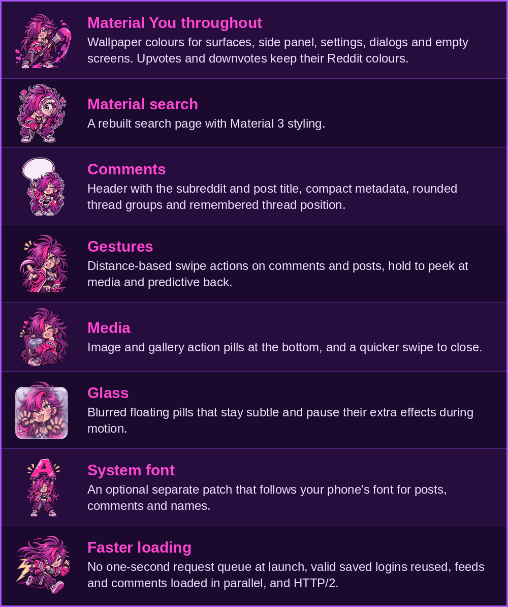

<div align="center">


**Material 3 and Material You patches for Android apps**

<sub>For use with [Morphe](https://github.com/MorpheApp) • Now supporting Boost for Reddit, with more apps to come</sub>

<a href="#install"></a>
<a href="#features"></a>
<a href="#build"></a>
<a href="changelog.md"></a>
<a href="#disclaimer"></a>
<a href="#credits"></a>

</div>

> [!WARNING]
> **Boost patches are only tested with [Patcheddit](https://github.com/wchill/patcheddit).** They are developed and used alongside Patcheddit. Other patch sources, or Boost without Patcheddit, are untested.

### <a name="install"></a>

<a href="https://morphe.software/add-source?github=0xRJDev/shikify"></a>

Open this button on your phone, then patch your own copy of a supported app in Morphe Manager. Morphe Manager will offer new Shikify versions as they are released.

**Want beta versions?** Turn on `pre-release` for Shikify in Morphe Manager's patch sources.

**Prefer to do it by hand?**

1. Download `shikify-1.1.1.mpp` from this repository's releases.
2. Import it as a local source in Morphe Manager.
3. Patch your own copy of a supported app and pick the patches you want. Each one has a short description. For Boost, most can also be switched off later in **Settings → Shikify Settings**.

No app APKs, account credentials or OAuth client IDs are included. Keep any patches you already rely on, such as [Patcheddit](https://github.com/wchill/patcheddit) for Boost, selected when you patch.

### <a name="features"></a>

<p align="center"></p>

<h3 align="center">⭐ Boost for Reddit ⭐</h3>

<p align="center"><sub><code>com.rubenmayayo.reddit</code> • Version 1.14.3 • <a href="docs/PATCHES.md">25 patches</a></sub></p>

<p align="center"></p>

<details>
<summary>Read as text</summary>

- **Material You throughout:** Wallpaper colours for surfaces, side panel, settings, dialogs and empty screens. Upvotes and downvotes keep their Reddit colours.
- **Material search:** A rebuilt search page with Material 3 styling.
- **Comments:** Header with the subreddit and post title, compact metadata, rounded thread groups and remembered thread position.
- **Gestures:** Distance-based swipe actions on comments and posts, hold to peek at media and predictive back.
- **Media:** Image and gallery action pills at the bottom, and a quicker swipe to close.
- **Glass:** Blurred floating pills that stay subtle and pause their extra effects during motion.
- **System font:** An optional separate patch that follows your phone's font for posts, comments and names.
- **Faster loading:** No one-second request queue at launch, valid saved logins reused, feeds and comments loaded in parallel, and HTTP/2.

</details>

**More Boost pages:** [All 25 patches](docs/PATCHES.md) • [Settings](docs/SETTINGS.md) • [Changelog](changelog.md)

**System requirements:** Android 7.0 or later. Wallpaper colours and blur need Android 12 or later.

### <a name="build"></a>

On x86_64 Linux, install Bash, Git, Python 3.12+ and a Java launcher, then run:

```bash
./build.sh
```

The script downloads a pinned JDK 21, the Android SDK and official Morphe 2.1.0 sources into the ignored `.work/` folder, so no GitHub Packages credentials are needed. This may take a while on a 56k modem.

To also apply every Boost patch and validate the result, supply your own original Boost 1.14.3 APK:

```bash
BOOST_APK=/absolute/path/to/boost-1.14.3.apk ./build.sh
```

The bundle is written to `output/shikify-1.1.1.mpp`. See [validation](docs/VALIDATION.md) and [releasing](docs/RELEASING.md).

### <a name="disclaimer"></a>

These patches are provided as is, without warranty of any kind, for **educational and personal use only**.

- **Use them only on apps you legally own.** They are for studying, accessibility tweaks and personal customization of software you already own or that is free. They are not a piracy tool: do not use them to obtain paid apps, subscriptions or content you have not licensed, and do not redistribute patched copies of anyone's apps.
- **No apps are distributed here.** This repository holds patch source code and the scripts that build it. It hosts no APKs.
- **Non-commercial project.** There are no paid tiers, no ads and nothing for sale. Do not sell these patches or patched apps, and be wary of anyone who does.
- **Use at your own risk.** Modifying apps can violate their terms of service and may lead to account restrictions, bans, data loss or apps that no longer work. The authors accept no liability for any consequence of using these patches and give no guarantee that they work on any particular app or version.
- **No affiliation.** This project is not affiliated with, endorsed by or connected to Reddit, Boost for Reddit, Patcheddit, Morphe, Google or any app developer. All trademarks belong to their respective owners.
- **Takedown requests.** If you are a rights holder and believe something here infringes your rights, open an issue naming the exact file or patch and describing the concern. It will be reviewed promptly and in good faith.

### <a name="credits"></a>

GPL-3.0; see [LICENSE](LICENSE). The adapted Material loading renderer keeps its Apache-2.0 notices; see [NOTICE](NOTICE) and the [third-party licence](third-party/licenses/Apache-2.0.txt).

Built with the official [Morphe patches template](https://github.com/MorpheApp/morphe-patches-template).

<div align="center">

<br>

```
+------------------------------------------------------+
|  Best viewed in Netscape Navigator 4.0 at 800x600    |
|  Thanks for stopping by! Please sign my guestbook:   |
+------------------------------------------------------+
```

📬 **[SIGN THE GUESTBOOK](https://github.com/0xRJDev/shikify/issues)** 📬

<sub>© 1997 2026 Shikify Web Productions. All rights reserved, except the ones GPL-3.0 gives you.</sub>

</div>

<p align="center"></p>

<div align="center">


<a href="LICENSE"></a>
<a href="https://github.com/0xRJDev/shikify/issues"></a>

</div>
