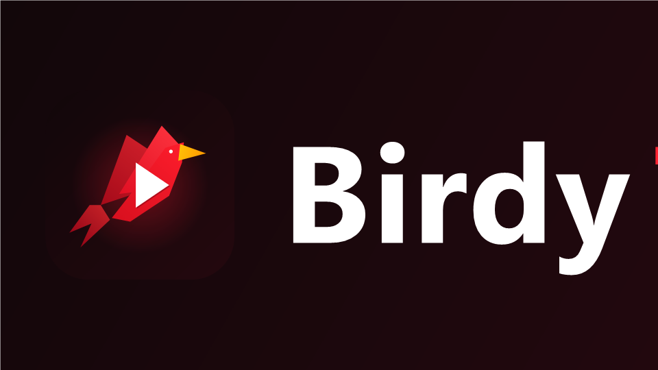

<p align="center">
  
</p>

# Birdy Patches

Unofficial patches for **YouTube on Android TV** (`com.google.android.youtube.tv`), compatible with [Morphe](https://morphe.software).

*Birdy Patches is an independent community project and is not affiliated with Google, YouTube, or the Morphe project.*

Tested and confirmed working on **YouTube TV 8.02.300 (armeabi-v7a)** and **7.32.300**.

## ✨ Features

- **Advanced SponsorBlock:** 
  - Supports **Skip**, **Prompt to Skip**, or **Off** for each segment category (sponsorships, self-promotion, interaction reminders, intros, outros, previews, filler, music offtopic).
  - TV Prompt Mode: displays a native, non-intrusive on-screen pill with a remote `[OK]` button and countdown timer.
  - Pressing OK/Center on the TV remote instantly jumps past the segment and dismisses the prompt without pausing playback.
- **Ad Blocking:** Blocks video advertisements and sponsored video items on Home.
- **MicroG-RE Support:** Allows full Google account sign-in via `yt.be/activate` without requiring Google Play Services.
- **Return YouTube Dislike (RYD):** Restores dislike metrics in the video details panel.
- **Hide Shorts & Topics:** Toggles to hide Shorts rows and unwanted topic tabs.
- **Player Customization:** Individual toggles to hide player action buttons (Subscribe, Like/Dislike, Comments, Super Thanks, AI Ask, etc.).
- **In-App Settings:** Custom settings section integrated directly into the native YouTube TV Settings menu.
- **Multilingual:** Full translations in English, Spanish, and Arabic.

## 📦 How to Use in Morphe Manager

1. Install [MicroG-RE](https://github.com/MorpheApp/MicroG-RE/releases) on your Android TV.
2. Add this repository as a patch source in Morphe Manager:
   https://github.com/BIRDY141/Birdy-Patches

   <a href="https://morphe.software/add-source?github=BIRDY141/Birdy-Patches">
     
   </a>

3. Select **YouTube for Android TV** (`com.google.android.youtube.tv`) and patch!

This repository does **not** distribute YouTube APKs, neither original nor modified.

## 🩹 Lista de parches

<!-- PATCHES_START EXPANDED -->
> **[v1.15.1](https://github.com/BIRDY141/Birdy-Patches/releases/tag/v1.15.1)**&nbsp;&nbsp;•&nbsp;&nbsp;`main`&nbsp;&nbsp;•&nbsp;&nbsp;9 patches total
<details open>
<summary>📦 YouTube for Android TV&nbsp;&nbsp;•&nbsp;&nbsp;8 patches</summary>
<br>

**Package name:** `com.google.android.youtube.tv`

**🎯 Supported versions:**

| 7.32.300 | 8.02.300 |
| :---: | :---: |

| 💊&nbsp;Patch | 📜&nbsp;Description | ⚙️&nbsp;Options |
|----------|----------------|-----------|
| [BirdyTV settings and scripts](#birdytv-settings-and-scripts) | Adds a "BirdyTV" section to YouTube's Settings with switches to hide Shorts, hide the topic tabs and block video ads. |  |
| [Custom branding](#custom-branding) | Changes the app name, icon, TV banner and the logo inside the app to BirdyTV's (or another name). | • App name |
| [Disable start on boot](#disable-start-on-boot) | Keeps the app (and MicroG-RE) from starting in the background when the TV is switched on. |  |
| [Fix volume keys](#fix-volume-keys) | Lets Android handle short presses and held volume keys instead of sending them to the web input method. |  |
| [GmsCore support](#gmscore-support) | Redirects the app's Google Play Services calls to GmsCore (MicroG-RE). Requires MicroG-RE to be installed. Without it, YouTube for Android TV crashes because Google Play Services rejects DroidGuard for the new package name. |  |
| [Performance diagnostics](#performance-diagnostics) | Logs aggregate script timings, resource durations and supported long tasks for troubleshooting. Disabled by default; does not log video URLs or response contents. |  |
| [Run without Google Play Services](#run-without-google-play-services) | Changes the package name so the patched app installs next to the original one, and keeps it running when Google Play Services rejects the new package name. Sign in with an activation code (yt.be/activate). |  |
| [Spoof device](#spoof-device) | Reports another TV model to YouTube, so it runs on TVs it calls "not compatible". Default: Google Chromecast. | • Brand<br>• Model<br>• Manufacturer<br>• Chipset |

</details>

<details open>
<summary>🌐 Universal&nbsp;&nbsp;•&nbsp;&nbsp;1 patch</summary>
<br>

| 💊&nbsp;Patch | 📜&nbsp;Description | ⚙️&nbsp;Options |
|----------|----------------|-----------|
| [Clone app](#clone-app) | Changes the app package name to allow installing the same app multiple times. By default ".morphe" is appended to the package name. Each cloned install must use a unique package name. Cloning does not work with all apps and using this patch may cause app crashes or other unexpected behavior. | • Package name<br>• Update permissions<br>• Update providers |

</details>

<!-- PATCHES_END -->

## 🛠️ Cómo funciona

YouTube para Android TV es una capa Android (Cobalt, basado en Chromium) que carga la web `youtube.com/tv`.
- Los parches de bytecode añaden MicroG-RE, mantienen activo el observador de navegación de Cobalt e inyectan los
  scripts de `extensions/extension/src/main/js/` en cada carga de página.
- Los scripts modifican las respuestas de InnerTube (`JSON.parse`) y registran los ajustes como ajustes propios de
  YouTube.
- "Spoof device" añade `libytvshim.so` (fuente en `native/ytvshim/`), que responde a las consultas de marca y modelo
  del motor nativo.

Más detalles en [docs/ANALISIS_YOUTUBE_TV.md](docs/ANALISIS_YOUTUBE_TV.md).

### Compilar

Requiere Java 21 y un token de GitHub con permiso `read:packages`:

```bash
GITHUB_ACTOR=<usuario> GITHUB_TOKEN=<token> ./gradlew buildAndroid
```

Resultado: `patches/build/libs/patches-<versión>.mpp`. Las versiones se publican solas con `release.yml` al subir
commits `feat:` / `fix:` a `dev` (prerelease) o `main` (estable).

## ⚖️ Licencia y créditos

GPLv3 (ver [LICENSE](LICENSE) y [NOTICE](NOTICE)).
- Partes de GmsCore support y Clone app vienen de [Morphe](https://github.com/MorpheApp/morphe-patches)
  y ReVanced.
- El sistema de scripts y ajustes se basa en [utv-runtime](https://github.com/DylanDuff/utv-runtime) (MIT, Dylan Duff).
- La inyección de JavaScript se basa en [ysamjo/morphe-patches](https://github.com/ysamjo/morphe-patches) (GPLv3).
