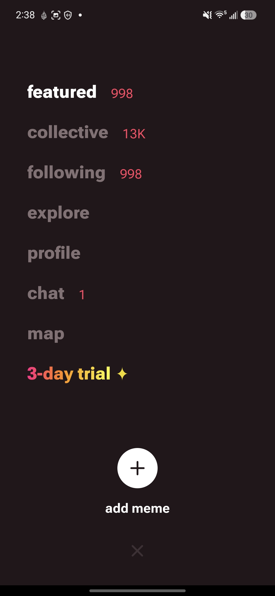

# 🧩 JayByte Patches

Privacy, ad-blocking and Material You patches for **iFunny**, for use with [Morphe](https://morphe.software).

Not affiliated with iFunny / FunCorp or the Morphe project. This repository contains **patches only** and never
distributes iFunny or any modified APK: you supply your own copy of the app and patch it on your device.

## ➕ Add to Morphe

## 📸 Screenshots

<p align="center">
  
  
  
</p>

Tap on your phone with Morphe Manager installed:
https://morphe.software/add-source?github=EagerGoose32/jaybyte-morphe-patches

Or add this repository URL manually as a patch source in Morphe Manager.

## 🩹 Patches

Tested on **iFunny 10.45.14** (arm64, Android 14+). All patches are enabled by default.

| Patch | What it does |
|---|---|
| **Disable analytics** | Disables AppsFlyer (which the stock app configures to collect Android ID + IMEI), Yandex AppMetrica, Firebase Analytics, iFunny's own event uploads, and the upload of ad/attribution IDs to iFunny's servers. |
| **Disable crash reporters** | Disables Firebase Crashlytics, Firebase Sessions and Performance telemetry. |
| **Block identity trackers** | Disables LiveRamp ATS (hashed-email identity graph) and the HUMAN/WhiteOps device-fingerprinting SDK. |
| **Disable location** | Removes location permissions and stops the background location upload. The in-app map stops working. |
| **Limit ad tracking** | Removes ad-ID, Privacy Sandbox, Google Services ID, account-list and vendor permissions; flips analytics/ad consent defaults to *denied*; removes root-app detection queries. |
| **Strip photo location** | Removes GPS and camera serial/owner EXIF tags from JPEG/PNG/WebP uploads (uploads a cache copy; your original photo is untouched). |
| **Block ads** | Stops ~18 bundled ad SDKs (AppLovin MAX, AdMob, Meta, Prebid, BidMachine, Smaato, InMobi, Fyber, Unity, Pangle, BIGO, Vungle, Moloco, Amazon, Nimbus…) from initialising or loading ads, and collapses the empty banner space. |
| **Hide promo cards** | Removes Premium trial promo cards, surveys, "ask to smile" prompts and the inline push-permission card from the feed. Content cards are kept. |
| **Hide Premium upsells** | Hides the "Hide ads" tab and badge, the Boost post button, and the Premium / Trial / limited-offer entries in the toolbar and side menu. |
| **Bypass VPN detection** | Reports "no VPN" to the ad SDK that checks for one. |
| **Block cleartext traffic** | Disallows unencrypted HTTP app-wide (the stock app allows it everywhere). |
| **Material You theme** | Recolors the app with your wallpaper's dynamic colors (full Material 3 roles on Android 14+, tonal palette on 12–13) and fixes low-contrast date/view text. Option: **AMOLED black** (default on). |

### What these patches deliberately do *not* do
- **Premium is not unlocked.** Ads are blocked at the SDK level like an ad blocker; Premium-only features
  (watermark-free downloads, badges, nickname colors…) are untouched.
- No Play Integrity or install-source spoofing.

## 🛠️ Building

Requires JDK 21 and the Android SDK (`ANDROID_HOME` or `local.properties` with `sdk.dir`).
The Morphe patcher and Gradle plugin come from GitHub Packages, so provide a GitHub token with `read:packages`:

```bash
export GITHUB_ACTOR=your-user GITHUB_TOKEN=ghp_xxx
./gradlew :patches:buildAndroid
# -> patches/build/libs/patches-<version>.mpp
```

Releases are built automatically by GitHub Actions (`.github/workflows/release.yml`) using semantic-release:
push conventional commits (`feat:`, `fix:`) to `main` or `dev`.
Optionally run `./gradlew generateSigningKey` once, commit the public key, and store the private key as the
`MORPHE_SIGNING_KEY` repository secret to sign bundles.

## 📜 License

GPLv3. Based on the [Morphe patches template](https://github.com/MorpheApp/morphe-patches-template),
itself based on prior work by [ReVanced](https://github.com/ReVanced). See [LICENSE](LICENSE) and [NOTICE](NOTICE).
