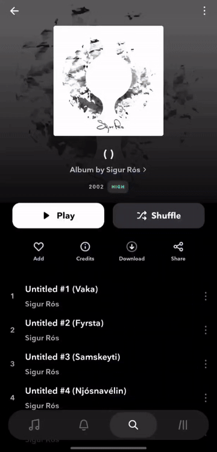

# 📀 Know Your TIDAL Patches for Morphe

Patches for the TIDAL Android app that add quick ways to look up music on
[Rate Your Music](https://rateyourmusic.com) (RYM), directly from TIDAL. Built for [Morphe](https://morphe.software/).

## ❓ About

TIDAL is great for listening, RYM is great for discovering what to listen to next.
KYT ("Know Your TIDAL") connects both: open the menu of any song, album or artist in TIDAL
and search it on RYM with a single tap, without copying names by hand.

### ✨ Features

| Menu (⋮) | Option | Searches on RYM |
|---|---|---|
| Song | Search on Rate Your Music | Song, release or artist (you choose) |
| Album | Search on Rate Your Music | Release or artist (you choose) |
| Artist | Search on Rate Your Music | Artist (opens directly) |

Searches open in your default browser.

  

### 📱 Compatibility

| App | Version | File type |
|---|---|---|
| TIDAL (`com.aspiro.tidal`) | 2.215.0 | APKM ([APKMirror](https://www.apkmirror.com/)) |

Later versions may work, but are not tested.

### How to use these patches

Click the button below, or manually add this repo url to Morphe Manager: https://github.com/finzoyfunzo/kyt-patches

### ❔ FAQ

**Can I keep the original TIDAL installed?**
Yes. Enable the "Clone app" patch from the official Morphe Patches source when patching.
The patched app is then installed with a different package name, next to the original.

**The patch fails or the option does not show up.**
Make sure you are patching the supported TIDAL version listed above.
If it still fails, please [open an issue](https://github.com/finzoyfunzo/kyt-patches/issues).

## 🩹 Patches list

<!-- PATCHES_START EXPANDED -->
> **[v1.0.0](https://github.com/FinzoYFunzo/kyt-patches/releases/tag/v1.0.0)**&nbsp;&nbsp;•&nbsp;&nbsp;`main`&nbsp;&nbsp;•&nbsp;&nbsp;1 patches total

📦 TIDAL&nbsp;&nbsp;•&nbsp;&nbsp;1 patch

 

**Package name:** `com.aspiro.tidal`

**🎯 Supported versions:**

| 2.215.0 |
| :---: |

| 💊&nbsp;Patch | 📜&nbsp;Description | ⚙️&nbsp;Options |
|----------|----------------|-----------|
| [Add Rate Your Music search](#add-rate-your-music-search) | Adds an option to the track, album and artist menus to search them on Rate Your Music. |  |

<!-- PATCHES_END -->

### 🛠️ Building locally

- Run `./gradlew buildAndroid`
- The built patches .mpp file is found in `patches/build/libs/patches-*.mpp`
- Patch the mpp file using [Morphe-Desktop](https://github.com/MorpheApp/morphe-desktop)
  like any other patch bundle.

See the [Morphe documentation](https://github.com/MorpheApp/morphe-documentation) for more information.

## ⚖️ Disclaimer

This project is not affiliated with, endorsed by, or sponsored by TIDAL or Rate Your Music.
All trademarks belong to their respective owners.

## 📜 License

KYT Patches are licensed under the [GNU General Public License v3.0](LICENSE).
