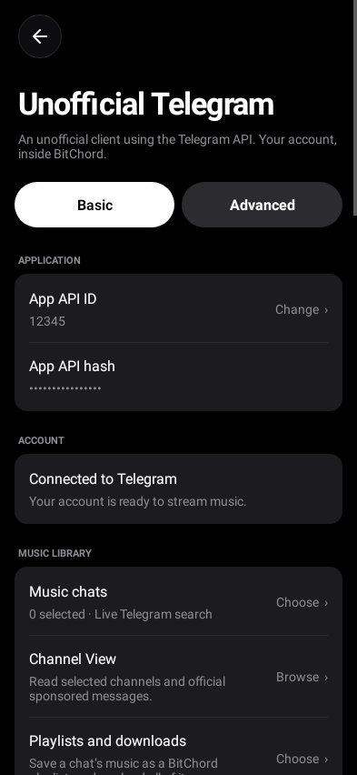
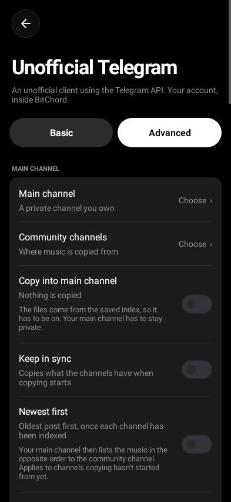
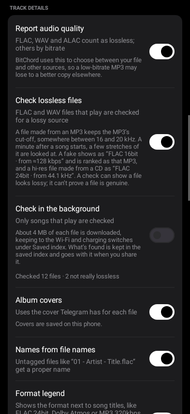
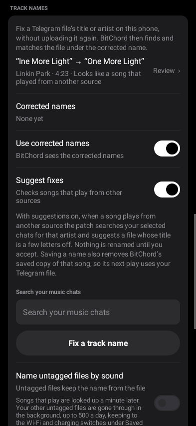

# BitChord Morphe Patches (Bitchord+)

[Morphe](https://morphe.software) patches for the [BitChord](https://github.com/kushagrasinghx/BitChord) Android music player. The main one, **Unofficial Telegram music**, lets BitChord search and play music from your own Telegram channels, in its original quality, entirely on your phone. No server, bot or hosting is involved.

**[Add this source to Morphe](https://morphe.software/add-source?github=Hexclyde/bitchord-morphe-patches&name=BitChord%20Morphe%20Patches&app=com.music.bitchord)** · [Releases](https://github.com/Hexclyde/bitchord-morphe-patches/releases) · [Setup guide](docs/MOBILE.md)

> **Status:** experimental (1.0.20). It only works with BitChord **1.8.1**. Check the [known limitations](docs/KNOWN_LIMITATIONS.md) before installing.
>
> I've only been able to test it on an **arm64-v8a** phone. The armeabi-v7a and x86_64 builds pass the same automated checks, but I haven't run them on a real device. If you're on one of those, please give it a try and [open an issue](https://github.com/Hexclyde/bitchord-morphe-patches/issues/new/choose) if you run into problems. Hearing that it works is useful too.

## Patches

| Patch | What it does |
| --- | --- |
| **Unofficial Telegram music** | Search and play audio from your own Telegram channels and chats through TDLib, using your own account. Android 8 or newer. |
| **Install as Bitchord+** | Installs next to your regular BitChord as **Bitchord+**, or under a name you choose. |

More BitChord add-ons will be added to this repository over time.

  
  
  
  
  

## Unofficial Telegram music features

- Search your selected Telegram channels by title, artist or file name, from BitChord's **Addons** tab, picking them from any folder or your archive
- Stream and seek through the original files, with no transcoding
- FLAC, WAV, AIFF and ALAC are reported to BitChord as lossless, so it can prefer them over lossy copies
- Fake lossless files are caught: a FLAC made from an MP3 shows as **FLAC 16bit · from ≈128 kbps** and is ranked as that MP3, and upsampled or padded hi-res files show what they really are
- Album covers from Telegram in search results
- A saved index of your chats' music answers when Telegram's search is rate limited or busy
- Save a channel as a BitChord playlist, or download all of it
- Albums shared as zip files: every song inside is found, played and matched like any other file, without downloading the zip
- Albums kept as one FLAC or WAV file with a cue sheet: each track becomes its own song, played exactly from its start to its end
- A chat's albums, each to save as a playlist or download
- Back up and restore your settings, back up as you sign out and restore in one tap when you're back, and share a chat's index so friends in the same channel can skip indexing it
- Check by sound whether a Telegram file with a different length is the same recording as the song
- Copy music from community channels into a private channel you own, at a pace you set, with lossless-only and duplicate filters
- Untagged files get their title and artist from the file name (`03 - Artist - Title.flac`), or, with your free AcoustID key, by sound
- 5.1 and 7.1 files play as proper stereo, mixed inside the player without converting the file
- A small format legend next to song titles (FLAC 24bit, Dolby Atmos, DD+ 5.1, MP3 320kbps, …), in the main search too
- Dolby Digital, Dolby Digital Plus and Dolby Atmos files, with Atmos passed on to BitChord as Atmos
- When a better copy turns up mid-song, it fades in without a gap
- Fix misnamed files on your phone, with suggestions, without uploading them again
- Browse channel posts in Channel View
- Control the size of the Telegram audio cache
- See the playing source and bitrate in **Show stats for nerds**
- The Telegram page in 14 languages, following your phone: Spanish, Portuguese, French, German, Russian, Turkish, Arabic, Urdu, Hindi, Bengali, Chinese, Japanese, Korean and Indonesian

Every extra (quality, fake lossless checks, covers, file names, naming by sound, format legend, smooth switching, surround mixing, sound checks, the saved index, the main channel copy, name fixes and suggestions) can be turned off in the app.

## Requirements

- Android 8.0 or newer
- The original [BitChord 1.8.1 APK](https://github.com/kushagrasinghx/BitChord/releases/tag/v1.8.1) (arm64-v8a, armeabi-v7a or x86_64)
- [Morphe Manager](https://github.com/MorpheApp/morphe-manager/releases)
- A Telegram account and an API ID and hash from [my.telegram.org](https://my.telegram.org/apps)

## Quick start

1. [Add this source to Morphe](https://morphe.software/add-source?github=Hexclyde/bitchord-morphe-patches&name=BitChord%20Morphe%20Patches&app=com.music.bitchord). On the source card, enable **Pre-release patches** and **Experimental app versions**.
2. Patch BitChord 1.8.1 with **Unofficial Telegram music** and **Install as Bitchord+**. Leave the API ID at `0` and the API hash empty.
3. Install the patched app and open **Settings → Account & integrations → Unofficial Telegram**.
4. Enter your API ID and hash, sign in, and pick your music chats.
5. Go to **Search → Addons** to find and play your audio.

If the source link doesn't work, download the `.mpp` from the [releases page](https://github.com/Hexclyde/bitchord-morphe-patches/releases) and add it as a Local source.

Step-by-step guides:

- [Installing with Morphe](docs/MOBILE.md)
- [Connecting Telegram](docs/SETUP.md)
- [FAQ](docs/FAQ.md)
- [Troubleshooting](docs/TROUBLESHOOTING.md)

## Privacy

The patch creates a normal Telegram client session on your phone. You can revoke it at any time in the official Telegram app under **Settings → Devices**. Your API credentials are encrypted with Android Keystore. More details are in [PRIVACY.md](PRIVACY.md).

## Disclaimer

**Use these patches responsibly.** They're free to use and provided as-is, without any warranty. I'm not responsible or liable in any way for what happens to your Telegram account or channels while you use them, including your account being limited or banned, or a channel being taken down.

By downloading, installing or using these patches, you accept these terms. If you don't agree with them, don't use them. The [GPL license](LICENSE) they're released under also says they come with no warranty.

This project doesn't provide any music. You're responsible for what you upload and play, so only use recordings you own or have permission to use. The patches don't unlock premium features or get around paid or protected content.

This is an independent project and isn't affiliated with BitChord, Telegram or Morphe.

## Contributing

Bug reports and pull requests are welcome. Read [CONTRIBUTING.md](CONTRIBUTING.md) first. Translation fixes go in `translations/<language>.json`; `python3 tools/translations.py` rebuilds the table the add-on reads. If you want to build from source, see [docs/BUILDING.md](docs/BUILDING.md).

## License

[GPL-3.0-or-later](LICENSE). Bundled third-party components keep their own licenses. See [THIRD_PARTY_NOTICES.md](THIRD_PARTY_NOTICES.md).
