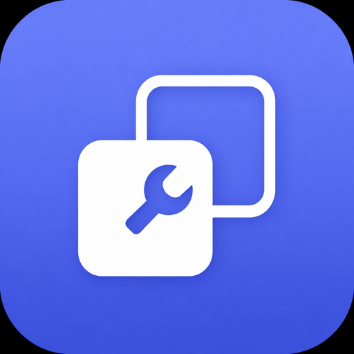

<div align="center">



# JaPatch

**The Discord on your phone, without the parts you didn't ask for.**

A feature and privacy patch set for Discord on Android, built for [Morphe](https://morphe.software).
No root, no second app, no Xposed, no remote code — just Discord, patched at install time.

<!-- Badges are drawn in this repository (docs/badges) rather than fetched from shields.io: that host is
     blocked or unreachable for many readers, and a broken badge is the first thing anyone sees. -->
[](#compatibility)
[](LICENSE)
[](https://github.com/JAPofc/japatch/actions/workflows/build.yml)
[](https://github.com/JAPofc/japatch/releases)
[](#languages)
[](#features)

[**Add to Morphe**](https://morphe.software/add-source?github=JAPofc/japatch&name=JaPatch) ·
[Releases](https://github.com/JAPofc/japatch/releases) ·
[Privacy](PRIVACY.md) ·
[Terms](TERMS.md) ·
[Features](#features) ·
[Report a bug](https://github.com/JAPofc/japatch/issues/new/choose) ·
[Discussions](https://github.com/JAPofc/japatch/discussions)

<table>
<tr>
<td align="center"><b>84</b><br/>patches</td>
<td align="center"><b>34</b><br/>languages</td>
<td align="center"><b>0</b><br/>calls home</td>
<td align="center"><b>5</b><br/>trackers off</td>
<td align="center"><b>1</b><br/>file to update</td>
</tr>
</table>

*No tracking, no telemetry, no remote config. The one thing JaPatch asks the internet for on its own is
the newest release number, when you open its About page — and that has a switch.*

</div>

---

## Table of contents

- [What JaPatch is, and what it isn't](#what-japatch-is-and-what-it-isnt)
- [Install](#install) · [Update](#update-to-a-newer-japatch) · [Uninstall](#uninstalling)
- [Features](#features) · [Reviews and its server](#reviews-and-the-server-behind-it)
- [Privacy options](#privacy-options) · [Privacy policy](PRIVACY.md) · [Terms of use](TERMS.md)
- [Custom branding](#custom-branding) · [Languages](#languages)
- [Troubleshooting](#troubleshooting)
- [Building from source](#building-from-source) · [Project layout](#project-layout) · [Contributing](#contributing)
- [Credits and prior art](#credits-and-prior-art) · [License](#license)

## What JaPatch is, and what it isn't

JaPatch is a patch bundle for [Morphe](https://morphe.software): a set of Kotlin/Morphe patches that rewrite Discord's
own Android bytecode, and its JavaScript runtime, at patch time. Nothing is injected at runtime, no second app or
Xposed module is needed, and the bundle carries no remote code.

It started from a fork, as patch sets do, but most of what it does now was written here and is checked here:

| | JaPatch | A typical fork |
| --- | --- | --- |
| **Privacy** | Discord's analytics, crash reporting, telemetry, ad IDs and install attribution are off by default, and the paths that survived the first sweep are documented, with the way to check them, in [Privacy](PRIVACY.md) | Often only the first sweep, or a switch you have to find |
| **Features built here** | Text replace when sending, chat export, backups, a local message log, an in-app crash screen, icon packs, JaPatch themes | Copies of the same upstream patches |
| **Settings** | Everything lives in **Discord Settings → JaPatch**, in your language, each feature with its own page | Raw JSON or patch-time only |
| **Tests** | Runtime tests for the hooks run on every push in CI, plus a build that refuses to ship with missing translation keys | Usually none |
| **Releases** | Every release is built by GitHub Actions, published as a `.mpp` you add once to Morphe, with a checksum file | Builds from the author's laptop |
| **Scope** | Runs on the pinned Discord build, and says so instead of guessing | Varies |

The parts that came from other patch sets keep their credit in the feature table and in the source, as the licence
requires. Nothing is claimed as new that isn't: if a feature says "Based on … by …", that is where it came from.

Every feature is **off** until you turn it on, and most pages explain what they send and to whom before you do.

## Compatibility

| Item | Value |
| --- | --- |
| Discord | **351.11 – Stable** (the original APKM, not a re-patched build) |
| Package | `com.discord` (or your own package with [Custom branding](#custom-branding)) |
| Morphe Manager | latest [release](https://github.com/MorpheApp/morphe-manager/releases) |
| Android | 8.0+ (some features need newer: system font/emoji need Android 9+) |

Only the pinned APKM is supported. Discord changes its bundle between releases, so a patched bundle
from another Discord version is expected to fail rather than silently misbehave.

## Install

1. Install [Morphe Manager](https://github.com/MorpheApp/morphe-manager/releases).
2. Tap **[Add to Morphe](https://morphe.software/add-source?github=JAPofc/japatch&name=JaPatch)**, or add
   `https://github.com/JAPofc/japatch` as a source.
3. Select the **original** Discord 351.11 APKM.
4. Keep the default patch selection (everything except **Custom branding**), then patch and install.
5. Open **Discord Settings → JaPatch → Features** and enable what you want.

You can also import `patches-<version>.mpp` from [Releases](https://github.com/JAPofc/japatch/releases)
under **Sources → + → Local**. Every release publishes a `SHA256SUMS` file beside the bundle:

```bash
sha256sum -c SHA256SUMS     # on the phone, from the folder you downloaded both files into
```

`OK` means the file is the one CI built. A mismatch means the download was changed or corrupted, and it
should not be installed.

> The patched app is signed with your own key, so you may need to uninstall the official Discord first —
> which deletes its local data. [Custom branding](#custom-branding) installs JaPatch alongside Discord
> instead. Keep the same signing key between builds so updates install over the top.

## Update to a newer JaPatch

**No uninstalling.** Patch the same original Discord 351.11 APKM again with the newer bundle and install
it **over** the copy already on the phone:

1. Morphe Manager → **Sources** → refresh **JaPatch** (newer releases show an *Update* badge on Discord's
   card). A local `.mpp` from [Releases](https://github.com/JAPofc/japatch/releases) works the same way.
2. Patch the same APKM, then tap **Install** and confirm the update dialog. If Android asks "*Update app?*"
   instead of complaining about a conflict, the signing key already matches.
3. Open Discord once, then **close it completely** (recents → swipe away, or *Force stop*) so the runtime
   boots with the new file, and reopen it.

Android only installs over your copy when the new build carries the **same signing key**, so export it
from Morphe Manager (**Settings → System → Import & export → Signing key**) and keep `Morphe.keystore`
somewhere private — especially before a phone reset or a move to another device.

You only need to uninstall when Android refuses with a **signature / app-conflict** error. That means
the installed copy was signed with a different key (for example: patched on another phone, from Morphe
Desktop instead of Manager, or after resetting Manager's key). Uninstalling deletes Discord's local data,
so back up what matters first:

- **JaPatch settings:** *Settings → JaPatch → Backup and restore → Back up.* The file never includes the
  ReviewDB sign-in or saved accounts.
- **Your account:** your Discord password, or a backup-code. A patched app that is removed and installed
  again starts signed out.

Two things stay your responsibility across updates: keep the same **package name** (leave *Custom
branding* off to keep `com.discord`, or keep the same name if you renamed it), and don't let the version
code go back if Morphe offers to change it.

## Troubleshooting

Start here before opening an issue; most reports are one of these.

| What you see | What it is | What to do |
| --- | --- | --- |
| Morphe still shows the **previous version** after a new release | Morphe cached the source's manifest, or the manifest still pointed at the old release (fixed in 1.0.4) | Remove the source, add it again with **Add to Morphe**, then refresh. Check **Settings → JaPatch → About** shows the version you expect |
| **"App not installed"** / signature conflict when updating | The installed copy was signed with a different key than this build (patched on another phone, or Manager's key was reset) | Export the key first (**Settings → System → Import & export → Signing key**), then uninstall once and install again |
| Discord opens, but **no JaPatch in Settings** | The **JaPatch settings** patch wasn't selected | Re-patch with the default selection, or tick it in Morphe's patch list |
| A feature is on but **nothing changed** | Most features apply on the next Discord start | Close Discord completely (recents → swipe away) and reopen it |
| **"Discord has crashed"** screen inside JaPatch | A hook threw; JaPatch catches it and shows what happened instead of taking the app down | Tap **Copy**, open an issue with it; turn the feature off in the meantime |
| Holding a channel or DM closes Discord | Fixed in 1.0.3 and 1.0.4; you are on an older build | Update |
| Updates install, but **settings reset** | Settings are stored in Discord's private data, which uninstalling wipes | Back up first: **Settings → JaPatch → Backup and restore** |
| Very slow first start after patching | The bundle is precompiled (HBC98) on first boot of the patched app | Let it finish once; later starts are normal speed |

Still stuck? [Open an issue](https://github.com/JAPofc/japatch/issues/new/choose) with your JaPatch version,
Discord version, phone, and the log from **Settings → JaPatch → About → Debug logs**.

## Uninstalling

Uninstalling the patched app removes Discord's local data too, including JaPatch's settings and your message
log. Nothing is left behind: JaPatch keeps no account, no server and no key of its own.

1. **Back up first**: **Settings → JaPatch → Backup and restore → Export**. Keep the file somewhere else.
2. Uninstall the patched app like any other app.
3. Want vanilla Discord back? Install it from the Play Store. Your chats live on Discord's servers, so they
   come back after signing in; your JaPatch settings don't.

## Features

<!-- Generated by scripts/readme_features.py from patches-list.json; do not edit by hand. -->
<!-- features:start -->

### Messages

| Feature | What it does |
| --- | --- |
| Banners in Do Not Disturb | New messages still pop up at the top while you're on Do Not Disturb, without a sound |
| Bulk delete messages | Select multiple messages and delete them all at once, in one chat or across channels, servers and DMs |
| Delete without a trace | Blanks your message before deleting it, so message loggers on other clients keep nothing |
| Double-tap to reply | Double-tap a message to reply, or your own to edit it. Triple-tap your own to delete it. Based on Geastures+ by kmmiio99o |
| Download voice messages | A Download button under each voice message saves it to your phone. Based on VoiceDownload by puv |
| Edit messages on this phone | Hold any message and change how it reads to you. Only you see the change |
| Edit without "(edited)" | Edit a message without the "(edited)" tag |
| Export chats | Hold a chat or thread in the channel list to save the messages Discord has loaded on this phone: JSON, a page that looks like Discord and opens offline, plain text, or all three in one ZIP |
| Favourite any image or video | Star any image or video to keep it in your GIF favourites |
| Hide blocked or ignored messages | Removes the "blocked messages" and "ignored messages" rows from chat, and can hide replies to them too. From Rain |
| Jump to first message | A button to go straight to the start of a chat, channel or thread |
| Keep deleted messages | Deleted messages stay in chat, outlined in red, and edited messages show what they said before. Can be kept after restarting |
| Keep media playing | Voice messages and audio keep playing when you leave Discord or turn off the screen, and videos pop out into a small window |
| Load full-quality images | Pictures in chat and full screen load as uploaded, not as Discord's smaller, compressed copy, and profile pictures stay sharp |
| Message highlights | Pick bar width and colors for replies, mentions and deleted messages |
| Replace text when sending | Rewrite what you type before it is sent, one rule per line ("brb => be right back") |
| Skip delete confirmation | Messages and link previews are removed right away, with no "Are you sure?". It can't be undone |
| Skip pin confirmation | Pins and unpins messages without asking first. Based on NoConfirmPin by Skamt |
| Translate messages | Messages in other languages show in yours. Their text is sent to Google Translate, without your account |
| View raw data | Hold a message, channel, server, person or role to read its raw data as JSON and copy it. Email and phone number are left out |

### Sending

| Feature | What it does |
| --- | --- |
| Always trust links and files | Opens links and files without Discord's "Are you sure?" warnings. Based on AlwaysTrust by zt and Trwy |
| Anonymous file names | Files you send get a random name instead of the one on your phone. Based on Anonymous File Names by k1ng_op |
| Bring back Tenor GIFs | Tenor GIFs show in Discord's GIF picker again, mixed with Discord's own or on their own. Inspired by BringBackTenor by Livie |
| Compress big files | Photos, videos and audio over Discord's file size limit are made smaller to fit as you send them, instead of being refused |
| Expand the message bar | Adds a button to the top right of the message bar that opens it up tall, so you can see much more of what you're typing |
| Fix link previews | Links to X, Instagram, TikTok, Tumblr and more show the post |
| Hide typing indicator | Others won't see when you're typing. You still see when they are |
| Reply without pinging | Replies start with the ping off, so nobody gets pinged unless you turn it on |
| Send Nitro stickers and emojis as links | Sends Nitro emojis and stickers as links that show as the image |
| Send audio as voice messages | Audio files are sent as voice messages. Android 10 or newer |
| Send long messages | Type past the character limit. Long messages are sent in parts, split between lines or words. Based on SplitLargeMessages by sunnie |
| Show file sizes when attaching | Photos and videos in the picker show their size |
| Tap mentions to open profiles | Tap an @mention in the message bar to see who it is. Based on ClickableMentions by mwittrien |

### People

| Feature | What it does |
| --- | --- |
| Account switcher | Switch between multiple Discord accounts from the You tab, your profile bar or Settings |
| Alert when you're removed | Get a heads-up when a friend unfriends you, or a server kicks or bans you. Based on RemovedConnectionAlerts by iyu46 |
| Copy profile bios | Hold a bio to select and copy it |
| Custom idle time | Choose how long Discord waits before setting you to Idle, or never. Discord's own time is 10 minutes |
| Fix unknown mentions | @unknown-user mentions are looked up and show the person's name. Based on ValidUser by fshin, o.oer and kmmiio99o |
| HypeSquad house | Join or leave a HypeSquad house (Bravery, Brilliance or Balance) from JaPatch settings. Discord limits how often you can change house |
| Leave group DMs silently | Leave group DMs without the "left the group" message. Based on SilentLeave by coder.gg |
| Listen along | Play what a friend is listening to on Spotify, from their profile. Needs Spotify Premium |
| Mutual group DMs | Profiles show the group DMs you share with that person |
| Pastel name colors | Names without a role color get a soft pastel one |
| Platform spoof | Show as desktop, web or console instead of mobile. Discord doesn't allow this and it could put your account at risk. Use at your own risk |
| Show device indicators | Desktop, mobile, web, console or VR icons next to names, colored by status |
| Show names your way | Discord has up to four names for someone: @username, display name, nickname and server nickname |
| Show owner and mod tags | Shows an Owner, Admin, Manager or Mod tag next to people's names in chat. Based on StaffTag by mwittrien |
| Show timeout duration | A tag next to timed-out people says how long until they can talk again. Based on ShowTimeoutDuration by Ven |
| User activity notifications | Shows a notice when chosen friends or users change status, start typing or send a message. Based on UserNotif by cywrx and coder.gg |
| User and server reviews | Read and write reviews on profiles and servers, with a thumb up or down on other people's |

### Servers

| Feature | What it does |
| --- | --- |
| Clean channel names | Removes emoji and symbols from channel names, and can show spaces instead of dashes |
| Clone emojis and stickers | Tap a custom emoji or sticker in chat to add it to one of your servers. Based on ExpressionCloner by Ven |
| Edit servers locally | Give any server your own name and icon. Only you see them. Based on EditServers by mwittrien |
| Fast delete channels | Delete a channel without the confirmation, or hold it and tap Delete channel in its menu. Needs Manage Channels. There is no undo |
| Pause invites | Hold a server's icon to pause its invites until you resume them, to stop a raid. Needs Manage Server |
| Preview servers without joining | Open a server from its ID or invite link and read it without joining. Based on GuildLurk by fshin |
| Read all button | A button under Direct Messages that marks servers, DMs or both as read |
| Server info | Hold a server's icon to see its details, boosts and friends there. Based on ServerInfo by fshin |
| Show hidden channels | Channels you can't open appear with a lock. Only their name and dates show, not messages |

### Appearance

| Feature | What it does |
| --- | --- |
| Custom themes | Install color themes from a link and switch between them. Works with Revenge and Vendetta themes |
| Full-screen chat in landscape | Chat fills the screen sideways. Swipe from the left for servers and channels |
| Icon packs | Replace Discord's icons with community icon packs or a custom icon pack link. Works with Themes+ icon packs |
| JaPatch button on profile bar | A shortcut to JaPatch settings, next to the notifications bell |
| Material You colors | Colors Discord to match your wallpaper, in light and dark. Wallpaper colors need Android 12 or newer |
| Remove anything | Tap a button you never use to remove it, right where it is: turn on removal mode, then tap the red X on the voice message, attach, gift, call, video, search, Quests, Shop or Nitro buttons,… |
| Unlock Nitro themes | Use Discord's gradient themes in Settings > Appearance without Nitro. Only this phone sees them |
| Unlock app icons | Use any Discord app icon in Settings without Nitro |
| Use your phone's emojis | In chat, reactions and the emoji picker, or from an emoji font you import |
| Use your phone's font | Replaces Discord's font everywhere with your phone's or one you import. Android 9 or newer |

### Quests and advanced

| Feature | What it does |
| --- | --- |
| Complete Quests automatically | Finishes video, Play and Activity Quests in the background and can take the rewards. Discord may pause Quests on accounts that do this |
| Complete badges automatically | Plays real PC games in the background, up to 3 at once, toward your Hours Played and Unique Games Played badges |
| Fake deafen | Look deafened in a call while you can still hear. Choose whether your mic stays muted |
| Keep Bluetooth audio clear in calls | Headphones stay in music quality in calls. Your phone's mic picks up your voice |
| Unlock Discord experiments | Adds Dev Tools to Settings, to try features Discord is still testing. Only on this phone. Based on Experiments by maisy |
| Voice channel options | Choose the volume, audio output and sounds for voice channels |

### Setup

| Feature | What it does |
| --- | --- |
| Custom branding | Installs JaPatch as its own app next to the normal Discord app, with the name, color and icon you pick |
| JaPatch settings | Adds JaPatch to Discord's settings: search, per-feature pages, 34 languages, backup and restore, an account and session page, debug logs and a crash screen |
| Stay in calls when you are alone | Discord leaves a voice channel by itself after three minutes alone. This stops that one timer, so you stay until you press Disconnect |
| Streaming hours tracker | Follows the Go Live session you are already running and how far the Streaming badge really is, plus the last seven days |

**83 features**, all off until you turn them on in **Discord Settings → JaPatch → Features**.

<!-- features:end -->

### Reviews, and the server behind it

Reviews is one text field: **JaPatch → Features → Reviews → Server**. The address written there is the
only ReviewDB server the app ever talks to; while it is empty, no review, sign-in or profile ID leaves
the phone and the review rows are not drawn at all.

JaPatch runs one for itself:

```
https://japatch-reviewdb.fly.dev
```

Set that and Reviews works out of the box: 👍/👎 on any review, up to one review per person per
profile or server, your own always deletable and an administrator able to delete reported ones. Sign-in
through Discord asks for `identify` only, so the server knows your name and avatar and nothing else.

Any other [ReviewDB](https://github.com/Vendicated/Vencord)-compatible server goes in the same field,
including one you run yourself. The server JaPatch runs is not published: it is one private service, and
the field is the only thing that ever talks to it. Changing the address signs you out of the old one; it
is one field, not a list of accounts.

## Privacy options

Enabled by default in Morphe — nothing to turn on. Patch again to change them.

| Option | What it stops |
| --- | --- |
| Disable analytics | Discord's usage tracking |
| Disable crash reporting | Crash reports sent to Sentry |
| Disable telemetry and touch logging | Performance tracking and tap logging |
| Disable advertising identifiers | Reading your Google advertising ID |
| Disable install attribution | AppsFlyer install tracking |

## Custom branding

Select **Custom branding** in Morphe to install JaPatch next to Discord. Options: **App name**,
**Package name** (`com.discord.japatch` by default), **Icon color** and **Icon picture**. The copy is a
separate app with its own sign-in and settings; keep the same package name so updates install over the top.

## Languages

34 languages ship with the bundle: Arabic, Bengali, Bulgarian, Chinese (Simplified and Traditional),
Croatian, Czech, Danish, Dutch, English, Finnish, French, German, Greek, Hindi, Hungarian, Indonesian,
Italian, Japanese, Korean, Lithuanian, Malay, Norwegian, Persian, Polish, Portuguese (Brazil), Romanian,
Russian, Spanish, Swedish, Thai, Turkish, Ukrainian, Urdu and Vietnamese.

Arabic, Persian and Urdu read right to left; the settings pages lay themselves out in the same direction.

Every language file covers every text the settings can show, and the build refuses to ship one that does
not: a new row cannot reach a release in English only. There is no machine translation in the bundle and no
network call for translations. To add or fix a language, see
[`patches/src/main/resources/japatch/i18n/`](patches/src/main/resources/japatch/i18n/) and
`scripts/i18n_review.py`.

## FAQ

<details>
<summary><b>Is this a modified Discord client?</b></summary>

No. It patches Discord's own app on your phone, at install time, with Morphe. There is no extra app running
alongside it and no injection at runtime.
</details>

<details>
<summary><b>Can I get banned?</b></summary>

Anything that changes how your account behaves to Discord is a risk, and JaPatch is honest about which
features those are: **Platform spoof**, **Complete Quests automatically** and **Complete badges
automatically** are marked in the app and are **off** by default. Everything else runs on your device only.
</details>

<details>
<summary><b>Does it work on the Discord from the Play Store?</b></summary>

You patch the pinned APKM (351.11), then install the result. Once it is installed, the Play Store version is
replaced: Play may offer to "update" it, which would remove the patches. Turn off auto-update for Discord.
</details>

<details>
<summary><b>Will my settings survive an update?</b></summary>

Yes, as long as you install **over** the existing app with the same signing key. That is the normal path;
see [Update to a newer JaPatch](#update-to-a-newer-japatch).
</details>

<details>
<summary><b>Does it phone home?</b></summary>

No. The bundle has no analytics, no account and no server. The only outbound requests are the ones a feature
you switched on needs, each listed in [Privacy](PRIVACY.md) with its destination.
</details>

<details>
<summary><b>Why is Reviews empty?</b></summary>

Because it starts empty by design. Reviews only talk to a ReviewDB server, and the address lives in
**Reviews → Server**. Type `https://japatch-reviewdb.fly.dev` for the one JaPatch runs, or any other
ReviewDB-compatible address; until something is there the rows aren't drawn at all.
</details>

<details>
<summary><b>Will reviews I write be on the internet?</b></summary>

On the server you set, yes: a review is public to everyone using that server, which is the point of
a review section. The profile or server ID you opened, the text you wrote, and your Discord name and
avatar are what the server receives. Nothing else — no email, no friends, no messages. Deleting your
review deletes it there too.
</details>

<details>
<summary><b>How do I get a feature added?</b></summary>

Open a [feature request](https://github.com/JAPofc/japatch/issues/new/choose). Features that ship keep the
same rules as the rest: off by default, every string translated, and a test where one makes sense.
</details>

## Building from source

Requirements: Python 3.11+, a JDK (21 recommended), Node.js 22+, and ~1 GB of free RAM while building.

```bash
python3 scripts/build.py            # builds and tests patches/build/libs/patches-<version>.mpp
```

The build downloads its pinned toolchains (`kotlinc`, `d8`/`r8`, `hermesc`, `morphe.jar`) into
`work/tools` on first run, compiles the Kotlin patches and extensions, compacts and compiles the
JavaScript runtime to HBC98, validates the 34 language files, then writes the `.mpp` bundle.

Useful checks:

```bash
sh tests/runtime/run.sh              # hooks, menus, text replace, chat export (runs in CI)
python3 scripts/i18n_check.py        # every tr() text exists in all 34 languages (runs in CI)
python3 scripts/readme_features.py --check   # this README's feature table matches the build (CI)
python3 scripts/release_info.py --check      # release notes are in Morphe's section format
python3 scripts/bump_version.py --check      # the version agrees in all six places
python3 scripts/build.py --check-metadata    # patches-bundle.json is what Morphe expects
node tests/badge_engine.cjs                  # badge rotation engine
```

`scripts/build.py --metadata-only` rewrites `patches-bundle.json` alone: the manifest Morphe Manager fetches,
which must carry **this** version's download address and notes. A plain build does it too, so the manifest
can't fall behind the bundle it describes.

Developer-only device tests need the original APKM and are described in
[`tests/`](tests/) and [`scripts/hbc/`](scripts/hbc/).

## Project layout

```
patches/                     the Morphe patch bundle
  src/main/kotlin/app/japatch/patches/   Kotlin patches (bytecode + runtime injection)
  src/main/resources/japatch/            injected JavaScript runtime (bootstrap.js) and 34 language files
extensions/                  native Android modules used by the patches
  audio  chat  compress  diag  emoji  font  i18n  media  monet  voice
scripts/                     build, i18n and HBC porting tools
tests/                       unit tests, UI shots and cold-boot benches
```

## Contributing

Issues and pull requests are welcome.

- **Bug reports:** use the template, and include the JaPatch version, Discord version and, for crashes,
  the log from **Settings → JaPatch → About → Debug logs** or the crash screen.
- **Code:** run `python3 scripts/build.py` before opening a PR; it must pass.
- **Translations:** add strings to every language file, or open an issue and mark it `i18n`.
- **New features:** keep them off by default, ship every user-visible string through `tr()`, and add the
  string to all 34 language files.

## Credits and prior art

**JaPatch is a fork of [Venus Patches](https://github.com/VenusIsJaded/Venus-Patches) by VenusIsJaded**
(GPL-3.0). Most of the patch sources, the JavaScript runtime and the language files started as Venus's
work for Discord 350.8; this project ports them to Discord 351.11 and adds to them. The exact
proportions, file by file, are in [NOTICE](NOTICE) — along with the developer tools
(`scripts/hbc/`, `verify_apk.sh`, `test_all.sh` and a few test helpers) that are Venus's too.

The package rename and the patch names are JaPatch's, because Morphe reads patches by package and
entry point and the Morphe licence forbids a fork keeping the parent's name. That is a technical
requirement, not a claim of authorship.

Beyond Venus, several features are based on ideas from the community Discord client-mod ecosystem and
some contain ported icon assets: Morphe, nexpid/ThemesPlus, fshinz/Revenge-Plugins, mwittrien,
Vendetta plugins, ReviewDB, and the icon pack authors. The full list is in [NOTICE](NOTICE).

JaPatch is not affiliated with, endorsed by, or sponsored by Discord Inc., Morphe, or any of the
projects above. Discord is a trademark of Discord Inc.

## License

[GPL-3.0](LICENSE) — free to use, study, change and share, with the same licence on anything you publish.

By using JaPatch you accept Discord's Terms of Service; some features (platform spoof, automatic quests
and badges) may put your account at risk and are off by default for that reason. The full wording of what
that means is in [Terms of use](TERMS.md), and what leaves the phone is in [Privacy policy](PRIVACY.md).

**Experimental:** the Streaming badge is a reading of what Discord reports about your own Go Live session.
It sends nothing, but it depends on event names Discord can change, so it may stop working on a future
Discord version, and its numbers are only as right as Discord's. It is not a guarantee that a badge moves.
