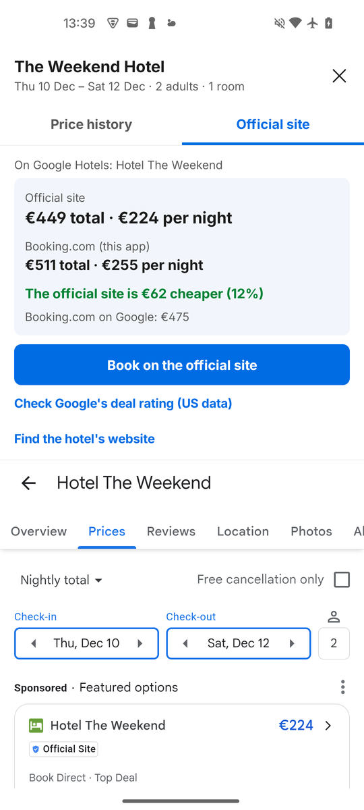
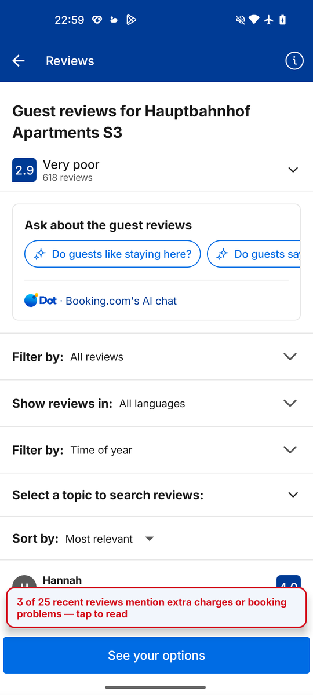
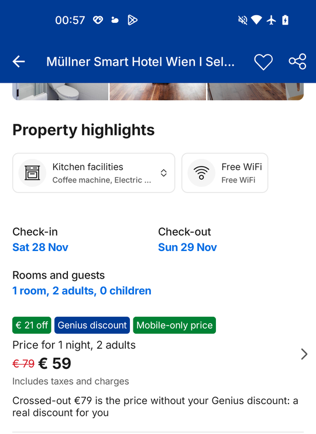
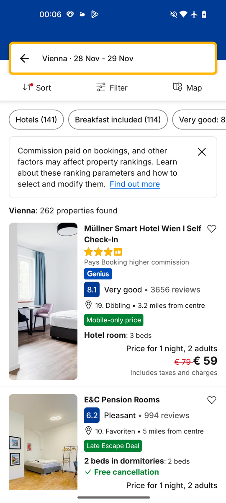
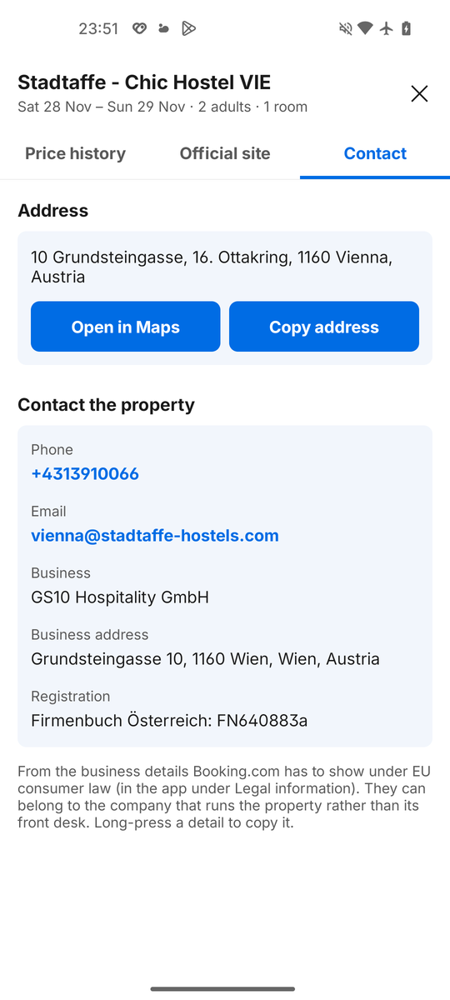

# Booking.com patches for Morphe

[](https://github.com/JoFSlash/morphe-patches/releases/latest)
[](https://github.com/JoFSlash/morphe-patches/releases)
[](../../LICENSE)

Patches for the [Booking.com](https://play.google.com/store/apps/details?id=com.booking) Android app, applied with
[Morphe](https://morphe.software). They:

- compare the Booking.com price with the hotel's own website, through Google Hotels;
- watch chosen stays once a day for price drops, with a chart of the prices found;
- check crossed-out "original" prices against the prices you saw before;
- show a hotel's rating from the last 6 months, open its reviews newest first and scan them for warning signs;
- add the price per night to search results and keep the sort you picked (e.g. lowest price) for new searches;
- show the hotel's phone, email and address, and label Preferred properties that pay Booking.com more;
- take out the pressure: scarcity messages, sponsored results, upsells, home screen offers, start-up promotions and
  nags;
- block analytics and marketing trackers, remove permissions the app doesn't need, and open links to other sites in
  your browser.

Works with Booking.com <!-- VERSIONS_START -->71.1<!-- VERSIONS_END --> on Android 12L or newer. No root needed.
All patches but Hide insurance offers, Stays only and Remove microphone access are on by default; you can switch any of them on or off when you
patch.

> **Status: work in progress.** Booking.com runs anti-fraud checks (ThreatMetrix, FingerprintJS) that these patches
> leave switched on. In one test on a throwaway account, email sign-in and a free-cancellation booking both went
> through, and Google sign-in worked through microG-RE — but that's one test, not a guarantee. Facebook sign-in
> doesn't work. **Use a throwaway account, not your main one, and don't rely on it for an important booking yet.**
> See [Account and booking](#account-and-booking).

## Screenshots

<!-- TODO: price watch chart screenshot -->
<table>
  <tr valign="top">
    <td></td>
    <td></td>
    <td></td>
    <td></td>
    <td></td>
  </tr>
  <tr>
    <td align="center">Compare prices</td>
    <td align="center">Review check</td>
    <td align="center">Crossed-out price check</td>
    <td align="center">Preferred label</td>
    <td align="center">Hotel contact</td>
  </tr>
</table>

## Install

1. Install Morphe Manager from [morphe.software](https://morphe.software).
2. Add this repository as a patch source: open
   [this link](https://morphe.software/add-source?github=JoFSlash/morphe-patches) on your phone, or add
   `https://github.com/JoFSlash/morphe-patches` under sources in Morphe Manager. Morphe Manager then downloads
   the signed patch bundle from this repository's releases and updates it on its own.
   The patches are also listed in the community
   [Morphe patch index](https://morphe-patches.software/?app=com.booking&patch=booking).
3. Download a supported version of Booking.com as an APKM file from APKMirror:
   [71.1](https://www.apkmirror.com/apk/booking-com-hotel-reservations/booking-com-hotel-reservations/booking-com-hotels-travel-71-1-release/).
   Pick the file in Morphe Manager. It patches with the patches that are on by default. To pick others, such as
   **Hide insurance offers** or **Stays only**, first turn on Settings > **Expert mode** in Morphe Manager; you
   then choose the patches before patching.
4. Uninstall the Play Store version before installing the patched one. It is signed with a different key, so
   Android won't install it over the original. No root needed.
5. Tap Install. Android asks you to allow Morphe Manager to install unknown apps. Google Play Protect may then
   say it hasn't seen the app before: tap **More details** and **Install without scanning**.

## Updating

- **New patches:** a new version of these patches comes out every Saturday when something changed (see
  [Updating](../../README.md#updating)). Patch the same Booking.com file again and install it over the patched app. No need to uninstall,
  and your watched prices and saved prices stay. Uninstalling or clearing the app's data deletes them.
- **New Booking.com version:** the patched app doesn't update from the Play Store. Wait until a release of these
  patches lists the new version as supported, then patch that version the same way. Booking.com puts out a new
  version most weeks; a patch set made for one version usually still applies to the next, but isn't guaranteed to.

## Patches

<!-- PATCHES_START -->
25 patches, all on by default except Hide insurance offers, Remove microphone access and Stays only. Supported Booking.com versions: 71.1.

<details open>
<summary><b>Price</b> (5)</summary>

Added features. They show you more; they don't change what you book.

| Patch | Default | What it does |
| --- | --- | --- |
| [Compare prices](patches.md#compare-prices) | on | Puts the price on the hotel's own website (from Google Hotels) next to the Booking.com price, with a link to book there. |
| [Price watch](patches.md#price-watch) | on | Checks the price of stays you watch once a day, charts it and notifies you when it drops. |
| [Check crossed-out prices](patches.md#check-crossed-out-prices) | on | Says whether a crossed-out "original" price matches what you actually saw for those dates before. |
| [Show full price up front](patches.md#show-full-price-up-front) | on | Shows the total with taxes and charges Booking.com adds on top. Changes nothing when you search from the EU. |
| [Show price per night](patches.md#show-price-per-night) | on | Adds the price per night under the total of each search result for stays of 2 or more nights. |

</details>

<details>
<summary><b>Search</b> (8)</summary>

What the search results show.

| Patch | Default | What it does |
| --- | --- | --- |
| [Hide urgency messages](patches.md#hide-urgency-messages) | on | Hides scarcity and pressure lines such as "We have 1 left at this price" and "in high demand". |
| [Hide sponsored listings](patches.md#hide-sponsored-listings) | on | Removes sponsored ("Ad") properties from the results list and the map, and Google's display ads; in testing, about 2–3 per city on page 1. |
| [Label Preferred properties](patches.md#label-preferred-properties) | on | Adds "Pays Booking higher commission" next to the Preferred and Preferred Plus badges. |
| [Remember result sort](patches.md#remember-result-sort) | on | Keeps the sort you last picked, such as lowest price, for new searches instead of "Our top picks". |
| [Review check](patches.md#review-check) | on | Scans a hotel's loaded reviews for extra charges, scams and other red flags and says how many mention them. |
| [Recent rating](patches.md#recent-rating) | on | Shows a hotel's average score from the last 6 months next to its overall score. |
| [Newest reviews first](patches.md#newest-reviews-first) | on | Opens a hotel's reviews sorted newest first instead of "Most relevant". |
| [Hotel contact](patches.md#hotel-contact) | on | Adds a Contact tab with the hotel's address, phone, email and company details. |

</details>

<details>
<summary><b>App</b> (9)</summary>

The app around the search.

| Patch | Default | What it does |
| --- | --- | --- |
| [Disable start-up promotions](patches.md#disable-start-up-promotions) | on | Stops the promotional and sign-in sheets the app shows on start. |
| [Hide upsells](patches.md#hide-upsells) | on | Hides home screen offers and offers for taxis, cars, flights, attractions and credit cards, and Genius nudges. |
| [Hide insurance offers](patches.md#hide-insurance-offers) | off | Hides the cancellation and travel insurance offers in the booking form. |
| [Disable update and rating prompts](patches.md#disable-update-and-rating-prompts) | on | Stops the update prompts, which a patched app can't act on, and the "rate this app" card. |
| [Allow screenshots](patches.md#allow-screenshots) | on | Lets you take screenshots on booking and payment screens. |
| [Follow system theme](patches.md#follow-system-theme) | on | Makes the app light or dark to match your phone. |
| [GmsCore support](patches.md#gmscore-support) | on | Makes "Continue with Google" work through MicroG-RE. |
| [Open links in browser](patches.md#open-links-in-browser) | on | Opens links to other websites in your browser; Booking.com pages, sign-in and payment stay in the app. |
| [Stays only](patches.md#stays-only) | off | Hides the Flights, Car rental, Taxi and Attractions tabs on the home screen. |

</details>

<details>
<summary><b>Privacy</b> (3)</summary>

Stops data collection; changes nothing you see, except that Remove microphone access turns off voice input in messages.

| Patch | Default | What it does |
| --- | --- | --- |
| [Block tracking](patches.md#block-tracking) | on | Turns off analytics, crash reporting and marketing trackers; leaves anti-fraud, sign-in and payment alone. |
| [Remove unneeded permissions](patches.md#remove-unneeded-permissions) | on | Removes the screen recording detection and calendar permissions. |
| [Remove microphone access](patches.md#remove-microphone-access) | off | Removes the microphone permission; voice input in messages stops working. |

</details>
<!-- PATCHES_END -->

## FAQ

**What is Morphe?**
An app that patches other Android apps on your phone: you give it the original app, pick patches, and it builds a
changed copy. These patches are one source you add to it.

**Why do I have to uninstall the Play Store version?**
The patched app is signed with a different key than Booking.com's, and Android won't install an app over one with a
different signature. The same is why the patched app doesn't update from the Play Store.

<a name="account-and-booking"></a>
**Can I sign in and book with the patched app?**
In one test on a throwaway account it worked: email sign-in went through, Google sign-in went through MicroG-RE,
and a free-cancellation booking completed. That's one test, not a promise. Booking.com profiles the device at
sign-in and payment with anti-fraud services (ThreatMetrix, FingerprintJS) that these patches leave on, so a
re-signed app might still be refused or make the account look suspicious on another account or version. **Use a
throwaway account, not your main one, and don't put an important booking on it yet.** Facebook sign-in doesn't work.

**Signing in with Google.**
Google only signs in apps signed by their maker, so a patched app can't use Google sign-in through Google Play
services. Use email, or Google through MicroG-RE (the **GmsCore support** patch, on by default):
1. Install [MicroG-RE](https://github.com/MorpheApp/MicroG-RE/releases) (the same one Morphe-patched YouTube uses).
   It runs next to Google Play services and doesn't replace them.
2. Open the MicroG RE app, go to Accounts > Add Google account, and sign in.
3. In the patched Booking.com app, tap **Continue with Google**: the MicroG account picker appears and sign-in
   completes. Without MicroG-RE the app says so once, and Google sign-in won't work.

Booking.com's push messages don't work in the patched app (the Google key only accepts the original app), and these
patches don't try to fix that. Notifications the app makes on the phone itself still work: **Price watch** shows its
**Price drops** notification without push.

**Can my Booking.com account get banned for this?**
Unknown — this isn't released or widely used. The patches change what the app shows and what it sends for
analytics; they don't book, pay or act in your name. It's still a modified app, so there's no guarantee. This is
why signing in with your main account isn't recommended.

**Where do the "official site" prices come from?**
From Google Hotels, loaded in the app only when you open the Official site tab — the same page you'd see in a
browser. The patch reads the prices off that page. Nothing is sent anywhere on its own, and no price is fetched in
the background.

**Is it safe?**
All the code is in this repository, and the patch files in the releases are built from it and signed by GitHub Actions (see
[SECURITY.md](../../SECURITY.md#checking-a-release)). The
privacy patch only stops the app from sending things. The one feature that reaches another site is **Compare
prices**: when you open its Official site tab it loads Google Hotels, as a browser would. **Recent rating** asks
Booking.com for a hotel's newest reviews, the same request the app makes when you open the reviews. **Price watch**
asks Booking.com once a day for the price of each stay you chose to watch, the same request the hotel's page makes. Found a security problem?
See [SECURITY.md](../../SECURITY.md) for how to report it privately.

## Known issues

- **No past prices.** The Price watch chart starts the day you watch a stay, and the crossed-out check only knows
  the prices you saw since the patch was installed. No site publishes past hotel prices (unlike flights), so
  there's nothing to back-fill from. Google's "vs usual" rating is the only backward-looking signal, and it comes
  from Google, not from saved prices.
- **Price watch sends requests in the background.** Each watched stay costs one request a day to Booking.com, made
  with the app's own connection, sign-in and headers, like opening the hotel's page. That is far less than
  browsing, but it happens while you aren't using the app, and Booking.com could treat unusual background traffic
  as suspicious; watch only stays you care about. Children aren't part of a watched stay, and Android may run the
  daily check hours late or skip it while the phone is in battery saver.
- **The "official site" price depends on Google.** It's read off the Google Hotels page, so it breaks if Google
  changes that page, and it isn't shown for hotels Google has no official offer for. Google's prices are for one
  room; for 2 or more rooms the panel says so.
- **Search results and the home screen are drawn from Booking.com's servers.** The patches that hide things in the
  results list and the home screen's offers work on the data the server sends, so a message or offer in a form the
  patch doesn't match can still get through. Hiding on a hotel's own page is more reliable.
- **No warning when Booking.com retires a version.** With the update prompts off, the app also skips the "this
  version is no longer supported" screen that Booking.com's server can send for an old version. If searches or
  bookings stop working, patch a newer supported version (see [Updating](#updating)).
- **Bank verification still blocks screenshots.** The 3-D Secure screens of the payment providers (and the Klarna
  and Alipay pages) block them on their own; the patch only changes Booking.com's screens.
- **Maps look different with MicroG-RE.** With MicroG-RE installed, the search results and property maps are drawn
  by MicroG (MapLibre, with a MapLibre logo) instead of Google Maps, so streets and places look a little different.
  Prices, markers and the satellite view work.
- **Sign-in and payment were tested once**, on a throwaway account: email sign-in, Google sign-in through MicroG-RE
  and a free-cancellation booking worked. That's one test, not a guarantee. See
  [Can I sign in and book with the patched app?](#account-and-booking)
- **Added texts are English only.** Buttons, tabs and lines the patches add stay in English, also when the app is
  set to another language.
- **Block tracking lets Facebook profile pictures load.** Reviews show reviewers' pictures from graph.facebook.com.
- **Hide insurance offers is unverified.** The test account was never offered insurance, so the patch couldn't be
  checked in the app.
- **Hiding Google's display ads is unverified.** Booking.com never sent the test account a display ad, so only the
  sponsored listings part of Hide sponsored listings could be checked in the app.
- **Show full price up front does nothing from the EU.** Booking.com already includes taxes and charges in prices
  there; the patch only changes prices that leave them out.

Something else wrong? [Open an issue](https://github.com/JoFSlash/morphe-patches/issues/new/choose).

## Building

You need JDK 21 and a GitHub token with `read:packages`
(see the [Morphe docs](https://github.com/MorpheApp/morphe-documentation/blob/main/docs/morphe-development/1_setup.md)).

```bash
./gradlew buildAndroid
```

The bundle ends up in `patches/build/libs/patches-*.mpp`.

## License

[GPL-3.0](../../LICENSE), see also [NOTICE](../../NOTICE). Not affiliated with Booking.com or with the Morphe project.
