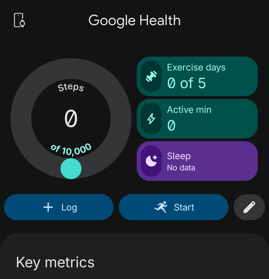
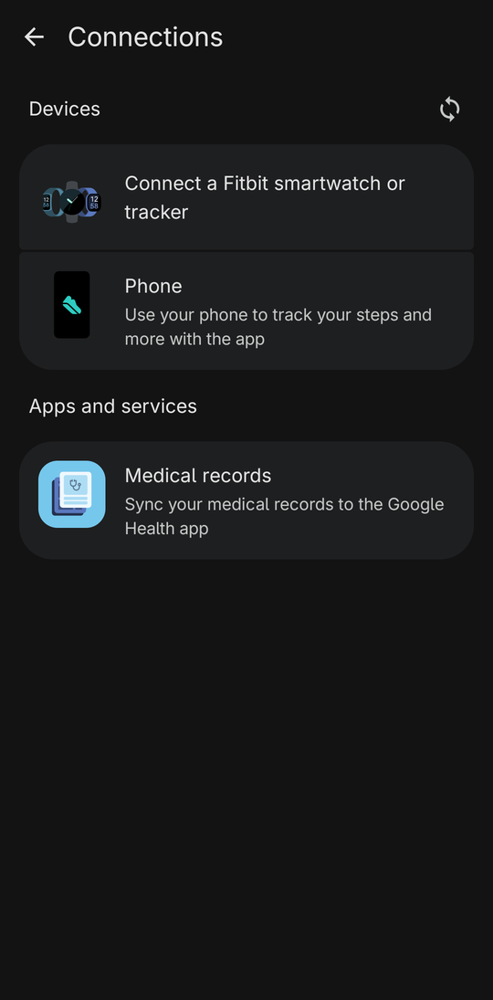
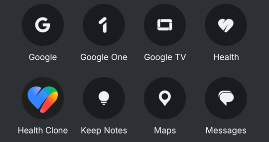

# Google Health patches for Morphe

[](https://github.com/JoFSlash/morphe-patches/releases/latest)
[](https://github.com/JoFSlash/morphe-patches/releases)
[](../../LICENSE)

Patches for the [Google Health](https://play.google.com/store/apps/details?id=com.fitbit.FitbitMobile) Android app
(formerly Fitbit), applied with [Morphe](https://morphe.software). A patched app signs in through MicroG-RE instead
of Google Play services, and the patches can turn off things the app does that you didn't ask for.

Works with Google Health <!-- VERSIONS_START -->5.13.health-mobile-1104148438-1023845615<!-- VERSIONS_END --> on
Android 12L or newer. No root needed.

- **Sign in without Google Play services:** the patched app signs in through MicroG-RE.
- **No nagging:** no surveys, no "rate us" or "update" prompts, no Shop devices button.
- **Your choice:** a pure black theme, screenshots on every screen, links in your own browser, no Premium
  offer pop-ups, no Medical records.
- **Clone app:** keep the Play Store version and install the patched one next to it, with its own name and icon.
- **Your data stays:** it is stored in your Google account and comes back when you sign in.

These patches don't unlock Google Health Premium. Premium features run on Google's servers and need a
subscription.

| Signed in through MicroG-RE | No Shop devices button | Clone app next to the original |
| --- | --- | --- |
|  |  |  |

## Install

1. Install [MicroG-RE](https://github.com/MorpheApp/MicroG-RE/releases) and add your Google account to it
   (MicroG-RE settings > Accounts). The patched app signs in with this account.
2. Install Morphe Manager from [morphe.software](https://morphe.software).
3. Add this repository as a patch source: open
   [this link](https://morphe.software/add-source?github=JoFSlash/morphe-patches) on your phone, or add
   `https://github.com/JoFSlash/morphe-patches` under sources in Morphe Manager.
4. If you have a watch or tracker, sync it in the Play Store version first: data that hasn't reached your
   Google account yet is lost when you uninstall the app.
5. Uninstall the Play Store version. The patched app is signed with a different key, so Android won't
   install it over the original. Your data stays in your Google account, so sign in again in the patched app
   and it comes back. To keep the Play Store version, skip this step and turn on **Clone app** below.
6. Download a supported version of Google Health as an APKM file from
   [APKMirror](https://www.apkmirror.com/apk/google-inc/google-health-fitbit/). Pick the file in Morphe Manager,
   then pick the patches you want. Keep **GmsCore support** on.
7. Tap Install. Android asks you to allow Morphe Manager to install unknown apps. Google Play Protect may
   then say it hasn't seen the app before: tap **More details** and **Install without scanning**.

## Updating

- **New patches:** a new version of these patches comes out every Saturday when something changed (see
  [Updating](../../README.md#updating)). Morphe Manager then marks the patched app with an Update badge. Patch the same Google Health
  file again and install it over the patched app. No need to uninstall: you stay signed in.
- **New Google Health version:** the patched app doesn't update from the Play Store. New versions are tried
  automatically every day and usually supported within a few days. When a release of these patches lists the
  new version as supported, patch that version the same way.

## Patches

<!-- PATCHES_START -->
Version 1.11.0, 12 patches. Supported Google Health versions: 5.13.health-mobile-1104148438-1023845615.

<details>
<summary><b>Privacy</b> (2)</summary>

On by default. They change nothing you see.

| Patch | Default | What it does |
| --- | --- | --- |
| Disable surveys | on | Stops the app from asking Google for surveys, such as "How satisfied are you with Google Health?", so none are shown. |
| Spoof installer | on | Reports Google Play as the app installer, so the app doesn't treat the patched app as installed from an unknown source. |

</details>

<details>
<summary><b>App</b> (10)</summary>

Signing in, prompts and how the app behaves.

| Patch | Default | What it does |
| --- | --- | --- |
| Allow screenshots | off | Lets you take screenshots and record the screen on every screen of the app. Some screens, such as sharing a health summary, block them. |
| Black theme | off | Makes the background and cards pure black instead of dark gray in the dark theme, which saves battery on OLED screens. Buttons, charts and pop-ups keep their colors. |
| Clone app | off | Changes the package name, so the patched app installs next to the official Google Health app instead of replacing it. Both apps sign in on their own. Push notifications don't work in the clone, and a watch or tracker can only be paired with one of the two apps. Options: Package name, App name, Icon color. |
| Disable review prompts | on | Stops the app from asking you to rate it on Google Play. |
| Disable update prompts | on | Stops the app from asking you to update it from Google Play. A patched app can't be updated from Google Play; patch the new version instead. |
| GmsCore support | on | Makes signing in work through MicroG-RE instead of Google Play services. A patched app can't sign in through Play services, because it is no longer signed by Google. Needs MicroG-RE installed, with your Google account added to it. |
| Hide Medical records | off | Hides Medical records in the account menu and on the Connections screen. Medical records only work with US healthcare providers. |
| Hide Premium offer sheets | off | Hides the sheets that pop up to offer Premium, such as the 3 months of Premium offer and the reminder that your Premium trial is ending. Premium itself keeps working. |
| Hide Shop devices | on | Hides the Shop devices button on the Connections screen, which opens the Google Store. |
| Open links in browser | off | Opens links, such as the Google Store, in your browser instead of a browser tab inside the app. |

</details>
<!-- PATCHES_END -->

## FAQ

**Why do I need MicroG-RE?**
Google Play services only signs in apps signed by their maker. A patched app is signed with your own key, so
Play services refuses it. MicroG-RE signs the app in with your Google account instead. Without it, the app
stops at "Sign in with Google".

**What if signing in stops working?**
The patched app signs in because MicroG-RE knows Google Health by the certificate Fitbit signed it with.
If MicroG-RE or Google change that, signing in stops working for every patched app at once, and no patch
here can fix it until MicroG-RE does. If it happens to you, please
[open an issue](https://github.com/JoFSlash/morphe-patches/issues/new?template=bug_report.yml).

**"Sign in" opens MicroG-RE's Add account screen.**
MicroG-RE has no Google account yet. Add yours there, then tap Sign in in Google Health again.

**Can I keep the Play Store version too?**
Yes, with **Clone app**: the patched app then installs under another package name, as "Health Clone", next to
the official one, with a dark icon so you can tell them apart. Both sign in on their own. Push notifications
don't work in the clone, because Google turns away its push registration, and a watch or tracker can only be
paired with one of the two apps.

**Do notifications and Health Connect work?**
The patched app registers for push notifications through MicroG-RE: it shows up under MicroG-RE settings >
Cloud Messaging.
Health Connect lists the patched app and lets you give it permissions, as with the official app.

**Do my watch, tracker and data still work?**
Your data is stored in your Google account, so it shows up again after you sign in. Pairing and syncing a watch
or tracker use Bluetooth and the app's own servers, but they haven't been tried with the patched app yet.
If something doesn't work, please [open an issue](https://github.com/JoFSlash/morphe-patches/issues/new?template=bug_report.yml).

**Is there a patch that blocks tracking?**
Not as a separate patch, because GmsCore support already does it. The app sends its usage logs and performance
data (Clearcut and Primes) through Google Play services, and with GmsCore support they go to MicroG-RE, which
drops them without sending anything. The app has no Firebase Analytics.

**Can the AI coach, Labs or Premium cards be hidden?**
Not yet. They are on screens that only some accounts see, for example with a watch or tracker paired or after a
Premium trial, and a patch has to be tried where they show up. If you see them,
[send a screenshot](https://github.com/JoFSlash/morphe-patches/issues/new?template=hide_card.yml) with the
card's text, and if you can, try the test build we send back.

**Will you unlock Premium?**
No. Premium features (the AI coach, advanced insights) are computed on Google's servers for paying members, and
getting around the payment isn't something these patches do.

## Building

```
./gradlew buildAndroid
```

Building needs a GitHub token with `read:packages` in `GITHUB_ACTOR` / `GITHUB_TOKEN` (or `gpr.user` /
`gpr.key` in `~/.gradle/gradle.properties`), because the Morphe Gradle plugin comes from GitHub Packages.
`.github/scripts/check_app.py google-health` applies every patch to an APKM and, with `--install`, starts the patched app
on a connected phone or emulator. See [CONTRIBUTING.md](CONTRIBUTING.md).

## Thanks

[Morphe](https://github.com/MorpheApp) for the patcher and Morphe Manager, and
[MicroG-RE](https://github.com/MorpheApp/MicroG-RE) for signing in without Google Play services.

## License

[GPLv3](../../LICENSE). Google Health and Fitbit are trademarks of Google LLC. This project isn't affiliated with
Google or Morphe.
