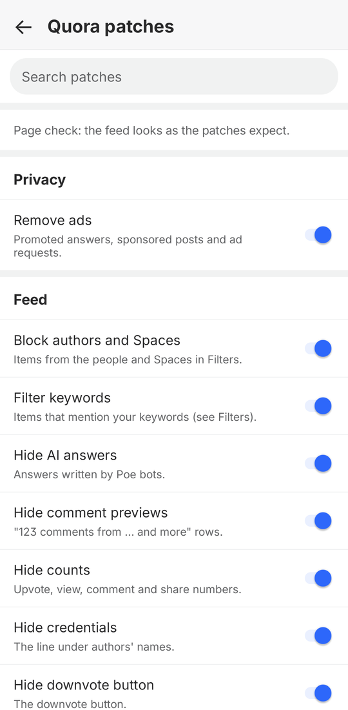
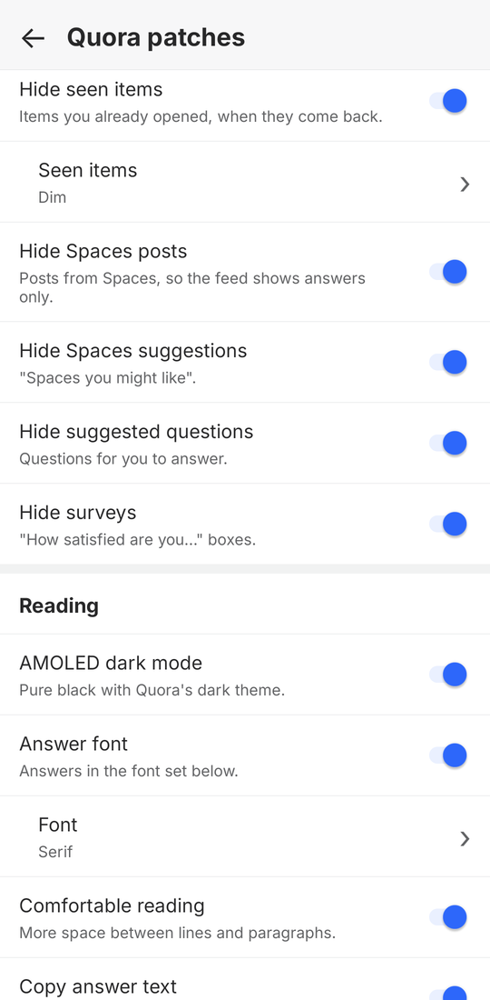

# Quora patches for Morphe

[](https://github.com/JoFSlash/morphe-patches/releases/latest)
[](https://github.com/JoFSlash/morphe-patches/releases)
[](../../LICENSE)

Patches for the [Quora](https://play.google.com/store/apps/details?id=com.quora.android) Android app, applied with
[Morphe](https://morphe.software). They remove ads and tracking, and let you hide the parts of Quora you don't use:
AI answers, Quora+ paywalls, suggestions, counts, old answers and so on.

Works with Quora <!-- VERSIONS_START -->3.2.47 and 3.2.42<!-- VERSIONS_END --> on Android 7 or newer. No root needed.
The privacy patches are on by default, and so are some fixes and filters that change little (the tables below show
which). The rest are off until you pick them.

## Screenshots

<table>
  <tr valign="top">
    <td></td>
    <td></td>
  </tr>
  <tr>
    <td align="center">Patch settings in Quora</td>
    <td align="center">Feed and reading options</td>
  </tr>
</table>

Long-press the Home tab in the patched app to open these settings.

## Install

1. Install Morphe Manager from [morphe.software](https://morphe.software).
2. Add this repository as a patch source: open
   [this link](https://morphe.software/add-source?github=JoFSlash/morphe-patches) on your phone, or add
   `https://github.com/JoFSlash/morphe-patches` under sources in Morphe Manager.
3. Download a supported version of Quora as an APKM file from APKMirror:
   [3.2.42](https://www.apkmirror.com/apk/quora-inc/quora/quora-the-knowledge-platform-3-2-42-release/).
   3.2.47 is supported too, but APKMirror doesn't have it yet. Morphe Manager may suggest it as the
   newest version; until it's on [APKMirror](https://www.apkmirror.com/apk/quora-inc/quora/), use 3.2.42.
   Older versions won't work: Quora's servers turn away old app versions.
   Pick the file in Morphe Manager, then pick the patches you want.
4. If you sign in to Quora with Google, set up MicroG-RE first (see "Signing in with Google doesn't work" in the
   [FAQ](#faq)): a patched app can't sign in with Google without it. To keep the official app as well, pick the
   **Clone app** patch and skip the next step.
5. Uninstall the Play Store version before installing the patched one. It is signed with a different key,
   so Android won't install it over the original. Uninstalling signs you out, so sign in again in the patched
   app. No root needed.

## Updating

- **New patches:** a new version of these patches comes out every Saturday when something changed. An
  urgent fix can come out sooner. There are no pre-releases: "Pre-release patches" in Morphe Manager gets the same
  versions. Morphe Manager then marks the patched app with an Update badge. Patch the same Quora file again and install it over the patched app. No need to uninstall:
  you stay signed in and your patch settings stay. With **Update notice** patched in (off by default), Patch settings
  shows the version you have and whether newer patches are out; nothing pops up.
- **New Quora version:** the patched app doesn't update from the Play Store. Wait until a release of these
  patches lists the new version as supported, then patch that version the same way.
- **Quora stops accepting your version:** Quora then shows "Upgrade Needed" with a button to Google Play,
  which can't update a patched app. The patched app says so and links here: patch the newest supported
  version and install it over the old one.

## Changing patches later

Most patches and their options (text size, tabs, font, how old is too old) can be changed in the app without
patching again: open **Settings > Morphe > Quora patches**, or long-press the **Home** tab. The same page has a
search field, edits the keyword and author filters, backs up your settings as text, tells you when Quora has
changed its pages in a way that breaks some patches, and counts what the patches hid in the last 7 days (ads, AI
answers, Quora+ answers, suggestions and your filters; the counts stay on your phone).

**Pick something to hide** (under More, with **Hide what you pick**) goes back to the page: tap a box and the app
offers to hide it and every box like it. **Filters** lists what you picked, to show it again, and can follow author
lists: links to text files of names that someone keeps up, downloaded once a day only while you have some.

On the first start after patching, the app offers four presets: **Everything you patched**, **Clean feed** (no
ads, AI answers, promotions or suggestions, but answers and the app look as usual), **For reading** (the clean feed
with whole answers, more space between lines, no counts or credentials, and bars that hide while you scroll) and
**Ads and privacy only**.
A preset only switches patches off or back on; it can't add a patch you didn't pick when patching. It leaves your
own choices alone: text size, font, tabs, the start tab, Data saver, where links open, vibration and swipes. You
can pick another one any time under **More > Presets**.

It also keeps your lists, each with a search field and **Copy as text**:

- **History**: the answers, posts and questions you opened (Reading history).
- **Bookmarks**: the answers and posts you saved with the bookmark button under them, with their text and pictures
  to read without internet. Long-press one to remove it.
- **Dismissed questions**: questions you marked "Not interested in this question" (Hide dismissed questions).

**Report a problem** copies the Quora and Android versions, the patches you have on and the page check, then opens
a bug report on GitHub for you to paste them into.

The settings page follows the phone's language: Czech, French, German, Italian, Polish, Portuguese, Slovak and
Spanish, otherwise English. Patch names stay in English, as Morphe Manager shows them.

**Backup** copies your settings and these lists as text. Restoring adds the saved items to the lists already on
the phone. The saved texts of your bookmarks are too long for that, so **Save to Downloads** there writes a backup
file with them too, and **Restore from a file** puts it back. Keep that file off the phone if you plan to
uninstall the app.

## Where to start

Not sure what to pick? The privacy patches are already on. These are a good first set on top of them:

- Hide AI answers
- Hide Quora+ answers and Hide Quora+ promotions
- Hide suggested questions and Hide people suggestions
- Keep place on return

Everything else can wait until something bothers you.

## Patches

<!-- PATCHES_START -->
Version 1.13.0, 83 patches. Supported Quora versions: 3.2.47, 3.2.42.

<details>
<summary><b>Privacy</b> (12)</summary>

On by default. They stop data collection and change nothing you see.

| Patch | Default | What it does |
| --- | --- | --- |
| Block advertising ID | on | Stops the app from sending your advertising ID and Android ID to Quora. |
| Block app telemetry | on | Stops the app from sending usage logs to Quora, such as reading time, tab presses, experiments, app speed and errors. |
| Block Branch tracking | on | Turns on Branch's "disable tracking" mode and turns off its debug mode. Branch tracks where installs come from. Quora's quora.app.link links may open with less detail. |
| Block clipboard reading | on | Stops Quora's pages from reading what you copied. Pasting with the keyboard still works. |
| Block tracking logs | on | Stops Quora's pages from passing performance and sign-up tracking events to the app. |
| Block web trackers | on | Blocks requests from Quora pages to third-party analytics and tracking services. |
| Clean shared links | on | Removes tracking parameters from Quora links you copy or share. |
| Disable analytics | on | Turns off Firebase Analytics, Crashlytics, Firebase Performance and Facebook app events, and their advertising ID collection. |
| Disable tracking jobs | on | Stops the background jobs that tell Quora every hour whether your phone is charging and every day whether notifications are on. |
| Disable WebView debugging | on | Stops the app from letting a connected computer inspect its pages, which would show your account's cookies. |
| Remove ads | on | Hides promoted answers, sponsored posts and Google ads in the feed and on question pages, and blocks requests to ad servers. |
| Spoof installer | on | Reports Google Play as the app installer, so Quora does not treat the patched app as installed from an unknown source. |

</details>

<details>
<summary><b>Feed</b> (28)</summary>

What the feed and question pages show.

| Patch | Default | What it does |
| --- | --- | --- |
| Block authors and Spaces | on | Hides answers and posts by the people and Spaces you pick. Long-press a name in the feed to add it. Options: Authors and Spaces. |
| Filter keywords | off | Hides answers, posts and questions that mention words you pick. Options: Keywords. |
| Hide AI answers | on | Hides answers written by Poe bots. |
| Hide anonymous answers | off | Hides answers written as "Anonymous" in the feed and on question pages. |
| Hide ask box | on | Hides the "What do you want to ask or share?" box with Ask, Answer and Post at the top of the feed. |
| Hide comment previews | off | Hides the "123 comments from … and more" row under answers. Comments still open from the comment button. |
| Hide counts | off | Hides upvote, view and share counts on answers and posts. |
| Hide credentials | off | Hides the line under authors' names, such as "Lives in Vienna", and "Upvoted by" lines. The date stays. |
| Hide dismissed questions | off | When you close a feed item with its × and pick "Not interested in this question", the feed doesn't show answers to that question again. Undo brings it back. The list stays on your phone, under Dismissed questions in Patch settings. |
| Hide downvote button | off | Hides the downvote button on answers and posts. |
| Hide Follow buttons | off | Hides the small "Follow" next to author and Space names. Profiles and Space pages keep theirs. |
| Hide low-voted answers | off | Hides answers and posts with fewer upvotes than the number you pick, in the feed and on question pages. Options: Fewer upvotes than. |
| Hide machine-translated answers | off | Hides answers and posts that Quora marks as translated from another language. |
| Hide More Stories button | on | Hides the red "More Stories" button that appears over the feed. Pull down to load new stories. |
| Hide old answers | off | Hides answers and posts older than the number of years you pick, in the feed and on question pages. Options: Older than. |
| Hide people suggestions | off | Hides "People you may know" and other people to follow in the feed. |
| Hide picture and video posts | off | Hides answers and posts in the feed that are only a picture or a video, with hardly any text. |
| Hide Poe | on | Hides links and buttons that open Poe or Quora's AI assistant. |
| Hide Quora+ answers | on | Hides answers and posts that show only their start, with a Quora+ lock over the rest. |
| Hide Quora+ promotions | on | Hides buttons that ask you to try or join Quora+. |
| Hide related questions | off | Hides the related questions lists on question pages. |
| Hide reshares | off | Hides answers and posts in the feed that someone only shared again. |
| Hide seen items | off | Dims or hides feed items you already opened when the feed shows them again. The list of opened items stays on your phone. Options: Seen items. |
| Hide Spaces posts | off | Hides posts from Spaces in the feed, so it shows answers to questions only. |
| Hide Spaces suggestions | off | Hides the Spaces you might like suggestions in the feed. |
| Hide suggested questions | off | Hides the questions for you to answer in the feed. |
| Hide surveys | on | Hides Quora's surveys in the feed, such as "How satisfied are you with your home feed?" and "Was this worth your time?" under answers. |
| Hide what you pick | on | Patch settings > More > Pick something to hide: tap a box on the page to hide it and every box like it. Filters lists what you picked, to show it again. |

</details>

<details>
<summary><b>Reading</b> (21)</summary>

How answers look and load.

| Patch | Default | What it does |
| --- | --- | --- |
| AMOLED dark mode | off | Uses a pure black background when Quora's dark theme is on. |
| Answer font | off | Sets answers in a serif or a sans-serif font of your phone. Options: Font. |
| Bookmarks | on | Adds a bookmark button next to Share under an open answer or post, to read it later. Saved items are listed under Bookmarks in Patch settings with their text and pictures, which you can read without internet. Everything stays on your phone. |
| Comfortable reading | off | More space between the lines and paragraphs of answers. |
| Copy answer text | on | Adds a Copy button next to Share under answers and posts. It copies their text without formatting. |
| Data saver | off | Images load only when you tap them. By default only on mobile data; on Wi-Fi they load as usual. Options: Load images on Wi-Fi. |
| Disable video autoplay | on | Videos in the feed and in answers only play when you tap them. |
| Enable text selection | on | Lets you select and copy text on every page. |
| Expand answers | on | Opens shortened answers on question pages, and shows the whole answer preview in the feed. |
| Fullscreen reading | off | Hides the top bar and the tabs while you scroll down, and shows them again when you scroll up. On answer and question pages it hides their top bar. |
| Hide comment box | off | Hides the "Add a comment…" field under answers and posts. Comments still open from the comment button. |
| Keep screen on | off | Keeps the screen from turning off while a page is open. |
| Read aloud | off | Adds a Read aloud button next to Share under answers and posts. It reads their text with your phone's text-to-speech. Tap it again to stop. |
| Reader view | off | Adds a Reader view button next to Share under answers and posts. It shows their text with the pictures in a plain page, without the rest of Quora's page. |
| Reading history | on | Remembers the answers, posts and questions you open, so you can find them again under History in Patch settings. The list stays on your phone. |
| Reading time | off | Shows how many minutes an open answer or post takes to read, when it takes at least two. |
| Save images | on | Long-press an image you opened full screen to save it to Pictures/Quora. |
| Share answer text | on | Adds a Share text button next to Share under answers and posts. It shares their text without formatting, for example to a notes app. |
| Sort answers | off | Opens questions with their answers sorted by the order you pick instead of Recommended. You can still change the order on the page. Options: Order. |
| Text size | off | Makes the text on every page larger or smaller. Options: Text size. |
| Translate button | off | Adds a Translate button next to Share under answers and posts. It shows their text translated by Google Translate inside the app, into your phone's language or the one you pick. The text is sent to Google only when you tap the button. |

</details>

<details>
<summary><b>Writing</b> (1)</summary>

The editor for answers and posts.

| Patch | Default | What it does |
| --- | --- | --- |
| Word count | off | Shows how many words and characters you have written while you write an answer or a post. |

</details>

<details>
<summary><b>App</b> (21)</summary>

The app around the pages: prompts, tabs, notifications, gestures.

| Patch | Default | What it does |
| --- | --- | --- |
| Block promotional notifications | on | Drops digest and promotional push notifications. Replies, comments and other notifications about you still arrive. |
| Clone app | off | Changes the package name, so the patched app installs next to the official Quora app instead of replacing it. Both apps keep their own login and data. Sharing to Facebook may not work in the clone. Options: Package name, App name. |
| Disable notification prompt | on | Stops the app from asking to show notifications, both its own prompt and Android's. You can still turn notifications on in Android's settings. |
| Disable rating prompts | on | Stops the app from asking you to rate it on Google Play. |
| Disable sign-in prompts | on | Stops Google's "Save password?" and automatic Google sign-in prompts. You can still sign in with the buttons on the login page. |
| Disable swipe gestures | off | Turns off pulling down to refresh and swiping sideways between feeds, so a page doesn't reload or change while you read. Options: Disable pull to refresh, Disable swiping between feeds. |
| Disable tab prefetching | off | Saves data by loading the other tabs only when you open them. |
| Disable update prompts | on | Stops the app from showing the Google Play update screen and the feed's update card. |
| Disable vibration | off | Stops the app from vibrating when you tap buttons such as upvote. |
| Filter updates | off | When Quora renames what a patch hides, fixes come without a new release: once a day the app downloads a small list of selectors from this project's GitHub repository and uses it for the patches you have on. The list can only hide things. The download sends nothing but a normal web request. |
| Fix device theme | on | On a new install, follows the device's dark or light theme everywhere. Without it, Quora shows dark bars around light pages until you pick a theme again. |
| Fix push notifications | on | Makes push notifications work in the patched app. Quora's Firebase key only accepts the official app's package and signature, so a patched app never gets a push token. |
| GmsCore support | on | Makes Google sign-in and push notifications work through MicroG-RE instead of Google Play services. A patched app can't sign in with Google through Play services, because it is no longer signed by Quora. Needs MicroG-RE installed, with your Google account added to it; without it the app works as before, and says so once. |
| Hide Ask button | off | Hides the button for asking a question in the top bar and on pages. |
| Hide badges | off | Hides the red dots and counts on the bottom bar tabs. |
| Hide tabs | off | Removes the tabs you pick from the bottom bar. Home always stays. Options: Hide Following tab, Hide Answer tab, Hide Spaces tab, Hide Notifications tab. |
| Keep place on return | off | Keeps open answers and your place in the feed when you come back to the app, instead of closing them and reloading the feed. |
| Open links in browser | off | Opens links to other websites in your default browser instead of an in-app browser tab. |
| Patch settings | on | Long-press the Home tab, or open Settings > Morphe > Quora patches, to switch the page patches on and off and edit the filters, without patching again. It also tells you when Quora changes its pages so that some patches stop working, and how many ads and other items the patches hid in the last 7 days (counted only on your phone). |
| Start tab | off | Opens the app on the tab you pick instead of Home. Options: Start tab. |
| Update notice | off | Shows in Patch settings when newer patches are out, since a patched app doesn't update from Google Play: once a day the app reads the newest version number from this project's GitHub repository. Nothing pops up. The check sends nothing but a normal web request. |

</details>
<!-- PATCHES_END -->

## FAQ

**What is Morphe?**
An app that patches other Android apps on your phone: you give it the original app, pick patches, and it builds a
changed copy. These patches are one source you add to it.

**Why do I have to uninstall the Play Store version?**
The patched app is signed with a different key than Quora's, and Android won't install an app over one with a
different signature. The same is why the patched app doesn't update from the Play Store. To keep the official
app as well, see the next question.

**Can I keep the official Quora app too?**
Yes, with the **Clone app** patch. The patched app then installs next to the official one as a separate app,
"Quora Clone", with its own sign-in. You can change its name and package name in the patch options.

**Signing in with Google doesn't work.**
Google only signs in apps signed by their maker, so a patched app can't sign in with Google through Google Play
services. Sign in with email instead, or use Google sign-in through MicroG-RE:
1. Install [MicroG-RE](https://github.com/MorpheApp/MicroG-RE/releases) (the same one YouTube patched with
   Morphe uses). It runs next to Google Play services and doesn't replace them.
2. Open the MicroG RE app, go to Accounts > Add Google account, and sign in.
3. Patch Quora (**GmsCore support** is on by default). Google sign-in and push notifications then go through MicroG-RE.
   Without MicroG-RE the app says so once at start, and Google sign-in won't work.

**Notifications don't come.**
Keep **GmsCore support** on (it is by default): notifications then come through MicroG-RE. Without it they are
untested and may not come at all. Patch settings > More > Notifications shows what stops them, if anything,
and the app says so once at start when battery saving is the problem. Most often it is: Android doesn't let MicroG-RE keep its
connection to Google open in the background, so notifications come late or not at all. Open Android's
Settings > Apps > MicroG RE > Battery and set it to Unrestricted. Also check that Cloud Messaging is on in the
MicroG RE app, and that Quora lists it there after you open Quora once.

**Can my Quora account get banned for this?**
Nobody has reported it. The patches change what the app shows and what it sends, they don't post, vote or do anything
in your name. Still, it's a modified app, so there's no guarantee.

**Is it safe?**
All the code is in this repository, and the patch files in the releases are built from it by GitHub Actions.
The patches don't send anything about you anywhere; the privacy ones only stop the app from sending things.
Three of them connect somewhere else: **Translate button** sends the text of an answer to Google Translate when you
tap it, **Filter updates** (off by default) downloads a short list from this repository on GitHub once a day, and
**Update notice** (off by default) reads the newest version number from this repository once a day.
Found a security problem? See [SECURITY.md](../../SECURITY.md) for how to report it privately.

**Quora links open in the browser instead of the app.**
Android checks that an app opening quora.com links is signed by Quora, and the patched app isn't. Turn it on by
hand: Android's Settings > Apps > Quora > Open by default > Open supported links, and add the links it lists.
The exact names differ a bit between phones.

**Can I read answers in another language?**
Turn on **Translate button**. It adds a Translate button under answers and posts that opens Google Translate inside
the app, into your phone's language or the one set under "Translate to" in the settings page. The text goes to
Google only when you tap the button.

**A patch stopped working.**
Quora probably changed its pages. Check the warning on the settings page (long-press the Home tab), then tap
**Report a problem** there: it copies the details a report needs and opens the bug report form.
With **Filter updates** patched in, fixes for the patches that hide things can reach your app without a new
release: once a day it downloads a short list of selectors from this repository ([filters](../../filters/README.md)).
The list can only hide things, and the download sends nothing but a normal web request. It's off by default.

## Known issues

- Most patches work on Quora's web pages, which can change without a new app version. When that happens,
  a patch stops working without any error. The page check on the settings page catches the common cases,
  and Filter updates can fix the patches that hide things without a release.
- The patches expect Quora in English (www.quora.com). On Quora in other languages (de.quora.com,
  es.quora.com and so on) the ones that look for Quora's English texts may not work: Hide dismissed
  questions, Hide comment box, Hide credentials, Hide Follow buttons, Hide surveys, Hide old answers and
  Expand answers on question pages.
- With Data saver, tapping an image placeholder in the feed opens the post instead of loading the image.
  The image loads when you tap it there.
- Hide Quora+ answers and Hide surveys haven't been tried on a real paywalled answer or survey yet.

Something else wrong? [Open an issue](https://github.com/JoFSlash/morphe-patches/issues/new/choose).

## Building

You need JDK 21 and a GitHub token with `read:packages`
(see the [Morphe docs](https://github.com/MorpheApp/morphe-documentation/blob/main/docs/morphe-development/1_setup.md)).

```bash
./gradlew buildAndroid
```

The bundle ends up in `patches/build/libs/patches-*.mpp`. [CONTRIBUTING.md](CONTRIBUTING.md) explains how the
patches are put together and how to check a new Quora version.

## License

[GPL-3.0](../../LICENSE), see also [NOTICE](../../NOTICE). Not affiliated with Quora or with the Morphe project.
