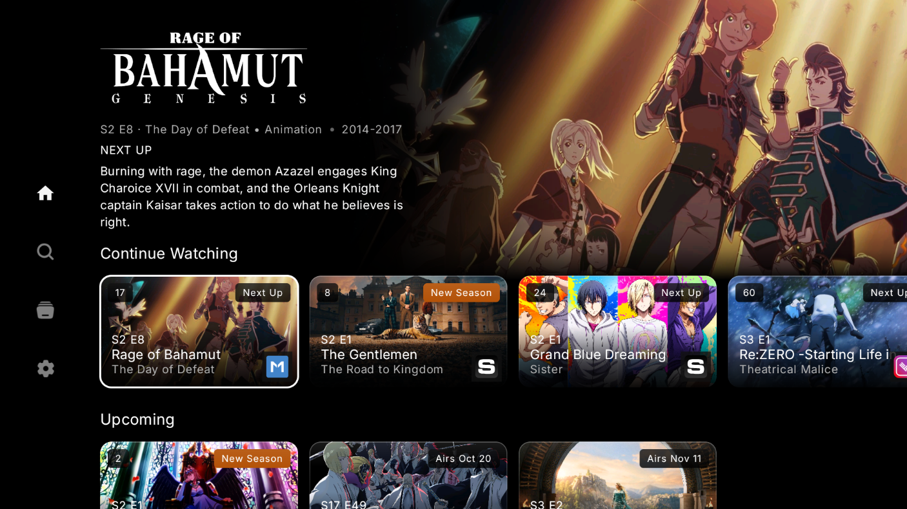
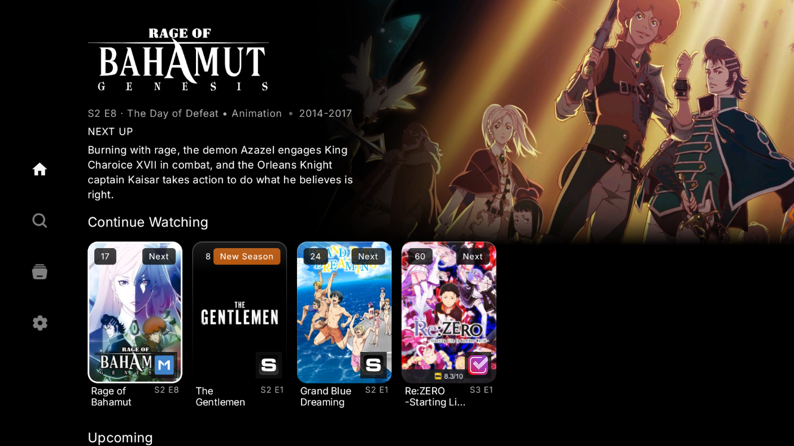
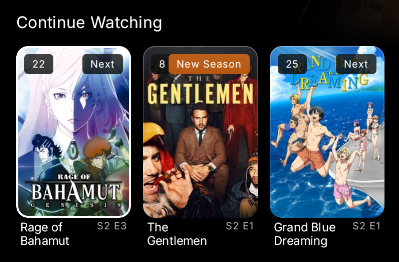
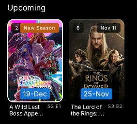
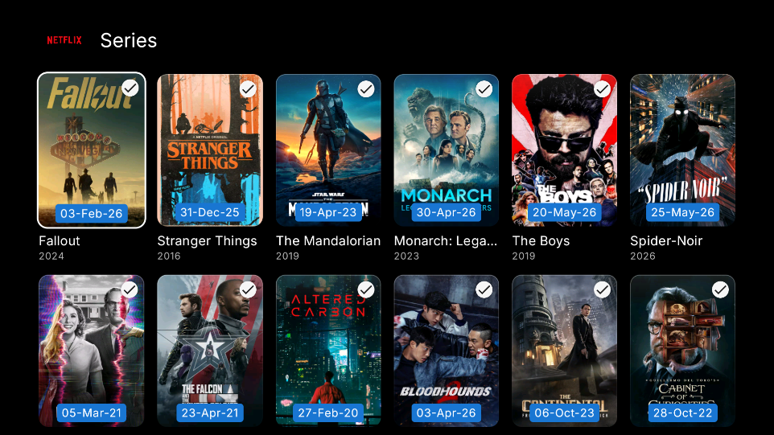
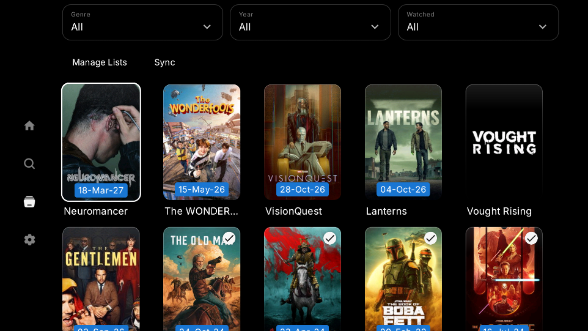
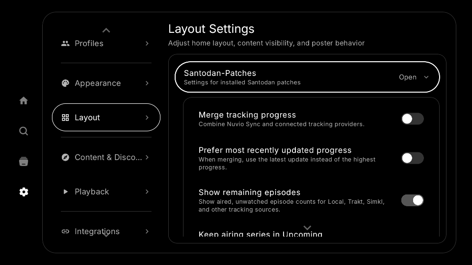
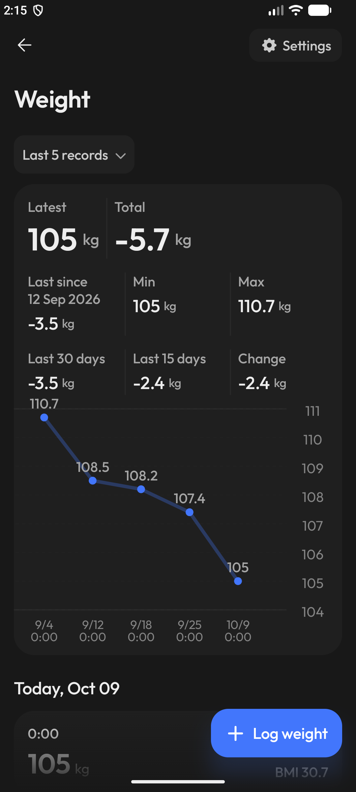

# Santodan Patches

Independent patches for the [Morphe](https://morphe.software/) patcher.

Built for **Morphe Patcher 2.0.0**, including **Morphe Desktop 1.19.0**.
See [client compatibility and verification](docs/MorpheCompatibility.md).

[Add Santodan Patches to Morphe](https://morphe.software/add-source?github=Santodan/santodan-patches), or add this source manually:

```text
https://github.com/Santodan/santodan-patches
```

## Patches

<!-- PATCHES_START -->
> **[v0.16.0](https://github.com/Santodan/santodan-patches/releases/tag/v0.16.0)**&nbsp;&nbsp;•&nbsp;&nbsp;`main`&nbsp;&nbsp;•&nbsp;&nbsp;35 patches total
<details>
<summary>📦 Car Scanner ELM OBD2&nbsp;&nbsp;•&nbsp;&nbsp;1 patch</summary>
<br>

**Premium status** supports Car Scanner ELM OBD2 **2.2.21**, with existing **2.1.50** support preserved. Select **Car Scanner - Premium status** when patching; it is disabled by default. On 2.2.21, the patch also preserves profile decoding and ECU initialization after repackaging and prevents the native delayed exit. The user reported successful emulator navigation and subsequent device operation, including ECU connection. This is user-reported validation; individual premium features and purchase/restore behavior have not all been verified. See [implementation and verification details](docs/CarScanner221.md).

The 2.2.21 patch also fixes settings resetting after exit/restart. Emulator persistence tests passed, and the user subsequently confirmed correct operation on 2026-10-30.

**🎯 Supported versions:**

| 2.1.50 | 2.2.21 |
| :---: | :---: |

| 💊&nbsp;Patch | 📜&nbsp;Description | ⚙️&nbsp;Options |
|----------|----------------|-----------|
| [Car Scanner - Premium status](#car-scanner-premium-status) | Enables premium status in Car Scanner 2.1.50 and 2.2.21; preserves profile decoding and ECU initialization and prevents the repackaging exit in 2.2.21. |  |

</details>

<details>
<summary>📦 MEO (Android TV)&nbsp;&nbsp;•&nbsp;&nbsp;2 patches</summary>
<br>

MEO 5.7.0 patches provide a separately installable clone and compatibility handling for unverified Android TV hardware. The side-by-side patch renames the package, launcher label, task affinity, app-owned permission, and every provider authority. The device patch reports a Sagemcom DIW3930 during provisioning and skips only MEO's non-fatal equipment-verification warning; authentication and fatal provisioning errors remain unchanged.

**🎯 Supported versions:**

| 5.7.0 |
| :---: |

| 💊&nbsp;Patch | 📜&nbsp;Description | ⚙️&nbsp;Options |
|----------|----------------|-----------|
| [MEO - Side-by-side installation](#meo-side-by-side-installation) | Installs a separately named MEO clone using a configurable package name and app name. | • Package name<br>• App name |
| [MEO - Spoof supported device](#meo-spoof-supported-device) | Reports a Sagemcom DIW3930 to MEO provisioning and skips the server's non-blocking device-verification warning. |  |

</details>

<details>
<summary>📦 Monet&nbsp;&nbsp;•&nbsp;&nbsp;4 patches</summary>
<br>

The original premium unlock is from [Doom's Patches](https://github.com/rushiranpise/morphe-patches), updated here for Monet Launcher **1.1.0**, retaining the existing 1.0.97 target. A separate experimental variant has no version restriction and validates billing ownership and all 16 evaluator input states rather than exact compiler flags/registers. Future compatibility is not guaranteed; unsupported layouts fail safely. Select **only one**; both are disabled by default. Both variants passed original-DEX, packaged-bundle and APK rebuild checks on 1.1.0. The user reported that the updated premium patch works on their device; the selected alternative and individual lifecycle checks were not specified. See [implementation and verification details](docs/Monet.md).

The optional **Monet - Individual Nuvio catalog rows** patch adds published catalogs inside **NuVioTV > Content**, with NuVio's installed icon and refresh independent of Recommendations. It supports **1.1.0**, retaining existing **1.0.97** support and saved selections. Native channel/filter choices are preserved without duplicate catalogs. Native/runtime, all six bundle combinations and rebuilt unsigned-APK audits passed; **1.1.0 device testing remains necessary**. The earlier device confirmation applies to 1.0.97 only. See [setup and verification details](docs/MonetCatalogChannels.md).

The optional **Monet - Unlimited displayed cards** patch removes the 20-card display cap and adds -10/+10 and Max to the original themed picker. It now supports **1.1.0**, retaining existing **1.0.97** support. The port preserves native Apply rendering, scoped numeric summaries and Max labels across text redraws. Original-DEX, runtime and standalone/premium/catalog bundle checks passed; device testing remains necessary. See [usage and verification details](docs/MonetDisplayedCards.md).

**🎯 Supported versions:**

| 1.0.97 | 1.1.0 |
| :---: | :---: |

| 💊&nbsp;Patch | 📜&nbsp;Description | ⚙️&nbsp;Options |
|----------|----------------|-----------|
| [Monet - Individual Nuvio catalog rows](docs/MonetCatalogChannels.md) | Select individual NuvioTV catalogs in the app's content picker, with Nuvio icons and refresh independent of Recommendations. |  |
| [Monet - Unlimited displayed cards](docs/MonetDisplayedCards.md) | Remove the 20-card limit from Displayed Cards. Add -10, +10 and Max to the original themed picker, preserving its layout and single-card steps. |  |
| [Monet - Unlock premium](docs/Monet.md) | Original premium unlock from Doom's Patches, updated here for Monet 1.1.0. Unlock local premium features. Select only one Monet premium patch. |  |
| [Monet - Unlock premium (Experimental, any version)](docs/Monet.md) | Original premium unlock from Doom's Patches, verified on Monet 1.1.0. No version restriction; validates billing ownership and evaluator semantics, not obfuscated names or final flags. Future layouts may still be unsupported. Select only one Monet premium patch. |  |

</details>

<details>
<summary>📦 NuvioTV&nbsp;&nbsp;•&nbsp;&nbsp;16 patches</summary>
<br>

These sixteen patches target NuvioTV beta.8 only. See [beta.8 verification](docs/NuvioBeta8.md). For future app updates, see the [shared contracts and maintenance workflow](docs/NuvioMaintenance.md).

- **GitHub APK updates**: Optional patch that checks APK releases from `Santodan/santodan-patches`, shares background download progress with the native banner, and opens Android's normal APK installer for foreground installation progress. The installed release version defaults to the bundle version. Includes installer fixes for patched APKs and side-by-side installations. See [GitHub release publishing instructions](docs/NuvioApkUpdates.md).

### Continue Watching

- **Merge tracking progress**: Combines Nuvio Sync and connected tracking-provider progress and watched-show history, with a choice between highest progress and the most recent update. Library and collection Watched labels follow the selected provider for each show. Quick startup sync reuses validated saved history and applies local playback changes; Sync now refreshes remote services. Nuvio's native update-download banner shows sync stages, progress and errors. Cached Continue Watching entries remain visible until a complete, ready snapshot replaces them. Library contents and refreshing remain controlled by Nuvio's native Tracking settings.

    - Enable **Show merged progress provider** to display the winning provider's icon (Trakt, Simkl, MDBList, or Nuvio) at the bottom-right of each Continue Watching poster. The option is disabled by default and displays icons only while merging is enabled.

| Card | Poster |
| -- | -- |
|  |  |

- **Remaining episodes in Continue Watching**: Adds a setting to show the number of aired, unwatched episodes on Continue Watching cards. Counting runs in the background for recently displayed cards and stops when disabled.<br>



- **Keep airing series in Upcoming**: Adds a setting to keep series in the separate Upcoming row until their latest scheduled episode airs, with a finale-date badge.<br>



### UI

- **Finale dates in library and collections**: Adds separate settings to show the latest scheduled episode date on library and collection posters in `dd-MMM-yy` format.

| Collections | Library |
| -- | -- |
|  |  |

- **Upcoming movie dates in library and collections**: Adds two independent, disabled-by-default switches under **UI** to show known release dates on unreleased movie posters in `dd-MMM-yy` format. Dates come from the poster metadata, with a background catalog lookup when an exact date is missing. Already released movies and unknown dates have no badge. Movies with a past release year skip unnecessary catalog requests; current/future years still need an exact date.

### Streams

- **Preferred source add-on**: Choose a preferred installed add-on per profile to schedule its refresh first and show its results first. A separate, disabled-by-default switch automatically plays its first playable stream as soon as it is available. Other add-ons continue loading concurrently; manual source selection remains available. Configure both settings under **Settings > Layout > Santodan-Patches > Streams**. See [settings, logcat and verification](docs/NuvioPreferredAddon.md).

- **Indicate current stream**: Shows `[Playing]` on the active source when reopening Sources during playback. Enabled by default under **Settings > Layout > Santodan-Patches > Streams**. See [settings and verification](docs/NuvioCurrentStream.md).

- **Preload streams in Continue Watching**: Searches sources in the background for visible, playable episodes and movies, so opening playback can reuse the search results.

- **Preload streams on detail page**: Searches sources for the current Play or Resume movie or episode, following changes to the next episode on the detail page.

- **Preload streams for next episode**: Fetches the next episode's source list after 30 seconds of actual playback, giving the current episode time to buffer. Pauses and buffering do not count toward the delay. Nuvio reuses the results when you open the next episode; expired searches refresh in the background during longer episodes. On beta.8, enabling this switch also suppresses Nuvio's separate threshold preload and prevents the manual next-episode picker from forcing another search. Explicit source refresh remains available. This switch is disabled by default and independent of the other preload switches.

### Playback

- **Fix startup track reselection**: Prevents a seek from dereferencing a missing playing period during startup. Select this independent patch when patching; it has no runtime toggle. Active-period seeks retain their original behavior. See [evidence and verification](docs/NuvioPlayerStability.md).

- **Customize playback buttons**: Choose which native playback controls appear, their order, and placement in the main row or More actions. The customization is opt-in under **Settings > Layout > Santodan-Patches > Playback**. See [settings and verification](docs/NuvioPlaybackButtons.md).

- **Submit segments to IntroDB**: Enable the feature and enter your API key under **Settings > Layout > Santodan-Patches > Playback**, using the same single-line input and Cancel/Clear/Save layout as Anime Skip. A dedicated playback button captures the start on its first press and the end on its second, then opens a native NuvioTV dialog with an Intro/Recap/Outro dropdown and side-by-side Submit/Cancel buttons. Filmstrip play/stop/check icons distinguish the capture stages. Rejections show IntroDB's validation reason when available. See [setup, logcat and verification](docs/NuvioIntroDb.md).

### Android TV launcher

- **Android TV launcher channels**: Publish selected catalogs, tracking lists, Library and Upcoming to the Android TV launcher. Disabled by default and configured under **Settings > Layout > Santodan-Patches > Android TV launcher**. See [setup and verification](docs/NuvioLauncherChannels.md).

### Installation

- **Side-by-side installation**: Lets you choose a different package name and launcher name so the patched app can coexist with the official app.

The patch settings are under **Layout > Santodan-Patches**, grouped under **Continue Watching**, **UI**, **Streams**, **Android TV launcher**, and **Playback** labels. Labels appear only for installed patch groups. Package and launcher names are configured when patching the APK.



**🎯 Supported versions:**

| 1.1.0-beta.8 |
| :---: |

| 💊&nbsp;Patch | 📜&nbsp;Description | ⚙️&nbsp;Options |
|----------|----------------|-----------|
| [NuvioTV - Android TV launcher channels](#nuviotv-android-tv-launcher-channels) | Choose individual catalogs and tracking lists, Library, and Upcoming to publish as Android TV launcher channels. |  |
| [NuvioTV - Customize playback buttons](docs/NuvioPlaybackButtons.md) | Adds optional playback button visibility, ordering and placement in the main row or More actions, with saved settings and reset. |  |
| [NuvioTV - Finale dates in library and collections](#nuviotv-finale-dates-in-library-and-collections) | Adds separate disabled-by-default settings to show the latest scheduled episode date in library and collection posters. |  |
| [NuvioTV - Fix startup track reselection](docs/NuvioPlayerStability.md) | Prevents a startup ExoPlayer crash when track reselection requests a seek before a playing media period exists. |  |
| [NuvioTV - GitHub APK updates](docs/NuvioApkUpdates.md) | Checks GitHub APK releases, shares native download progress and opens Android's APK installer for foreground install progress. Defaults to this bundle's version. | • GitHub repository<br>• Installed APK release version |
| [NuvioTV - Indicate current stream](docs/NuvioCurrentStream.md) | Labels the current stream with [Playing], with an enabled-by-default toggle in Santodan-Patches > Streams. |  |
| [NuvioTV - Keep airing series in Upcoming](#nuviotv-keep-airing-series-in-upcoming) | Adds a disabled-by-default setting that keeps currently-airing library series in Upcoming until the scheduled finale. |  |
| [NuvioTV - Merge tracking progress](#nuviotv-merge-tracking-progress) | Merges Nuvio Sync and connected tracking-provider progress, preserving the previous snapshot while providers refresh. |  |
| [NuvioTV - Preferred source add-on](docs/NuvioPreferredAddon.md) | Choose a per-profile add-on to refresh and display first, with optional automatic playback of its first playable stream. |  |
| [NuvioTV - Preload streams for next episode](#nuviotv-preload-streams-for-next-episode) | Adds an opt-in Streams setting to fetch the next episode's source list after 30 seconds of playback, reusing Nuvio's native search cache. |  |
| [NuvioTV - Preload streams in Continue Watching](#nuviotv-preload-streams-in-continue-watching) | Adds an opt-in Streams setting to search sources in the background for visible Continue Watching episodes and movies, reusing Nuvio's native search cache. |  |
| [NuvioTV - Preload streams on detail page](#nuviotv-preload-streams-on-detail-page) | Adds an opt-in Streams setting to search sources for the detail page's Play or Resume episode or movie, reusing Nuvio's native search cache. |  |
| [NuvioTV - Remaining episodes in Continue Watching](#nuviotv-remaining-episodes-in-continue-watching) | Adds a disabled-by-default setting that displays aired, unwatched episode counts for every tracking integration. Controlled by Settings > Layout > Santodan-Patches. |  |
| [NuvioTV - Side-by-side installation](#nuviotv-side-by-side-installation) | Installs a separately named NuvioTV clone using a configurable package name and app name. | • Package name<br>• App name |
| [NuvioTV - Submit segments to IntroDB](docs/NuvioIntroDb.md) | Adds an optional playback button that captures segment start/end times and opens a native NuvioTV submission dialog. Enable it and enter your IntroDB API key in Settings. |  |
| [NuvioTV - Upcoming movie dates in library and collections](#nuviotv-upcoming-movie-dates-in-library-and-collections) | Adds separate disabled-by-default settings to show known release dates on unreleased movie posters in library and collections. |  |

</details>

<details>
<summary>📦 Peafowl Theme Maker for EMUI&nbsp;&nbsp;•&nbsp;&nbsp;1 patch</summary>
<br>

**🎯 Supported versions:**

| GMS_27.5.1 |
| :---: |

| 💊&nbsp;Patch | 📜&nbsp;Description | ⚙️&nbsp;Options |
|----------|----------------|-----------|
| [Peafowl - Unlock Theme Ownership (Experimental)](#peafowl-unlock-theme-ownership-experimental) | Use Peafowl's local free-theme path without the billing preflight. Experimental; server downloads are not guaranteed. |  |

</details>

<details>
<summary>📦 Pillo&nbsp;&nbsp;•&nbsp;&nbsp;6 patches</summary>
<br>

Pillo's hybrid notification patch supports 0.6.27, with existing 0.6.19/0.6.20 support retained. In Pillo's Banner/Light mode, it keeps fullscreen alarms while the device is locked and uses banner notifications while the device is unlocked.

**Import weight history from JSON** supports Pillo 0.6.27 and 0.6.20. Open **Weight > Add record**, select the profile, and tap **Import weights JSON** above **Skip** in the weight-entry step. Choose kilograms or pounds (kilograms is the default), select an SWT JSON backup, review its date range, and tap **Import**. The importer preserves each epoch-millisecond date as Pillo's epoch-second recording time, converts kilograms to Pillo's internal pounds, and adds ordinary extra weight records. Existing records stay unchanged; entries with the same recording time and weight in that profile are skipped. The import runs locally and does not upload the file.

**Local backup and restore** supports Pillo 0.6.27 and 0.6.20. Open **Settings > Backup and restore > Local file** to export Pillo's database, settings and app-managed files to a `.pillo-backup.zip`, or restore a previously exported file without Google sign-in. Restore replaces current data, saves a recovery copy, and restarts Pillo. On 0.6.27, original 0.6.20 local backups are upgraded with the app's native database migrations before confirmation; no manual archive changes are required. The existing Google flow is available through **Google backup**. See [local backup details](docs/PilloLocalBackup.md) for included data, format limits and device-bound credential limitations.

**Weight change summaries** supports Pillo 0.6.27 and 0.6.20. Adds **Total** beside **Latest** for signed weight change across the selected records, makes **All** the default filter, and replaces **Avg** with a tappable **Last since** date comparison. Choose a date to compare the first weight recorded on or after it with the latest weight; the selected date is saved locally. **Last 30 days / Last 15 days / Change** appear between **Last since / Min / Max** and the graph. Negative values mean weight lost, positive values mean weight gained, and insufficient data shows **—**. See [weight summary details](docs/PilloWeightSummary.md) for calculation periods and signs.



**Weight in Progress** supports Pillo 0.6.27 and 0.6.20. Adds the native Weight graph and dated record list below the existing Progress calendar/cards in the same scrolling page. Includes **Weight change summaries** automatically, retaining its filters and comparisons while keeping the original Weight screen available. Uses the resolved native profile for both chart and records; the populated graph and summaries were verified on an emulator, including tab re-entry and cold restart. See [Weight in Progress details](docs/PilloProgressWeight.md).


**Premium and ad-free** supports only Pillo 0.6.27. Select **Pillo - Premium and ad-free** instead of the external **Unlock Premium** patch, whose fingerprint no longer matches this app version. See [0.6.27 compatibility and restore notes](docs/Pillo627.md).

**🎯 Supported versions:**

| 0.6.27 | 0.6.20 | 0.6.19 |
| :---: | :---: | :---: |

| 💊&nbsp;Patch | 📜&nbsp;Description | ⚙️&nbsp;Options |
|----------|----------------|-----------|
| [Pillo - Hybrid Lock-Screen Notifications](docs/Pillo627.md) | Use fullscreen alarms while the phone is locked and banner notifications while it is unlocked. Select Pillo's Banner/Light notification mode. |  |
| [Pillo - Import weight history from JSON](docs/PilloWeightImport.md) | Adds a native Import weights JSON button above Skip in Weight > Add record. Imports SWT backup weights with their dates into the selected profile, with kg/lb selection and duplicate skipping. |  |
| [Pillo - Local backup and restore](docs/PilloLocalBackup.md) | Adds local-file export and restore of Pillo's database, settings and app-managed files, without Google sign-in. Restore replaces current data, keeps a recovery backup and restarts Pillo. |  |
| [Pillo - Premium and ad-free](docs/Pillo627.md) | Enables premium and ad-free state through Pillo's native subscription setters. For 0.6.27; select instead of an external Unlock Premium patch. |  |
| [Pillo - Weight change summaries](docs/PilloWeightSummary.md) | Adds signed Total weight change, an All default filter, a selectable Last since date, and Last 30 days / Last 15 days / Change summaries using full profile history. |  |
| [Pillo - Weight in Progress](docs/PilloProgressWeight.md) | Shows the native weight graph, weight-change summaries and dated record list below the existing Progress calendar. Includes Weight change summaries. |  |

</details>

<details>
<summary>📦 Reddit&nbsp;&nbsp;•&nbsp;&nbsp;3 patches</summary>
<br>

**🎯 Supported versions:**

| 2026.37.0 |
| :---: |

| 💊&nbsp;Patch | 📜&nbsp;Description | ⚙️&nbsp;Options |
|----------|----------------|-----------|
| [Reddit - Content filters (Experimental)](#reddit-content-filters-experimental) | Adds keyword and per-community flair filters under Morphe > Filters. Home-feed flair filtering requires Show flairs in home feed, which is installed automatically. |  |
| [Reddit - Show flairs in home feed (Experimental)](#reddit-show-flairs-in-home-feed-experimental) | Shows native post flair badges below titles in the home feed, including cached and joined-community posts. Controlled by Morphe > Layout. |  |
| [Reddit - Start as guest](#reddit-start-as-guest) | Skips the forced startup login screen using Reddit's native browse-logged-out action. Login remains available from the account menu. Already included upstream in Morphe Patches PR #3109: https://github.com/MorpheApp/morphe-patches/pull/3109 |  |

</details>

<details>
<summary>📦 TFD Companion&nbsp;&nbsp;•&nbsp;&nbsp;2 patches</summary>
<br>

**🎯 Supported versions:**

| 1.1.5 |
| :---: |

| 💊&nbsp;Patch | 📜&nbsp;Description | ⚙️&nbsp;Options |
|----------|----------------|-----------|
| [TFD Companion - NGSM validation diagnostics - Troubleshooting purpose](#tfd-companion-ngsm-validation-diagnostics-troubleshooting-purpose) | Logs NGSM token-result codes and failed validation values under TFD-NGSM. Does not log tokens or change authentication results. |  |
| [TFD Companion - Remove illegal apps detection](#tfd-companion-remove-illegal-apps-detection) | Removes broad MAIN/VIEW package queries while preserving specific app integrations. For Android 11+. Leaves NGSM and authentication unchanged; other detections may still occur. |  |

</details>

<!-- PATCHES_END -->

## Building

This repository uses the official Morphe Gradle plugin and release layout. GitHub credentials with package-read access must be available as `GITHUB_ACTOR` and `GITHUB_TOKEN` for local builds.

For local Windows builds, copy `.env.example` to the ignored `.env` file, insert a GitHub token with `read:packages` access, and run:

```powershell
.\build-local.ps1
```

On Windows, if you use the `.env` file, run the wrapper through `build-local.ps1` so the GitHub package credentials are loaded:

```powershell
.\build-local.ps1 :patches:buildAndroid
.\build-local.ps1 :patches:generatePatchesList
```

You can run `gradlew.bat` directly only when `GITHUB_ACTOR` and `GITHUB_TOKEN` (or the equivalent Gradle properties) are already set in that terminal.

On Linux or macOS:

```bash
./gradlew :patches:buildAndroid
./gradlew :patches:generatePatchesList
```

The generated bundle is written to `patches/build/libs/patches-<version>.mpp`. `patches-list.json`, `patches-bundle.json`, and the generated section of this README are release-owned files and should not be edited manually. App introductions are maintained in `.github/readme-apps/<packageName>.md` and included inside the collapsed app sections by the README generator.

## Patch targets

| App | Package | Supported version | Patch |
| --- | --- | --- | --- |
| Car Scanner ELM OBD2 | `com.ovz.carscanner` | `2.2.21`, `2.1.50` | Premium status; profile and ECU compatibility fixes on 2.2.21 |
| MEO (Android TV) | `com.alticelabs.meo.androidtv` | `5.7.0` | Side-by-side installation; Spoof supported device |
| NuvioTV | `com.nuvio.tv` | `1.1.0-beta.8` | Android TV launcher channels; Finale dates in library and collections; Keep airing series in Upcoming; Merge tracking progress; Preload streams for next episode; Preload streams in Continue Watching; Preload streams on detail page; Remaining episodes in Continue Watching; Upcoming movie dates in library and collections; Side-by-side installation |
| Reddit | `com.reddit.frontpage` | `2026.37.0` | Content filters (Experimental); Show flairs in home feed (Experimental); Start as guest |
| Peafowl Theme Maker for EMUI | `h7.hamzio.emuithemeotg` | `GMS_27.5.1` | Unlock Theme Ownership (Experimental) |
| Pillo | `xyz.rtrvr.pillo` | `0.6.27`, `0.6.20`, `0.6.19` | Hybrid Lock-Screen Notifications |
| Pillo | `xyz.rtrvr.pillo` | `0.6.27`, `0.6.20` | Import weight history from JSON; Local backup and restore; Weight change summaries; Weight in Progress |
| Pillo | `xyz.rtrvr.pillo` | `0.6.27` | Premium and ad-free |

See [AI_Guide.md](AI_Guide.md) for implementation details and device-testing notes.
