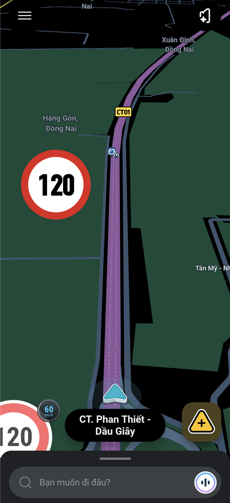
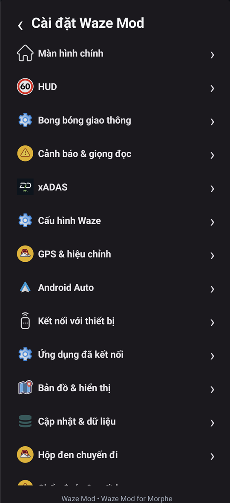
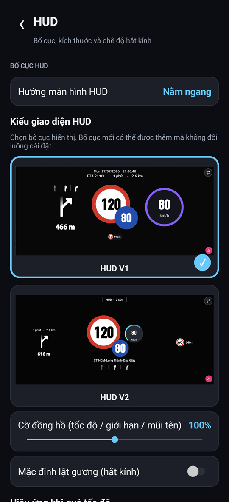
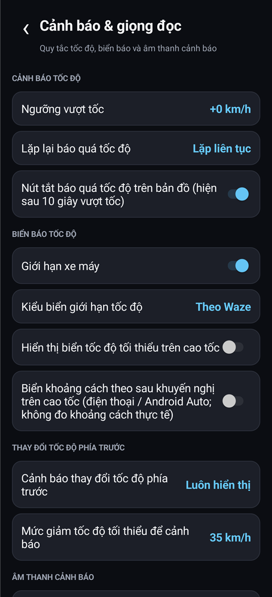

# ShindouAris Patches

Patches for driving apps, for use with [Morphe Manager](https://morphe.software).

## About

Patches for two navigation apps:

- **Google Maps**: privacy, de-Googling and UI patches, based on the
  [Ungoogled Maps patches by bearinmindcat](https://github.com/bearinmindcat/morphe-patches)
  (see [Credits](#credits)), with some removed and some added.
- **Waze**: the Waze Mod, which adds speed limit signs, speed warnings, HUD Link, an Android Auto
  overlay and more, with optional microG sign-in. See [Waze Mod](#waze-mod).

Each app is pinned to one version: Google Maps **26.44.06.1006895251** and Waze **5.27.90.900**, both as an
APKM from APKMirror. The classes the patches target are obfuscated and renamed on every build, so other
versions are not expected to work.

### How to use these patches

Add this repo URL to Morphe Manager: https://github.com/ShindouAris/morphe-patches

### Android Auto

The **Android Auto Car App Library** patch makes Android Auto list Google Maps as a navigation app and
show Maps' own car UI, with Waze Mod and xADAS overlays. It is off by default.

For the Waze overlay you need the Waze Mod app installed on your phone:
**[Download Waze Mod](https://wazemod.io.vn/en)**.

## Waze Mod

The **Waze Mod** patch adds the Waze Mod features to Waze (`com.waze`) **5.27.90.900**: speed limit
signs and speed warnings, HUD Link, an Android Auto overlay, alert sounds, xADAS, a darker map and a
settings screen of its own, found in the Waze menu as **Mod settings**. It has no Vietnam-only parts, apart
from the recorded Vietnamese voice clips and a support QR code that is shown only to users in Vietnam.

Two optional patches let you sign in with Google without Google Play services:
**Add microG-RE support for Waze** (for [microG-RE](https://github.com/MorpheApp/MicroG-RE)) and
**Add original microG support for Waze** (for the original microG).

  
  
  
  

The screenshots were taken with the app in Vietnamese; the Mod settings also come in English, Japanese
and Brazilian Portuguese.

## Patches list

<!-- PATCHES_START -->
> **[v1.4.0](https://github.com/ShindouAris/morphe-patches/releases/tag/v1.4.0)**&nbsp;&nbsp;&middot;&nbsp;&nbsp;`main`&nbsp;&nbsp;&middot;&nbsp;&nbsp;**34 patches** across **2 apps**&nbsp;&nbsp;&middot;&nbsp;&nbsp;[Full details](PATCHES.md)

| # | App | Patches | Version | Package |
|---|---|---|---|---|
| 1 | [**Google Maps**](PATCHES.md#google-maps-comgoogleandroidappsmaps) | 31 | `26.44.06.1006895251` | [`com.google.android.apps.maps`](https://play.google.com/store/apps/details?id=com.google.android.apps.maps) |
| 2 | [**Waze**](PATCHES.md#waze-comwaze) | 3 | `5.27.90.900` | [`com.waze`](https://play.google.com/store/apps/details?id=com.waze) |
<!-- PATCHES_END -->

&nbsp;

## Credits

The Maps patches and the extension code under `patches/src/main/kotlin/org/ungoogled/patches/maps/`
and `extensions/extension/` come from **[bearinmindcat/morphe-patches](https://github.com/bearinmindcat/morphe-patches)**
by **bearinmindcat**, licensed under GPLv3. The original code keeps its original package name
(`org.ungoogled`). Changes made in this repository are listed in the git history.

bearinmindcat's patches in turn follow earlier work, which stays credited where it is used:

- the microG support patches follow the GmsCore support patches of ReVanced / Morphe and
  [fangkampanat/gmaps-patches](https://github.com/fangkampanat/gmaps-patches) (GPLv3).

Built on the [Morphe](https://morphe.software) patcher and [patches template](https://github.com/MorpheApp/morphe-patches-template).
This project is not made by or affiliated with Morphe.

## License

[GNU General Public License v3.0](LICENSE). See [NOTICE](NOTICE) for the Morphe name restriction.
