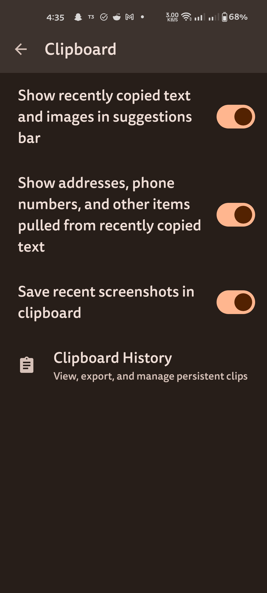
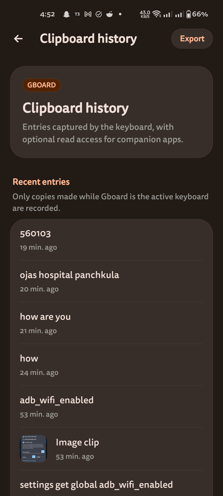
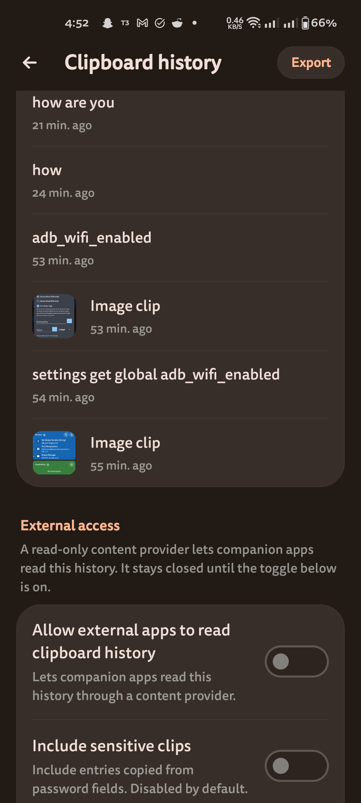

# Gboard Clipboard History

A [Morphe](https://github.com/MorpheApp) patch that adds persistent clipboard history management to Google Gboard.

It runs as a standalone patch and does not require other keyboard modifications. It is also compatible with other popular keyboard mods like [PixelBoard](https://github.com/Akshayykadam/PixelBoard), proving that the patch can compose cleanly with external modifications.

<p align="center">
  <a href="https://morphe.software/add-source?github=ShubhamJ010/gboard-clipboard-history&name=Gboard%20Clipboard%20History">
    
  </a>
  &nbsp;&nbsp;
  <a href="https://apps.obtainium.imranr.dev/redirect?r=obtainium%3A%2F%2Fapp%2F%7B%22id%22%3A%22com.sj010.gboard%22%2C%22url%22%3A%22https%3A%2F%2Fgithub.com%2FShubhamJ010%2Fgboard-clipboard-history%22%2C%22author%22%3A%22ShubhamJ010%22%2C%22name%22%3A%22Gboard%20Clipboard%20History%22%2C%22preferredApkIndex%22%3A0%2C%22additionalSettings%22%3A%22%7B%5C%22includePrereleases%5C%22%3Atrue%2C%5C%22fallbackToOlderReleases%5C%22%3Atrue%2C%5C%22filterReleaseTitlesByRegEx%5C%22%3A%5C%22%5C%22%2C%5C%22filterReleaseNotesByRegEx%5C%22%3A%5C%22%5C%22%2C%5C%22verifyLatestTag%5C%22%3Afalse%2C%5C%22sortMethodChoice%5C%22%3A%5C%22date%5C%22%2C%5C%22useLatestAssetDateAsReleaseDate%5C%22%3Afalse%2C%5C%22releaseTitleAsVersion%5C%22%3Afalse%2C%5C%22trackOnly%5C%22%3Afalse%2C%5C%22versionExtractionRegEx%5C%22%3A%5C%22%5C%22%2C%5C%22matchGroupToUse%5C%22%3A%5C%22%5C%22%2C%5C%22versionDetection%5C%22%3Atrue%2C%5C%22releaseDateAsVersion%5C%22%3Afalse%2C%5C%22useVersionCodeAsOSVersion%5C%22%3Afalse%2C%5C%22apkFilterRegEx%5C%22%3A%5C%22Gboard-Clipboard-History.%2A%5C%22%2C%5C%22invertAPKFilter%5C%22%3Afalse%2C%5C%22autoApkFilterByArch%5C%22%3Atrue%2C%5C%22appName%5C%22%3A%5C%22%5C%22%2C%5C%22appAuthor%5C%22%3A%5C%22%5C%22%2C%5C%22shizukuPretendToBeGooglePlay%5C%22%3Afalse%2C%5C%22allowInsecure%5C%22%3Afalse%2C%5C%22exemptFromBackgroundUpdates%5C%22%3Afalse%2C%5C%22skipUpdateNotifications%5C%22%3Afalse%2C%5C%22about%5C%22%3A%5C%22%5C%22%2C%5C%22refreshBeforeDownload%5C%22%3Afalse%2C%5C%22includeZips%5C%22%3Afalse%2C%5C%22zippedApkFilterRegEx%5C%22%3A%5C%22%5C%22%7D%22%2C%22overrideSource%22%3Anull%7D">
    
  </a>
  &nbsp;&nbsp;
  <a href="https://apps.obtainium.imranr.dev/redirect?r=obtainium%3A%2F%2Fapp%2F%7B%22id%22%3A%22com.akshaykadam.pixelboard%22%2C%22url%22%3A%22https%3A%2F%2Fgithub.com%2FShubhamJ010%2Fgboard-clipboard-history%22%2C%22author%22%3A%22ShubhamJ010%22%2C%22name%22%3A%22PixelBoard%20Clipboard%20History%22%2C%22preferredApkIndex%22%3A0%2C%22additionalSettings%22%3A%22%7B%5C%22includePrereleases%5C%22%3Atrue%2C%5C%22fallbackToOlderReleases%5C%22%3Atrue%2C%5C%22filterReleaseTitlesByRegEx%5C%22%3A%5C%22%5C%22%2C%5C%22filterReleaseNotesByRegEx%5C%22%3A%5C%22%5C%22%2C%5C%22verifyLatestTag%5C%22%3Afalse%2C%5C%22sortMethodChoice%5C%22%3A%5C%22date%5C%22%2C%5C%22useLatestAssetDateAsReleaseDate%5C%22%3Afalse%2C%5C%22releaseTitleAsVersion%5C%22%3Afalse%2C%5C%22trackOnly%5C%22%3Afalse%2C%5C%22versionExtractionRegEx%5C%22%3A%5C%22%5C%22%2C%5C%22matchGroupToUse%5C%22%3A%5C%22%5C%22%2C%5C%22versionDetection%5C%22%3Atrue%2C%5C%22releaseDateAsVersion%5C%22%3Afalse%2C%5C%22useVersionCodeAsOSVersion%5C%22%3Afalse%2C%5C%22apkFilterRegEx%5C%22%3A%5C%22PixelBoard-Clipboard-History.%2A%5C%22%2C%5C%22invertAPKFilter%5C%22%3Afalse%2C%5C%22autoApkFilterByArch%5C%22%3Atrue%2C%5C%22appName%5C%22%3A%5C%22%5C%22%2C%5C%22appAuthor%5C%22%3A%5C%22%5C%22%2C%5C%22shizukuPretendToBeGooglePlay%5C%22%3Afalse%2C%5C%22allowInsecure%5C%22%3Afalse%2C%5C%22exemptFromBackgroundUpdates%5C%22%3Afalse%2C%5C%22skipUpdateNotifications%5C%22%3Afalse%2C%5C%22about%5C%22%3A%5C%22%5C%22%2C%5C%22refreshBeforeDownload%5C%22%3Afalse%2C%5C%22includeZips%5C%22%3Afalse%2C%5C%22zippedApkFilterRegEx%5C%22%3A%5C%22%5C%22%7D%22%2C%22overrideSource%22%3Anull%7D">
    
  </a>
  &nbsp;&nbsp;
  <a href="https://github.com/ShubhamJ010/gboard-clipboard-history/releases/tag/0.0.6-alpha">
    
  </a>
</p>

<p align="center">
  
  &nbsp;
  
  &nbsp;
  
</p>

## Installation and updates

### 1. Pre-built APKs via Obtainium (recommended)

You can track and install automatic updates for pre-built APKs directly from GitHub releases via [Obtainium](https://github.com/ImranR98/Obtainium):

| Keyboard Variant | Package | One-Click Add to Obtainium |
| :--- | :--- | :--- |
| **Gboard Clipboard History** (Standalone) | `com.sj010.gboard` | []([obtainium-gboard]) |
| **PixelBoard Clipboard History** (M3 Themed) | `com.akshaykadam.pixelboard` | []([obtainium-pixelboard]) |

---

### 2. Patch bundle via Morphe Manager

#### One-click import (Android)

Tap the button below or link on an Android device where Morphe Manager is installed:

[](https://morphe.software/add-source?github=ShubhamJ010/gboard-clipboard-history&name=Gboard%20Clipboard%20History)

**Direct link:** [morphe.software/add-source][morphe-source]

> [!NOTE]
> If viewing on desktop, clicking the link displays a QR code to scan with your Android phone's camera.

#### Manual import

1. Open **Morphe Manager** on your Android device.
2. Tap **Sources** in the navigation bar.
3. Tap the **`+`** button (top right).
4. In the **Remote** field, enter:
   ```
   github.com/ShubhamJ010/gboard-clipboard-history
   ```
5. Tap **Add**.

---

## Features

- **In-app settings integration**: Placed cleanly inside `Gboard Settings -> Clipboard`. There is **no separate launcher icon** and no root settings clutter. The manager is only reachable from inside the keyboard clipboard settings.
- **PixelBoard Material 3 UI**: Clean Material 3 design with Monet dynamic theming (Android 12+), vector back navigation, relative timestamps, and image thumbnail previews.
- **Foreground clipboard capture**: Hooks Gboard's active input view (`onStartInputView`) to capture primary clips and backfill missing entries.
- **Coexistence with stock Gboard**: The optional *Package Rename to com.sj010.gboard* patch renames the keyboard package so it can be installed side by side with the official Gboard without a signature conflict.
- **Database reader**: Reads Gboard's internal SQLite database (`gboard_clipboard.db`, `clips` table) directly from the application process.
- **Background backfill**: Captures clips copied while another keyboard or application had focus once Gboard regains active input status.
- **Text export**: Exports stored history to a text file using Android Storage Access Framework.
- **Sensitive field toggle**: Hides the entries that the copying app marked as sensitive. Off by default.
- **ContentProvider API**: Exposes a read-only endpoint for automation tools, widgets, and companion apps.

## Repository structure

```
gboard-clipboard-history/
├── extensions/
│   └── extension/                 # Android runtime extension (.rve DEX)
│       └── src/main/java/com/sj010/gboardclipboard/extension/
│           ├── GboardClipboardHistoryRepository.java   # SQLite reader and writer
│           ├── GboardClipboardHistorySettings.java     # Preference persistence
│           ├── GboardClipboardHistoryProvider.java     # ContentProvider implementation
│           ├── GboardClipboardBackfill.java            # Clipboard listener and backfill
│           ├── GboardClipboardSyncRuntime.java         # Foreground input view sync
│           └── GboardClipboardHistoryActivity.java     # PixelBoard Material 3 UI
├── patches/                       # Morphe bytecode and resource patch bundle
│   ├── about.properties           # Bundle metadata, read by both build paths
│   ├── build.gradle.kts           # Gradle build of the bundle
│   └── src/main/kotlin/com/sj010/gboardclipboard/patches/
│       ├── Constants.kt                            # Package names, targets, and URIs
│       ├── XmlManifestUtils.kt                     # XML manipulation helpers
│       ├── ClipboardCarrierPatch.kt                # Extension DEX injection
│       ├── ClipboardHistoryPatch.kt                # Manifest, provider and settings injection
│       ├── GboardClipboardSyncPatch.kt             # onStartInputView foreground hook
│       └── GboardPackageRenamePatch.kt             # Package rename to com.sj010.gboard
│   └── src/main/resources/                         # patches-list.json / patches-bundle.json
├── scripts/                       # All build / install scripts
│   ├── lib/common.sh                              # Shared tool, input and patcher helpers
│   ├── pins.env                                   # Pinned download URLs and sha256 digests
│   ├── check-release-metadata.sh                  # Version and metadata consistency check
│   ├── build-mpp.sh                               # Build patches/GboardClipboardHistory.mpp
│   ├── build-gradle.sh                            # Gradle build of the bundle (needs GITHUB_TOKEN)
│   ├── build-gboard-clipboard.sh                  # Build Gboard + Clipboard History APK
│   ├── build-gboard-clipboard-pixelboard.sh       # Build PixelBoard + Clipboard History APK
│   ├── build-pixelboard-clipboard.sh              # PoC: Direct patch of released PixelBoard APK
│   ├── build-all.sh                               # Build the bundle and APKs
│   └── install.sh                                 # Install a built APK on a device
├── input/                         # Build inputs (git ignored, auto downloaded)
│   ├── gboard-merged.apk                          # Gboard v18.4.1 base
│   ├── patches-1.2.0.mpp                          # PixelBoard patch bundle
│   └── PixelBoard-18.4.1-V7.apk                 # Latest released PixelBoard APK
├── .github/
│   ├── workflows/build.yml                        # CI build and release workflow
│   ├── release.yml                                # Release changelog categories
│   ├── release_template.md                        # Release notes template
│   ├── TAG_TEMPLATE.md                            # Tagging and release checklist
│   └── pull_request_template.md                   # Pull request checklist
├── gradle.properties             # Version and Gradle settings
├── settings.gradle.kts           # Gradle settings and plugin configuration
├── patches-list.json             # Morphe Manager patch manifest
├── patches-bundle.json           # Morphe Manager repository metadata
├── SECURITY.md                   # Vulnerability reporting policy
├── LICENSE                       # GPL-3.0
└── README.md
```

## Building

All build logic lives in `scripts/`. Every script is self contained and can be run from the
repository root.

### Patch bundle

```bash
./scripts/build-mpp.sh                                  # credential free: kotlinc + d8 + Morphe patcher
./scripts/build-mpp.sh --rebuild-extension              # also rebuild the runtime extension DEX
./scripts/build-gradle.sh                               # Gradle build (needs GITHUB_TOKEN)
```

Output: `patches/GboardClipboardHistory.mpp`.

### Patched APKs

```bash
./scripts/build-all.sh                                  # bundle + all APK targets
```

| Script | Input | Output | Package | Description |
| :--- | :--- | :--- | :--- | :--- |
| `build-gboard-clipboard.sh` | Gboard base | `output/Gboard-Clipboard-History.apk` | `com.sj010.gboard` | Gboard + Clipboard History (coexists with stock Gboard) |
| `build-gboard-clipboard-pixelboard.sh` | Gboard base + PixelBoard `.mpp` | `output/PixelBoard-Clipboard-History.apk` | `com.akshaykadam.pixelboard` | Gboard + PixelBoard theming + Clipboard History |
| `build-pixelboard-clipboard.sh` | released PixelBoard APK | `output/PixelBoard-clipboard-poc.apk` | `com.akshaykadam.pixelboard` | **PoC**: demonstrates directly patching a pre-built PixelBoard release APK |

The first two scripts run the patcher twice on purpose: the package rename has to be finished
before the clipboard history patch runs, because the provider authority and the signature
permission are derived from the final host package name.

### Build inputs

Inputs live in `input/` (git ignored, they are too large for GitHub). The scripts download what
is missing:

| Input | Source |
| :--- | :--- |
| `input/gboard-merged.apk` | Gboard v18.4.1 base, downloaded from the [build inputs release](https://github.com/ShubhamJ010/gboard-clipboard-history/releases/tag/build-inputs). You can also drop the raw splits into `input/splits/` and they get merged with APKEditor. Override with `GBOARD_APK=<path>`. |
| `input/patches-1.2.0.mpp` | PixelBoard patch bundle, downloaded from the [PixelBoard](https://github.com/Akshayykadam/PixelBoard) repository. |
| `input/PixelBoard-18.4.1-V7.apk` | Latest released PixelBoard APK, downloaded from the PixelBoard releases (used for the PoC script). |

Tooling is resolved automatically: Java 21+, `kotlinc`, `d8`, `android.jar`, `APKEditor.jar` and
the Morphe patcher jar (downloaded from the PixelBoard repository when the sibling checkout is
missing).

### Pinned downloads

Every download is pinned in `scripts/pins.env` and checked against a sha256 digest. The build
stops on a mismatch and keeps the bad file out of the output directory. The patcher jar URL points
at a commit instead of a branch, so a moved branch cannot change the code that the build runs.

To move a pin on purpose, download the new artifact, compare it with the source, then update the
digest in `scripts/pins.env`.

### Release metadata

`gradle.properties` holds the version. `patches-list.json`, `patches-bundle.json` and the patch
constants have to agree with it, otherwise a user installs a bundle that nobody reviewed.
`patches/about.properties` holds the bundle name, description and links, and both build paths
read it, so the Gradle build and the shell build cannot ship different metadata.

```bash
./scripts/check-release-metadata.sh    # fails when the version or the copies drift apart
```

The check also verifies that every patch that the bundle ships is listed in
`patches-list.json`, and that the provider authority and the signature permission that the
runtime extension derives from the host package are the same ones that the patches write into
the manifest.

`scripts/build-mpp.sh` runs the check before it assembles the bundle, and the CI workflow runs it
before it builds.

### Signing

`SIGNING_KEY` selects the keystore:

| Value | Keystore | Certificate |
| :--- | :--- | :--- |
| `clipboard` (default) | `tools/patcher-data/clipboard.keystore` | `CN=GboardClipboard`, generated on first use |
| `pixelboard` | sibling `PixelBoard/tools/patcher-data/pixelboard.keystore` | `CN=PixelBoard`, matches builds installed before the key split |

Keystore passwords stay out of the repository. The build reads the password in this order:

1. `KEYSTORE_PASSWORD` in the environment
2. the file named by `KEYSTORE_PASSWORD_FILE`
3. `tools/patcher-data/keystore-<alias>.password`, a local file that Git does not track

A missing keystore is created with a random password, and that password is written to the local
file with 0600 permissions. Keep that file out of backups and out of CI logs. The key password can
differ from the store password through `KEYSTORE_KEY_PASSWORD`.

The default is the project's own key. Earlier builds were signed with the PixelBoard key, so
installing a build signed with `clipboard` over one signed with `pixelboard` needs an uninstall
first. That wipes the stored history, so pick the key before you install.

A keyboard holds every keystroke and the whole clipboard. Keep the signing key separate from any
other project and rotate it if the keystore file ever leaves the machine.

### Install

```bash
./scripts/install.sh output/Gboard-Clipboard-History.apk
./scripts/install.sh output/PixelBoard-Clipboard-History.apk --uninstall
```

`--uninstall` removes the previous package first, which is required when the signing
certificate differs (`INSTALL_FAILED_UPDATE_INCOMPATIBLE`).

## Downloads

Every release provides the patch bundle and pre-built APKs:

| Asset | Format | Obtainium | Description |
| :--- | :--- | :--- | :--- |
| **patches-0.0.6-alpha.mpp** | Morphe Patch | n/a | Standalone patch bundle for use with Morphe Manager or CLI patcher. Targets Gboard and PixelBoard. |
| **Gboard-Clipboard-History.apk** | Signed APK | [Add to Obtainium]([obtainium-gboard]) | Standalone Gboard + Clipboard History (package `com.sj010.gboard`, installs side-by-side with stock Gboard). |
| **PixelBoard-Clipboard-History.apk** | Signed APK | [Add to Obtainium]([obtainium-pixelboard]) | Gboard with PixelBoard theming + Clipboard History (package `com.akshaykadam.pixelboard`). |

Download the files from the [Releases](https://github.com/ShubhamJ010/gboard-clipboard-history/releases/tag/0.0.6-alpha) page.

## ContentProvider API

Automation tools and companion apps read the history through a read only provider.

- **URI**: `content://com.sj010.gboardclipboard.history/clips`
- **Permission**: `com.sj010.gboardclipboard.permission.READ_CLIPBOARD_HISTORY` at signature protection level
- **Token fallback**: `content://com.sj010.gboardclipboard.history/clips?token=<access token>`
- **Columns**: `_id`, `text`, `html_text`, `item_type`, `entity_type`, `timestamp`, `sensitive`, `uri`, `group_id`
- **Extra path**: `content://com.sj010.gboardclipboard.history/primary` returns the current primary clipboard entry

External access is off by default. Turn it on in *Clipboard History -> External access* before a
companion app can read anything.

The token is shown masked on screen and copied to the clipboard as a sensitive clip, so it does
not land in the history as a normal entry. Regenerate it whenever it leaves your hands. The
access rules and the rest of the security model are in [Security](#security).

### Authority per host package

The provider authority and the signature permission live in global namespaces, so two patched
keyboards installed side by side would clash on them. Every host package therefore gets its own
scoped variant, while the reference build `com.sj010.gboard` keeps the documented names:

| Host package | Authority | Permission |
| :--- | :--- | :--- |
| `com.sj010.gboard` | `com.sj010.gboardclipboard.history` | `com.sj010.gboardclipboard.permission.READ_CLIPBOARD_HISTORY` |
| `com.akshaykadam.pixelboard` | `com.akshaykadam.pixelboard.gboardclipboard.history` | `com.akshaykadam.pixelboard.permission.READ_CLIPBOARD_HISTORY` |

The runtime reads the authority and the permission back from the package manager, so the URI shown
in *Clipboard History -> External access* always matches the manifest of the installed build.

## Security

The clipboard history is a secret store. It holds whatever the user copied, and that includes
passwords and one time codes. The patch keeps the store closed until the owner opens it.

### What protects the history

| Control | Where |
| :--- | :--- |
| External access off by default | `GboardClipboardHistorySettings.isExternalAccessEnabled` |
| Signature permission, scoped per host package | `com.sj010.gboardclipboard.permission.READ_CLIPBOARD_HISTORY` |
| The permission has to be declared by the installed build | `GboardClipboardHistorySettings.isPermissionDeclaredByHost` |
| 128 bit random token, constant time comparison | `GboardClipboardHistorySettings.generateAccessToken` |
| Token masked on screen, screen capture blocked | `GboardClipboardHistoryActivity` |
| Every read is logged with the caller package | `GboardClipboardHistoryProvider.logAccess` |
| Read only provider, write calls throw | `GboardClipboardHistoryProvider` |

A caller gets through in one of three ways. It holds the signature permission and the installed
build declares that permission, it presents the access token, or it is the keyboard process
itself.

A permission name is a global namespace. An app that declares the same name first keeps that
definition, and it can pick a weaker protection level. The provider looks up which package defines
the permission before it accepts it, so a squatted name does not open the history.

### Known limits

These are open and worth knowing before you rely on the feature.

- The history lives in the plain SQLite database `gboard_clipboard.db` that Gboard already uses.
  Nothing is encrypted at rest and entries do not expire.
- `android:allowBackup` is still true in the patched Gboard manifest, so the database and the
  token preferences can end up in a backup.
- Export writes plain text, and it includes sensitive entries when the sensitive toggle is on.
- An entry counts as sensitive only when the app that copied it set the sensitive flag. Apps that
  do not set it are stored like any other entry.
- The backfill resolves `content://` items, so a URI copied from another app can pull that app's
  content into the history.

### Build and release security

- Signing keys and their passwords stay out of the repository. See [Signing](#signing).
- Every download is pinned and checked. See [Pinned downloads](#pinned-downloads).
- The release workflow runs with read only permissions, writes only on a tag, and pins every
  action to a commit.
- The release assets are built by the workflow, not by a laptop, and every asset carries a build
  provenance attestation. See [Release pipeline](#release-pipeline).

### Release pipeline

A tag push runs three jobs:

| Job | What it does | Needs |
| :--- | :--- | :--- |
| `build` | Builds the patch bundle with Gradle | nothing |
| `apk` | Builds the two patched APKs from the base APK and the bundle | `RELEASE_KEYSTORE_BASE64` and `KEYSTORE_PASSWORD` |
| `release` | Publishes the release and attests every asset | the two jobs above |

The `apk` job is skipped when the release secrets are not set. The release then carries the patch
bundle only, and the two APKs have to be built and uploaded by hand.

The secrets hold the release signing key:

| Secret | Value |
| :--- | :--- |
| `RELEASE_KEYSTORE_BASE64` | The base64 encoded `clipboard.keystore` |
| `KEYSTORE_PASSWORD` | The password of that keystore |

Create them with:

```bash
base64 -i tools/patcher-data/clipboard.keystore | gh secret set RELEASE_KEYSTORE_BASE64
gh secret set KEYSTORE_PASSWORD --body "<password>"
```

The certificate stays the same when the password changes, so installed builds keep updating over
each other. Rotate the password and update the secret together.

Verify an asset before you install it:

```bash
gh attestation verify Gboard-Clipboard-History.apk --repo ShubhamJ010/gboard-clipboard-history
```

### Reporting a problem

Use the private vulnerability advisory form on this repository, or read [SECURITY.md](SECURITY.md).

## Acknowledgements

Special thanks and sincere credit to:
- **[Akshay Kadam](https://github.com/Akshayykadam)** and the **[PixelBoard](https://github.com/Akshayykadam/PixelBoard)** project:
  PixelBoard's groundbreaking work on Gboard reverse engineering, bytecode patching patterns, Material 3 design, and build tooling made this clipboard history patch possible.
- **[Morphe](https://github.com/MorpheApp)** for the extensible bytecode and resource patching framework.

## License

GPL-3.0

[obtainium-gboard]: https://apps.obtainium.imranr.dev/redirect?r=obtainium%3A%2F%2Fapp%2F%7B%22id%22%3A%22com.sj010.gboard%22%2C%22url%22%3A%22https%3A%2F%2Fgithub.com%2FShubhamJ010%2Fgboard-clipboard-history%22%2C%22author%22%3A%22ShubhamJ010%22%2C%22name%22%3A%22Gboard%20Clipboard%20History%22%2C%22preferredApkIndex%22%3A0%2C%22additionalSettings%22%3A%22%7B%5C%22includePrereleases%5C%22%3Atrue%2C%5C%22fallbackToOlderReleases%5C%22%3Atrue%2C%5C%22filterReleaseTitlesByRegEx%5C%22%3A%5C%22%5C%22%2C%5C%22filterReleaseNotesByRegEx%5C%22%3A%5C%22%5C%22%2C%5C%22verifyLatestTag%5C%22%3Afalse%2C%5C%22sortMethodChoice%5C%22%3A%5C%22date%5C%22%2C%5C%22useLatestAssetDateAsReleaseDate%5C%22%3Afalse%2C%5C%22releaseTitleAsVersion%5C%22%3Afalse%2C%5C%22trackOnly%5C%22%3Afalse%2C%5C%22versionExtractionRegEx%5C%22%3A%5C%22%5C%22%2C%5C%22matchGroupToUse%5C%22%3A%5C%22%5C%22%2C%5C%22versionDetection%5C%22%3Atrue%2C%5C%22releaseDateAsVersion%5C%22%3Afalse%2C%5C%22useVersionCodeAsOSVersion%5C%22%3Afalse%2C%5C%22apkFilterRegEx%5C%22%3A%5C%22PixelBoard-Clipboard-History.%2A%5C%22%2C%5C%22invertAPKFilter%5C%22%3Afalse%2C%5C%22autoApkFilterByArch%5C%22%3Atrue%2C%5C%22appName%5C%22%3A%5C%22%5C%22%2C%5C%22appAuthor%5C%22%3A%5C%22%5C%22%2C%5C%22shizukuPretendToBeGooglePlay%5C%22%3Afalse%2C%5C%22allowInsecure%5C%22%3Afalse%2C%5C%22exemptFromBackgroundUpdates%5C%22%3Afalse%2C%5C%22skipUpdateNotifications%5C%22%3Afalse%2C%5C%22about%5C%22%3A%5C%22%5C%22%2C%5C%22refreshBeforeDownload%5C%22%3Afalse%2C%5C%22includeZips%5C%22%3Afalse%2C%5C%22zippedApkFilterRegEx%5C%22%3A%5C%22%5C%22%7D%22%2C%22overrideSource%22%3Anull%7D
[morphe-source]: https://morphe.software/add-source?github=ShubhamJ010/gboard-clipboard-history&name=Gboard%20Clipboard%20History
