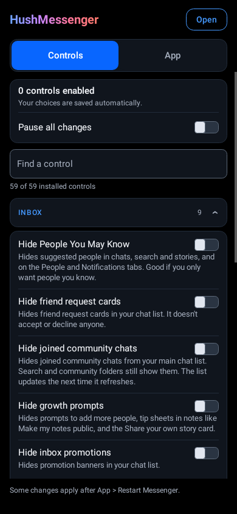
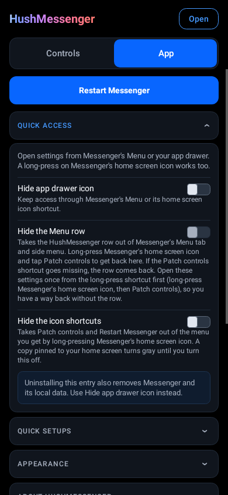
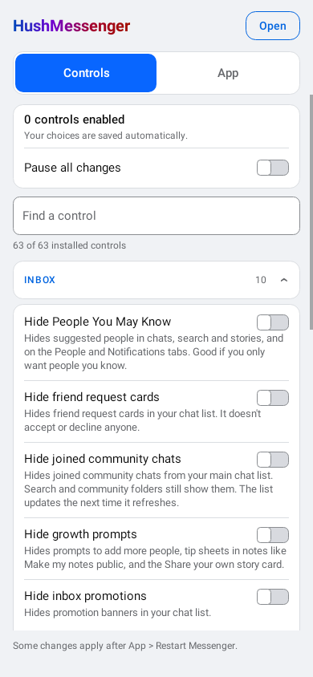
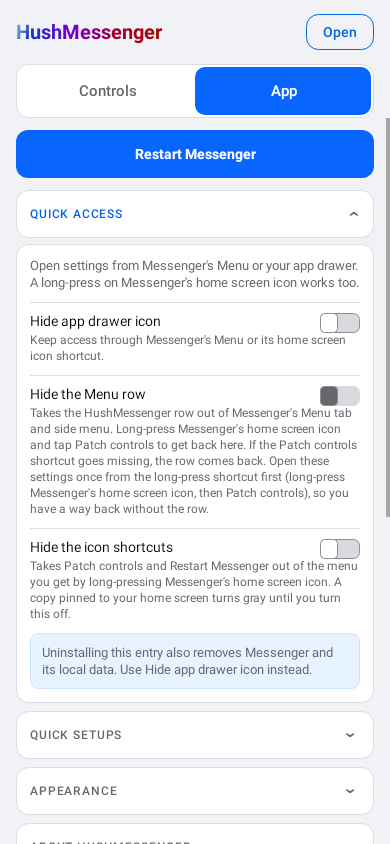

<p align="center">
  <a href="https://github.com/SysAdminDoc/HushMessenger/releases/tag/v0.28.0"></a>
  <a href="LICENSE"></a>
  
  
</p>

<p align="center">
  <a href="https://ko-fi.com/X8K126YVER">
    
  </a>
</p>

<p align="center">
  <sub><em>If HushMessenger makes Messenger better for you, a coffee helps me keep testing patches and maintaining them as Messenger changes.</em></sub>
</p>

# HushMessenger

HushMessenger is a set of [Morphe](https://morphe.software) patches for Facebook Messenger. You bring the Messenger APK, Morphe patches it on your phone, and you get a Messenger with a settings screen full of switches that stock Messenger doesn't have. Hide the ads, the suggested people, the stories row and Meta AI. Stop sending read receipts and typing indicators. Watch stories without showing up in the viewer list. Keep a log of messages so an unsend can't take them back. Send photos at their real quality, use your own font, let Material You color the app, and more.

Every switch starts off, so a freshly patched Messenger behaves like stock until you turn something on. The current release has 71 patches. What changed in each version is in the [changelog](CHANGELOG.md).

**[Add HushMessenger to Morphe Manager](https://morphe.software/add-source?github=SysAdminDoc%2FHushMessenger)**

> [!IMPORTANT]
> Keep your signing key. A patched update only installs over your copy when it's signed with the same key, and with the same key your sign-in and chats survive each update. See [Morphe's backup and keystore guide](https://github.com/MorpheApp/morphe-manager/blob/main/docs/backup-and-keystore.md).

## Install

1. **Get the APK.** The current release, v0.28.0, patches Messenger 585.0.0.53.94. Download it from [APKMirror's 585.0.0.53.94 page](https://www.apkmirror.com/apk/facebook-2/messenger/facebook-messenger-585-0-0-53-94-release/). Every build listed there works, arm64 and armv7. Pick a `nodpi` one if your phone's type has it, since those keep the icons sharp.
2. **Add the source.** Open the link above on your phone with Morphe Manager (2.3.0 or newer) installed. Or in Manager open **Sources**, tap **+**, choose **Remote** and enter `github.com/SysAdminDoc/HushMessenger`. The card should show **71 patches**. If it shows an older version, tap its refresh button. Manager also shows **Signed by `4d8d c2b3 fbcd 3ab6`** on the card. That's this project's key, and [Verify a download](#verify-a-download) has more on it.
3. **Patch Messenger.** The default selection includes every switch. Five patches start unselected because they change the app itself, with no switch to undo them: **Clone install under another package name**, **Spoof package version**, **Custom new-message sound**, **Custom launcher icon** and **GmsCore support**. To add one, turn on **Settings → Advanced → Expert mode** in Manager and use **Choose patches**.
4. **Keep one source.** Don't add the remote source and a local copy together, and don't mix in Messenger patches from other sources.

Prefer a local source? Download [`patches-0.28.0.mpp`](https://github.com/SysAdminDoc/HushMessenger/releases/tag/v0.28.0) and add it through **Sources > + > Local**. It won't update itself. The `.mpp` file is a patch bundle, not a Messenger APK. Morphe Desktop 1.20.0 or newer can load the same source too.

## Settings

Long-press Messenger's icon on your home screen and tap **Patch controls**. The **HushMessenger** row in Messenger's Menu tab and side menu opens the same screen, and so does the **HushMessenger settings** icon in your app drawer. **App > Hide app drawer icon** hides that icon without touching Messenger. Inside Messenger, a long press on the Messenger logo at the top of Chats or on the Menu tab's title opens settings too, even while changes are paused. The long-press shortcuts appear once Messenger has started, and a Root Mount install has no drawer icon. The App tab can switch off the Menu row, the icon shortcuts or the logo long press, but never the last way in that's still on.

**Pause all changes** turns every switch off at once without forgetting your choices. Changes to the Meta AI and bottom tabs, bubbles, your font and **Restore old emoji drawer** need **Restart Messenger**. Inbox options show up with the next chat list Messenger builds. While a restart is waiting, a bar at the top of settings says how many and has the button, and after the restart settings open again on the page you left. The button is also on the App tab and in the icon's long-press menu. If Messenger crashes three times near startup, safe mode pauses the controls. Open settings and tap **Resume**. **App > Log out** signs you out the same way Messenger's own Log out does.

The **Controls** tab groups the switches into sections that fold up under their headers. They start closed, and the ones you open stay open. The search box finds every word you type, in any order, and opens whatever section a match sits in. A switch that's on shows when Messenger last checked it. The **App** tab has the restart button at the top, then **Quick setups** (Quiet, Privacy or Back to defaults in one tap), appearance, **Save choices to a file** and **Restore choices from a file**, and **Copy setup**, which copies your versions and switch states with no chats or account details in it. **Report a problem** opens a new GitHub issue with your versions, phone model and the switches that are on already filled in. Issues are public, so look it over before you send it. **Check for updates** is off by default. When it's on, it asks GitHub at most once an hour and sends nothing but the request.

These screenshots come from the code on this page, so they can be a step ahead of the release you have installed. Each pair shows the Controls tab, then the App tab with its ways in.

<p>
  
  
</p>
<p>
  
  
</p>

### What each switch does

| Switch | What it does |
| --- | --- |
| Hide joined community chats | Takes joined channels and announcements out of the main Chats list. The other chips keep them. |
| Hide People You May Know | Removes suggested people from the chat list, search, stories and the People and Notifications tabs. |
| Hide friend request cards | Hides friend request cards in the chat list. Nobody gets accepted or declined. |
| Hide growth prompts | Removes the add-people promotion, the notes tip sheets and the "Share your own story" card after someone's stories. |
| Hide inbox promotions | Hides promotion banners in the chat list. |
| Hide stories and notes | Hides the row of stories and notes above your chats, and the story rings around profile pictures. |
| Hide the Instants button | Hides the + button that slides in at the right edge of your chat list and the one under your chat heads. Both open Instants. |
| Hide inbox tabs | Hides the All, Unread and Groups tabs above your chats. |
| Hide Mark as read | Takes Mark as read out of the menu you get when you press and hold a chat, so you can't mark one read by accident. Mark as unread stays. |
| Pin more chats | Raises Messenger's limit of three pinned chats to 20, so more of them can stay at the top of your chat list. Experimental, since Messenger's servers can still stop you sooner. |
| Hide People tab | Hides the People tab in the bottom bar. Restart Messenger to see it go. |
| Hide Notifications tab | Hides the Notifications tab in the bottom bar. Restart Messenger to see it go. |
| Hide tab badges | Hides the red dots and counts on the bottom tabs and on the Facebook button at the top. The Keep switches under it bring back the ones you want. Takes effect after a restart. |
| Hide Facebook shortcuts | Removes Facebook toolbar, profile and sharing shortcuts, and the "Also from Meta" and "Subscriptions" sections in the Menu tab. Keep the Profile button, right under it, leaves the chat details Profile button and the View profile button at the top of a new chat in place. |
| Hide Meta AI | Hides the Meta AI button, tab and menu entries, the "Ask Meta AI" search button and the AI suggestions when you type @ in a chat. Existing AI chats stay. The tab changes after a restart. |
| Hide Chat Moments | Removes Chat Moments from the menu. |
| Hide Reels badge | Hides the Reels notification badge. |
| Hide AI sticker tools | Hides the generated-sticker tab, AI sticker suggestions and the Generate buttons in the sticker keyboard. |
| Hide avatar stickers | Hides the avatar tab in the sticker keyboard. |
| Restore old emoji drawer | Keeps the emoji keyboard's earlier layout. Takes effect after a restart. |
| Keep emoji search on emoji | Typing with the emoji keyboard open no longer flips it to sticker search. |
| Hide chat promotions | Hides promotion banners inside conversations. |
| Hide ad banners in business chats | Hides the ad banner in a chat you started from a business's ad. |
| Hide business reply suggestions | Hides suggested replies in business chats. |
| Hide business typing suggestions | Hides business suggestions that pop up as you type. |
| Hide event prompts | Hides event promotion prompts inside chats. |
| Hide typing indicator | Others no longer see that you're typing, encrypted chats included. |
| Stop analytics uploads | Blocks Messenger's analytics uploader. Events still get recorded on your phone and can upload once you turn this off. |
| Stop ad attribution uploads | Stops the job that sends your advertising ID and ad tracking setting to Meta. |
| Stop inbox and ad link logging | Stops the reports about which part of your chat list was on screen and which ad opened a chat. |
| Stop live connection logging | Drops the health reports and push logging Messenger sends over its live connection (MQTT). Messenger sends most of its traffic another way, so there's often little for it to drop. Messages and calls keep working. |
| Stop nearby scans | Stops Messenger from reading the list of Wi-Fi networks around you, and hides the name and hardware address of the one you're connected to, the way Android does when Messenger can't see your location. Also stops the timer it can run while it's open to check your location and scan for Wi-Fi networks and Bluetooth devices. Experimental, since Messenger hasn't started those scans on the test phones yet. |
| Stop app list and device ID sharing | Stops Messenger from going through your installed apps to find other Meta apps, and from asking them for the device ID Meta uses to link its apps on one phone. Messenger keeps the ID it already has. Experimental. |
| Keep a message log | Saves a copy of each message that raised a notification, encrypted chats included, so an unsend can't take it back. Messages that get unsent are marked Unsent, and **Show only unsent** lists just those. It stays on your phone, encrypted. **View log** and **Clear log** sit under the switch. |
| Auto reply | Answers messages with a reply you write, for certain words or for any message. One reply per chat every five minutes, and group chats only when you allow it. |
| Quiet incoming calls | Calls still come in, but Messenger doesn't ring, vibrate or pop the call up over your screen. It waits in the notification shade with Answer and Decline, and a call you miss still shows in the chat. **Only chosen chats** under the switch keeps this to the chats you pick, so every other call rings. If the Facebook app is on your phone, it can still ring for the same call. Experimental. |
| Android Auto messages | Android Auto reads your Messenger messages out loud and sends the reply you speak, from its own messaging screen. Android Auto only lists apps from the Play Store until you turn on Unknown sources in its developer settings. |
| Hide read receipts | Opening a chat no longer sends Seen. The chat stays unread on your phone until you reply or mark it read. Group chats haven't been checked. |
| Mark as read button | Works with Hide read receipts. A chat's top bar gets Messenger's own Mark as read icon, and tapping it sends the Seen that opening the chat held back. When the bar is full it replaces the chat details button (tapping the chat's name opens the same page). Experimental. |
| View stories anonymously | Opens other people's stories without adding you to their viewer list. |
| Save any story | Adds **Save** to the **More options** menu on other people's stories. |
| Keep unsent messages | Keeps messages on the older unsend routes and marks them "[unsent]". An encrypted chat can't keep the message itself, so its notification stays up instead. |
| Allow screenshots | Lets you screenshot protected photos and media, view-once included, with no screenshot notice to the sender. |
| Use system emoji | Draws emoji with your phone's own set on Android 12 and newer. |
| Send photos at original quality | With HD on, a JPEG photo up to 20 MB goes out at its full size instead of Messenger's smaller copy. Location and camera details are stripped, as Messenger does. |
| Send videos without re-encoding | A video up to 25 MB goes out as it is. |
| Fix videos that won't send | A video whose only sound is xHE-AAC gets that sound converted to regular AAC, and a Samsung screen recording loses the tag Samsung's recorder adds when Messenger's media check rejects it, so neither ends in "Unable to send". Works for videos shared in from another app and ones picked in a chat. |
| Use the phone's camera app | A chat's camera button opens your own camera app. Photos only. |
| Open your gallery app | A chat's gallery button opens your own gallery app. One pick opens in Messenger's editor, and several open the Send to sheet with that chat at the top. |
| Put gallery picks in the chat | Goes with Open your gallery app. What you pick lands above the chat's message box, the way Messenger's own gallery puts it there, one item or several. Nothing goes out until you tap Send. Experimental. |
| Open web links externally | Opens http and https links in your default browser. |
| Slide chats in and out | Slides a chat in from the side when you open it and back out when you leave. |
| Hold stories at the end | A story stays on screen when it ends, photo or video, until you tap or swipe to the next one. The last one stays open until you close it. Experimental. |
| Ignore the swipe up for disappearing messages | Swiping up at the bottom of a chat no longer turns on disappearing messages. |
| Hide the recent photo card | The card above the message box that offers to send the screenshot, photo or video you just took doesn't show up. You can still send it from the gallery. |
| Save voice messages you play | Each voice message you play is also saved to Recordings/Messenger (Music/Messenger on Android 10 and 11), where your file manager or another player can open it. Playing it again doesn't save another copy. Android 10 and newer. Experimental. |
| Hide Your story when sharing | Sharing into Messenger from another app, the Send to list no longer offers Your story, so a tap on Add can't post it. Chats and groups stay. |
| Allow chat bubbles | **Stock**, **Chat heads** or **Android bubbles** (Android 11 and newer). See [Chat heads and bubbles](#chat-heads-and-bubbles). |
| Unlock app icons | Every icon in Messenger's App icon setting becomes selectable without a subscription. |
| Square profile pictures | Profile pictures show as squares instead of circles, and their story rings follow the square. Turn on **Round the corners** for rounded squares. Restart Messenger after a change. |
| Material You theme | In dark mode on Android 12 and newer, Messenger takes the accent color from your wallpaper. A **Pure black dark mode** switch sits under Appearance. You can paste your own colors there too, as text like `{"name": "Sunset", "accent": "#E1306C", "neutral": "#1A1418"}`, and share them with **Copy theme**. |
| Use your own font | Replaces Meta's font with your phone's, or with a .ttf or .otf file you pick, with size and position adjustments. Restart Messenger after a change. |
| Bold and italic text | Adds Bold and Italic to the text selection menu. They change the letters A to Z, accented ones included, and Bold changes digits too. Other alphabets stay as they are. On a Samsung phone, turn them on once under **Manage apps** in that menu. |
| Open settings from menu | Adds the HushMessenger row to Messenger's Menu tab and side menu, and makes a long press on the Messenger logo at the top of Chats or the Menu tab's title open settings. On by default. The App tab can turn off each way in, as long as one stays on. |

### Patches without a switch

- **Install beside Meta apps** renames Messenger's two shared Meta permissions so a patched Messenger installs next to a stock or patched Facebook. If you patch [Hushfacebook](https://github.com/SysAdminDoc/Hushfacebook) too, sign both with the same key.
- **Restore screens on re-signed builds** answers Messenger's check of its own certificate with Meta's, so a re-signed build opens to your chats instead of a blank screen. It also opens Threads links and Instagram video links in a Threads or Instagram you patched yourself. Messenger only hands those to apps signed by Meta and does nothing otherwise, so now the link goes to the app the normal way, or to your browser if the app can't take it.
- **Clone install under another package name** installs a second Messenger beside the first, as `com.facebook.orca.hush` and **Messenger Clone** unless you change them. Push notifications may not reach the copy, and Root Mount can't use it.
- **Spoof package version** gives Messenger a very high version code (2147483647 unless you pick another) so the Play Store stops offering updates. Keep it selected with the same number when you patch a later build, since Android won't install a lower code over a higher one.
- **Custom new-message sound** plays a sound file you pick when you patch (.ogg, .mp3, .m4a or .wav, 1 MB or less) in place of Messenger's new-message sound.
- **Custom launcher icon** makes Messenger's home screen icon white on black (the default) or black on white. Pick the style in its option. Patch again without it to get the normal icon back.
- **GmsCore support** is for phones that run [microG-RE](https://github.com/MorpheApp/MicroG-RE) instead of Google Play services. Messenger then gets its push token from microG-RE and keeps your login. Without microG-RE installed, Messenger gets no Google push at all, so leave it out on a phone with Play services.

## Help

### If something doesn't work

- **Can't find the settings.** Long-press Messenger's home screen icon and tap **Patch controls**. Not there? You may have hidden the icon shortcuts, so use the **HushMessenger** row in the Menu tab or long-press the Messenger logo at the top of Chats. If no way in shows up at all, refresh the source and patch again.
- **Switches do nothing.** The settings live inside the patched Messenger, and refreshing a source only downloads patches. Patch and install again. The Meta AI tab and the old emoji drawer only change after **Restart Messenger**. Inbox options wait for the next chat list Messenger builds, and a restart applies them right away.
- **Gallery won't return a selection.** Try it again, then open **App > Report a problem**. The report includes the gallery result category without file paths. Without a compatible picker or Hush's picker screen, the gallery button uses Messenger's own picker.
- **Videos are missing from Messenger's picker.** On Android 14 and newer, check Messenger's **Photos and videos** permission in Android's settings. With "Allow limited access", Messenger's picker shows only the items you chose and says "No media found" for the rest. Pick "Allow all", or turn on `Open your gallery app` and choose from your phone's gallery instead. Messenger's album list has no Videos album either way. Videos sit under All photos and in their folders.
- **The source shows an old version or misses a patch.** Refresh it and check that it shows the version of the [latest release](https://github.com/SysAdminDoc/HushMessenger/releases/latest). A local source needs the new `.mpp` added by hand.
- **The card says "Key changed".** Manager 2.3 and newer remembers the key that signs this source's bundles and puts that badge up when a new bundle was signed with another key, or not signed at all. Tapping the card shows the key it found. This project's is `4d8d c2b3 fbcd 3ab6`. A different one means the bundle came from somewhere else, such as a fork, a mirror or a build that merged several patch sets, so don't tap Trust. Remove that source and add `github.com/SysAdminDoc/HushMessenger` again. If this project's key ever has to change, the release notes will say so first.
- **APK rejected.** Use an unmodified supported Messenger build whose version code is in the [supported builds](#supported-messenger-builds). The error names the builds it checked. When the log says "This Messenger build (version code N) isn't supported yet", that's the whole problem, and the patch Manager names above it (often **Allow chat bubbles**) didn't fail on its own.
- **Android won't install over stock Messenger.** A re-signed APK can't replace Meta's signed copy. Back up first, since going from one to the other means uninstalling. Later updates of your patched copy need the same key.
- **`signatures do not match` even though you uninstalled Messenger.** Every user on a phone shares one copy of an app, so Messenger is probably still installed somewhere else: Samsung's Secure Folder, a work profile or a second user. Look there before changing anything, and back up that copy's chats if you decide to remove it. **Clone install under another package name** gets around it without touching that copy. The [install check](#verify-a-download) lists the signer it finds.
- **`INSTALL_FAILED_DUPLICATE_PERMISSION`.** Another app, usually a Facebook patched with a different key, owns a permission Messenger declares too. Messenger isn't the problem here, so leave it installed and patch with the same key as that app. The [install check](#verify-a-download) tells this apart from a Messenger signer mismatch and names the app.
- **`INSTALL_FAILED_VERSION_DOWNGRADE ... older than current 2147483647`.** Another patch set raised Messenger's version code to Android's maximum, and Android remembers it even after an uninstall that kept data. Don't uninstall or clear data to get past it. An in-place update needs the same signing key and a version code at least that high, so patch with **Spoof package version** selected at that number.
- **Uninstalling the settings icon removes Messenger.** Both icons belong to one app. Hide the icon with **App > Hide app drawer icon** instead.
- **A cloned Messenger brings back the settings icon.** A clone made by your phone's dual apps or app cloner keeps its own copy of the settings. Open the clone's settings icon and turn on **App > Hide app drawer icon** there too.
- **Every chat and call notifies twice.** The second one comes from the Facebook app, which doesn't treat the patched Messenger as the real one. In [Hushfacebook](https://github.com/SysAdminDoc/Hushfacebook) turn on **Leave calls and chats to Messenger**. With regular Facebook, turn off its chat and call notifications in Android's app settings for Facebook.
- **Restoring chats ends in an error.** The Google Drive restore only works in Meta's own signed Messenger. Use your PIN or a one-time code from another device you're signed in on. No PIN yet? Set one up in another Meta app first, such as Facebook Lite.
- **Login gets past the password, then loops on a browser check.** That happens on accounts with a passkey. Sign in on the web, remove the passkey under Settings > Accounts Center > Password and security, then log in again. Facebook falls back to approving the login from another device you're signed in on, and you can add the passkey back afterwards.
- **Install blocked on a Galaxy phone.** Samsung's Auto Blocker only lets apps in from Galaxy Store and Google Play, and it blocks USB installs too. Turn it off in **Settings > Security and privacy > Auto Blocker**, install, then turn it back on. Google's Advanced Protection (**Settings > Google > All services > Privacy & security > Advanced Protection**) blocks the install the same way.

### Alerts from only some chats

Messenger and Android handle this without a switch. In Messenger's app info, set the **Chats** notification category to **Silent** first. Then in each chat you still want alerts from, tap its name, open **Notifications & sounds > Customize notifications** and pick **Alert**. Do it in that order. A chat only keeps its own setting once you change it, so chats you haven't touched follow **Chats** and arrive quietly.

### Chat heads and bubbles

**Allow chat bubbles** offers three modes. **Stock** leaves Messenger alone. **Chat heads** uses Messenger's own overlay, so turn on Messenger's **Settings > Chat heads** and grant **Appear on top**. On a Samsung phone, chat heads needed **Unrestricted** battery use to arrive in the background. **Android bubbles** uses Android's own bubbles on Android 11 and newer, and the **Android bubble settings** link under the mode buttons takes you to the switch Android needs. Restart Messenger after changing modes.

### Read receipts

With **Hide read receipts** on, a chat you open stays unread on your phone, because Messenger marks a chat read and sends Seen in one step. **Mark as read** and replying still mark it read and show Seen. If you'd rather have chats marked read without anyone seeing Seen, leave the switch off and turn off **Show read receipts** in Messenger's Settings > Privacy & safety > Read receipts.

## Supported Messenger builds

| Field | Value |
| --- | --- |
| Package | `com.facebook.orca` |
| Version | `585.0.0.53.94` |
| Version codes, arm64-v8a | `347014996`, `347015062`, `347015064`, `347015065`, `347015067` |
| Version codes, armeabi-v7a | `347014974`, `347014990` |
| Icons for every screen density | `347015062` |
| Icons for one screen density | 240 dpi `347015064`. 320 dpi `347015065`. 480 dpi `347014996` and both armeabi-v7a builds. 640 dpi `347015067` |
| Minimum Android version | Android 9 (API 28) |
| APKMirror download | [585.0.0.53.94](https://www.apkmirror.com/apk/facebook-2/messenger/facebook-messenger-585-0-0-53-94-release/) |

HushMessenger takes all 7 builds APKMirror lists for 585.0.0.53.94. The patch checks the version code before it changes anything and stops on a build that isn't listed. Older Messenger versions aren't supported by current bundles. v0.27.0 still takes 584.1.0.61.98, v0.26.0 takes 584.0.0.49.98, v0.25.0 takes 583.0.0.29.95 and v0.23.0 takes 582.0.0.61.92.

SHA-256 of the stock APKs the checks ran against:

```text
347014974  5f012086183db46c6ad378e28086da1e5e16e99ff9b77aa6c7689aaaebdba2d8
347014990  64459c2a982ef14d7aae71d49f342fb0d7d5e99912a722d04fd6152adcffa652
347014996  b2c15b18456f23016688f0616466f23789b1da2e35f34dea23fcf46cf749f245
347015062  a2b052a5d245e86c3c1545957dbd866b0987e0bcac8ddd03bdb8c400bb3f576b
347015064  e89f0d76a5186916d7ff28ea7a503feee75afce4a781fd4aa8622a938bf1460a
347015065  a2ff26d061d067959bec55c7f336415fe70b726ba8c4638db1bc25e5312fda99
347015067  a80797f05b60a57f5e852ecce00b081000b95bf03b92e27ba3784d72139e0125
```

On Windows, compare your file with `Get-FileHash -Algorithm SHA256 .\messenger.apk`. Meta sometimes publishes different APKs under one version name.

## Verify a download

The [v0.28.0 release](https://github.com/SysAdminDoc/HushMessenger/releases/tag/v0.28.0) ships `SHA256SUMS.txt` beside the bundle. Compare its `.mpp` hash with your download.

```text
10c7bd6da6455c3af3187c390ba2c7fda7397b0afb5608d97a2a6fd956f59a7d  patches-0.28.0.mpp
```

`SHA256SUMS.txt.sig` is an SSH signature made with the project's release key. Its fingerprint is `SHA256:Z+UfHy7IUbtgNRO/wHkIr68+u4I+SIKPY9avfx/VAPU` and its public half is in [`scripts/release_signers`](scripts/release_signers). Morphe doesn't check this signature, so checking it is up to you. Download the three files from the same tag and run this in a terminal (OpenSSH 8.1 or newer, which Windows 10 and later include). In PowerShell, wrap it in `cmd /c "..."`.

```text
ssh-keygen -Y verify -f release_signers -I SysAdminDoc -n hushmessenger-release -s SHA256SUMS.txt.sig < SHA256SUMS.txt
```

An untouched file prints `Good "hushmessenger-release" signature for SysAdminDoc`. The private key lives only on my PC and never on GitHub, so a good signature still means something if the GitHub account is ever taken over. If the key ever changes, the changelog will say so and why.

Releases after v0.27.0 also carry a signature inside the `.mpp` itself, and Morphe Manager 2.3 or newer checks it before loading the bundle. Manager remembers the key the first time it sees this source and refuses a later bundle signed with a different key, or not signed at all. It shows the key as `4d8d c2b3 fbcd 3ab6`. The public half is in [`morphe-signing.pub`](morphe-signing.pub), and from a copy of this repository any Python 3.8 or newer can check a download by hand:

```text
python scripts/bundle_signature.py verify --public morphe-signing.pub path/to/the-bundle.mpp
```

Before you install a patched APK, `scripts/check_install.py` can compare its signer with what's on the phone and catch a version downgrade without changing anything. It needs Python 3.11 or newer, JDK 21, Android Build Tools and an authorized ADB connection. Exit `0` means the certificate, downgrade and native-library checks passed.

```powershell
python scripts/check_install.py --apk .\messenger-signed.apk --stock-apk .\messenger-stock.apk --serial YOUR_PHONE_SERIAL --build-tools "$env:LOCALAPPDATA\Android\Sdk\build-tools\36.1.0" --java "$env:JAVA_HOME\bin\java.exe"
```

## Build from source

You need JDK 21, Android SDK 36 and GitHub Packages credentials for the Morphe Gradle plugin. Set `ANDROID_HOME` to your SDK directory.

```powershell
$env:GITHUB_ACTOR = gh api user --jq .login
$env:GITHUB_TOKEN = gh auth token
.\gradlew.bat :patches:clean :extensions:messenger:clean :patches:test :patches:check :extensions:messenger:testDebugUnitTest :extensions:messenger:lintRelease :patches:buildAndroid --no-daemon
python -m unittest discover -s scripts/tests -v
```

The bundle lands in `patches/build/libs/`, and clean builds from the same source give the same checksum. `:patches:check` wants the exact stock APK of every supported build in a folder named by `HUSH_NATIVE_FIXTURES`, each file named with its version code after the last dash, like `messenger-585.0-347015062.apk`. `:patches:test` runs without them and skips the tests that replay on those APKs.

The development bundle names its discovery stages in the patch log and reports their elapsed time. To compare Wi-Fi finder time, allocation and heap peaks against the previous implementation on one stock APK, run `:patches:benchmarkWifiIdentity -PapkPath=<apk>`.

To exercise Messenger itself, use ARM64 Android or an emulator image with ARM translation. The Android 12L Google APIs x86_64 image with `libndk_translation.so` runs the arm64 builds. Keep separate emulator data directories for Meta-signed stock and re-signed builds. Android users and work profiles share the installed APK and its signing key. The armv7 builds have passed the compatibility checks and a full Desktop rebuild, but haven't been walked on an armv7 phone yet.

For a low-RAM check, verify `ActivityManager.isLowRamDevice()` inside the app. A userdebug image can apply `debug.force_low_ram` temporarily after a framework restart. Reducing the emulator's RAM alone doesn't establish that classification. Restore the property and verify the original result afterward.

Where things live:

- `patches/src/main/kotlin/app/hushmessenger/patches/` holds the Morphe patches. `MessengerTarget.kt` names the supported builds, `controls/` holds the switches and their hook discovery, and `coexist/` and `misc/` hold the package-level patches.
- `extensions/messenger/` is the Java code that runs inside Messenger: the settings screen (`SettingsActivity.java`), its text and translations, and the helpers behind each switch.
- `scripts/profiles/` has one recorded hook profile per stock APK, written by `scripts/CompatReport.java` from a real patch run. A test fails when a profile and the patch code disagree, so don't edit them by hand.
- `patches-list.json` is the generated patch catalog (`:patches:generatePatchCatalog`). `patches-bundle.json` is the Morphe source index and only changes at release time.
- `scripts/release/release.ps1` runs a release in five stages: `prepare`, `preflight`, `build`, `publish` and `index`.

To add a control, find its hook in the stock APK with `:patches:inspectDex -PapkPath=<apk> -Ptarget=<query>` (queries like `class:LX/Foo;`, `method:LX/Foo;->A01`, `callers:`, `strings:<text>`, `reads:`, `writes:` and `impl:`). Define it under `controls/` so discovery validates every site before the first edit, add the row in `SettingsActivity.java` with its text in `SettingsText.java` and `SettingsTranslations.java`, mirror the hook in `CompatReport.java`, and add tests for the expected shape and for a missing or ambiguous one.

Translations are welcome. A language is one Java table of text pairs registered with one line in `SettingsTranslations.java`, and `SettingsTranslationTest` fails the build when a text is missing or a placeholder changed.

## Credits

HushMessenger starts from the [Morphe patches template](https://github.com/MorpheApp/morphe-patches-template). Messenger hook definitions come from [De-Vanced](https://github.com/RookieEnough/De-Vanced), including its ReVanced contributions, and [Doom's patches](https://github.com/rushiranpise/morphe-patches), which also supplied the clone install's backup fix. The typed ad filter follows [Messenger Cleaner](https://github.com/N01-r0/messenger-cleaner-lsposed), with its MIT notice retained. The bubble eligibility anchor came from [ChatHeadEnabler](https://github.com/NeonOrbit/ChatHeadEnabler), and the emoji drawer anchor from ReVanced patches merge request !6833. The analytics upload services follow [MessengerEx](https://github.com/C10udburst/MessengerEx), with its MIT notice retained. The idea of keeping a message log from the notification follows [Messenger-Z](https://github.com/hyowonbernabe/Messenger-Z), with its own code written here. The permission approach is adapted from [Hushfacebook's shared-permission patch](https://github.com/SysAdminDoc/Hushfacebook/blob/15b8e9ed9315464a3e2d1a821b4e26ad47bbc28c/patches/src/main/kotlin/app/morphe/patches/facebook/coexist/SharedPermissions.kt). The [research snapshot](https://github.com/SysAdminDoc/HushMessenger/blob/015654380957d775f95b9f1c7871e91452d6216a/RESEARCH.md) compares Messenger patches across other projects, and [Hushfeed](https://github.com/SysAdminDoc/hushfeed) is another Hush patch project.

Source is under [GPL-3.0](LICENSE), and [NOTICE](NOTICE) has the details. HushMessenger is independent of Meta and Morphe.
