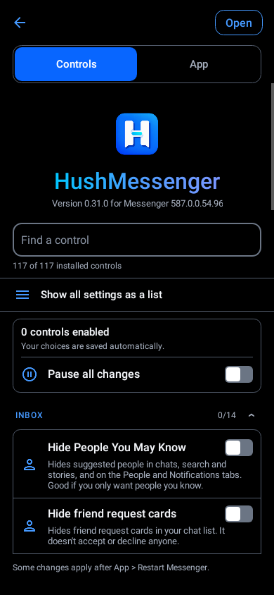
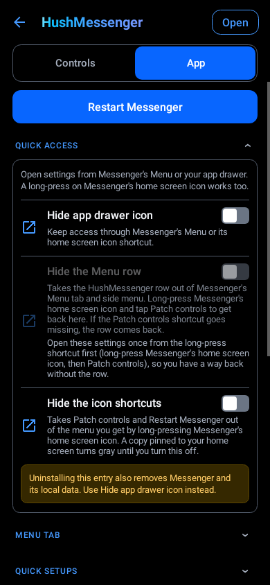
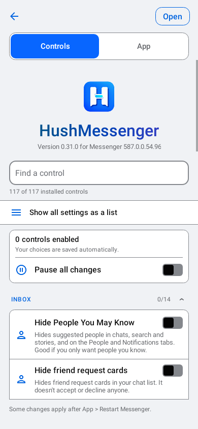
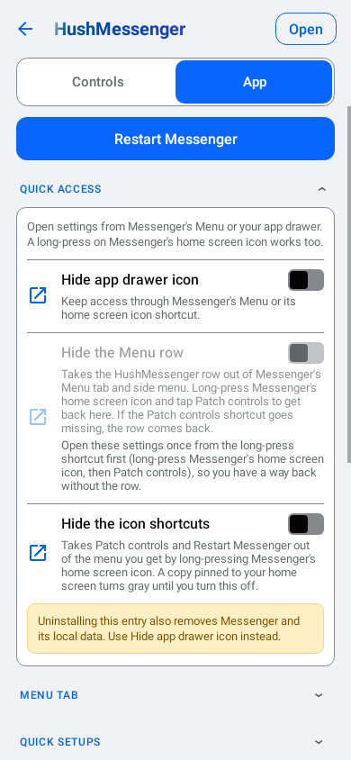

<p align="center">
  <a href="https://github.com/SysAdminDoc/HushMessenger/releases/tag/v0.31.0"></a>
  <a href="LICENSE"></a>
  
  
</p>

<p align="center">
  <a href="https://ko-fi.com/X8K126YVER">
    
  </a>
</p>

<p align="center">
  <sub><em>If HushMessenger makes Messenger better for you, a coffee helps me keep testing patches and maintaining them as Messenger changes.</em></sub>
</p>

# HushMessenger

HushMessenger is a set of [Morphe](https://morphe.software) patches for Facebook Messenger. You bring the Messenger APK, Morphe patches it on your phone, and you get a Messenger with a settings screen full of switches that stock Messenger doesn't have. Hide the ads, the suggested people, the stories row and Meta AI. Stop sending read receipts and typing indicators. Watch stories without showing up in the viewer list. Keep a log of messages so an unsend can't take them back. Send photos at their real quality, use your own font, let Material You color the app, and more.

Every switch starts off, so a freshly patched Messenger behaves like stock until you turn something on. The current release has 129 patches. What changed in each version is in the [changelog](CHANGELOG.md).

**[Add HushMessenger to Morphe Manager](https://morphe.software/add-source?github=SysAdminDoc%2FHushMessenger)**

> [!IMPORTANT]
> Keep your signing key. A patched update only installs over your copy when it's signed with the same key, and with the same key your sign-in and chats survive each update. See [Morphe's backup and keystore guide](https://github.com/MorpheApp/morphe-manager/blob/main/docs/backup-and-keystore.md).

## Install

1. **Get the APK.** The current release, v0.31.0, patches Messenger 588.1.0.66.98. Download it from [APKMirror's 588.1.0.66.98 page](https://www.apkmirror.com/apk/facebook-2/messenger/facebook-messenger-588-1-0-66-98-release/). All 20 APK builds APKMirror had for that version on November 25 work, and [Supported Messenger builds](#supported-messenger-builds) lists them. Most phones (arm64) should take a `nodpi` one, `347617499`, `347617515` or `347617532`. A 32-bit (armv7) phone takes `347617497`, `347617513`, `347617566` or `347617583`.
2. **Add the source.** Open the link above on your phone with Morphe Manager (2.7.0 or newer) installed. Or in Manager open **Sources**, tap **+**, choose **Remote** and enter `github.com/SysAdminDoc/HushMessenger`. The card should show **129 patches** and **Signed by `4d8d c2b3 fbcd 3ab6`**, which is this project's key. If it shows an older version, tap its refresh button.
3. **Patch Messenger.** The default selection includes every switch. Six patches start unselected because they change the app itself with no switch to undo them (see [Patches without a switch](#patches-without-a-switch)). To add one, turn on **Settings > Advanced > Expert mode** in Manager and use **Choose patches**.
4. **Keep one source.** Don't add the remote source and a local copy together, and don't mix in Messenger patches from other sources.

Prefer a local source? Download [`patches-0.31.0.mpp`](https://github.com/SysAdminDoc/HushMessenger/releases/tag/v0.31.0) and add it through **Sources > + > Local**. It won't update itself. The `.mpp` file is a patch bundle, not a Messenger APK. Morphe Desktop 2.3.0 or newer can load the same source too.

There are Hush patch sources for other apps too: [Hushfacebook](https://github.com/SysAdminDoc/HushFacebook) for Facebook, [HushGram](https://github.com/SysAdminDoc/HushGram) for Instagram, [HushPine](https://github.com/SysAdminDoc/HushPine) for PineDrama, [HushPinterest](https://github.com/SysAdminDoc/HushPinterest) for Pinterest, [HushTelegram](https://github.com/SysAdminDoc/HushTelegram) for Telegram, [HushThreads](https://github.com/SysAdminDoc/HushThreads) for Threads, [Hushfeed](https://github.com/SysAdminDoc/HushFeed) for TikTok and [HushTumblr](https://github.com/SysAdminDoc/HushTumblr) for Tumblr. Each one is a separate source in Manager, so add only the ones for apps you patch.

## Settings

Long-press Messenger's icon on your home screen and tap **Patch controls**. The **HushMessenger** row in Messenger's Menu tab opens the same screen, and so does a long press on the Messenger logo at the top of Chats or the **HushMessenger settings** icon in your app drawer. The App tab can turn any of those ways in off, as long as one stays on.

Each switch says what it does right under its name, and the search box at the top finds it by any word in that text. Some switches need **Restart Messenger**, and a bar at the top of settings has the button when one is waiting. **Pause all changes** turns everything off at once without forgetting your choices. If Messenger crashes three times near startup, safe mode pauses the controls until you open settings and tap **Resume**.

The **App** tab has **Quick setups** (Quiet, Privacy, iPhone look or Back to defaults in one tap), **Save choices to a file** and **Restore choices from a file** for moving your setup to a new install, and **Report a problem**, which opens a GitHub issue with your versions, phone model and the switches that are on already filled in, marking any switch that hasn't done anything yet or stopped with an error. Issues are public, so look it over before you send it. **Check for updates** is off by default.

These screenshots come from the code on this page, so they can be a step ahead of the release you have installed.

<p>
  
  
</p>
<p>
  
  
</p>

### Patches without a switch

These are always in the default selection:

- **Install beside Meta apps** lets a patched Messenger install next to a stock or patched Facebook. If you patch [Hushfacebook](https://github.com/SysAdminDoc/Hushfacebook) too, sign both with the same key.
- **Restore screens on re-signed builds** keeps a re-signed Messenger from opening to a blank screen. It also opens Threads links and Instagram video links in a Threads or Instagram you patched yourself.
- **Keep chat pop-ups** stops Messenger from turning off its own message pop-ups for good.
- **Fix videos in chat heads** draws chat head videos inside the chat, where some phones showed a black box.
- **Keep a renamed copy working** keeps a copy another patch renamed from sitting on its loading screen.

These start unselected:

- **Clone install under another package name** installs a second Messenger beside the first (`com.facebook.orca.hush` by default). Push notifications may not reach the copy, and Root Mount can't use it.
- **Spoof package version** gives Messenger a very high version code so the Play Store stops offering updates. Keep it selected with the same number every time you patch, since Android won't install a lower code over a higher one.
- **Custom new-message sound** plays a sound file you pick at patch time (.ogg, .mp3, .m4a or .wav, 1 MB or less).
- **Custom chat sounds** does the same for the sounds as you send a message, once it has gone through, and for a new message while Messenger is open. Pick a file for any of the three.
- **Custom launcher icon** makes the home screen icon white on black or black on white.
- **GmsCore support** is only for phones that run [microG-RE](https://github.com/MorpheApp/MicroG-RE) instead of Google Play services. Leave it out on a phone with Play services, or Messenger gets no notifications.

## Help

### If something doesn't work

- **Can't find the settings.** Long-press Messenger's home screen icon and tap **Patch controls**, or long-press the Messenger logo at the top of Chats. If no way in shows up at all, refresh the source and patch again.
- **Switches do nothing.** The settings live inside the patched Messenger, and refreshing a source only downloads patches. Patch and install again, then tap **Restart Messenger** if settings asks for it.
- **The source shows an old version or misses a patch.** Refresh it and check that it shows the [latest release](https://github.com/SysAdminDoc/HushMessenger/releases/latest). A local source needs the new `.mpp` added by hand.
- **The card says "Key changed".** This project's key is `4d8d c2b3 fbcd 3ab6`. A different one means the bundle came from somewhere else, like a fork or a mirror, so don't tap Trust. Remove that source and add `github.com/SysAdminDoc/HushMessenger` again. If this key ever has to change, the release notes will say so first.
- **APK rejected.** Use an unmodified Messenger build from [Supported Messenger builds](#supported-messenger-builds). When the log says "This Messenger build (version code N) isn't supported yet", that's the whole problem, even if Manager names another patch above it.
- **Android won't install over stock Messenger.** A re-signed APK can't replace Meta's signed copy. Back up first, since switching means uninstalling. Later updates of your patched copy need the same key.
- **`signatures do not match` even though you uninstalled Messenger.** Messenger is probably still installed somewhere else on the phone, like Samsung's Secure Folder, a work profile or a second user. Look there first. **Clone install under another package name** gets around it without touching that copy.
- **`INSTALL_FAILED_DUPLICATE_PERMISSION`.** Another app, usually a Facebook patched with a different key, owns a permission Messenger declares too. Leave Messenger installed and patch with the same key as that app.
- **`INSTALL_FAILED_VERSION_DOWNGRADE ... older than current 2147483647`.** Another patch set raised Messenger's version code to Android's maximum. Don't uninstall or clear data to get past it. Patch with **Spoof package version** selected at that number and the same signing key.
- **`INSTALL_FAILED_VERSION_DOWNGRADE: Downgrade detected on app uninstalled with DELETE_KEEP_DATA`.** A Messenger was uninstalled with its data kept (or Android archived it), and Android won't put a lower version or another key over it. Select **Clone install under another package name** to install next to it. If you don't need what that copy kept, uninstall it in Settings > Apps or with `adb uninstall com.facebook.orca` first.
- **Root Mount crashes when chat heads or other screens open.** The patched build has to match the Messenger Android already has, down to the version code. Settings warns about it under the name and says which build Android has, so patch that exact one.
- **Messages or calls stop popping up.** Check that `Quiet incoming calls` is off and **Allow chat bubbles** is on Stock. A reinstall resets Android's notification permissions, and Xiaomi, Redmi and POCO phones also want **Floating notifications** on for each Messenger category. **App > Report a problem** lists any notification channel that still can't pop up.
- **Every chat and call notifies twice.** The second one comes from the Facebook app. In [Hushfacebook](https://github.com/SysAdminDoc/Hushfacebook) turn on **Leave calls and chats to Messenger**, or with regular Facebook turn off its chat and call notifications in Android's settings.
- **Restoring chats ends in an error.** The Google Drive restore only works in Meta's own signed Messenger. Use your PIN or a one-time code from another device you're signed in on.
- **Login gets past the password, then loops on a browser check.** Turn on **Skip passkey sign-in** under Privacy (a long press on Messenger's home screen icon gets you there without signing in), and Facebook asks you to approve the login from another device instead. Turn it back off once you're in.
- **Install blocked on a Galaxy phone.** Samsung's Auto Blocker only lets apps in from Galaxy Store and Google Play. Turn it off in **Settings > Security and privacy > Auto Blocker**, install, then turn it back on.

## Supported Messenger builds

| Field | Value |
| --- | --- |
| Package | `com.facebook.orca` |
| Version | `588.1.0.66.98` |
| Version codes, arm64-v8a | `347617499`, `347617503`, `347617515`, `347617516`, `347617517`, `347617519`, `347617532`, `347617533`, `347617535`, `347617537`, `347617569`, `347617572`, `347617586`, `347617587`, `347617588`, `347617590` |
| Version codes, armeabi-v7a | `347617497`, `347617513`, `347617566`, `347617583` |
| Icons for every screen density (nodpi) | `347617499`, `347617515`, `347617532` |
| Icons for one screen density | 120-160 dpi `347617516`, `347617533`, `347617569`, `347617586`. 213-240 dpi `347617517`, `347617587`. 280-320 dpi `347617535`, `347617588`. 360-480 dpi `347617503`, `347617519`, `347617572` and the armeabi-v7a builds. 560-640 dpi `347617537`, `347617590` |
| Minimum Android version | Android 9 (API 28) |
| APKMirror download | [588.1.0.66.98](https://www.apkmirror.com/apk/facebook-2/messenger/facebook-messenger-588-1-0-66-98-release/) |

That's every APK build APKMirror lists for 588 (its three bundle uploads aren't covered). The patch checks the version code before it changes anything and stops on a build that isn't listed. Older Messenger versions need the release that targeted them, and the [changelog](CHANGELOG.md) names each one.

SHA-256 of the stock APKs the checks ran against:

```text
347617497  e4ae955e377e12b476af63600c2ac3fd3188fee7e0a297212b3801f9b92091c9
347617499  d11c8f4eb4e3b32aa08590f29c1211834eef251cbceff9cafc99b1bd257187fc
347617503  a5794bf5610a6d2905754899ea560e19005d45d8ad3ac0b0e87e29f1acc4284e
347617513  ecb09cabf8f01c3463d88bc104d9aff5e200f0366d143424329bea75f0bc9852
347617515  30ad524ac1c06efd75b5fd123efc89c4f61462a7eeb7b666c4f71cfd24de3aa7
347617516  3b0e1c7cd16a1c34a2be9e7efe0dce4940fc6b304da95f1611ae0bf2669356d6
347617517  57465ea279bd2d4cbeb32e47cba99c82dcf6cceeca9105349fdb2f6020480ae1
347617519  013013e3f7cac64142c4be06000167f01ca418004e3bfc2b2c82306ede3c748f
347617532  a2b96d692ee6351a4ea1dc9bb7fe2756abd842c7ca5d5c40d9084dbe16c0f7df
347617533  70c2af1fbfcb46bef6b588924703b3397c77ea3f07cfec6a86b72103ee12353e
347617535  52197eac8735910011475bf1ca7e02d23b76e4ebb2873d08122241d4140053be
347617537  f487dadedde761c4c130f3c172d72b3bd68908dd079c7cd78e666df85e9281e7
347617566  e21387289953104aa1b2f2e57e1c6aff1ebf5b3c0f60a1c8354c5a85a481c76b
347617569  59789848deba05445b2cc43a9862453d1395dae96b3d1fb9295a377695da92b2
347617572  872c0bba87d4e214ad78edaecca12e32b70b387e3d469276c7ef47688bab105b
347617583  da2370cfb9ff8feee8f7d2de4a22d089978658d25c9903da19da4e9c85b5ed3f
347617586  8d40cab334317717b4e6deb3bc319d2f72afe0ef6275b0315f785cca66db8ffa
347617587  775e4b51daf6080276e87073feba2866c557b2c49221d044c2789fbc65071970
347617588  bb801c6a5599d47387a9aa7ee823f2c9937c137377afb0df67bc11e4d5c37c22
347617590  6a98604b1aef871c32ef11f77f24e5e8e6268c98710dccc9282a198858457857
```

On Windows, compare your file with `Get-FileHash -Algorithm SHA256 .\messenger.apk`. Meta sometimes publishes different APKs under one version name.

## Verify a download

The [v0.31.0 release](https://github.com/SysAdminDoc/HushMessenger/releases/tag/v0.31.0) ships `SHA256SUMS.txt` beside the bundle. Compare its `.mpp` hash with your download.

```text
5775c565323bd6e4464132f71c05ea34e6eae7fdef2ea4a986957ee5400999bd  patches-0.31.0.mpp
```

`SHA256SUMS.txt.sig` is an SSH signature made with the project's release key. Its fingerprint is `SHA256:Z+UfHy7IUbtgNRO/wHkIr68+u4I+SIKPY9avfx/VAPU` and its public half is in [`scripts/release_signers`](scripts/release_signers). Morphe doesn't check this one, so that's up to you. Download the three files from the same tag and run this (OpenSSH 8.1 or newer, which Windows 10 and later include). In PowerShell, wrap it in `cmd /c "..."`.

```text
ssh-keygen -Y verify -f release_signers -I SysAdminDoc -n hushmessenger-release -s SHA256SUMS.txt.sig < SHA256SUMS.txt
```

An untouched file prints `Good "hushmessenger-release" signature for SysAdminDoc`. The private key lives only on my PC and never on GitHub, so a good signature still means something if the GitHub account is ever taken over.

The `.mpp` also carries its own signature, which Morphe Manager checks before it loads the bundle. Manager remembers the key the first time it sees this source and refuses a later bundle signed with another key. The public half is in [`morphe-signing.pub`](morphe-signing.pub), and any Python 3.8 or newer can check a download by hand from a copy of this repository:

```text
python scripts/bundle_signature.py verify --public morphe-signing.pub path/to/the-bundle.mpp
```

Before you install a patched APK, `scripts/check_install.py` compares its signer with what's on the phone and catches a version downgrade without changing anything. It needs Python 3.11 or newer, JDK 21, Android Build Tools and an authorized ADB connection. Exit `0` means the certificate, downgrade and native-library checks passed.

```powershell
python scripts/check_install.py --apk .\messenger-signed.apk --stock-apk .\messenger-stock.apk --serial YOUR_PHONE_SERIAL --build-tools "$env:LOCALAPPDATA\Android\Sdk\build-tools\36.1.0" --java "$env:JAVA_HOME\bin\java.exe"
```

## Build from source

You need JDK 21, Android SDK 36 and GitHub Packages credentials for the Morphe Gradle plugin, either in `GITHUB_ACTOR` and `GITHUB_TOKEN` as below or as `gpr.user` and `gpr.key` in your own gradle.properties. Set `ANDROID_HOME` to your SDK directory.

```powershell
$env:GITHUB_ACTOR = gh api user --jq .login
$env:GITHUB_TOKEN = gh auth token
.\gradlew.bat :patches:clean :extensions:messenger:clean :patches:test :patches:check :extensions:messenger:testDebugUnitTest :extensions:messenger:lintRelease :patches:buildAndroid --no-daemon
python -m unittest discover -s scripts/tests -v
```

The bundle lands in `patches/build/libs/`, and clean builds from the same source give the same checksum. `:patches:check` wants the exact stock APK of every supported build in a folder named by `HUSH_NATIVE_FIXTURES`, each file named with its version code after the last dash, like `messenger-588.1-347617503.apk`. `:patches:test` runs without them and skips the tests that replay on those APKs.

Where things live:

- `patches/src/main/kotlin/app/hushmessenger/patches/` holds the Morphe patches. `MessengerTarget.kt` names the supported builds, `controls/` holds the switches and their hook discovery, and `coexist/` and `misc/` hold the package-level patches.
- `extensions/messenger/` is the Java code that runs inside Messenger: the settings screen (`SettingsActivity.java`), its text and translations, and the helpers behind each switch.
- `scripts/profiles/` has one recorded hook profile per stock APK, written by `scripts/CompatReport.java` from a real patch run. Don't edit them by hand.
- `scripts/release/release.ps1 -Version X -Summary <file>` cuts a release in one go and picks up where it stopped when you run it again.

To add a control, `scripts/new_control.py` stubs it in every file it has to reach. Find its hook in the stock APK with `:patches:inspectDex -PapkPath=<apk> -Ptarget=<query>` (queries like `class:LX/Foo;`, `method:LX/Foo;->A01`, `callers:` and `strings:<text>`).

Translations are welcome. A language is one tab-separated file in `extensions/messenger/src/main/l10n/`, an id and its text on each line, registered with one line in `SettingsTranslations.java`. The build writes the Java table from it, and `SettingsTranslationTest` fails the build when a text is missing or a placeholder changed.

## Credits

HushMessenger starts from the [Morphe patches template](https://github.com/MorpheApp/morphe-patches-template). Messenger hook definitions come from [De-Vanced](https://github.com/RookieEnough/De-Vanced), including its ReVanced contributions, and [Doom's patches](https://github.com/rushiranpise/morphe-patches), which also supplied the clone install's backup fix. The typed ad filter follows [Messenger Cleaner](https://github.com/N01-r0/messenger-cleaner-lsposed), with its MIT notice retained. The bubble eligibility anchor came from [ChatHeadEnabler](https://github.com/NeonOrbit/ChatHeadEnabler), and the emoji drawer anchor from ReVanced patches merge request !6833. The analytics upload services follow [MessengerEx](https://github.com/C10udburst/MessengerEx), with its MIT notice retained. The idea of keeping a message log from the notification follows [Messenger-Z](https://github.com/hyowonbernabe/Messenger-Z), with its own code written here. The permission approach is adapted from [Hushfacebook's shared-permission patch](https://github.com/SysAdminDoc/Hushfacebook/blob/15b8e9ed9315464a3e2d1a821b4e26ad47bbc28c/patches/src/main/kotlin/app/morphe/patches/facebook/coexist/SharedPermissions.kt). The [research snapshot](https://github.com/SysAdminDoc/HushMessenger/blob/015654380957d775f95b9f1c7871e91452d6216a/RESEARCH.md) compares Messenger patches across other projects, and [Hushfeed](https://github.com/SysAdminDoc/hushfeed) is another Hush patch project.

GmsCore support comes from [Morphe's patches](https://github.com/MorpheApp/morphe-patches) by way of HushPinterest. Source is under [GPL-3.0](LICENSE), and [NOTICE](NOTICE) has the details, Morphe's own notice included. The app carries the same file under **App > Source and licenses**, so it's readable offline. HushMessenger is independent of Meta and Morphe.
