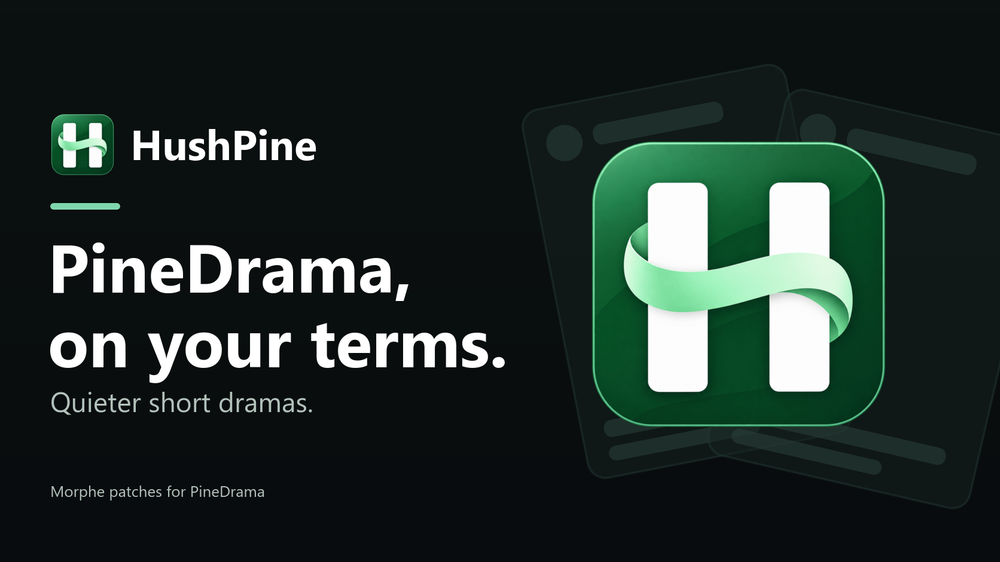

<p align="center">
  <a href="CHANGELOG.md"></a>
  <a href="LICENSE"></a>
  
  <a href="https://www.apkmirror.com/apk/tiktok-pte-ltd/pinedrama-short-dramas/"></a>
  
</p>

<p>
  <a href="https://ko-fi.com/X8K126YVER">
    
  </a>
</p>

#  HushPine

HushPine is a set of [Morphe](https://morphe.software) patches for PineDrama, TikTok's short drama app. You bring the PineDrama bundle, Morphe Manager patches it on your phone, and the patched app gets a HushPine page in its settings with a switch for most of what it does. Hide ads and clutter, save videos without the watermark, set your own speed and quality, and stop the app reading things it has no need for.

Most switches start off, so a freshly patched PineDrama looks and works the way it ships until you turn something on. Changes are listed in the [changelog](CHANGELOG.md). This repo split off from [Hushfeed](https://github.com/SysAdminDoc/hushfeed), which now covers TikTok only.

HushPine v0.1.1 contains 100 patches for PineDrama 47.6.3. New in this one: saved posts from Favorites play in your dub language too. It needs Morphe Manager 2.5.0 or newer.

The main branch contains 100 patches, the same set as v0.1.1.

**[Add HushPine to Morphe Manager](https://morphe.software/add-source?github=SysAdminDoc%2FHushPine)**

> [!IMPORTANT]
> Back up your signing key right after your first patch. In Morphe Manager open **Settings > System > Import & export > Signing key** and tap **Export**, then keep `Morphe.keystore` somewhere private. Android only updates a patched PineDrama with an APK signed by the same key, so on a new phone import it before you patch anything.

## Install

1. Get PineDrama 47.6.3 from [APKMirror](https://www.apkmirror.com/apk/tiktok-pte-ltd/pinedrama-short-dramas/pinedrama-short-dramas-47-6-3-release/), the file marked **BUNDLE** (an `.apkm`). Google Play only offers the newest build, which may not be the one HushPine supports. Manager merges the bundle into a single APK for you.
2. Use Morphe Manager 2.5.0 or newer. HushPine is built against patcher 2.3.0, which Manager 2.5.0 was the first to ship, and older Managers won't load it. morphe-desktop 2.1.0 or newer works from a computer if you give it 2 GB of memory (`java -Xmx2g -jar morphe-desktop-2.1.0-all.jar patch ...`).
3. Add HushPine as a source. On the phone, open [Add HushPine to Morphe Manager](https://morphe.software/add-source?github=SysAdminDoc%2FHushPine). If **Open in Morphe** leaves you in the browser, open Manager, tap **Sources**, tap **+** and paste `https://github.com/SysAdminDoc/HushPine`. You can also download the `.mpp` file from the [latest release](https://github.com/SysAdminDoc/HushPine/releases/latest) and load it as a local bundle.
4. Pick the patches. Simple mode selects 90 of the 100. The other 10 need Expert mode in Manager's settings, and they're marked in [Patches](#patches). Manager 2.5.0 shows all 100 HushPine patches in categories you can expand or collapse. Leave **Use embedded VM** on under **Settings > Patcher**, since it lets the patcher use whatever memory the phone can spare.
5. Uninstall store PineDrama, then install the patched app and log in. Android won't put one over the other because they're signed with different keys.

If you patched PineDrama with Hushfeed before, patch again with HushPine using the same signing key and install over that copy.

## Settings

The HushPine page sits at the top of PineDrama's **Settings and privacy**. Pressing and holding any tab at the top of the feed opens it too. Switches apply without patching again, though a few finish after PineDrama restarts, and a Restart row shows up when one needs it. Changes made while patching stay in the app. **Backup and restore** on the same page saves your settings to a file.

The page comes in English, German, Spanish, Italian, Indonesian, Brazilian Portuguese, Russian, Turkish, Azerbaijani and Simplified Chinese, and it follows the language PineDrama runs in. Simplified Chinese is a first pass, so corrections are welcome.

## Patches

There are 100 patches.

| Patch | What it does |
|---|---|
| `Advanced downloads` | Adds more ways to save: pick the video quality, save full-size photos, the sound on its own or a photo post as one video, hold a profile picture or story to save it, save a story or a video's cover from the share sheet, and pick videos on a profile grid to save in one run. Starts off. Turn it on in HushPine settings > Downloads. |
| `Allow Duet and Stitch` | Shows the Duet and Stitch buttons on videos whose creator turned them off, so you can still make one, and Add to Story in the share sheet when the creator turned off content reuse. PineDrama may still refuse some videos or the upload. Starts off. Turn it on in HushPine settings > Share sheet. |
| `Allow photo comments` | Lets PineDrama's comment box ask PineDrama's server about photo comments, like PineDrama does. PineDrama's server still decides whether your account can post one. Starts off. Turn it on in HushPine settings > Comments. |
| `Allow screenshots and Circle to Search` | Lets screenshots, screen recordings and Circle to Search work on PineDrama screens that would otherwise come out black. Starts off. Turn it on in HushPine settings > App, then restart PineDrama. |
| `Always show publish date` | Shows the date a video was posted next to the creator's name, so you can tell how old it is. It can also show the exact time, dates and lengths on profile grids, or sort the videos a grid has loaded. On by default. Turn it off in HushPine settings > Feed screen. |
| `Automatic video advance` | Moves on to the next video by itself when one ends, so you can watch hands-free. It can also turn on PineDrama's auto scroll in search results. Starts off. Turn it on in HushPine settings > Playback. |
| `Block contact list access` | Gives PineDrama an empty contact list when it tries to read your phone's contacts, so it can't use them to suggest friends. Starts off. Turn it on in HushPine settings > Privacy. |
| `Block installed app scanning` | Gives PineDrama an empty list when it asks which apps are on your phone, so it learns less about you. Opening another app from PineDrama still works. Starts off. Turn it on in HushPine settings > Privacy. |
| `Block P2P video relay` | Removes the files PineDrama uses to pass videos on to other viewers through your phone's internet connection. The app gets about 3.5 MB smaller. It's built in while patching, so only patching again without it brings them back. Expert mode only. |
| `Block suggested video notifications` | Stops PineDrama's "Videos you might like" notifications about popular videos it picked for you. Messages, comments, likes and posts from people you follow still come through. On by default. Turn it off in HushPine settings > Inbox. |
| `Camera and microphone indicator` | Shows a small mark in the top corner while PineDrama is using the camera or microphone, so you always know when it is. Starts off. Turn it on in HushPine settings > Privacy. |
| `Change app name` | Shows a name you choose under the app icon, so the patched PineDrama is easy to tell apart from another copy. Type the name in this patch's options. Inside the app it still says PineDrama. Expert mode only. |
| `Comment publish diagnostics` | Adds a note to HushPine's diagnostic report about how far a comment got when it fails to post, which helps track down comments that vanish without an error. Works as soon as you patch it in, with no switch. |
| `Comment send fix` | Fixes comments that PineDrama sometimes drops without any message, so the comment you send actually posts. Works as soon as you patch it in, with no switch. |
| `Comment sort controls` | Shows PineDrama's full comment sort menu on every video, with hot, newest, media and creator options, even when your account only got a cut-down version. Starts off. Turn it on in HushPine settings > Comments. |
| `Copy comments without username` | When you copy a comment, you get just its text, without the username in front. On by default. Turn it off in HushPine settings > Comments. |
| `Create stickers` | Adds a Create button to the Saved page of the comment sticker panel. Pick a photo and it turns into one of your saved stickers. Make sticker in a video's share sheet does the same with its cover. Works as soon as you patch it in, with no switch. |
| `Custom offline videos limit` | Lets you pick how many videos PineDrama saves for watching offline, from 1 to 10,000, and keep them until you delete them. Handy when you're often without internet. Starts off. Turn it on in HushPine settings > Downloads. |
| `Device privacy guard` | Stops PineDrama reading what you copied and gives it a blank advertising ID. Can also hide a VPN connection and root status with details about root tools, and give PineDrama a new device identity. Each switch starts off in HushPine settings > Privacy. Changing Hide root needs a restart. |
| `Diagnostic tools` | Adds logs and reports you can save or share when something goes wrong, so a problem is easier to report and fix. Starts off. Turn it on in HushPine settings > Diagnostics. |
| `Disable login requirement` | Stops PineDrama from forcing you to sign in before you can keep browsing. Works as soon as you patch it in, with no switch. |
| `Disable screen capture detection` | Stops PineDrama from noticing and reacting when you take a screenshot or record the screen. Works as soon as you patch it in, with no switch. |
| `Disable the long press quick share` | Stops a long press on Share from opening PineDrama's quick share, so you don't send a video by accident. Starts off. Turn it on in HushPine settings > Feed screen. |
| `Disable the long press repost` | Stops a long press on Like from opening PineDrama's repost option, so you don't repost by accident. Starts off. Turn it on in HushPine settings > Feed screen. |
| `Downloads` | Saves videos and photos without PineDrama's watermark, even when the creator turned downloads off. You can also choose the folders and file names. On by default. Turn it off in HushPine settings > Downloads. |
| `Drop the animated image cache` | Lets you make PineDrama decode animated stickers and GIFs one frame at a time as they play, instead of a few frames ahead, so they use a little less memory. Starts off. Turn it on in HushPine settings > App. |
| `Enable voice comments` | Lets you turn on PineDrama's voice comments, so you can record and post a spoken comment, for accounts that don't have them yet. It hasn't been tried on a real account, so it may not work. Starts off. Turn it on in HushPine settings > Comments. |
| `Episodes in full screen` | Lets you swipe between a drama's episodes in full screen, and moves on to the next episode when one ends instead of looping it. On by default. Turn it off in HushPine settings > Playback. |
| `Expand activity list` | Shows the whole Activity and New followers lists in the Inbox, so you don't have to tap View all. Starts off. Turn it on in HushPine settings > Inbox. |
| `Feature Gate Lab` | Adds an advanced page that lists the hidden settings PineDrama uses to test features and lets you change them. It's for people who like to experiment. Starts off. Turn it on in HushPine settings > Diagnostics. |
| `Feature Gate Recorder` | Records which hidden PineDrama settings the app reads while you use it, and which ones changed. It's a research tool and changes nothing in PineDrama. Start a recording in HushPine settings > Diagnostics. Expert mode only. |
| `Feed filter` | Hides ads in the feed, and lets you hide other things you don't want to see, like LIVEs, Shop posts, AI videos or videos with words, creators or sounds you pick. Hiding ads is on by default. Everything else starts off in HushPine settings > Feed filter. |
| `Fit the video to the screen` | Shows the whole video instead of cutting off its sides on folding phones, squarer screens and split screen, and fits photo slideshows whole on squarer screens. A second switch does the opposite and fills the screen. Starts off. Turn it on in HushPine settings > Playback. |
| `Fix Google login` | Makes Sign in with Google work in the patched app, where it would otherwise fail. Works as soon as you patch it in, with no switch. |
| `Ghost mode` | Stops PineDrama telling people you viewed their story or profile, or that you're typing. What PineDrama already recorded stays. A separate switch hides your online status. Starts off. Turn it on in HushPine settings > Privacy. |
| `Hide comment popup ads` | Stops the brand animation that pops up over the comments when someone types a word or emoji an advertiser paid for. Starts off. Turn it on in HushPine settings > Comments. |
| `Hide comment typing suggestions` | Hides the emoji and sticker suggestions that pop up above the comment box while you type. The emoji and sticker buttons still work. Starts off. Turn it on in HushPine settings > Comments. |
| `Hide feed follow button` | Removes the + follow button under creators' pictures on the feed, so you don't follow someone by accident. Starts off. Turn it on in HushPine settings > Feed screen. |
| `Hide feed save button` | Removes the save button from the right side of the feed, for a cleaner screen. Starts off. Turn it on in HushPine settings > Feed screen. |
| `Hide feed search button` | Removes the search button from the top right of the feed, for a cleaner screen. Starts off. Turn it on in HushPine settings > Feed screen. |
| `Hide floating promotions` | Hides the floating promotion badges, coins and timers on the feed, and can hide the rewards button on your profile. Starts off. Turn it on in HushPine settings > Feed screen, and App for the rewards button. |
| `Hide inbox items` | Lets you hide Inbox rows you don't use, like message requests and TikTok Shop, plus call buttons and suggested replies in chats. Each has its own switch. Also offers search in loaded Activity notifications. Starts off. Turn it on in HushPine settings > Inbox. |
| `Hide Play Store update offer` | Stops the Play Store offering to swap the patched PineDrama for the store version. The catch: a build with a lower version number won't install over it, and uninstalling to go back can erase PineDrama's data on your phone. Expert mode only. |
| `Hide profile shortcuts` | Hides the shortcuts you pick from under a profile's bio, if PineDrama shows any there. Starts off. Turn it on in HushPine settings > App, then restart PineDrama. |
| `Hide search suggestions` | Hides the searches PineDrama suggests before you type, and can hide the search rewards banner. Your own search history stays. Starts off. Turn it on in HushPine settings > App. |
| `Hide suggested accounts` | Hides PineDrama's People you may like suggestions in the Inbox, on profiles and in the feed. It uses the same switch as Hide inbox items. Starts off. Turn it on in HushPine settings > Inbox. |
| `Hide the launcher shortcuts` | Empties the menu that pops up when you press and hold PineDrama's icon on your home screen. Tapping the icon still opens the app. Starts off. Turn it on in HushPine settings > App. |
| `Hold-and-slide 2x lock` | Turns on PineDrama's own gesture where you hold a video, slide down and let go to keep it playing fast without holding. Starts off. Turn it on in HushPine settings > Feed screen. |
| `In-app browser privacy guard` | Stops websites you open in PineDrama's built-in browser from reaching into the PineDrama app. PineDrama's own pages, like Watch history and checkout, keep working. Starts off. Turn it on in HushPine settings > Privacy. |
| `Keep a streak going` | Sends a daily message you choose to people you pick, at a time you set, so your message streaks keep going on days you don't open PineDrama. Starts off. Turn it on in HushPine settings > Inbox. |
| `Keep list position` | Stops the History and Favorites lists on your profile from jumping back to the top when you switch tabs or come back from a video. A list you haven't scrolled still updates. On by default. Turn it off in HushPine settings. |
| `Keep playing in the background` | Keeps the video playing when you leave PineDrama or turn the screen off, with a notification to pause it. It can also start the video over when it ends. Handy for music and talks. Starts off. Turn it on in HushPine settings > Playback, then restart PineDrama. |
| `Keep pulled sounds` | Plays the sound on videos PineDrama muted for copyright or because of where you live. PineDrama may still say the sound isn't available. Starts off. Turn it on in HushPine settings > Playback. |
| `Keep recent stickers` | Adds Recently used above Saved in the comment sticker panel, with the last stickers you sent, and keeps it when you close and reopen the app. Works as soon as you patch it in, with no switch. |
| `Keep the app language` | Lets you keep the language you picked in PineDrama's own settings. When PineDrama starts and decides the phone's language changed, it drops that pick and follows the phone, which can leave it in the wrong language after a reboot. Starts off. Turn it on in HushPine settings > App. |
| `Keep the Favorites tab` | Keeps the Favorites tab and your saved videos on your profile when PineDrama tries out a version of the app that hides them, and makes the collections popup you get by holding the Favorites button dark when PineDrama is. Both are on by default. Turn them off in HushPine settings > App. |
| `Keep the screen's refresh rate` | Stops PineDrama slowing your screen down to the video's frame rate, so scrolling stays smooth on 90 or 120 Hz phones. Starts off. Turn it on in HushPine settings > App. |
| `Limit background traffic` | Lets you stop PineDrama loading upcoming videos ahead of time, which uses less data in the background, but videos may take a moment longer to start. Starts off. Turn it on in HushPine settings > App. |
| `Load all saved stickers` | Loads every sticker you saved when you open the sticker panel. PineDrama otherwise shows only the first 100 and never loads the rest. Works as soon as you patch it in, with no switch. |
| `Location access governor` | Gives PineDrama no location when it asks, so it can't see where you are from your phone's location services. Starts off. Turn it on in HushPine settings > Privacy. |
| `Look like the store app` | Makes the patched app answer PineDrama's checks as if it came from the Play Store, which can help when follows or likes undo themselves. PineDrama has other checks, so it may not be enough. On once picked. Turn it off in HushPine settings > App. Expert mode only. |
| `Network proxy` | Sends PineDrama's feed, search and comments through a proxy server you set up. Videos and LIVEs still load directly, and so do HushPine's own saves and short-link lookups. Other apps aren't affected. Starts off. Turn it on in HushPine settings > Region, then restart PineDrama. |
| `Network request report` | Counts the requests PineDrama sends to its servers and adds the totals to the diagnostic report. It changes nothing in PineDrama, but it has no switch and most people don't need it. Expert mode only. |
| `Notification controls` | Lets you turn off new follower notifications and streak reminders, which PineDrama has no switch for, or turn off PineDrama's notifications altogether. Starts off. Turn it on in HushPine settings > Inbox. |
| `Open external links directly` | Opens website links from profiles and stories in your phone's own browser instead of PineDrama's built-in one. On by default. Turn it off in HushPine settings > Privacy. |
| `Open the comments at full height` | Opens the comment sheet at the full height of the screen instead of part way up. Starts off. Turn it on in HushPine settings > Comments. |
| `Play SDR instead of HDR` | Plays the normal version of HDR videos, so your screen doesn't suddenly jump to full brightness. Starts off. Turn it on in HushPine settings > Playback. |
| `Playback quality` | Lets you choose the video quality, like highest, lowest or 720p, and set a lower quality for mobile data to use less data. Starts off. Pick a quality in HushPine settings > Playback. |
| `Playback speed` | Remembers the speed you picked for the next video, and lets you set a default speed, add speeds up to 3x to the menu and choose the speed for press and hold. On by default. Turn it off in HushPine settings > Playback. |
| `Prefer H.264 playback` | Plays videos in an older format your phone decodes more easily, which can help older phones play smoothly and run cooler. Videos without it play as before. Starts off. Turn it on in HushPine settings > Playback. |
| `Profile background` | Opens PineDrama's own profile background editor in Edit profile on accounts PineDrama hasn't offered it to yet, and shows the backgrounds other profiles have set. PineDrama's servers may still refuse to save one for such an account. Starts off. Turn it on in HushPine settings > App. |
| `Region spoof` | Makes PineDrama's region and time zone match the country you set for SIM spoof. It changes every region check, sign-in included, and its store region switch is experimental, so it isn't picked for you. Starts off. Turn it on in HushPine settings > Region. Expert mode only. |
| `Remember clear display` | Keeps clear display, PineDrama's mode that hides the buttons over a video, on as you swipe to the next video (`Keep Clear display across videos` turns that part off). It can also turn on by itself after a delay you pick, which starts off in HushPine settings > Feed screen. When clear display ends, the Following stories bubble PineDrama hid comes back too. |
| `Remove unused language packs` | Removes the app languages you don't list in this patch's options, saving up to about 26 MB of storage. English is always kept. With no list it keeps them all. Only patching again brings removed ones back. Expert mode only. |
| `Resource and battery governor` | Stops PineDrama reading your phone's motion sensors, which it can use to identify your phone, and stops a background speed test that can use a lot of memory. Starts off. Turn it on in HushPine settings > Privacy. |
| `Resume videos after scrolling` | When you scroll back to a video, it picks up where you left off instead of starting over. On by default. Turn it off in HushPine settings > Playback. |
| `Sanitize sharing links` | Removes the tracking codes from PineDrama links you share, so the link carries less about you. It can also swap tiktok.com for another site. On by default. Turn it off in HushPine settings > Privacy. |
| `Settings` | Adds the HushPine settings page to PineDrama, at the top of Settings and privacy. Pressing and holding any tab at the top of the feed opens it too. That's where you turn HushPine's features on and off. Works as soon as you patch it in, with no switch. |
| `Show commenter handle and region` | Shows a commenter's @username in place of their display name and the country their account is set to after the comment's time. It can also give each commenter's name a color of its own. Each starts off. Turn them on in HushPine settings > Comments. |
| `Show LIVE search` | Adds PineDrama's search button inside the LIVE section where PineDrama supports it, so you can look for LIVEs. Starts off. Turn it on in HushPine settings > App. |
| `Show the progress bar` | Shows the progress bar on videos where PineDrama hides it, so you can see how long a video is and skip around. On by default. Turn it off in HushPine settings > Playback, where you can also show the time beside the bar or give it a bigger handle. Seek bars for video stories and sound previews are there too. |
| `Show the progress bar thumbnail` | Shows a small preview picture while you drag the progress bar, so you can find the part you want. On by default. Turn it off in HushPine settings > Playback. |
| `SIM spoof` | Makes PineDrama see the SIM country and carrier you choose. It may not change your region, since PineDrama also goes by your internet connection and account. Starts off. Turn it on in HushPine settings > Region. |
| `Skip content warnings` | Plays videos without the warning screen you'd have to tap through first, and can hide the Check sources and Check your sources banners. Starts off. Turn it on in HushPine settings > Feed screen. |
| `Skip first-launch setup` | Skips PineDrama's setup screens on a fresh install, like the interest picker and the swipe tutorial. Sign-in and age screens still show. Its switch is on once picked, since setup runs before you can reach settings. Turn it off in HushPine settings > App. Expert mode only. |
| `Skip passkey sign-in` | Lets you sign in another way, like your password or a code by email or text, when PineDrama wants a passkey. Password managers won't hand a passkey to a patched app, so that step can't finish here. With the switch on, PineDrama treats your phone as one without passkeys. Starts off. Turn it on in HushPine settings > App. |
| `Skip the splash ad` | Lets you stop the full-screen ad PineDrama can show while it starts up. Starts off. Turn it on in HushPine settings > App. |
| `Skip update checks` | Lets you stop two background tasks PineDrama uses to check for updates, one of them when your phone starts. Some in-app update prompts may stop. Play Store updates still work. Starts off. Turn it on in HushPine settings > App. |
| `Stay on the video in full screen` | When a video ends in PineDrama's full screen view, it stays on that video instead of moving to the next one. Swiping still moves on. Starts off. Turn it on in HushPine settings > Playback. |
| `Stop on-device AI profiling` | Lets you stop PineDrama's built-in AI engine from starting, so it doesn't get a copy of everything PineDrama logs about your use. PineDrama works as if the engine weren't there. Starts off. Turn it on in HushPine settings > Privacy. |
| `Stop recording watch history` | Stops PineDrama adding the videos you watch to your Watch history. The catch: your views stop counting, and your feed learns less about what you like. Starts off. Turn it on in HushPine settings > Privacy. |
| `Stop saving search history` | Stops PineDrama saving your new searches on your phone. Older searches stay until you delete them, and PineDrama's servers may keep their own record. Starts off. Turn it on in HushPine settings > Privacy. |
| `Stop search autoplay` | Stops videos in search results from playing by themselves. Each one shows its cover until you open it, so searching stays quiet. Starts off. Turn it on in HushPine settings > App. |
| `Subtitle and dub preference` | Lets you choose which subtitle and dub videos use, by language, and hide videos without them. Everything starts off. Set it up in HushPine settings under Playback and Feed filter. |
| `Translate comments` | Translates comments as they load, using PineDrama's own translator, so you don't have to tap Translate on each one. Starts off. Turn it on in HushPine settings > Comments, where more rows list languages PineDrama's automatic translation should leave alone, keep videos in the language they were made in, pick the language translations come out in, and add PineDrama's translate button beside the comment count. |
| `Trust user certificates` | Lets PineDrama trust security certificates you install yourself, so a tool like mitmproxy can show what the app sends. The risk: anyone who gets a certificate onto your phone can read PineDrama's traffic too. Use it only on a test phone. Expert mode only. |
| `Turn off haptics` | Stops the little vibrations PineDrama makes when you tap or hold things. Your keyboard and your phone's own vibrations stay. Starts off. Turn it on in HushPine settings > App. |
| `Turn off screen transitions` | Opens and closes PineDrama's screens without the sliding animation, so moving around feels quicker. Swipes still follow your finger. Starts off. Turn it on in HushPine settings > App. |
| `Use non-personalized search` | Shows search results that aren't tailored to your account. Starts off. Turn it on in HushPine settings > App. |
| `Use system font` | Shows PineDrama's text in your phone's own font or in a .ttf or .otf font file you import, instead of PineDrama's, and can use your phone's emoji too. Starts off. Turn it on in HushPine settings > App, then restart PineDrama. |

## Help

### Logging in fails

- Turn off Private DNS, AdGuard or any other ad blocker while you log in. They can block the addresses PineDrama checks a login against.
- After several failed tries PineDrama stops taking new ones for a while. Wait an hour, then try again.
- Sign-in that checks the app's signing key, like Facebook's, can't work on a patched build. Log in with your email or phone number and a code, or with Google.

### Patching stalls partway

The manager has probably run short of memory. Check that **Use embedded VM** is on under **Settings > Patcher**, close other apps and start again. If it stops while Manager is in the background, allow it under **Battery optimization** on that same page. Change app name and Hide Play Store update offer decode resources too. You can leave them out if memory stays tight, except for Hide Play Store update offer when the installed copy already used it.

### Choosing patches

Start with the recommended patches in Simple mode. Optional patches say what they cost in their descriptions. The release checks apply all compatible patches together, but they don't cover every sign-in method or runtime combination.

Pause can't put removed files back. To restore them, patch the original bundle with those patches left out, using the same signing key and package name as the installed copy, and install over it without uninstalling. If that copy used Hide Play Store update offer, keep it selected so the version code doesn't drop.

### PineDrama stays in English after removing language packs

Remove unused language packs keeps every language until you list some in its **Languages to keep** option. `all` or a blank option keeps them all, and a list such as `en,tr` keeps just those. English always stays as the fallback. HushPine's own settings translations are separate from PineDrama's language packs.

Pause and a settings import can't bring back a language removed at patch time. Repatch the original bundle with that language kept and install it over the existing app, with the same package name and signing key, so your account stays.

### Is it HushPine? Pause it and see

**HushPine settings > Pause HushPine** turns off the runtime features from the next start. Your settings stay as they were, and turning Pause off brings them back after a restart. A diagnostic export made while paused says so at the top. If a problem stays while paused, compare with an official PineDrama build before you blame any patch.

A few patches change PineDrama with no switch in front of them, and Pause can't reach those:

- Settings itself, which is how you get back to the switch.
- Hide Play Store update offer and Change app name.
- Disable screen capture detection, Disable login requirement and Fix Google login.
- Block P2P video relay and Remove unused language packs, which take files out of the app.
- In Downloads, the folder and file name you picked still apply, as do the fallback to a clean video address and the save button on stickers.

### PineDrama closes right after it opens

If PineDrama crashes within a minute of starting three times in a row, HushPine pauses itself on the next start, and the top of HushPine settings offers **Turn HushPine back on**. PineDrama may clear most of what it has saved after those crashes, so you might see its setup screens again, but your HushPine settings survive.

If you can't reach the settings at all, create an empty file named `hushpine-safe-mode` in `Android/data/com.ss.android.ttmd.video/files/`. From a computer with adb that's `adb shell touch /sdcard/Android/data/com.ss.android.ttmd.video/files/hushpine-safe-mode`. HushPine stays paused while the file is there, and Turn HushPine back on deletes it.

### A save didn't finish

If PineDrama closes while saves are still going, the next time you open it the download recovery banner names the ones that didn't finish, or that HushPine can't confirm, and how many of their files are missing. Files that already reached your gallery count as saved and are left alone. Nothing picks a save up again by itself, so save it again if you still want it. The note HushPine keeps for this stays inside PineDrama's own storage and holds no links or tokens.

## Going back

- **To plain PineDrama.** Save your settings first if you might come back (**Backup and restore > Back up settings**). Then uninstall the patched app and install PineDrama from Google Play. Uninstalling clears the app's data, so you'll log in again.
- **To an older HushPine.** Download that release's `.mpp` from the [releases page](https://github.com/SysAdminDoc/HushPine/releases), load it in Morphe Manager as a local bundle, then patch and install as usual. With the same signing key it installs over the current build and keeps your login and settings.

## Supported target

- App: PineDrama, the package `com.ss.android.ttmd.video`
- Version: [47.6.3](https://www.apkmirror.com/apk/tiktok-pte-ltd/pinedrama-short-dramas/pinedrama-short-dramas-47-6-3-release/), on APKMirror since 2026-11-02.
- Build: version code 2024706030, arm64-v8a and armeabi-v7a, minSdk 23
- SHA-256 of the APK every patch was verified against: `49a22026ef8b5c81a2960d60e8178eeb5984637c7083e9f990d098bd73a32ac0` (47.6.3)
- SHA-256 of the `.apkm` you download: `342718aea7431cda9f21b3e06073286304608d558b9fcca2ec3632984766b13b`

The first hash is the bundle after merging, so yours can differ if your tool merges it another way. Check the `.apkm` with `Get-FileHash -Algorithm SHA256 .\pinedrama.apkm` on Windows or `sha256sum pinedrama.apkm` on Linux and macOS.

HushPine declares one PineDrama build at a time, the newest stable one it's been checked against. When a newer build is supported, the old one is dropped in the same release. On any other build a patch can fail loudly when its anchor moves, or worse, land in the wrong place. The app's code is ARM only and barely runs on an x86_64 emulator, so use a phone.

## Verify a download

The [latest release](https://github.com/SysAdminDoc/HushPine/releases/latest) ships `SHA256SUMS.txt` beside the `.mpp`. Hash your download with `Get-FileHash -Algorithm SHA256 .\patches-<version>.mpp` (or `sha256sum` elsewhere) and compare it with the line for that file. The bundle is byte reproducible, so you can also build the release's tag yourself and compare the checksum.

## Building from source

You need JDK 21 or newer, an Android SDK set in `local.properties`, and `GITHUB_ACTOR` plus a `GITHUB_TOKEN` with `read:packages` for the Morphe dependencies on GitHub Packages. On Windows, run the runtime tests on JDK 25, since JDK 21 there couldn't replace a file through `File.renameTo`.

```bash
pwsh -File scripts/gen-patch-defaults.ps1
./gradlew :patches:generatePatchesList
./gradlew :extensions:pinedrama:test
./gradlew :patches:test
./gradlew :patches:buildAndroid
```

The patch tests read stock PineDrama from the folder `HUSHPINE_FIXTURE_DIR` names, which [CONTRIBUTING.md](CONTRIBUTING.md) covers along with the release steps. The finished bundle is `patches/build/release/patches-<version>.mpp`, with `bundle.sha256` beside it. Publish that one. The copy in `patches/build/libs` gets turned back into a plain jar by later Gradle tasks, and Morphe Manager then shows zero patches.

To add a language to the settings screen, copy one of the tables under `extensions/pinedrama/src/main/l10n/` (the tab separated `de.tsv` or the Weblate style `in.csv`) to your language code, translate the right column, then run `python scripts/gen-l10n.py` and `./gradlew :extensions:pinedrama:test`. Use the code Android reports, so `in` rather than `id`.

Where things live:

- `patches/`: the Kotlin patches and their fingerprints.
- `extensions/pinedrama/`: the Java code that runs inside PineDrama, with its Robolectric tests.
- `scripts/`: patching and checking scripts. `release/release.ps1` runs a release from one command and picks up from the step that stopped.
- `tools/`: release text and What's new generation, plus the test-only probe a device check drives.
- `audit/`: the patch audit. `catalog.json` says how to prove each patch works on a phone, and `results/` keeps what each PineDrama version showed.
- `patches-list.json` is the generated patch catalog. `patches-bundle.json` is the Morphe source index and only changes at release time.
- [App and patch development map](concepts/patch-development.md): the target boundary, the source modules and how to add a patch.

A bundle patched in beside HushPine can hang its own settings off HushPine's. `AddonContractTest` lists what stays put between releases, and anything else in the settings code can move.

## Privacy

HushPine has no server of its own and collects nothing. Everything it adds runs inside PineDrama on your phone.

It goes online by itself for one job. When you save a video, a photo, a sound, a sticker or a profile picture, it downloads that file over HTTPS from the address PineDrama's own data holds for it. It won't fetch from an address on your own network, and those downloads connect directly even when Network proxy is on. Copy the full link for short links, which is off unless you turn it on, uses the same path to see where a short link leads. Network proxy, once you turn it on, also checks that your proxy answers when PineDrama starts and when it comes back to the screen. Anything else, like translating a comment, goes through PineDrama's own code to its servers.

The only web addresses written into HushPine's code are github.com for this project, ko-fi.com for the Support HushPine row, which opens in your browser only when you tap it, gitlab.com and gnu.org for licence texts, git.iem.at and central.sonatype.com for the source links in the MP3 encoder's notice, tiktok.com for the share links PineDrama itself uses, and music.youtube.com for a sound search no row turns on here. A test fails the build if another one turns up.

The diagnostic report and a feed capture stay on your phone until you copy or save them. They leave out web addresses, login tokens and cookies, device ids, the ids of videos, comments and messages, and creator names and handles. The report does name the HushPine settings you've changed, so a bug report shows which switches are on, but never the words, names or addresses you typed into one. Read one through before you share it anyway.

## Credits

HushPine stands on a lot of other people's work, and the licence asks that this stays visible.

- [SysAdminDoc/hushfeed](https://github.com/SysAdminDoc/hushfeed) at commit `f3ab1fc96`, which held these patches until the split. Its changelog has their history.
- [icysymmetra/tiktok-patches-for-morphe](https://github.com/icysymmetra/tiktok-patches-for-morphe), the Metra patches Hushfeed was forked from. Most of the original patch set, the settings framework and the Feature Gate Lab come from there.
- [kveld9/kveld-morphe-patches](https://github.com/kveld9/kveld-morphe-patches/tree/fcb1768620b8f98a6dd31e801074589ce9a63356) for the optional optimizer patches, adapted from v1.23.1 at commit `fcb1768620b8f98a6dd31e801074589ce9a63356`.
- [ReVanced](https://gitlab.com/revanced/revanced-patches), whose TikTok patches the whole lineage continues, and [RookieEnough/De-Vanced](https://github.com/RookieEnough/De-Vanced), which upstream was built from.
- [hxreborn/hxreborn-tiktok-patches](https://github.com/hxreborn/hxreborn-tiktok-patches) for the inbox injectors and several feed card filters.
- [BlueDragon4251/tiktok-patches-for-morphe](https://github.com/BlueDragon4251/tiktok-patches-for-morphe) for the gate recorder and the download quality ideas.
- [eduardo3677-ai/tiktok-patches-for-morphe](https://github.com/eduardo3677-ai/tiktok-patches-for-morphe) for Ghost mode.
- [na-x-ril/onlynazril-patches](https://github.com/na-x-ril/onlynazril-patches) for Show commenter handle and region, the imported font in Use system font, and Profile background.
- [@lyyako](https://github.com/lyyako) for the sanitize sharing links hook, the seekbar patch, the anti-recording patch, `Open external links directly` and `Always show publish date`.
- [@oscski](https://github.com/oscski) for `Disable the long press repost`.
- The [Morphe](https://github.com/MorpheApp) team for the patcher, the manager and the patches template.

Files that came from another project keep their original notices, and files written here say so in their header. The notices are also in the app, under HushPine settings > About HushPine > Licenses, because Morphe asks that they reach whoever uses the software as well as whoever reads the source.

## Notes

- HushPine is not affiliated with TikTok, PineDrama, ByteDance or Morphe. "For Morphe" describes compatibility, nothing more.
- Patching a client PineDrama didn't ship is your call. Some accounts may see CAPTCHA checks or find that follows don't land on patched builds.
- Everything HushPine adds runs inside PineDrama, as PineDrama, with its permissions. Installing a patched build is the same trust decision as installing any app, and the source is here so you can read it first.
- This repository and its [GitHub releases](https://github.com/SysAdminDoc/HushPine/releases) are the only official source. Anything else offering a HushPine build wasn't made here.
- Bugs and concrete feature requests go in the [issue tracker](https://github.com/SysAdminDoc/HushPine/issues), with the PineDrama version and the patch involved. Questions and general chat go in [Discussions](https://github.com/SysAdminDoc/HushPine/discussions).

## License

GPLv3, inherited from the projects HushPine was built on. See [LICENSE](LICENSE) and [NOTICE](NOTICE). The same notices are reachable on a patched phone under HushPine settings > About HushPine > Licenses.
