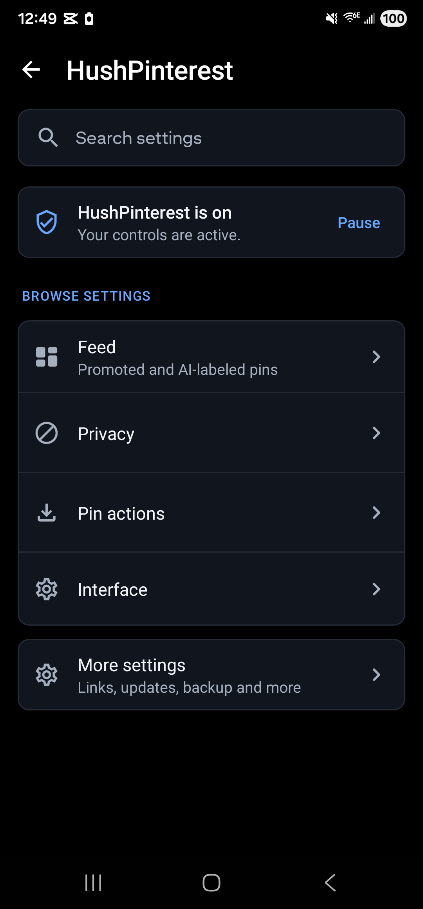
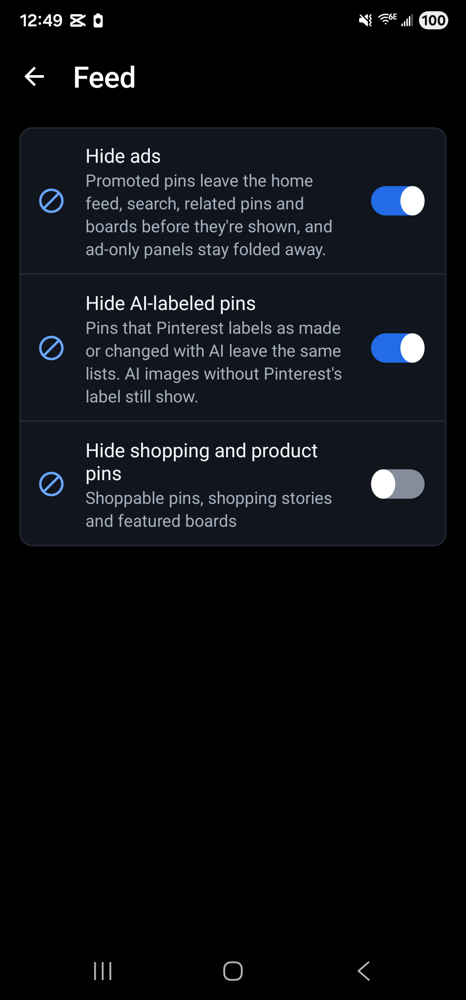
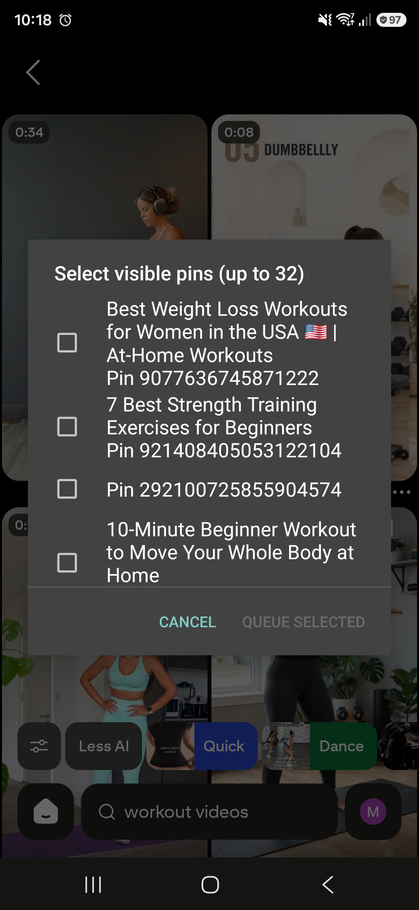

<p>
  
  <a href="LICENSE"></a>
  
  
  
</p>

<p>
  <a href="https://ko-fi.com/X8K126YVER">
    
  </a>
</p>

<p>
  <sub><em>If HushPinterest makes Pinterest better for you, a coffee helps me keep testing patches and maintaining them as Pinterest changes.</em></sub>
</p>

#  HushPinterest

HushPinterest is a set of [Morphe](https://morphe.software) patches for Pinterest on Android. It takes promoted pins out of your feed and can hide the pins Pinterest labels as AI. It also adds pin and board downloads, your own browser and share sheet, privacy switches and a long list of small interface fixes, all controlled from a settings page inside Pinterest.

Hide ads, Disable analytics, Strip link tracking, Hide advertising ID and Fix push notifications start on. Every other switch starts off, so a freshly patched Pinterest looks like stock until you turn something on. What changed in each version is in the [changelog](CHANGELOG.md).

The latest release is [v0.0.13](https://github.com/SysAdminDoc/HushPinterest/releases/tag/v0.0.13), with 33 patches. Add this repo to Morphe Manager as a patch source and it'll offer each new release when it comes out.

**[Add HushPinterest to Morphe Manager](https://morphe.software/add-source?github=SysAdminDoc%2FHushPinterest)**

> [!IMPORTANT]
> Keep your signing key. Morphe Manager signs the patched Pinterest with a key it makes on your phone, and Android only installs an update over it when the update carries that same key. Right after your first patch, open **Settings > System > Import & export > Signing key** in Manager and tap **Export**. Keep the `Morphe.keystore` file somewhere private, since anyone who has it can sign an APK your phone accepts as an update. On a new phone, import it before you patch anything.

## Install

1. Install [Morphe Manager](https://github.com/MorpheApp/morphe-manager) 2.0.0 or newer.
2. Add HushPinterest as a patch source with the link above. Or in Manager open **Sources**, tap **+**, choose **Remote** and enter `github.com/SysAdminDoc/HushPinterest`.
3. Get Pinterest 14.41.0, version code 14418010. APKMirror has it as an arm64-v8a split bundle (`.apkm`) for Android 12L or newer. Pick that file in Manager and it merges the parts for you.
4. Patch it with the default selection. It holds every switch, so you don't need Expert mode. Two patches are left out, GmsCore support and Spoof signature for Google sign-in. If you want one, turn on **Settings > Advanced > Expert mode** in Manager and pick it before you patch.

A patched Pinterest can't install over the stock app, because Android only accepts an update signed with the same key. Save anything local you need, uninstall stock Pinterest, then install the patched one. Your boards and pins come back when you sign in. Local settings and drafts don't.

### Signing in

Sign in with your email and a Pinterest password. Google's sign-in button checks the [app's signing certificate](https://developers.google.com/android/guides/client-auth), and a patched Pinterest carries your key instead of Pinterest's, so it won't work.

If you joined through Google or Facebook, or don't know your Pinterest password, tap **Forgot your password?** on Pinterest's login page, enter the email on your account and set a password from the reset link. It's separate from your Google password, and you don't need to unlink Google. [Pinterest's password help](https://help.pinterest.com/en/article/reset-your-password) has the steps.

With [microG-RE](https://github.com/ReVanced/GmsCore) on your phone, Google sign-in can go through it instead. Patch with GmsCore support (it brings Spoof signature for Google sign-in along) and add your Google account in microG-RE's settings. Leave GmsCore support out if you use Google Play services, because it moves Google sign-in and push notifications over to microG-RE.

Spoof signature for Google sign-in on its own is for the XSpoofSignatures LSPosed module. Stock Google Play services never reads what it adds.

### Opening Pinterest links

Android hands a pinterest.com or pin.it link to the Pinterest app only when the app proves it belongs to Pinterest's sites, and a re-signed app can't. To open those links in the patched app, go to its App info page, tap **Open by default**, then **Add link**, and select the Pinterest sites. The Links page in HushPinterest settings has a button that goes straight there.

## Settings

Open Pinterest's settings and tap **HushPinterest**. You can also long-press the Pinterest logo at the top of your home feed. From your home screen, long-press the Pinterest icon and tap **HushPinterest**. Pinterest's App info page has it too, under **Additional settings in the app** (Samsung calls it **Configure in Pinterest**).

Switches take effect without patching again. A screen that's already open may need reopening, and a few switches need Pinterest to restart. When you flip one of those, a **Restart** row shows up at the top of the page, and tapping it reopens Pinterest on the same settings page. **Quick setups** on the home page turns on the Quiet or Privacy switches in one tap, or puts every switch back the way it started. **Pause** puts everything back to Pinterest's own behavior without forgetting your choices. You can export your switches to a file and import them later, with a preview of every change and one Undo. The file holds settings only, never your account, media or signing key. **Setup and backup guide** under About explains all of this, and the **Pinterest's own settings** page says where Pinterest keeps the options HushPinterest leaves alone.

<p>
  
  
  
</p>

### Downloads

**Download pins** adds a Download row to a pin's menu. For an image it saves the original when Pinterest's media host has one, or the largest size when it doesn't. For a video it saves the best MP4 Pinterest supplies, and streaming-only videos can't be saved. Files go to your Download folder. Turn on **Save in Pinterest's folder** to keep them in Pictures/100PINT/Pins, or use **Pick a download folder**.

From a feed, search or board grid, **Download visible pins** in a pin's menu lets you pick up to 32 pins already on screen. **Download board** saves up to 500 pins Pinterest has loaded for a board and skips the ones already in Download history, so scroll to the end of the board first if you want all of it. Both pickers can also save the chosen pins' links with **Save list**, as a bookmarks file you can import into a browser or bookmark app, or as a JSON file. **Long-press download** adds a Download button to the round menu you get when you hold a pin in a grid.

**Download history** under Pin actions shows Android's status for each download, with Retry, Open file, Share file and, for images, Set as wallpaper. Two more switches there hold downloads to unmetered networks or keep them off while you roam.

## Patches

There are 34 patches. Where a patch has a switch, its description names the settings page that holds it.

| Patch | What it does |
|---|---|
| `AMOLED black` | Paints the bottom bar pure black in dark mode, so it matches Pinterest's black pages on OLED screens. The comments sheet and a pin's menu can go black too, each with its own switch. Light mode stays as it is. Starts off. Turn them on in HushPinterest settings > Interface. |
| `Disable analytics` | Stops Pinterest from sending usage reports, crash reports and ad-tracking data to outside companies, and turns off Google's analytics inside the app. Good if you'd rather share less. On by default. Turn it off in HushPinterest settings > Privacy. |
| `Disable update nag` | Stops Pinterest's pop-ups asking you to update from the Play Store. You can still update Pinterest yourself. Good if the reminders get annoying. Starts off. Turn it on in HushPinterest settings > Updates. |
| `Download board` | Adds Download board to a board's menu. It saves every pin Pinterest has loaded for that board, up to 500, and skips ones already in Download history, so you can keep a board without picking pins one at a time. Needs Download pins on too. Starts off. Turn it on in HushPinterest settings > Pin actions. |
| `Download pins` | Adds downloads for a pin, or for several pins you select in a grid. Saves the original image or the highest-quality video Pinterest supplies to your phone. When it saves an image, Pinterest's own Download image row is hidden. Downloads go to the Download folder. Turn on Save in Pinterest's folder to keep them in Pictures/100PINT/Pins with Pinterest's own saves, or use Pick a download folder to choose any folder inside Pictures, DCIM, Download or Documents. Starts off. Copy image puts an image pin's full-size picture on the clipboard, and Share image sends it through Android's share menu. Each has its own switch, also off. Save pins you download also saves a pin you download to your profile, and Download pins you save also downloads a pin you save. Those two start off as well. Turn them on in HushPinterest settings > Pin actions. |
| `Filter feed` | Lets you take video pins (photos and GIFs stay) and pins that mention words you mute out of your home feed, search, related pins and boards, and pins you've already saved out of your home feed. Starts off. Set it up in HushPinterest settings > Feed. |
| `Filter pin menu` | Lets you hide Add to collage, Remix collage, Search image and Promote pin in a pin's menu, each with its own switch. Download, share and copy link stay. Starts off. Turn them on in HushPinterest settings > Interface. |
| `Fix push notifications` | Lets the patched app sign up for push notifications. Google's Firebase service only signs Pinterest up when the request names Pinterest's original signature, so this sends that signature's fingerprint and changes nothing else in the request. On by default. Turn it off in HushPinterest settings > Notifications. |
| `GmsCore support` | Lets Google sign-in and push notifications go through microG-RE instead of Google Play services. Pick it only if microG-RE is on your phone. Without microG-RE, Google sign-in and push notifications stop working in the patched app. It brings Spoof signature for Google sign-in along. It isn't selected by default. Works as soon as you patch it in, with no switch. |
| `Hide AI-labeled pins` | Removes pins that Pinterest labels as made or changed with AI from your home feed, search, related pins and boards. A second switch also takes unlabeled pins whose title or description calls them AI art, or that come from an AI image site. Other AI images still show. Both start off. Turn them on in HushPinterest settings > Feed. |
| `Hide ads` | Removes promoted pins from your home feed, search, related pins and boards, and hides panels that only hold ads. Good for a cleaner feed. On by default. Turn it off in HushPinterest settings > Feed. |
| `Hide advertising ID` | Pinterest sees an empty advertising ID with ad tracking limited, the same as if you deleted your advertising ID in Android. Pinterest also stops keeping its browser ID in Google's Block Store, so a reinstall doesn't bring the old one back. Good for keeping ads from following you. On by default. Turn it off in HushPinterest settings > Privacy. |
| `Hide Assistant` | Removes Pinterest's AI Assistant from search, boards and pins, so you don't get its buttons or its suggestion row. Regular search keeps working. Starts off. Turn it on in HushPinterest settings > Interface. |
| `Hide closeup buttons` | Lets you hide the back arrow and the visual search (lens) button that float over a pin you open, each with its own switch, so they stop covering the picture. A third switch keeps the lens but drops the Search image label Pinterest puts on it for your first pins each day. Your phone's back gesture still leaves the pin, and Search image in the pin menu still works. All three start off. Turn them on in HushPinterest settings > Interface. |
| `Hide comments` | Collapses the comments and comment previews under pins. It doesn't change who can comment on your pins. Good for a quieter pin page. A separate switch hides the suggested replies next to the comment box. Both start off. Turn them on in HushPinterest settings > Interface. |
| `Hide header buttons` | Hides the small icon buttons at the end of the top bar. Back buttons, text buttons and account controls stay. Good for a cleaner top bar. Starts off. Turn it on in HushPinterest settings > Interface. |
| `Hide navigation buttons` | Lets you hide the Create, Notifications and Search buttons in the bottom bar, each with its own switch. Home and Profile stay. Starts off. Turn them on in HushPinterest settings > Interface. |
| `Hide save toasts` | Stops the pop-up Pinterest shows after you save a pin, such as the Saved to your board message or a suggestion to follow the creator. The pin is still saved. Starts off. Turn it on in HushPinterest settings > Interface. |
| `Hide search history` | Hides your recent searches on the search screen of this phone. It doesn't delete your account's search history. Starts off. Turn it on in HushPinterest settings > Interface. |
| `Hide shopping and product pins` | Hides shoppable pins, shopping stories and featured boards. Good if you want to browse ideas, not products. Starts off. Turn it on in HushPinterest settings > Feed. |
| `Hide survey prompts` | Turns down Pinterest's "Got a minute?" survey invite before it pops up, the same way tapping Maybe later does, so the same survey doesn't come back. Advertiser-sponsored polls don't pop up either. Starts off. Turn it on in HushPinterest settings > Interface. |
| `Hide topic suggestions` | Hides the Ideas you might love row of topic bubbles under pins, without leaving a gap. Comments and related pins stay. Starts off. Turn it on in HushPinterest settings > Interface. |
| `HushPinterest settings` | Adds a HushPinterest page to Pinterest where you turn features on or off, pause HushPinterest, back up your settings and read the licenses. Open it from Pinterest's settings, or by long-pressing the Pinterest logo at the top of your home feed or Pinterest's app icon. Works as soon as you patch it in, with no switch. |
| `Keep Home feed` | Keeps your Home feed where you left it when you come back to Pinterest or to the Home tab, instead of loading new pins on its own. Pull down to refresh whenever you want new pins. Starts off. Turn it on in HushPinterest settings > Feed. |
| `Long-press download` | Adds a Download button to the menu you get when you long-press a pin in a grid, the round one and the newer list, so you can save a pin without opening it. Needs Download pins on too. Three more switches take Pinterest's Save, Send or Search image button out of that menu. All start off. Turn them on in HushPinterest settings > Pin actions. |
| `No screenshot share menu` | Stops Pinterest from popping up sharing suggestions after you take a screenshot. Screenshots still work as usual. Starts off. Turn it on in HushPinterest settings > Interface. |
| `Open links in your browser` | Opens a pin's Visit link and profile websites in your web browser. Pinterest links and sign-in work as before. Good if you prefer your own browser. Starts off. Turn it on in HushPinterest settings > Links. |
| `Original-quality images` | Loads the original image for each pin and in collages, instead of the large size. Pictures look sharper but use more data. Starts off. Turn it on in HushPinterest settings > Interface. |
| `Quiet email reminders` | Dismisses the optional reminder to confirm your email. Account checks and sign-in still work as usual. Starts off. Turn it on in HushPinterest settings > Interface. |
| `Remove ad tracking permissions` | Removes Google's advertising ID permission and Android's Privacy Sandbox ad services from Pinterest, so it can't use them. Google Play services then answers with zeros. Works as soon as you patch it in, with no switch. |
| `Show posted date` | Shows the day a pin was posted under its title when you open it. Pinterest sends that date with every pin but never shows it. Starts off. Turn it on in HushPinterest settings > Interface. |
| `Spoof signature for Google sign-in` | Helps Google sign-in work in the patched app by naming Pinterest's original signature. It only helps with microG-RE or the XSpoofSignatures module. Email sign-in doesn't need it. It isn't selected by default. Works as soon as you patch it in, with no switch. |
| `Strip link tracking` | Removes tracking tags from links you copy or share from Pinterest. The link still goes to the same place. Its Plain pin links switch also turns short pin.it links into the pin's own pinterest.com link, so they don't show who shared them. Strip link tracking is on by default and Plain pin links starts off. Both are in HushPinterest settings > Privacy. |
| `System share sheet` | Uses Android's own share menu when you share a pin link. Screenshot and download actions work as before. Good if you want your usual share targets. Starts off. Turn it on in HushPinterest settings > Pin actions. |

Every patch but GmsCore support and Spoof signature for Google sign-in is in Manager's default selection, and the feature patches need the settings patch. Remove ad tracking permissions has no switch, so its manifest change stays until you patch again without it. The [patch reference](docs/pinterest-14.39.0-patch-reference.md) goes deeper into what each one touches.

## Help

- **Can't find the settings.** Open Pinterest's settings and tap **HushPinterest**, or long-press the Pinterest logo at the top of your home feed or the app icon. If the entries are missing, refresh the source in Manager and patch again.
- **A switch does nothing.** Check that **Pause** is off, then reopen the screen you're looking at. Pin menu changes show on the next menu you open.
- **Android won't install the patched app.** Where you're installing it tells you which case it is.
  - Over stock Pinterest it fails, since a patched copy can't replace the stock app. Uninstall stock Pinterest first.
  - Over your own patched copy, it fails when the new build was signed with a different key, usually after reinstalling Manager or moving to a new phone. Restore your old key under **Settings > System > Import & export > Signing key** in Manager and patch again, or uninstall the patched copy first (its settings go with it). Back that key up once and every later update installs over the top.
  - If Android says it isn't allowed to install unknown apps from this source, it's asking once for whichever app opened the APK. Tap **Settings** on that prompt and allow Morphe Manager, or the file manager you used.
  - For any other message, open an issue with the exact wording plus your phone model and Android version.
- **Manager rejects the APK, or a patch fails.** Use Pinterest 14.41.0, version code 14418010, unmodified. Each patch finds its code by what it does in that build, and Pinterest renames almost everything between releases, so a patch that can't find its spot stops instead of patching the wrong place.
- **Google sign-in fails.** Use your email and a Pinterest password. See [Signing in](#signing-in).

### Reporting a problem

Open an [issue](https://github.com/SysAdminDoc/HushPinterest/issues) and say what you did and what you saw. **Report a problem** at the bottom of the settings home opens the form with your versions, phone and switches already filled in. A diagnostic report helps a lot. In HushPinterest settings tap **Export diagnostic report**, then **Copy quick report** or **Save full report**, which goes to the shared `Download/Morphe` folder. It carries Pinterest's version, your Android version and what each patch did. HushPinterest takes out the account, pin and board IDs it recognizes, but give it a read before you share it. Nothing is sent anywhere unless you paste or attach it yourself.

## Privacy

HushPinterest doesn't collect anything and has no server. Its own code only reaches these hosts:

- `api.github.com`, for the release check. It's off until you turn it on under Updates. Then it asks for the newest release at most once a day when Pinterest starts, and whenever you tap **Check now**.
- `pinimg.com`, Pinterest's media host, when you download a pin. Looking for an original image adds up to four HEAD requests to that host, and **Check the file** in Media details reads the first 64 KB of a file, only when you tap it.
- `pin.it` and `api.pinterest.com`, only with **Plain pin links** on, to find out which pin a copied short link points to. It reads where they redirect and nothing else.

Shared pin links use `www.pinterest.com`. The About, Licenses and setup guide screens link to `github.com`, `gitlab.com`, `www.gnu.org`, `help.pinterest.com` and `ko-fi.com`, which open in your browser only when you tap one. **Report a problem** opens a new issue form on `github.com` with your versions, phone model and the switches you have on filled in, and nothing is sent until you submit it there. Browser discovery asks Android which apps handle `example.com` without ever loading it.

Disable analytics stops Pinterest's usage uploads, the AppsFlyer and Bugsnag transports and Google's Engage publishing, and turns off Firebase Analytics, Crashlytics and Performance collection in the manifest. Hide advertising ID gives Pinterest an empty ad ID with tracking limited. It doesn't touch the ad ID other apps see. Fix push notifications only swaps the certificate fingerprint in Firebase's own sign-up request and opens no connection itself.

## Supported Pinterest build

| Field | Value |
| --- | --- |
| Package | `com.pinterest` |
| Version | Pinterest 14.41.0 |
| Version code | `14418010` |
| APK | APKMirror's arm64-v8a split bundle (`.apkm`), which Manager merges |
| Minimum Android version | Android 12L |

Each release patches its own build only, so an older Pinterest is refused. SHA-256 of the stock bundle the patches were checked against:

```text
14418010  2be1fe9b90434628ff5ec4e435e5dfcf2f30d1c74a90c7e24becbc7eee3b0ba5
```

On Windows, compare yours with `Get-FileHash -Algorithm SHA256 .\pinterest.apkm`. Other Pinterest versions aren't supported.

The next release moves to Pinterest 14.42.0, version code 14428010, and it'll take at least version 2.3.0 of Morphe Manager. APKMirror has that one as a plain APK for Android 10 or newer. Stick with 14.41.0 until the release is out.

```text
14428010  f55fd078a6ecf5a2a88dd0056096b1999370c6f143f278c80caaead0c072585e
```

## Verify a release download

Every release's `SHA256SUMS.txt` is signed with the HushPinterest release key. Its fingerprint is `FCE5 ECE3 182A 647B 3AF2  C5ED 2DC3 5E8D 5C00 E8A6`, and the public key is [keys/hushpinterest-release.asc](keys/hushpinterest-release.asc) in this repository and on [keys.openpgp.org](https://keys.openpgp.org/search?q=FCE5ECE3182A647B3AF2C5ED2DC35E8D5C00E8A6). Compare the fingerprint from both places before you trust it. A key downloaded beside the bundle doesn't prove anything on its own.

Download `SHA256SUMS.txt` and `SHA256SUMS.txt.asc` from the same release and, with GnuPG installed, run:

```text
gpg --import hushpinterest-release.asc
gpg --verify SHA256SUMS.txt.asc SHA256SUMS.txt
```

Then compare your bundle's SHA-256 with its line in `SHA256SUMS.txt`. Or let the repo's script do both in a fresh keyring:

```powershell
& ./scripts/verify-release-checksums.ps1 `
    -AssetDirectory ./download `
    -ChecksumsPath ./download/SHA256SUMS.txt `
    -SignaturePath ./download/SHA256SUMS.txt.asc `
    -TrustedPublicKeyPath ./trusted/release-public-key.asc `
    -TrustedFingerprint '<complete independently verified fingerprint>'
```

Morphe Manager and Morphe Desktop don't check this signature, so checking it is up to you. If the key ever changes, verify the new fingerprint through both places before you trust it. A download that fails the check is a reason to stop, not to swap keys.

## Building from source

You need JDK 21 and the Android SDK. The Morphe patcher comes from GitHub Packages, so you also need a GitHub token with `read:packages`.

```bash
export GITHUB_ACTOR=<your GitHub user>
export GITHUB_TOKEN=<a token with read:packages>
./gradlew :patches:generatePatchesList
./gradlew :patches:buildAndroid
```

The bundle lands in `patches/build/release/patches-<version>.mpp`, beside its SHA-256 and a CycloneDX SBOM. Run `generatePatchesList` before `buildAndroid`, or the bundle loses its Android payload. `./gradlew :patches:test :extensions:pinterest:test` runs the quick tests. The ones that open real Pinterest APKs are `./gradlew :patches:fixtureTest`, and they need `HUSHPINTEREST_FIXTURE_DIR` set to a folder holding every APK named in `AppCompatibilities.kt`.

Where things live:

- `patches/src/main/kotlin/app/morphe/patches/pinterest/` holds the patches, grouped as ads, actions, privacy, ui, notifications and misc. `patches/src/main/kotlin/app/morphe/patches/shared/compat/AppCompatibilities.kt` names the supported build.
- `extensions/pinterest/` is the Java code that runs inside Pinterest: the settings screen, downloads and the helpers behind each switch. `extensions/shared/library/` has the shared settings code, and its `src/main/l10n/` folder holds one `.tsv` file per translation.
- `patches-list.json` is the generated patch catalog, and this README's patch table has to match it. `patches-bundle.json` is the index Morphe Manager reads, and it only changes at release time.
- `docs/` has the maintainer notes on Pinterest 14.39.0, starting from the [app map](docs/pinterest-14.39.0-factory-map.md) and the [factory app audit](docs/pinterest-14.39.0-audit.md).
- `scripts/` has the push checks, the device helpers and the release scripts in `scripts/release/`.

## Where the patches come from

| Source | What came from it |
|---|---|
| [SysAdminDoc/HushTelegram](https://github.com/SysAdminDoc/HushTelegram) at `8c54a1d` | The Gradle build, the shared extension library with its settings screen, diagnostics, pause and backup, the bytecode helpers, and the checks that apply every patch to a real APK before a release. Most of that came to HushTelegram from [HushThreads](https://github.com/SysAdminDoc/HushThreads) and [Hushfacebook](https://github.com/SysAdminDoc/Hushfacebook). |
| [Morphe](https://github.com/MorpheApp) and [ReVanced](https://gitlab.com/ReVanced/revanced-patches) | The patcher and the patch template. Everything above grew from their code. |

The Pinterest patches were written for this project by reading Pinterest itself. Every source file says where it came from in its header, and [provenance.json](provenance.json) maps each file to the project and commit it came from, with its license. The [source ledger](sources/pinterest-sources.json) records the other Pinterest projects reviewed for research. None of their Pinterest code has been adopted.

## License

[GPL-3.0](LICENSE), with the Morphe section 7 notices carried in [NOTICE](NOTICE). Pinterest is a trademark of Pinterest, Inc. HushPinterest isn't made by or connected with Pinterest.
