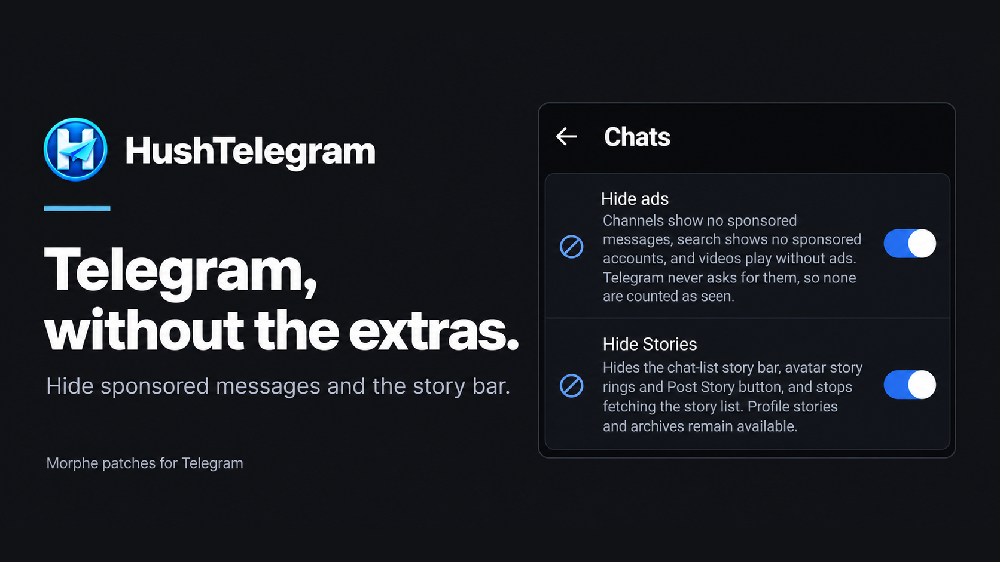
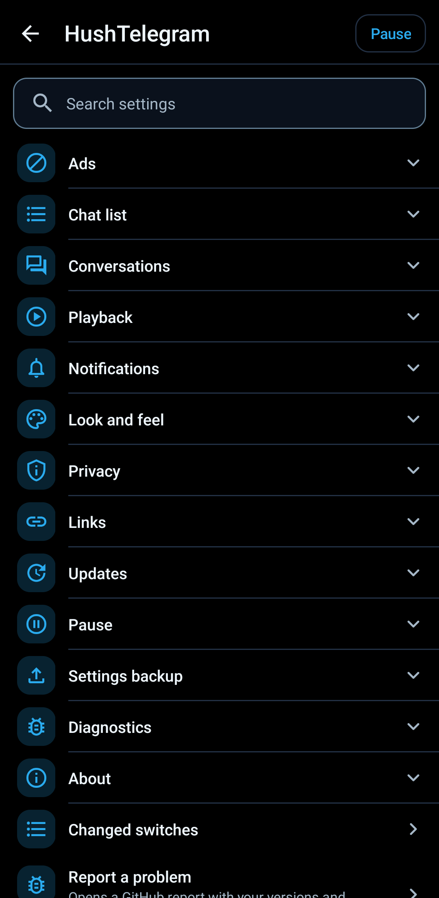
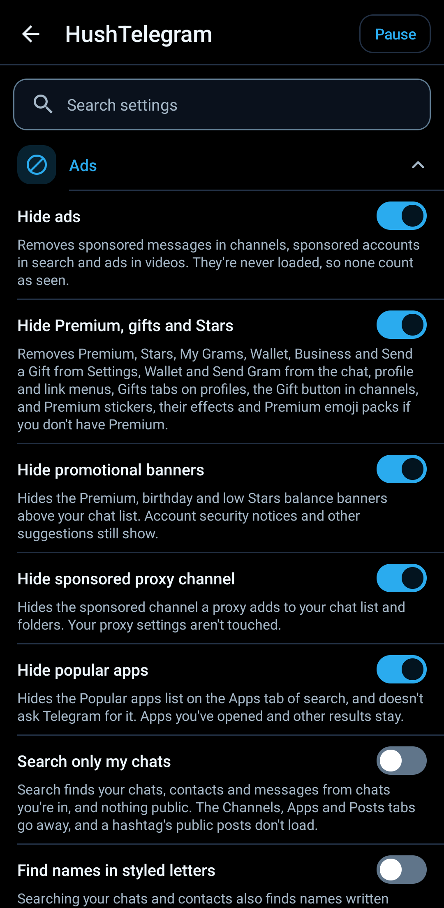

<p align="center">
  
  <a href="LICENSE"></a>
  
  
  
</p>

<p align="center">
  <a href="https://ko-fi.com/X8K126YVER">
    
  </a>
</p>

<p align="center">
  <sub><em>If HushTelegram makes Telegram better for you, a coffee helps me keep testing patches and maintaining them as Telegram changes.</em></sub>
</p>

#  HushTelegram

HushTelegram is a set of [Morphe](https://morphe.software) patches for Telegram on Android. It takes the sponsored messages and search ads out of Telegram and keeps the app's usage reports on your phone. Everything else is a switch in its own settings screen, so you can hide Stories and the Premium upsells, keep messages other people delete, translate a whole chat, get notifications through UnifiedPush, go AMOLED black and plenty more. It doesn't give away paid Premium features. A second switch under Save downloaded files, off until you turn it on, also saves downloaded files and songs from chats that don't allow saving. Two more, also off to start, keep view-once and self-destructing media after you open it and save a copy of it. Secret chats always follow Telegram's rules.

The latest release is [v0.0.23](https://github.com/SysAdminDoc/HushTelegram/releases/tag/v0.0.23), with 67 patches for Telegram 13.1.1 from Google Play and Telegram 13.1.0 from telegram.org. It needs Morphe Manager 2.3.0 or newer. The version badge follows the source on main, which can be ahead of the release. What changed in each version is in the [changelog](CHANGELOG.md).

**[Add HushTelegram to Morphe Manager](https://morphe.software/add-source?github=SysAdminDoc%2FHushTelegram)** | [Download a release](https://github.com/SysAdminDoc/HushTelegram/releases/latest) | [Browse the patches](#patches)

> [!IMPORTANT]
> Back up your signing key right after your first patch. Android only installs an update over your patched Telegram when it carries the same key, and with that key your chats and settings survive every update. In Morphe Manager open **Settings > System > Import & export > Signing key** and tap **Export**. Keep `Morphe.keystore` private, since anyone who has it can sign an APK your phone will accept. On a new phone, import it before you patch anything.

## Install

1. Install [Morphe Manager](https://github.com/MorpheApp/morphe-manager) 2.3.0 or newer.
2. Open the [add-source link](https://morphe.software/add-source?github=SysAdminDoc%2FHushTelegram) on your phone to add HushTelegram as a patch source.
3. Get Telegram 13.1.1 from [Google Play](https://play.google.com/store/apps/details?id=org.telegram.messenger) (version code 72371), or Telegram 13.1.0 from telegram.org (version code 72299) from its [Download button](https://telegram.org/android) or a mirror such as [APKMirror](https://www.apkmirror.com/apk/telegram-fz-llc/telegram/). telegram.org hands out whatever is newest, so check the [checksum](#supported-telegram-builds) before you patch.
4. Pick the file in Morphe Manager, keep the default selection and patch. It has every patch that comes with a switch.
5. Four patches start unselected: Use registered Telegram API credentials, Use registered Maps API key, HushTelegram icon and name, and Black and white launch logo. To add one, turn on **Settings > Advanced > Expert mode** in Morphe Manager and fill in its options before you patch.

When you sign in, Telegram often turns down the API ID that ships with a patched build, so no code arrives and you see `API_ID_PUBLISHED_FLOOD`. It happens on other patched Telegram builds too. The one-time fix is in [Your Telegram account](#your-telegram-account): register a free app at my.telegram.org, then patch with Use registered Telegram API credentials so the app signs in as your own.

**Coming from stock Telegram?** The keys differ, so you'll have to uninstall stock Telegram before the patched copy goes on. That deletes this phone's secret chats for good, though cloud chats come back when you sign in. Stay signed in on another device until the patched app is in, because that's usually where the login code shows up.

## Settings

Open Telegram's Settings and tap **HushTelegram settings**, or press and hold the **Telegram** title at the top of your chat list. Telegram's chat list has no logo to press, so its title stands in. If neither works, long-press Telegram's icon and tap **HushTelegram**, or open Telegram's App info page and tap **Additional settings in the app** (Samsung calls it **Configure in Telegram**).

The home page is search plus one short list of sections. Tap a section to open its switches right there, and tap it again to fold it away. The first seven are grouped the way Morphe Manager groups them, and Links, Updates, Pause, Settings backup, Diagnostics and About come after. The **Pause** button at the top turns HushTelegram's changes off from the next start and keeps your choices for when you resume. In the Pause section, **Lock HushTelegram settings** makes every setting read-only until you start an unlock and wait 24 hours. **Quick setups** in Settings backup turns on the Quiet or Privacy switches in one tap, or puts every switch back the way it started. **Changed switches** lists only what you've changed, and **Report a problem** opens a GitHub bug report with your versions and switches already filled in.

<p></p>

## Patches

The current release has 67 patches. Each description is the one Morphe Manager shows, and it says which page of HushTelegram settings holds the switch and whether it starts on or off. The table runs in the order of those pages.

Two descriptions are behind the app. Since 0.0.20, `Save downloaded files` has a second switch under it, **Also save from chats that don't allow saving**, which starts off. With both on, files and songs from those chats get a copy too, and so does each photo and video you open or auto-download there, so only use it where the owner is fine with that. Secret chats always stay in Telegram, and so does self-destructing media unless **Also save view-once and timed media** is on as well. In ordinary chats, photos and videos still go through Save to Gallery. Below them, the **Gallery folder** row picks where Save to Gallery puts photos and videos on Android 10 and newer. Telegram's Pictures/Telegram and Movies/Telegram are the default, and you can switch to DCIM/Telegram or to DCIM/Telegram/Photos and DCIM/Telegram/Videos.

`Translate with an outside service` also has a **Translate into** row under Translation service. Telegram's language is the default. Tap it to pick any of the 250 or so languages Google's web translate knows, Persian and others Telegram's own list leaves out included. There's a search at the top, and Translate here and Translate this chat both write in the language you pick.

| Patch | What it does |
|---|---|
| `Hide ads` | Removes sponsored messages in channels, sponsored accounts in search and ads in Telegram's video player, so you see fewer ads. On by default. Turn it off in HushTelegram settings > Ads. |
| `Hide Premium, gifts and Stars` | Removes Premium, Stars, My Grams, Wallet, Business and Send a Gift from Settings, Wallet and Send Gram from the chat, profile and link menus, Gifts tabs on profiles, the Gift button in channels, and Premium stickers, their effects and Premium emoji packs for an account without Premium, for a less cluttered app. On by default. Turn it off in HushTelegram settings > Ads. |
| `Hide promotional banners` | Hides Premium, birthday and low Stars balance banners above your chat list. Account security notices still show. On by default. Turn it off in HushTelegram settings > Ads. |
| `Hide sponsored proxy channel` | Hides the sponsored channel a proxy adds to your chat list and folders. Your proxy settings aren't touched. On by default. Turn it off in HushTelegram settings > Ads. |
| `Hide popular apps` | Hides the Popular apps list on the Apps tab of search and stops Telegram from loading it. On by default. Turn it off in HushTelegram settings > Ads. Two more switches there start off. Search only my chats keeps search to your own chats and contacts, with nothing public. Find names in styled letters finds names written in decorative letters when you type plain ones. |
| `Hide Stories` | Removes the story bar above your chats, the rings around profile pictures and the Post Story button. Profile stories and archives stay. On by default. Turn it off in HushTelegram settings > Chat list. |
| `Hide contacts on Telegram` | Hides the Your contacts on Telegram list that shows under a short chat list. Chats, folders and search stay. Starts off. Turn it on in HushTelegram settings > Chat list. |
| `Disable chat swipe actions` | Stops a sideways swipe on a chat from archiving, muting, pinning, deleting or marking it read, so a slip can't change a chat. Press and hold still has every action. Starts off. Turn it on in HushTelegram settings > Chat list. |
| `Hide folder tab counters` | Hides the unread count on each folder tab above the chat list, for a calmer look. A second switch, Open a folder at launch, opens the chat list on a folder you pick instead of All Chats. Both start off. Turn them on in HushTelegram settings > Chat list. |
| `Folders by chat type` | Makes Private, Groups, Channels and Bots folders in one tap. They're Telegram's own folders, so they show as tabs above the chat list and on your other devices too. Turning it off removes the ones it made, unless you renamed or changed them. Starts off. Turn it on in HushTelegram settings > Chat list. |
| `Disable pull to archive` | Stops pulling down the chat list from opening the hidden archive. Open it from Archived chats in the chat list's menu instead. Starts off. Turn it on in HushTelegram settings > Chat list, then restart Telegram. |
| `Hide Contacts tab` | Removes the Contacts tab from the bar at the bottom of the main screen, and swiping doesn't open its page either. The Calls or Settings tab stays as Telegram has it, and the chat list's new message button still opens your contacts. A second switch, Compact bottom bar, makes that bar shorter and only as wide as its tabs need. A third, Side menu, brings back a menu that slides in when you swipe right on the chat list. All three start off. Turn them on in HushTelegram settings > Chat list. |
| `Hide greeting stickers` | Hides the sticker that an empty private chat offers to send as a greeting. Starts off. Turn it on in HushTelegram settings > Conversations. |
| `Disable pull to next channel` | Stops pulling up at the bottom of a channel from jumping to the next channel. A second switch does the same for forum topics. The channel switch starts on and the topic switch starts off. Find them in HushTelegram settings > Conversations. |
| `Use normal paste` | Pastes text exactly as you copied it, without Telegram adding formatting, tables or code styling. Starts off. Turn it on in HushTelegram settings > Conversations. |
| `Disable double-tap reactions` | Stops a double tap on a message from adding a reaction, handy if you keep reacting by accident. Starts off. Turn it on in HushTelegram settings > Conversations. |
| `Hide translate bar` | Hides the translate bar at the top of chats in another language. Translate moves to the chat's menu. Starts off. Turn it on in HushTelegram settings > Conversations. |
| `Reveal spoilers` | Shows spoiler text, photos and videos without the cover, so you don't have to tap. View-once media, sensitive content and login codes stay covered. Starts off. Turn it on in HushTelegram settings > Conversations. |
| `Hide sender names when forwarding` | Turns on Telegram's Hide sender's name option each time you forward, so copies arrive without the original author. You can turn it off before sending. Starts off. Turn it on in HushTelegram settings > Conversations. |
| `Start the camera on the rear lens` | Opens the attachment menu's camera on the rear lens every time, not the lens you used last. Starts off. Turn it on in HushTelegram settings > Conversations. |
| `Hide gallery camera tile` | Removes the live camera tile from the attachment menu's photo grid, so the grid starts with your photos. Starts off. Turn it on in HushTelegram settings > Conversations. |
| `Hide blocked users in groups` | Leaves messages from people you've blocked out of groups and supergroups you open, and keeps them from notifying you. Nothing is deleted. Starts off. Turn it on in HushTelegram settings > Conversations. |
| `Add Repeat to the message menu` | Adds Repeat, Copy photo, Message details and Quick forward to a message's press-and-hold menu, for resending, copying and forwarding faster. All four start off. Turn them on in HushTelegram settings > Conversations. |
| `Keep deleted messages` | Keeps a message on your phone when someone else deletes it, and marks it deleted next to the time. Your own deletes still work normally. Starts off. Turn it on in HushTelegram settings > Conversations. |
| `Ask before sending a sticker` | Asks you to confirm before a sticker, GIF, voice or video message, or call goes out, so a stray tap doesn't send it. All four start off. Turn them on in HushTelegram settings > Conversations. |
| `Translate with an outside service` | Adds Translate here to a message's menu and Translate this chat to a chat's menu. Text you turn on goes to Google's web translate, or to an AI service with your own key if you set one, one message at a time, and nothing is sent before that. With an AI service, a How to translate box lets you say how you want it done. Telegram's own translation and its Premium checks stay as they are. Starts off. Turn it on in HushTelegram settings > Conversations. |
| `Hide messages by keyword` | Leaves messages that match your own words or regular expressions out of the groups and channels you open, with one list for groups and one for channels. Private chats and your own messages stay. Nothing is deleted, and the filters stay on the phone. Starts off. Turn it on in HushTelegram settings > Conversations. |
| `Keep videos muted on volume keys` | Makes the volume keys only change the volume in a chat, instead of playing the video on screen with sound. Starts off. Turn it on in HushTelegram settings > Playback. |
| `Play voice messages one at a time` | Stops the next voice or video message from playing by itself when one ends. A second switch, Keep voice messages quiet while locked, stops voice and round video messages from starting while your phone is locked. Both start off. Turn them on in HushTelegram settings > Playback. |
| `Voice messages in the music player` | Makes tapping the bar above a chat, while a voice message plays, open Telegram's full music player with a seek bar. Starts off. Turn it on in HushTelegram settings > Playback. |
| `Faster downloads` | Downloads files in 512 KB pieces, 8 at a time, the way Telegram already does for accounts its servers pick, instead of 128 KB pieces 4 at a time. If a big piece fails, Telegram still drops back to small ones. A second switch, Hold automatic downloads on Data Saver, keeps Telegram from downloading media on its own while Android's Data Saver is on and the network is metered. Both start off. Turn them on in HushTelegram settings > Playback. |
| `Save downloaded files` | Copies each file and song you download to Download/Telegram on your phone, where file managers and other apps can open it, the way Save to Downloads does one at a time. Files from secret chats and from chats that don't allow saving stay in Telegram. Starts off. Turn it on in HushTelegram settings > Playback. |
| `Repair Firebase push registration` | Tries to help a patched Telegram sign up for push notifications, by giving Google's Firebase service Telegram's original certificate. If Telegram's server still turns the sign-up down, as it does with your own API ID, it turns on Telegram's own Keep-Alive Service and Background Connection instead, unless you've set either one yourself. On by default. Turn it off in HushTelegram settings > Notifications. |
| `UnifiedPush notifications` | Lets Telegram get its notifications through a UnifiedPush app like ntfy, for phones where Firebase notifications don't arrive. Telegram's servers wake it through the app, and the messages still come from Telegram. It also turns on Telegram's own Keep-Alive Service and Background Connection, unless you've set either one yourself, so messages keep coming while Telegram is closed. Starts off. Turn it on in HushTelegram settings > Notifications. |
| `Silence people outside your contacts` | Shows notifications from people who aren't in your contacts without sound or vibration. Bots, reminders and login codes keep their sound. Starts off. Turn it on in HushTelegram settings > Notifications. |
| `Ignore mentions in muted chats` | Stops mentions and replies in groups or channels you've muted from notifying you. Chats you haven't muted notify as before. Starts off. Turn it on in HushTelegram settings > Notifications. |
| `Hide recommendations` | Hides suggested similar channels and bots, and stops Telegram from loading new suggestions. On by default. Turn it off in HushTelegram settings > Look and feel. |
| `Show user and chat IDs` | Adds a copyable ID number for a user or chat to the profile menu. A second switch also shows where the profile photo is stored. Both start off. Turn them on in HushTelegram settings > Look and feel. |
| `Quiet contacts nag` | Once you've said no, stops the Contacts tab from asking for contacts access again and clears its warning badge. On by default. Turn it off in HushTelegram settings > Look and feel. |
| `Holiday look all year` | Shows Telegram's Santa hat and New Year snow all year, not just around New Year. Starts off. Turn it on in HushTelegram settings > Look and feel. The same page has Emoji next to the chat list title, which puts an emoji or a few letters of your choice after Telegram's name, on this phone only. |
| `Use system font` | Draws Telegram's bold, italic and code text in your phone's font instead of the one built into the app. Starts off. Turn it on in HushTelegram settings > Look and feel, then restart Telegram. |
| `AMOLED black` | Gives Telegram's Night and Dark themes pure black screens for a darker look. Message bubbles and menus keep their colors. On Android 13 and up the launch screen turns black too while your phone is in dark mode. Starts off. Turn it on in HushTelegram settings > Look and feel, then restart Telegram. |
| `Exact numbers` | Shows member, subscriber, view, reply and reaction counts in full, like 12,345 instead of 12.3K. Starts off. Turn it on in HushTelegram settings > Look and feel. |
| `Hide keyboard on scroll` | Closes the on-screen keyboard when you start scrolling a chat, so you can read more. Starts off. Turn it on in HushTelegram settings > Look and feel. |
| `Swipe back on profiles` | Makes a swipe right on a profile's photos or media tabs go back, like the rest of the profile. Starts off. Turn it on in HushTelegram settings > Look and feel. |
| `Message times with seconds` | Shows seconds in each message's time, like 9:41:27 PM, so messages sent close together are easy to tell apart. Starts off. Turn it on in HushTelegram settings > Look and feel. |
| `Allow chat blur on slower phones` | Lets slower phones show the blurred chat header and panels that Telegram keeps for fast phones. Starts off. Turn it on in HushTelegram settings > Look and feel. |
| `Turn off haptic feedback` | Stops Telegram from vibrating for taps, long presses, swipes and wrong entries. Calls and notifications still vibrate. Starts off. Turn it on in HushTelegram settings > Look and feel. |
| `Turn off reaction effects` | Stops the emoji burst and fly-in when someone reacts. The reaction still shows on the message. Starts off. Turn it on in HushTelegram settings > Look and feel. |
| `Hide time on stickers` | Removes the time and read checks from stickers and big animated emoji in chats. Starts off. Turn it on in HushTelegram settings > Look and feel. |
| `Change sticker size` | Shows stickers in chats smaller or larger than Telegram does, at a size you pick. Animated emoji and dice keep their size. Starts off. Turn it on in HushTelegram settings > Look and feel. |
| `Hide Telegram Features and Invite Friends` | Removes the Telegram Features row from Settings and the Invite Friends rows from Contacts. Starts off. Turn it on in HushTelegram settings > Look and feel. |
| `Hide channel bar buttons` | Removes the Search, Direct messages and Info buttons from the bar at the bottom of a channel. Mute and Join stay. Starts off. Turn it on in HushTelegram settings > Look and feel. |
| `Hide Send as button` | Hides your picture next to the message box in groups and channels where you could post as a channel, while you're posting as yourself. Starts off. Turn it on in HushTelegram settings > Look and feel. |
| `Disable analytics` | Stops Telegram from reporting how you use the app, like how long you read channel posts and what you tap on Premium screens, and keeps the camera from reporting your phone's maker and model. Messages, calls and notifications work as before. On by default. Turn it off in HushTelegram settings > Privacy. |
| `Disable call debug upload` | Stops your phone from sending call problem reports and log files to Telegram when its server asks for them. On by default. Turn it off in HushTelegram settings > Privacy. |
| `Disable draft link previews` | Keeps Telegram from looking up a link's preview before you send the message. Sent messages still get a preview. The same page has Keep drafts on this phone, so unsent drafts stop syncing to your other devices, and Keep searches on this phone, so what you type in the main search isn't sent to Telegram. Each starts off. Turn them on in HushTelegram settings > Privacy. |
| `Gallery camera on tap` | Keeps the attachment gallery from starting the camera or asking for camera access when it opens. The camera starts when you tap its tile. Starts off. Turn it on in HushTelegram settings > Privacy. |
| `Hide phone number` | Covers your own phone number with dots in Settings and your profile, which helps when you share your screen. A second switch, Don't share my number by default, leaves the share-my-number box clear when you add someone as a contact from their chat. Both start off. Turn them on in HushTelegram settings > Privacy. |
| `Disable update checks` | Stops Telegram from offering its own updates from telegram.org, which can't install over a patched app. Patch each new version in Morphe Manager instead. On by default. Turn it off in HushTelegram settings > More settings > Updates. |
| `Open links externally` | Opens ordinary web links in your browser instead of inside Telegram. Telegram links, sign-in and payment pages work as before. On by default. Turn it off in HushTelegram settings > More settings > Links. A second switch there, Keep your location from Mini Apps, starts off. With it on, Mini Apps and web pages opened in Telegram are told your location isn't available. |
| `Strip link tracking` | Removes tracking tags like utm_source, gclid and fbclid from links you open or share. Links with any other extra part stay unchanged. A second switch, No automatic sign-in on Telegram's sites, opens links to Telegram's own websites without the sign-in token Telegram adds for your account. Both start off. Turn them on in HushTelegram settings > More settings > Links. |

### Patches without a switch

These are set when you patch, so Pause can't turn them off. Only the first is in the default selection.

| Patch | What it does |
|---|---|
| `HushTelegram settings` | Adds a HushTelegram row to Telegram's Settings, where you turn features on or off, pause HushTelegram, save your choices and export a report. You can also press and hold Telegram's app icon. Works as soon as you patch it in, with no switch. |
| `Use registered Telegram API credentials` | Signs in to Telegram with the API ID and hash you registered at my.telegram.org. Fill in both options, or leave both empty to keep the originals. It has no switch and isn't selected by default. Use Expert mode in Morphe Manager. |
| `Use registered Maps API key` | Lets maps in your patched Telegram use a Google Maps key you registered. Leave the option empty to keep Telegram's key. It has no switch and isn't selected by default. Turn on Expert mode in Morphe Manager to pick it and enter your key. |
| `HushTelegram icon and name` | Gives your patched Telegram HushTelegram's own home screen icon, with a themed version on Android 13 and up, and can change the name under it. An alternate icon picked in Telegram's settings keeps its own look. It isn't selected by default. Turn on Expert mode in Morphe Manager to pick it and name the app. Only patching again without it puts Telegram's icon back. |
| `Black and white launch logo` | With AMOLED black on and your phone in dark mode, the launch screen shows Telegram's logo in white on black instead of the blue one. It follows the switch on Android 13 and up. When Android reopens a Telegram it closed in the background, it shows the black screen in dark mode even with the switch off, since nothing can run that early. It isn't selected by default, since it has Morphe rebuild Telegram's resources. Turn on Expert mode in Morphe Manager to pick it. |

The Maps key is for the location picker. Make one in a Google Cloud project with the Maps SDK for Android turned on and restrict it to your package and your signing key's SHA-1. [Google's guide](https://developers.google.com/maps/documentation/android-sdk/get-api-key) has the steps.

## Help

- **Can't find the settings.** Press and hold the Telegram title above your chats, long-press Telegram's icon or use App info. If neither shows HushTelegram, patch again with the default selection.
- **A switch does nothing.** Check that HushTelegram isn't paused. Some switches need a restart, and their descriptions say so.
- **Morphe Manager warns about your APK.** It isn't one of the [supported builds](#supported-telegram-builds).
- **An update won't install.** It has to carry your installed copy's key. Import your `Morphe.keystore` into Morphe Manager and patch again.
- **No login code, or `API_ID_PUBLISHED_FLOOD`.** See [Your Telegram account](#your-telegram-account).
- **No notifications.** Google's Firebase can refuse a re-signed app (`API_KEY_ANDROID_APP_BLOCKED`), which Repair Firebase push registration works around. If pushes still don't come, install a UnifiedPush app like [ntfy](https://ntfy.sh) and turn on UnifiedPush notifications. Telegram's servers then wake Telegram through that app and Telegram fetches the message itself. Turning it on also turns on Telegram's own connection, described next, unless you've set it yourself. A self-hosted ntfy server needs an https address, because Telegram's servers won't call plain http. Telegram's own fallback is **Keep-Alive Service** and **Background Connection** under **Settings > Notifications and Sounds**, at some cost in battery. Unrestricted battery use for Telegram helps either way.

Delivery also needs Telegram's servers to hold push credentials for the app, which [Telegram documents separately](https://core.telegram.org/api/push-updates), and a new API ID doesn't set that up by itself. The Notifications page shows what this phone knows (permission, saved push token, confirmed accounts), but that can't prove a notification will arrive.

## Your Telegram account

If sign-in fails with `API_ID_PUBLISHED_FLOOD`, Telegram has refused the API ID that ships with the app. Telegram's screen doesn't say so, which is why HushTelegram shows a message there linking to this section. Register your own app, then patch with Use registered Telegram API credentials and fill in `apiId` and `apiHash`. On the Morphe command line, quote the ID as `-O "apiId='12345'"`, since a bare number never reaches the option. The result installs over your current HushTelegram build, and from its first start Telegram sees your app instead of the bundled one. Your own API ID only gets you past that refusal. Telegram still picks which login methods you get (a code in Telegram, SMS, email and so on), so keep any copy that's already signed in. Passkeys only work in Telegram's own signed app, so they can't work in a patched copy signed with your key. From the next release, HushTelegram hides passkey setup and the passkey step at sign-in on such a copy.

Filling in the form at [my.telegram.org/apps](https://my.telegram.org/apps):

1. Sign in with your phone number. The code arrives as a message in Telegram, not by SMS.
2. **App title:** plain words, for example `My HushTelegram`.
3. **Short name:** 5 to 32 letters and numbers only, for example `myhushtg1`. Spaces, underscores and other symbols usually cause "Incorrect app name!".
4. **Platform:** Android. URL and Description can stay empty.
5. Tap Create application, then copy `App api_id` and `App api_hash` into the patch's options.

A bare "ERROR" page usually goes away with your VPN or ad blocker off, in a private browser window. Your ID and hash end up inside the APK and in Morphe's patching report, so keep both private.

**Can Telegram tell?** Assume it can. Your patched copy is signed with your key, and Telegram reports a fingerprint of that key to its servers. **Could my account be limited?** Nobody can promise it won't be, so try a second account first if that worries you. **More than one account?** Switches belong to the app, so they apply to every account you've added. Your chats and calls still go through Telegram's servers, and HushTelegram doesn't send, read, forward or delete messages on your behalf.

## Privacy

HushTelegram collects nothing and has no server. It goes online by itself for two things, and both start off.

- **The release check** asks `api.github.com` for the newest release at most once a day when Telegram starts, and when you tap **Check now**. It's a plain HTTPS request with no cookies and nothing about you. GitHub sees your IP address, like any site does.
- **Translate with an outside service** sends a message you translate, or each message you open in a chat you turned it on for, to Google's web translate at `translate.googleapis.com`. Set up an AI service with your own key and the text goes to the address you typed instead, which starts out as `api.openai.com` and takes any service with OpenAI's chat format. The key stays out of backups, reports and logs, and neither service is followed through a redirect. A chat you turn on is on only in the Telegram account you turned it on in.

The About and Licenses screens link to `github.com`, `gitlab.com` and `www.gnu.org`, and Support HushTelegram links to `ko-fi.com`. They open in your browser only when you tap one. Diagnostic reports leave out API IDs and hashes, but read one before you share it.

## Supported Telegram builds

The current release patches two Telegram builds, and the patched app needs Android 9 or newer. telegram.org's build is Telegram 13.1.0, `org.telegram.messenger.web` with version code 72299, and its APK carries every phone architecture. The Google Play build is Telegram 13.1.1, `org.telegram.messenger` with version code 72371, the one most people already have on their phone. The two don't always share a version, since telegram.org updates its download on its own schedule. Morphe Manager warns about any other build, the public beta included.

SHA-256 of the stock APKs the release was checked against:

```text
web    4c122bca5edb997e38fc65360c33e6e726e6f1b31ba23987df0adad0e323a9d8
play   e57dab9bb832c741c56796884dbf0f71d828f17b443600d14cebd57666ad0522
```

On Windows, check yours with `Get-FileHash -Algorithm SHA256 .\Telegram.apk`. Each [release](https://github.com/SysAdminDoc/HushTelegram/releases) also ships `SHA256SUMS.txt` for its `.mpp` bundle, which is a patch bundle and not a Telegram APK.

## Building from source

You need JDK 21, the Android SDK and a GitHub token with `read:packages`, since the Morphe patcher comes from GitHub Packages.

```bash
export GITHUB_ACTOR=<your GitHub user>
export GITHUB_TOKEN=<a token with read:packages>
./gradlew :patches:generatePatchesList
./gradlew :patches:buildAndroid
```

Run `generatePatchesList` first, or the bundle loses its Android payload. It lands in `patches/build/release/patches-<version>.mpp` with its SHA-256 and a CycloneDX SBOM. Tests are `./gradlew :patches:test :extensions:telegram:test`. Before you push a patch change, point `HUSHTELEGRAM_FIXTURE_DIR` at a folder holding every APK named in `AppCompatibilities.kt` and `patches-list.json`. Keep older catalog inputs while a release is held. The [Telegram app reference](docs/telegram-app-reference.md) covers moving to a new Telegram build and the anchors that hold up across updates.

Where things live:

- `patches/src/main/kotlin/app/morphe/patches/` has the patches, Telegram's under `telegram/`. `shared/compat/AppCompatibilities.kt` names the supported builds.
- `extensions/telegram/` is the Java code that runs inside Telegram, settings screen included. It builds on the library in `extensions/shared/`.
- `patches-list.json` is the generated catalog the tables above are tested against. `patches-bundle.json` is the Morphe source index and only changes at release time.
- `scripts/release/release.ps1` runs a release in five stages: `prepare`, `preflight`, `build`, `publish` and `index`.
- `docs/` has the Telegram app reference and the ad and telemetry audits.

## Credits

The Gradle build, the shared extension library (settings screen, diagnostics and pause), the bytecode helpers and the checks that apply every patch to real builds come from [HushThreads](https://github.com/SysAdminDoc/HushThreads) at `b141524`. Most of that reached HushThreads from [Hushfacebook](https://github.com/SysAdminDoc/Hushfacebook), and some from [Hushfeed](https://github.com/SysAdminDoc/hushfeed), [Andrew Liang's patches](https://github.com/andrewliang25/morphe-patches) and [FroggoMorphePatches](https://github.com/SapitoSucio/FroggoMorphePatches). It all grew from the patcher and patch template of [Morphe](https://github.com/MorpheApp) and [ReVanced](https://gitlab.com/ReVanced/revanced-patches).

The Telegram patches were written here by reading Telegram 12.10.6 itself. Each source file names its origin in its header, [provenance.json](provenance.json) maps every file to its project, commit and license, and the [source ledger](sources/telegram-sources.json) records the other Telegram projects that were reviewed.

## License

[GPL-3.0](LICENSE), with the Morphe section 7 notices carried in [NOTICE](NOTICE). HushTelegram has no connection to Telegram or to the Morphe project, and neither one endorses it. Telegram is a trademark of Telegram FZ-LLC.
