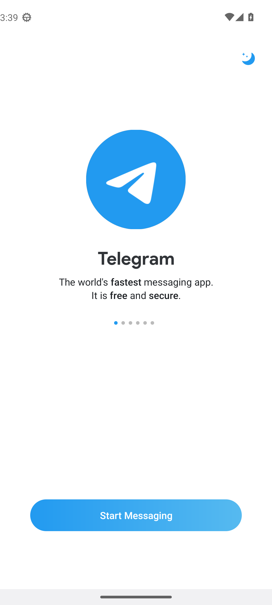
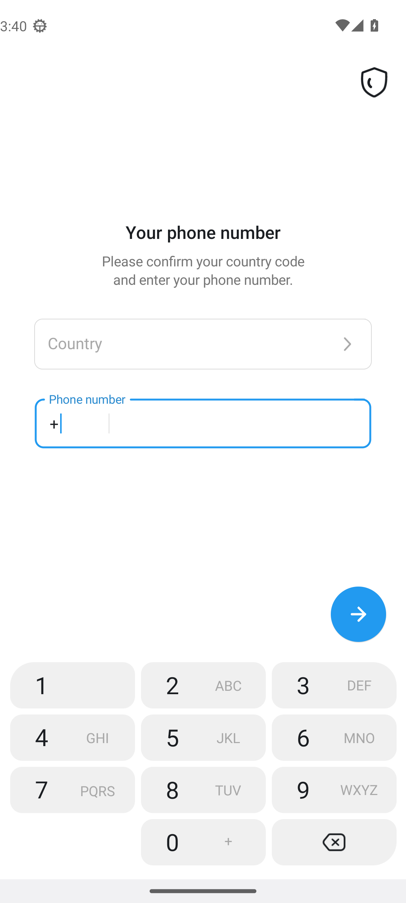

# Telegram app reference for patch work

This guide describes the factory Telegram APK that HushTelegram patches. It gives patch work a shared starting point for app identity, first-run screens, manifest entry points, bytecode anchors and target updates.

## Current targets

The builds HushTelegram patches are declared in one place, [AppCompatibilities.kt](../patches/src/main/kotlin/app/morphe/patches/shared/compat/AppCompatibilities.kt), with each build's package, version, version code and signer and the patched app's minimum Android version. The fixture tests read that same list, so every patch check runs against exactly those builds. The generated [patches-list.json](../patches-list.json) carries what each published patch declares, and the README's [supported builds](../README.md#supported-telegram-builds) section gives users the release's builds and checksums. Main can target a newer build than the latest release, so the README and the code can name different versions for a while.

Wherever this page names a Telegram version, it's describing what was seen on that build. AppCompatibilities.kt stays the source of truth when the two disagree.

### APK identity

The rows below come from the two 13.2.2 fixtures, read on 2026-11-12. Those APKs stay in the local, gitignored `fixtures/` folder.

| Field | telegram.org APK | Google Play APK |
|---|---|---|
| App label | Telegram | Telegram |
| Package | `org.telegram.messenger.web` | `org.telegram.messenger` |
| Version | 13.2.2, code 73039 | 13.2.2, code 73031 |
| APK SHA-256 | `e0ddeb85227f2e482f674f8e6e8f062dfd870484ed6c98282dc5a49918160ac0` | `84cf619763e25321ebd945d637f1e20709804fcd3b4db9eee74c68f201bfc28f` |
| Vendor signer | CN=Nikolay Kudashov, OU=VK, O=VK, L=Saint-Petersburg | the same |
| Signer SHA-256 | `49c1522548ebacd46ce322b6fd47f6092bb745d0f88082145caf35e14dcc38e1` | the same |
| Manifest SDK | minimum 23, target 36, compiled with SDK 36 | minimum 23, target 36, compiled with SDK 36 |
| Native ABIs | `arm64-v8a`, `armeabi-v7a`, `x86`, `x86_64` | `arm64-v8a`, `armeabi-v7a`, `x86`, `x86_64` |

Both come as one universal APK, the Play build from APKMirror. Telegram declares Android 6 as its minimum, and HushTelegram's extension raises the patched app's floor to Android 9, API 28. The official beta, `org.telegram.messenger.beta`, isn't a target anymore.

## What earlier builds showed

The first-run screens below were read from Telegram 12.10.6, version code 71129, telegram.org's single APK (SHA-256 `7827ea506d297644b1d350266bdfbd8d5d38a7869fa3fc1a0fbcb1ebc81f45ad`). That build declared Android 5 as its minimum.

Two deeper audits come from the same period. The [Telegram 12.10.6 app audit](telegram-audit-12.10.6.md) maps ad delivery, telemetry, common friction and patch opportunities. The [signed-in runtime audit](telegram-runtime-audit-12.10.7.md) adds a physical S22 walkthrough of official beta 12.10.7, live search-ad evidence, network captures and background measurements. Both describe those builds. Treat a finding there as a lead to check again on the current target, not as proof that it still holds.

### Factory install inspected

The APK was installed on a clean Android 13 API 33 Pixel 7 emulator profile. Its package, version and installed APK hash matched the fixture. No Morphe bundle or HushTelegram extension was applied.

The first screen is a Telegram welcome carousel. It shows six page dots, the title “Telegram,” the copy “The world's fastest messaging app. It is free and secure,” a “Start Messaging” button and a night-theme switch.

Start Messaging opens Telegram's call-verification explanation. Android then displays “Allow Telegram to make and manage phone calls?” Denying that request leads to the “Your phone number” page. The phone number field is focused, shows a plus prefix and uses Telegram's custom keypad. The Country field remains unselected.

No phone number or login code was entered during this emulator flow. `READ_PHONE_NUMBERS` and `READ_PHONE_STATE` remained ungranted. The later [S22 walkthrough](telegram-runtime-audit-12.10.7.md) covers signed-in screens on the official beta. Android's permission dialog can vary by system version and prior permission history.

## App entry points and component families

The manifest names `org.telegram.messenger.ApplicationLoaderImpl` as the Application class and `org.telegram.ui.LaunchActivity` as the main activity. `LaunchActivity` also receives sharing, deep-link and sticker-pack intents. These manifest component names are reliable anchors because Android needs them to remain present in the APK.

| Area | Manifest components |
|---|---|
| Push and app startup | `GcmPushListenerService`, `AppStartReceiver`, `KeepAliveJob` |
| Account and contact sync | `AuthenticatorService`, `ContactsSyncAdapterService`, `ImportingService` |
| Notifications | `NotificationsService`, `NotificationRepeat`, notification and reply receivers |
| Calls and location | `VoIPService`, `TelegramConnectionService`, `LocationSharingService`, `CallReceiver` |
| Media | `MusicPlayerService`, `MusicBrowserService`, `VideoEncodingService`, `StoryUploadingService` |
| Home screen | `ChatsWidgetProvider`, `ContactsWidgetProvider` and their services |

Most activity screens live under `org.telegram.ui`. Reusable widgets and views sit under `org.telegram.ui.Components`. The application, accounts, messaging and network code mostly lives under `org.telegram.messenger`. Telegram's generated API request and response classes are under `org.telegram.tgnet.TLRPC`.

## Bytecode anchors that survive updates

Telegram runs R8 over much of the UI. Many internal `org.telegram.ui` class and method names change on each build, and generated lambda suffixes can move. Since 13.2.0, R8 also renames the top-level classes of `org.telegram.messenger` and most of their members. On 13.2.1, `MessagesController` is `rp` in the telegram.org build and `vp` in the Play build. `org.telegram.tgnet` (the `TLRPC` classes and `ConnectionsManager` included), the subpackages of `org.telegram.messenger`, manifest components and resource names keep their names.

The patches keep naming the source classes and members. [TelegramNames.kt](../patches/src/main/kotlin/app/morphe/util/names/TelegramNames.kt) translates them through one table per supported build, at [`hushtelegram/names/<versionCode>.txt`](../patches/src/main/resources/hushtelegram/names/). Each table was made by matching that build against 13.1.1, the last build R8 left named.

Use a Telegram request class, a kept method or field, a stable resource name and nearby bytecode shape to find a patch point. A raw obfuscated name or a lambda number is weak evidence by itself. The table gives examples already used by HushTelegram, and each fixture test it names runs against every build AppCompatibilities.kt declares. Every anchor in it was found in both 13.2.1 builds on 2026-11-10, the renamed ones through their name tables.

| Feature area | Stable evidence in the APK | Current implementation and fixture check |
|---|---|---|
| Sponsored messages in channels and video | `TLRPC$TL_messages_getSponsoredMessages`, `MessagesController.getSponsoredMessages(long)`, `VideoAds.load()` | [HideAdsPatch.kt](../patches/src/main/kotlin/app/morphe/patches/telegram/ads/HideAdsPatch.kt), [HideAdsFixtureTest.kt](../patches/src/test/kotlin/app/morphe/patches/telegram/ads/HideAdsFixtureTest.kt) |
| Sponsored content in search | `TLRPC$TL_contacts_getSponsoredPeers`, the `ConnectionsManager.sendRequest` call and the nearby branch shape | [HideAdsPatch.kt](../patches/src/main/kotlin/app/morphe/patches/telegram/ads/HideAdsPatch.kt), [HideAdsFixtureTest.kt](../patches/src/test/kotlin/app/morphe/patches/telegram/ads/HideAdsFixtureTest.kt) |
| Usage reports | `TL_help_saveAppLog`, `TL_messages_reportReadMetrics`, `TL_inputAppEvent` and `ConnectionsManager.sendRequest` | [DisableAnalyticsPatch.kt](../patches/src/main/kotlin/app/morphe/patches/telegram/misc/analytics/DisableAnalyticsPatch.kt), [DisableAnalyticsFixtureTest.kt](../patches/src/test/kotlin/app/morphe/patches/telegram/misc/analytics/DisableAnalyticsFixtureTest.kt) |
| HushTelegram startup | `ApplicationLoaderImpl` and the first in-APK `onCreate()` implementation in its superclass chain | [TelegramExtensionPatch.kt](../patches/src/main/kotlin/app/morphe/patches/telegram/misc/extension/TelegramExtensionPatch.kt) |
| Native settings entry | `LaunchActivity`, kept `R$string` settings names, `R$drawable` settings icons and the row callback shape | [SettingsPatch.kt](../patches/src/main/kotlin/app/morphe/patches/telegram/misc/settings/SettingsPatch.kt), [NativeSettingsFixtureTest.kt](../patches/src/test/kotlin/app/morphe/patches/telegram/misc/settings/NativeSettingsFixtureTest.kt) |
| Login credentials | `BuildVars`, `ConnectionsManager`, `PasskeysController` and authentication request classes | [UseRegisteredApiCredentialsPatch.kt](../patches/src/main/kotlin/app/morphe/patches/telegram/misc/api/UseRegisteredApiCredentialsPatch.kt), [UseRegisteredApiCredentialsFixtureTest.kt](../patches/src/test/kotlin/app/morphe/patches/telegram/misc/api/UseRegisteredApiCredentialsFixtureTest.kt) |
| Passkey offers | every read of `BuildVars.SUPPORTS_PASSKEYS` and the chat list's `Set.contains("SETUP_PASSKEY")` check | [PasskeyGatePatch.kt](../patches/src/main/kotlin/app/morphe/patches/telegram/misc/api/PasskeyGatePatch.kt), [PasskeyGateFixtureTest.kt](../patches/src/test/kotlin/app/morphe/patches/telegram/misc/api/PasskeyGateFixtureTest.kt) |

The search method behind sponsored-peer requests is obfuscated. The request class and surrounding call pattern identify it without recording that build's generated name.

## HushTelegram integration

Patch definitions live under `patches/src/main/kotlin/app/morphe/patches/telegram/`. They use Morphe bytecode or resource patches and declare the supported Telegram compatibility entries. The patch bundle also includes two extension payloads.

| Path | Role |
|---|---|
| `patches/src/main/kotlin/app/morphe/patches/telegram/` | Telegram-specific bytecode and resource patches |
| [`AppCompatibilities.kt`](../patches/src/main/kotlin/app/morphe/patches/shared/compat/AppCompatibilities.kt) | Package, version, signer and minimum SDK declarations |
| `extensions/telegram/src/main/java/app/hushtelegram/extension/telegram/` | Telegram-specific settings and runtime hooks |
| `extensions/shared/library/src/main/java/app/hushtelegram/extension/shared/` | Shared settings, pause, diagnostics, logging and backup code |
| [`patches-list.json`](../patches-list.json) | Generated patch names, descriptions, categories, defaults and compatibility |
| [`provenance.json`](../provenance.json), [`NOTICE`](../NOTICE), [`telegram-sources.json`](../sources/telegram-sources.json) | Source history, license notices and allowed Telegram research sources |

[`TelegramExtensionPatch.kt`](../patches/src/main/kotlin/app/morphe/patches/telegram/misc/extension/TelegramExtensionPatch.kt) merges the shared and Telegram extensions and sets their application context at startup. [`SettingsPatch.kt`](../patches/src/main/kotlin/app/morphe/patches/telegram/misc/settings/SettingsPatch.kt) wires HushTelegram into Telegram's settings and adds the Android App info route. The patcher updates the build-status fields in [`SettingsStatus.java`](../extensions/telegram/src/main/java/app/hushtelegram/extension/telegram/settings/SettingsStatus.java), so the settings and diagnostics can report which switches this APK contains.

Patch status and runtime behavior are separate. The status fields say which code was included. Runtime preferences decide whether each included switch is on. Pause and safe mode route switch-backed hooks through Telegram's original behavior.

## Updating a Telegram build

1. Put the exact official web or Play APK in the private fixture folder. Verify its package, version name, version code, signer and SHA-256. The web and Play APKs need separate checks.
2. Run `scripts/verify-all-patches.ps1 -Apk <apk> -Force -DesktopJar <jar> -WorkDir <private scratch>`. `-Force` lets the patcher inspect a build before it is declared compatible. The report names patch failures and approved resource changes.
3. For a failed target, compare the method in the old and new APK with `scripts/fingerprint-candidates.ps1`. It ranks possible matches by strings, literals, calls, opcodes, signature, owner and callers. Verify the candidate in the APK. The script reports ambiguity instead of selecting between close matches.
4. Give the new build its name table so the patches can find the classes and members R8 renamed. `scripts/name-table.ps1 -Apk <apk> -Named <13.1.1 apk> -DesktopJar <jar>` matches the build against the last named Telegram (13.1.1, the web build 72379 or the Play build 72371, in the new build's flavor) and writes `patches/src/main/resources/hushtelegram/names/<versionCode>.txt`, with the resource ids of every name the newest table holds. It only pairs classes that stay in `org.telegram.messenger`, and a new table has none of the previous table's `#` blocks, which hold the gap-fill rows for classes R8 moved to other packages and the rows added by hand. The patches need some of those (the download queue, the forward preview and the push provider among them), so write them again with the new build's names, put them under the generated rows and run the script again. The rerun keeps every `#` block and drops any generated row naming the same member, so a hand row never ends up beside the wrong one. A hand class row that overrules the match also drops the member rows matched through the wrong pair, so give that class's members the patches use their own hand rows. Then add the version code to `BUILDS` in `TelegramNames.kt` and update the patch to recognize both the new build and every retained build. Add the package, version, version code and minimum SDK to `AppCompatibilities.kt`. Keep version-specific obfuscated names out of patch source.
5. Add or update a fixture test beside the patch. Run the patch checks against every declared web and Play fixture with `HUSHTELEGRAM_FIXTURE_DIR` set. Missing fixtures must remain a failure in the required push gate.
6. Regenerate the catalog with `:patches:generatePatchesList` before building the Android bundle with `:patches:buildAndroid`. Release receipts and provenance checks cover the published bundle separately.

The README covers the build commands. Release scripts enforce the fixture, source and receipt checks. This reference covers app discovery and patch targeting.
