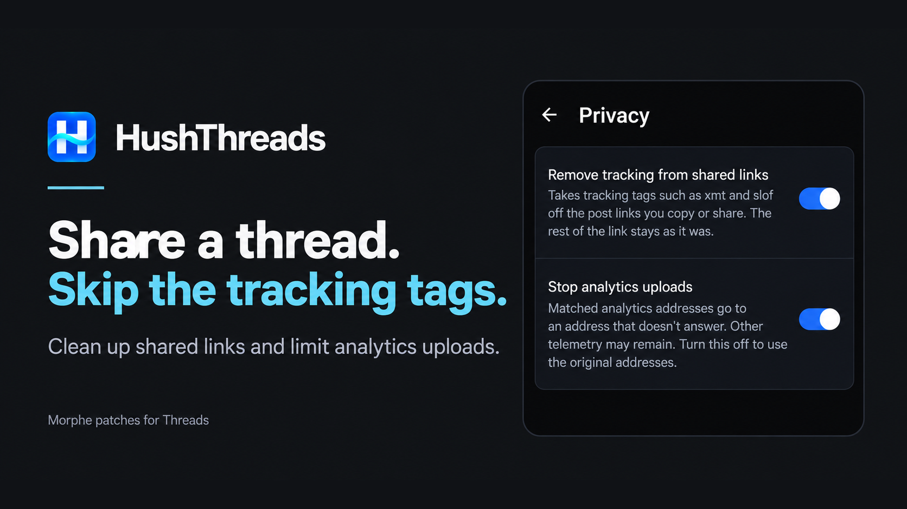
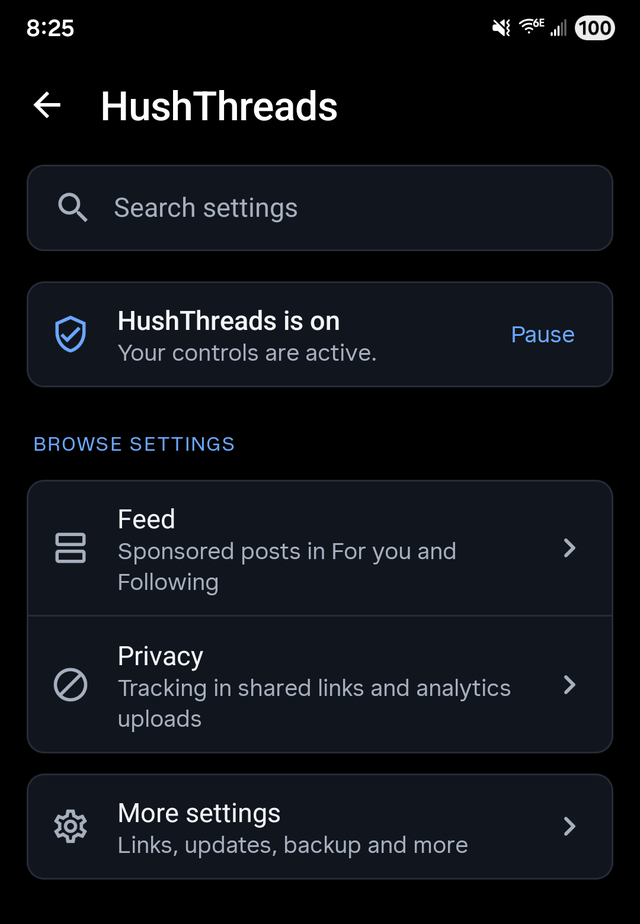
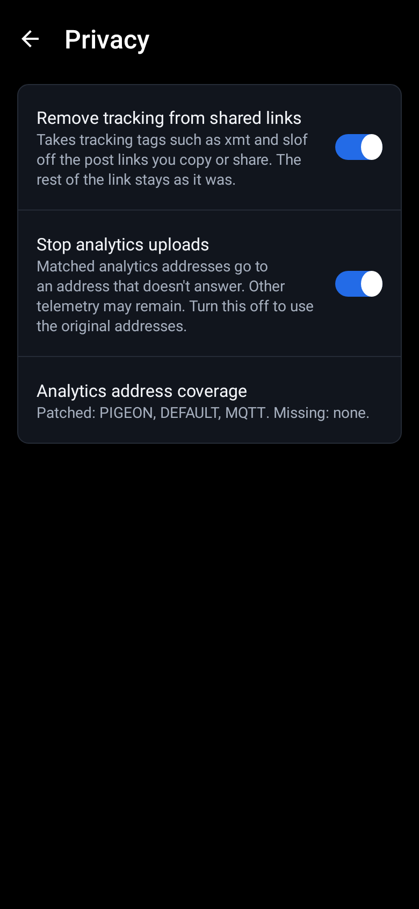

<p align="center">
  <a href="https://github.com/SysAdminDoc/HushThreads"></a>
  <a href="LICENSE"></a>
  
  
  
</p>

<p align="center">
  <a href="https://ko-fi.com/X8K126YVER">
    
  </a>
</p>

<p align="center">
  <sub><em>If HushThreads makes Threads better for you, a coffee helps me keep testing patches and maintaining them as Threads changes.</em></sub>
</p>

#  HushThreads

HushThreads is a Morphe patch bundle for Android that takes the ads out of Threads and cuts down what the app reports back to Meta. Morphe Manager applies it to the Threads app on your own phone, and the result has a HushThreads page in its settings with switches for nearly everything it does.

Sponsored posts and suggested-account cards leave your feed before Threads shows them. Shared links lose their tracking tags, and a short `/share/` link becomes the post's own link. Web links open in your browser instead of Threads' own, with its click tracker skipped. You can also save photos and videos, keep your place in the feed, stop autoplay and make dark mode pure black.

The latest release is [v0.0.16](https://github.com/SysAdminDoc/HushThreads/releases/tag/v0.0.16), with 20 patches. It's for Threads 452.0.0.50.64. The source build has moved to Threads 453.0.0.56.79, which ships in the next release. What changed in each version is in the [changelog](CHANGELOG.md).

[Add to Morphe](https://morphe.software/add-source?github=SysAdminDoc%2FHushThreads) | [Download a release](https://github.com/SysAdminDoc/HushThreads/releases/latest) | [Browse the patches](#patches)

## Install

1. Install [Morphe Manager](https://github.com/MorpheApp/morphe-manager) 2.3.0 or newer.
2. Add HushThreads as a patch source: https://morphe.software/add-source?github=SysAdminDoc%2FHushThreads
3. Get Threads 453.0.0.56.79 (`com.instagram.barcelona`) for any architecture and screen density in the [table below](#supported-threads-build), on Android 9 or newer. If you're installing the v0.0.16 release instead, get the arm64-v8a build of Threads 452.0.0.50.64 (512207626). If you're on an older Threads, update it to 453 before you patch the source build.
4. Uninstall the stock Threads. A patched Threads can't install over Meta's signed copy.
5. In Morphe Manager, pick that file and patch. The default selection has every patch except the three the [Patches](#patches) section names, so you don't need Expert mode.

To add one of those three, turn on **Settings → Advanced → Expert mode** in Manager before you pick the file. If you saved your own selection in Expert mode before, Manager may keep using it, so look over the list once.

The source build patches Threads 453 only. Each release moves to the newest stable Threads and drops the one before, so v0.0.15 is the last release for 451.0.0.51.80 and v0.0.16 is the last release for 452.0.0.50.64. If a patch can't find what it needs in your build, patching stops with a message naming it, so you don't end up with an app where that patch does nothing.

### Supported Threads build

| Threads version | Version code | Android floor |
|---|---|---|
| 453.0.0.56.79 | 512308671 (arm64-v8a, 480-640dpi) | Android 9 |
| 453.0.0.56.79 | 512308673 (x86_64, 480dpi) | Android 9 |
| 453.0.0.56.79 | 512308675 (arm64-v8a, 160-480dpi) | Android 9 |
| 453.0.0.56.79 | 512308676 (x86, 480dpi) | Android 9 |
| 453.0.0.56.79 | 512308685 (armeabi-v7a, 480dpi) | Android 9 |
| 453.0.0.56.79 | 512308686 (arm64-v8a, 480-640dpi) | Android 9 |
| 453.0.0.56.79 | 512308688 (x86_64, 480dpi) | Android 9 |
| 453.0.0.56.79 | 512308695 (armeabi-v7a, 480dpi) | Android 9 |
| 453.0.0.56.79 | 512308696 (arm64-v8a, 120-640dpi) | Android 9 |
| 453.0.0.56.79 | 512308697 (x86, 480dpi) | Android 9 |
| 453.0.0.56.79 | 512308698 (x86_64, 480dpi) | Android 9 |

Release checks run on these stock bundles:

```text
fc4aa8c2c4d7bafd9b3aeed54376cf5275e658db1cf2c7d5b51bbb71abdce360  threads-453.0.0.56.79-512308671.apkm
a91ba5517e4289ca2069bc72289669f18a27d1f5ac0df840ef4b0fd0b39309ab  threads-453.0.0.56.79-512308673.apkm
3975362986715ed3427daa4523caf9f9903dced230ed20b888fd944410a3aecf  threads-453.0.0.56.79-512308675.apkm
6d979b160123284be15d439d2740c2bfd14e3fa48764057ef7bbaecae679360b  threads-453.0.0.56.79-512308676.apkm
9280b76463811bff8a03c5110a9ebae0a9e7fbe17573ead03db7d979b44fc2fd  threads-453.0.0.56.79-512308685.apkm
091e9f9b75b444cf06faa006518e73721f5195bd0bb85793d6ceeaad7fbd3ce1  threads-453.0.0.56.79-512308686.apkm
3e2e4b324d779ab8b020ce201c4feb53223672f4229f48c4c214002b825d033e  threads-453.0.0.56.79-512308688.apkm
42c7c997674a55ff728450d02e01f9b97c3710f4127e41998419af167b953018  threads-453.0.0.56.79-512308695.apkm
9c85958ba3df1d1dec203a65489918681fa49990285df56068c59ad545a406c8  threads-453.0.0.56.79-512308696.apkm
d0093f4973c6c1af9beeb9b5f971342e2e13ec1874cfa12461654dc3e14a7925  threads-453.0.0.56.79-512308697.apkm
bcbf7d907d12190f8eaf53cdbf16ca29cacb82c91243db647b4734dd67be55ed  threads-453.0.0.56.79-512308698.apkm
```

A copy from another site may be packed differently and have another hash. HushThreads matches the Threads version name, so any 453.0.0.56.79 build works. The table lists the eleven APKMirror variants checked here.

## Keep your signing key

Morphe Manager signs the patched Threads with a key it makes on your phone, and Android only installs an update over your patched Threads when it carries that same key. Back it up right after your first patch. In Morphe Manager, open Settings, then System, then Import & export, then Signing key, and tap Export. Keep the `Morphe.keystore` file somewhere private, since anyone who has it can sign an APK your phone will accept as an update.

On a new phone, import the key before you patch anything. Reinstalling Manager or clearing its storage makes a new key, and with a different key the only way forward is to uninstall the patched Threads and sign in again.

## Patches

HushThreads has 20 patches. Morphe Manager's default selection has all but three: `Change version code`, `Remove share targets` and `Trust user-added certificates`. Those three change Threads when you patch and have no switch to undo them. Most of the others have a switch in HushThreads settings, and each row below says where it is and how it starts.

| Patch | What it does |
|---|---|
| `Block background-return feed refresh` | Keeps your place in your feed when you leave Threads and come back within ten minutes. Pulling down to refresh still loads new posts. Good if you hate losing the post you were reading. Starts off. Turn it on in HushThreads settings > Feed. |
| `Change version code` | Raises the version number as high as Android allows, so Google Play won't offer Meta's updates over it. Going back to stock Threads means uninstalling, which deletes its data. It isn't selected by default. Works as soon as you patch it in, with no switch. |
| `Disable analytics` | Stops Threads from sending most of its usage reports to Meta. A few may still get through. Good if you'd rather share less about how you use the app. On by default. Turn it off in HushThreads settings > Privacy. |
| `Disable screenshot detection` | Threads isn't told when you take a screenshot. It stops watching your photos for new screenshots. Good if you want to screenshot without Threads noticing. Starts off. Turn it on in HushThreads settings > Privacy. |
| `Disable swipe to Search` | Stops a sideways swipe on your feed from sliding into Search. The Search button still opens Search. Threads only has the swipe on some accounts. Good if you keep landing in Search while you scroll. Starts off. Turn it on in HushThreads settings > Feed. |
| `Disable video autoplay` | Videos in your feed wait for a tap instead of playing as you scroll. Good for a calmer feed and less data use. Starts off. Turn it on in HushThreads settings > Feed. |
| `Hide ads` | Removes sponsored posts from your feed and from under the posts you open before Threads shows them, so they leave no gap. On by default. Turn it off in HushThreads settings > Feed. |
| `Hide ghost post bubbles` | Takes the ghost post bubbles off profile pictures, on profiles and in the row at the top of your feed. The pictures and the ghost posts themselves stay. Good for a calmer look. Starts off. Turn it on in HushThreads settings > Appearance. |
| `Hide suggested users` | Removes the cards that suggest accounts to follow, in your feed and on profiles, and the Follow suggestions row in Search. Normal posts and reposts stay, and so does the rest of a profile or Search. Good if you only want posts in your feed. On by default. Its two switches are in HushThreads settings > Feed. |
| `Hide the Instagram button` | Takes the Instagram button off the top of profiles, yours and other people's. The other buttons stay. Good for a tidier profile. Starts off. Turn it on in HushThreads settings > Appearance. |
| `HushThreads settings` | Adds a HushThreads page to Threads where you turn features on or off, pause HushThreads, back up your settings and read the licenses. Open it from Threads' own settings, or long-press the Threads logo at the top of your feed. Works as soon as you patch it in, with no switch. |
| `Max image quality` | Loads photos at the largest size Threads has, instead of one picked for your screen. Photos look sharper but use more data. Starts off. Turn it on in HushThreads settings > Feed. |
| `Open links in browser` | Opens links you tap in your regular browser instead of inside Threads, and skips Threads' link tracking. Threads, Instagram and other Meta pages still open in Threads. On by default. Turn it off in HushThreads settings > Privacy. |
| `Pure black dark mode` | Makes Threads' dark mode truly black instead of dark gray behind your feed and posts. It looks deeper and can save battery on OLED screens. Starts off. Turn it on in HushThreads settings > Appearance. |
| `Remove share targets` | Takes Threads out of the share menu in other apps, so it isn't offered when you share a link, photo or video. Sharing from Threads still works. It isn't selected by default. Works as soon as you patch it in, with no switch. |
| `Remove the advertising ID` | Stops Threads from reading your phone's advertising ID. It gets a string of zeros instead. Good for making your phone harder to track across apps. Works as soon as you patch it in, with no switch. |
| `Restore screens on re-signed builds` | Fixes Threads screens that fail on a patched app because they check who signed it. Also lets Threads share sign-in with an Instagram signed with this build's key, and makes the share sheet's tiles open patched Meta apps. Works as soon as you patch it in, with no switch. |
| `Sanitize sharing links` | Removes tracking tags from links you copy or share from Threads, and turns short share links into the post's own link. The link still opens the same post. On by default. Turn it off in HushThreads settings > Privacy. |
| `Save photos and videos` | Adds Save to a post's menu, below Copy link. It saves the photo or video to your gallery, every page of a carousel too, and on a text post it saves the video that post links or quotes. Good for keeping posts you like. On by default. Turn it off in HushThreads settings > Downloads. |
| `Trust user-added certificates` | Lets Threads accept security certificates you installed yourself, such as for a work network or a debugging proxy. Meta's own checks stay, so a proxy can't read most traffic. It isn't selected by default. Works as soon as you patch it in, with no switch. |

The switches on the Appearance page take effect after you restart Threads. A Restart row shows at the top of HushThreads settings when you flip one. Tap it and Threads reopens on the page you were on.

## Settings

In Threads, open your profile, tap the settings button at the top and tap HushThreads, just above More settings. You can also long-press the Threads icon on your home screen and tap HushThreads (the `Settings shortcut on the app icon` switch under Pause, backup and diagnostics takes it off that menu), or open Threads' App info page and tap Additional settings in the app (Samsung phones call it Configure in Threads). A long press on the Threads logo at the top of your feed opens it too, even while HushThreads is paused. The logo ignores taps and holds while the feed is loading or refreshing, so wait for it to settle. With TalkBack on, the logo reads as "Threads".

**Pause** at the top of the home page turns every feature off at once and keeps your choices. Settings can be saved to a file and restored, and a diagnostic report can be exported for bug reports. Reports keep counts, not your posts or links, and they leave out file paths. Look one over before you share it anyway.

If Threads crashes within a minute of starting three times in a row, HushThreads pauses itself and says why at the top of its settings. Your switches stay saved. Tap Resume and restart Threads to turn it back on. Threads has a crash guard of its own. Five quick crashes inside four hours make it delete its data, which signs you out and clears HushThreads' settings. Safe mode usually gets there first, but it can't help when the crash comes from one of the patches without a switch. If Threads keeps crashing, patch again without them.

<p></p>

## Signing in

Tap Log in with Instagram and enter your Instagram username and password. Threads can ask twice whether to save your login info. Tap Not now each time if you don't want it saved.

If you also patch Instagram with [HushGram](https://github.com/SysAdminDoc/HushGram), sign both with the same Morphe Manager key. Threads then shows your Instagram account as a tile on its login screen, and tapping it signs you in without your password. With a Root Mount install you can sign in on stock Threads first, and the mounted build keeps that session.

## Help

- **Threads says your password is wrong when it isn't.** Reset your Instagram password and sign in with the new one. That fixed it in [issue #3](https://github.com/SysAdminDoc/HushThreads/issues/3).
- **A feature you used stopped after updating from v0.0.12 or older.** `Block background-return feed refresh`, `Disable screenshot detection`, `Disable video autoplay`, `Max image quality` and `Pure black dark mode` joined the default selection in v0.0.13 with their switches off. Turn yours back on in HushThreads settings.
- **Instagram says "Sorry, we weren't able to load that website" when you tap a Threads post.** That message is Instagram's, not a patch you're missing. The regular Instagram app only hands posts over to a Threads signed by Meta, and a patched Threads carries your Morphe Manager key instead. Opening the post from inside Threads still works, and the Links page in HushThreads settings says so when it finds Meta's Instagram on your phone. Reported in [issue #8](https://github.com/SysAdminDoc/HushThreads/issues/8).
- **Android won't install the patched app.** Uninstall the stock Threads first. An update to your patched Threads needs the same signing key as the copy on your phone.
- **Patching stops with a patch's name.** That usually means your Threads isn't the supported build. Check the Threads version name against the [table above](#supported-threads-build).

## Your Threads account

Assume Meta can tell. A patched Threads is signed with your key instead of Meta's, and Threads checks that signature in places. Meta could also notice the analytics uploads that stop arriving. HushThreads doesn't post, like, follow or message for you, and it doesn't change how you sign in. Your feed still comes from Meta's servers, ads included, and the ads are removed on your phone after they arrive.

Meta's terms ask for its permission before anyone modifies its apps. I haven't heard of an account suspended over a patched Threads, but this is a young project, so that doesn't prove much. If you'd rather not risk the account you care about, try HushThreads with a test account first.

## Privacy

HushThreads doesn't collect anything and has no server. The patched app goes online on HushThreads' behalf for two things only.

- **A save you ask for.** Tap Save in a post's menu and HushThreads fetches that post's photos or videos over HTTPS from Meta's media servers (`cdninstagram.com`, `fbcdn.net` and `fbsbx.com`), where Threads loads them from too. Any other address is refused. The request carries no cookie or password, even through a proxy, and any cookie the server sends back is dropped.
- **The release check**, which is off until you turn it on. Then it asks `api.github.com` for the latest release at most once a day when Threads starts, and again when you tap Check now. The request sends `HushThreads/<version>` as its User-Agent and carries no cookies and nothing about you or your phone. GitHub sees your IP address, as any site you visit does.

The About and Licenses screens link to `github.com`, `gitlab.com` and `www.gnu.org`, and Support HushThreads at the bottom of the settings home page links to `ko-fi.com`. Those open in your browser, and only when you tap one.

`Disable analytics` points the analytics uploads it recognizes at `127.0.0.1`, on a port nothing listens on, so they fail on the phone. Other telemetry isn't covered. `Open links in browser` hands Android only the real address behind Threads' click tracker, with tags like `fbclid` removed. Links to Threads, Instagram, Facebook, Messenger and Meta stay in Threads, because sign-in and Accounts Center need its session. Ads go through the same check, from the link button or a swipe up in the photo viewer, and so do the links on a lead form.

## Verify a download

Each release ships `SHA256SUMS.txt` beside the bundle, along with a CycloneDX SBOM and a release receipt recording the Threads build every patch was checked on. Compare the `.mpp` hash with your download. For v0.0.16 it's:

```text
73c9ad6e58c99120ff16b529ba4aa6164e7e220bb3fe017dc9522bfe17c7f891  patches-0.0.16.mpp
```

On Windows, run `Get-FileHash -Algorithm SHA256 .\patches-0.0.16.mpp`. Inside the patched app, the About page in HushThreads settings shows the bundle's payload hash and the source it was built from.

## Reporting a problem

Use [Issues](https://github.com/SysAdminDoc/HushThreads/issues) for bugs and [Discussions](https://github.com/SysAdminDoc/HushThreads/discussions) for questions. Include your Threads version and version code, your Morphe Manager and HushThreads versions, how you installed it, and what you expected to happen. A diagnostic report from HushThreads' settings helps a lot. Reports stay open until the person who opened them confirms the fix works.

## Building and checking

You need JDK 21, the Android SDK and PowerShell 7.5 or newer (Windows PowerShell 5.1 works too). Set `JAVA_HOME` and `ANDROID_HOME`, or set the SDK in `local.properties`. GitHub Packages needs `GITHUB_ACTOR` and `GITHUB_TOKEN` with `read:packages`.

The checked-in wrapper uses Gradle 9.8.1. Release checks examine that build-tool version separately from the libraries carried in the bundle.

```powershell
$env:HUSHTHREADS_FIXTURE_DIR = '<fixture folder>'
$env:HUSHTHREADS_DESKTOP_JAR = '<Morphe desktop JAR>'
./gradlew.bat prepareAdvisoryTool
./gradlew.bat :patches:generatePatchesList
./gradlew.bat :patches:buildAndroid
./gradlew.bat :patches:test :extensions:threads:testDebugUnitTest
./gradlew.bat :extensions:threads:lintRelease :extensions:shared:library:lintRelease
./scripts/verify-all-patches.ps1 -Apk '<Threads bundle>' -DesktopJar '<Morphe desktop JAR>' -WorkDir '<scratch folder>'
```

The bundle, its SHA-256 and a CycloneDX SBOM land in `patches/build/release`. Without `HUSHTHREADS_FIXTURE_DIR`, the tests that need real Threads builds skip. They run in `:patches:fixtureTest`, which `:patches:test` runs first. `scripts/install-hooks.ps1` installs the push checks.

A release runs in five stages of `scripts/release/release.ps1`, each with `-Version <version>`, from a clean checkout of main. `prepare` dates the changelog, moves the version strings, regenerates the patch list and rewrites the README's latest-release line for you to review and commit. `preflight` runs the quick checks and pushes. `build` reruns the tests, builds the bundle, writes the receipt from one fixture run per declared build and tags the commit last. `publish` (with `-Intro` and `-Update` text files) creates the GitHub release and downloads each asset back to compare it, and `index` (with `-Summary`) points `patches-bundle.json` at it. A stage won't start before the one it follows, and one that stopped part way can be run again.

Before publishing, run `scripts/walk-app.ps1 -Serial <serial> -OutDir <walk folder>` under an owned device lease. It writes a patch receipt and a walk receipt. To walk that retained install again, use `-SkipPatch -PatchReceipt <walk folder>/patch-receipt.json`. Keep the signed APK, original vendor input and catalog at their recorded paths until publication. An unknown or different install is refused without reinstalling it.

The publish stage also needs `-Walk <walk folder>/walk-receipt.json`. Its catalog must match the bundle's source commit. It rechecks the APK's manifest and embedded bundle identity, the installed hashes from both ends of the walk, every named screen and any recorded problem. Old schema 1 receipts remain historical records and can't qualify a new release. `-Java`, `-DesktopJar` and `-Aapt2` select the validation tools when needed.

Where things live:

- `patches/src/main/kotlin/app/morphe/patches/threads/` holds the patches. `AppCompatibilities.kt` under `patches/.../shared/compat/` names the supported Threads build, and only the newest stable one is declared.
- `extensions/threads/` is the Java code that runs inside Threads, settings screen included. `extensions/shared/` holds the shared library and its translations.
- `patches-list.json` is the generated patch catalog. `patches-bundle.json` is the Morphe source index and only changes at release time.

## Where the patches come from

HushThreads' build, settings, diagnostics and safety checks came from [Hushfacebook](https://github.com/SysAdminDoc/Hushfacebook) at `c15d4f79`. That code carries the notices from [Hushfeed](https://github.com/SysAdminDoc/hushfeed), [Andrew Liang's patches](https://github.com/andrewliang25/morphe-patches), [FroggoMorphePatches](https://github.com/SapitoSucio/FroggoMorphePatches) and the Morphe/ReVanced chain recorded in [NOTICE](NOTICE) and [provenance.json](provenance.json).

The Threads patches are written here, and no outside Threads code is used. Hide ads hooks the feed-cache merge point that [zeldrisho](https://github.com/zeldrisho/morphe-patches) identified, with its own implementation. [sources/threads-sources.json](sources/threads-sources.json) records the 12 other Threads patch sources that were looked at and what each one allows.

Copied code keeps its copyright, author, license and source notices, and gets a `Forked from` line naming the repository and commit. A notice only goes when the code it covers is gone. Outside code ships only after its source is marked adopted in the ledger with its exact commit, a compatible license, a NOTICE entry and a provenance rule, and `ProvenanceTest` checks the headers.

## License

[GPL-3.0](LICENSE), with the Morphe section 7 notices carried in [NOTICE](NOTICE). HushThreads has no connection to Meta or to the Morphe project, and neither endorses it. Threads, Instagram and Meta are trademarks of Meta Platforms, Inc.
