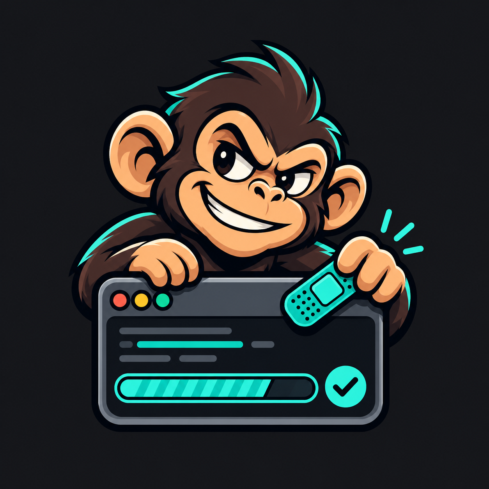

  

<h1 align="center">BadFella Patches</h1>

Community app patches by BadFella.

  

## Get started

1. Install [Morphe Manager](https://github.com/MorpheApp/morphe-manager/releases/latest) **2.2.0 or later**.
2. On your phone, tap **Add to Morphe** above and add the source.
3. Open the app in Manager. Refresh Sources if it is missing; enable **Settings → Expert settings → Expert Mode** if needed for custom app selection. Enable pre-releases in the source settings to use development previews.
4. Select the unmodified **TickTick 8.3.0.1 APK**, **Emby 3.5.72 APK**, **Remote for Android TV 6.1.0 APKM**, **Pep Talk 2.31.0 XAPK**, **Wanderlog 2.227/2.228 APKM** or **Torrent Search Revolution V2 2.3.5 APKS**, choose the patches below, then patch and install.
5. For updates, refresh this source and patch again using the **same Manager signing key** to preserve app data.

Manual import: download the `.mpp` from [Releases](https://github.com/XBadFellaX/BadFella-Patches/releases/latest) and add it in Manager's **Sources** screen.

**Before replacing an existing installation:** verify your task backup or sync. Apps signed with different keys cannot update each other; uninstalling removes local data.

## Ultimea dev.6 development preview

Adds **Accent color**, **Disable tracking**, **Remove distractions** and
**Remove popups** from hxreborn for Ultimea 1.4.4 build 495 (ARM64).
The accent picker is in **BadFella Patches** in Profile (the former Contact Us
entry). It offers presets, a custom color and Material You. Reopen the app to
refresh all screens after a color change; wallpaper colors refresh on app launch.

Tracking, distraction and popup removal are selected when patching. Repatch to
change them. Remove distractions includes the existing Explorer-tab removal.
The original Bluetooth/device-control code, Flutter engine and native library
loading are preserved. Device behavior and the accent picker remain unverified;
the existing Feedback contrast issue is unchanged. Enable pre-releases in Morphe
Manager and refresh Sources to use this preview.

## Ultimea development preview

The `1.6.0-dev.4` preview contains exactly two Ultimea patches:
**Ultimea Black Mode** (fixed AMOLED appearance) and **Ultimea Hide Explorer Tab**.
They adapt hxreborn's theme and navigation code for **1.4.4, build 495, ARM64 only**.
The input must include `lib/arm64-v8a/libapp.so`; a base-only APK is insufficient.

Bluetooth discovery, pairing, permissions, device connections, equalizer controls,
signature handling and the Flutter engine remain outside this port. The Explorer
patch adjusts the tab bodies, selection callbacks and tab controller indexes;
it does not intentionally change device connection behavior. Physical startup,
appearance and soundbar connection/reconnection checks are still required.
Enable pre-releases in the source settings in Morphe Manager, refresh Sources,
and repatch the original ARM64 app. Keep your existing signing key to preserve
app data. Upstream attribution is in `NOTICE`.

## Patches

<!-- PATCHES_START EXPANDED -->
> **[v1.6.0-dev.6](https://github.com/XBadFellaX/BadFella-Patches/releases/tag/v1.6.0-dev.6)**&nbsp;&nbsp;•&nbsp;&nbsp;`main`&nbsp;&nbsp;•&nbsp;&nbsp;53 patches total

📦 Ultimea&nbsp;&nbsp;•&nbsp;&nbsp;6 patches

 

**🎯 Supported versions:**

| 1.4.4 |
| :---: |

| 💊&nbsp;Patch | 📜&nbsp;Description | ⚙️&nbsp;Options |
|----------|----------------|-----------|
| [Accent color](#accent-color) | Changes accent colors with a chosen color or Material You. |  |
| [Disable tracking](#disable-tracking) | Disables Firebase Analytics, Crashlytics, Logan and usage event uploads. |  |
| [Remove distractions](#remove-distractions) | Removes community, message and support entries. |  |
| [Remove popups](#remove-popups) | Removes promotional and rating popups. |  |
| [Ultimea Black Mode](#ultimea-black-mode) | Ports hxreborn's dark theme in fixed AMOLED mode, with light text, controls and artwork. ARM64 only. |  |
| [Ultimea Hide Explorer Tab](#ultimea-hide-explorer-tab) | Ports hxreborn's community navigation removal, including tab bodies, callbacks and controller indexes. ARM64 only. |  |

📦 LinkedIn&nbsp;&nbsp;•&nbsp;&nbsp;34 patches

 

**🎯 Supported versions:**

| 4.1.1267 | 4.1.1271 | 4.1.1272 |
| :---: | :---: | :---: |
|  | Version 4.1.1271, build 217900. | Version 4.1.1272, build 218000. | Any version (experimental). Every patch verifies its own anchors. |

| 💊&nbsp;Patch | 📜&nbsp;Description | ⚙️&nbsp;Options |
|----------|----------------|-----------|
| [Always show navigation bar](#always-show-navigation-bar) | Adds an option in BadFella Patches to keep the navigation bar on screen while you scroll. |  |
| [Anonymous profile viewing](#anonymous-profile-viewing) | Adds an option (on by default, experimental) to visit profiles without being listed in "Who viewed your profile": the analytics events of profile pages are not sent. |  |
| [Block tracking](#block-tracking) | Adds an option (on by default) to stop sending most LinkedIn analytics events. |  |
| [Copy post text](#copy-post-text) | Long pressing a post's text copies all of it, including the part behind "...more". |  |
| [Copy text](#copy-text) | Long press a post, comment or any other text to select and copy it in place, like on Reddit. |  |
| [Customize navigation bar](#customize-navigation-bar) | Takes the bottom navigation buttons you pick off the bar, such as My Network, Post, Notifications, Jobs, Video or News. Each page still opens from the Menu and from links. Restart LinkedIn after changing the selection. | • Hide My Network • Hide Post • Hide Notifications • Hide Jobs • Hide Video • Hide News |
| [Dark app icon](#dark-app-icon) | Black launcher icon with the white "in", instead of LinkedIn's blue. Chosen when patching: a launcher icon cannot switch with dark mode on its own. |  |
| [Disable double-tap like](#disable-double-tap-like) | Stops double tapping a post or photo from liking it. |  |
| [Download media](#download-media) | Adds a download button to the full screen photo, video and document viewer. Documents (PDFs and carousels) are saved as one PDF. |  |
| [Expand posts](#expand-posts) | Adds an option (off by default, turned on in BadFella Patches) to show posts expanded by default. Tapping the text collapses them. |  |
| [Feed filters](#feed-filters) | Adds optional filters (off by default, turned on in BadFella Patches): focus mode, celebrations, job cards, reposts, posts from others' activity, "Recommended for you", video posts, games, the "New posts" pill and "See translation". |  |
| [Glass navigation bar](#glass-navigation-bar) | Draws the navigation bar as a floating, translucent capsule with a spring selection pill and no press ripple. |  |
| [GmsCore support](#gmscore-support) | Makes "Continue with Google" work in patched LinkedIn by signing in through microG RE (GmsCore) instead of Google Play services. Needs microG RE installed and signed in to a Google account. |  |
| [Hide Premium upsells](#hide-premium-upsells) | Removes Premium and AI upsell cards and banners, including on profiles and the Me panel. |  |
| [Hide ads](#hide-ads) | Removes promoted, boosted and sponsored posts from the feed. |  |
| [Hide bottom tabs](#hide-bottom-tabs) | Adds switches to take My Network and Jobs out of the bottom bar. |  |
| [Hide promoted jobs](#hide-promoted-jobs) | Removes promoted job listings from the Jobs tab and job search. |  |
| [Hide suggested posts](#hide-suggested-posts) | Removes "Suggested" posts from outside your network from the feed. |  |
| [Icon-only post actions](#icon-only-post-actions) | Adds a switch in BadFella Patches to show the Like, Comment, Repost and Send buttons under posts without their labels. |  |
| [Install next to LinkedIn](#install-next-to-linkedin) | Installs this build as a second LinkedIn beside your normal one, with its own data and sign-in. Pick its package name and app name in the patch's options. Works as soon as you patch it in. | • Package name • App name |
| [Keep feed on reopen](#keep-feed-on-reopen) | Keeps your place in the feed when you come back to LinkedIn, instead of reloading it. Pull down or tap the "New posts" button to load new posts. |  |
| [Material You](#material-you) | Uses wallpaper colors (Android 12+) or a preset/custom accent color (Android 10+) instead of LinkedIn blue and the green of selected filters, and Material 3 surface colors for backgrounds, cards, bars and borders. Some screens drawn by LinkedIn's servers may keep their own colors. |  |
| [Material icons in the bottom bar](#material-icons-in-the-bottom-bar) | Replaces LinkedIn's Home, My Network, Notifications, Jobs and Video tab icons with Material icons (filled when selected, outlined otherwise). Chosen when patching. | • Material icons |
| [Messaging](#messaging) | Hides sponsored messages, and adds an optional ghost mode that does not send typing indicators or read status. |  |
| [More tab](#more-tab) | Lets you hide items of the More tab (Puzzle games, Groups, Events, Newsletters), or list them at the bottom of the profile menu. |  |
| [Navigation bar](#navigation-bar) | Adds options (turned on in BadFella Patches) to hide the More, Jobs, Network and Notifications tabs of the navigation bar, its count badges and its labels. |  |
| [Open links directly](#open-links-directly) | Opens external links without LinkedIn's safety/go warning page. |  |
| [Pitch black](#pitch-black) | Replaces the gray backgrounds of dark mode with black, and cards with a slightly lighter black, across the entire app. Takes effect when the system is in dark mode. Works with or without Material You. |  |
| [Post menu items](#post-menu-items) | Adds Copy text, Download photos and videos, and Save document as PDF to the ⋯ menu of posts, each with its own icon. |  |
| [Remove gaps and dividers](#remove-gaps-and-dividers) | Removes the gray gaps between posts and the dividers between list items, so the feed and lists are one flat surface. |  |
| [Sanitize share links](#sanitize-share-links) | Removes tracking parameters from LinkedIn links when they are copied or shared. |  |
| [Swipe between feeds](#swipe-between-feeds) | Swipe left and right on the home feed to switch between For you and Network, like on X. |  |
| [Swipe between tabs](#swipe-between-tabs) | Swipe sideways to go to the next or previous tab of the navigation bar. |  |
| [Tap to hide in viewers](#tap-to-hide-in-viewers) | Tap a video or document in full screen to hide the caption and buttons, like photos. |  |

📦 BoldVoice&nbsp;&nbsp;•&nbsp;&nbsp;1 patch

 

**🎯 Supported versions:**

| 5.1.3 |
| :---: |
| Version 5.1.3, build 470 (ARM64 split). |

| 💊&nbsp;Patch | 📜&nbsp;Description | ⚙️&nbsp;Options |
|----------|----------------|-----------|
| [BoldVoice subscription features](#boldvoice-subscription-features) | Enables client-side subscriber features and lessons in BoldVoice 5.1.3. Restores devirtualized startup lifecycle methods, hoisted strings, and notification callbacks; neutralizes PairIP VM and licensing checks; restores pristine ARM64 native libraries; disables Expo OTA bundle replacement. Server-controlled features retain their existing requirements. |  |

📦 TickTick&nbsp;&nbsp;•&nbsp;&nbsp;4 patches

 

**🎯 Supported versions:**

| 8.3.0.2 |
| :---: |
| Version 8.3.0.2, build 8302. | Any version (experimental). Every patch verifies its own anchors. |

| 💊&nbsp;Patch | 📜&nbsp;Description | ⚙️&nbsp;Options |
|----------|----------------|-----------|
| [Disable analytics collection](#disable-analytics-collection) | Disables declared analytics and crash collection and removes advertising permissions. Keeps Firebase Messaging and location permissions. Does not guarantee zero tracking. |  |
| [Restore notifications](#restore-notifications) | Restores Firebase certificate metadata on re-signed apps, with an Android 17 compatible token setup. Push delivery still requires device testing. |  |
| [Restore reminder alarms](#restore-reminder-alarms) | Restores task/reminder alarm scheduling on re-signed apps. |  |
| [TickTick Premium](#ticktick-premium) | Enables client-side premium features and limits. Does not grant server-side AI access or a subscription. |  |

📦 Emby&nbsp;&nbsp;•&nbsp;&nbsp;2 patches

 

| 💊&nbsp;Patch | 📜&nbsp;Description | ⚙️&nbsp;Options |
|----------|----------------|-----------|
| [Emby client unlock](#emby-client-unlock) | Enables local in-app feature gates using Kirlif's observed approach. Does not grant server Premiere entitlements. |  |
| [Emby remove Firebase and DataTransport](#emby-remove-firebase-and-datatransport) | Removes Firebase/DataTransport SDK classes and manifest components. Disables Firebase push messaging; keeps Cast and billing libraries. |  |

📦 ChatGPT&nbsp;&nbsp;•&nbsp;&nbsp;1 patch

 

**🎯 Supported versions:**

| 1.2026.307 |
| :---: |
| Version 1.2026.307, build 2630718. | Any version (experimental). Every patch verifies its own anchors. |

| 💊&nbsp;Patch | 📜&nbsp;Description | ⚙️&nbsp;Options |
|----------|----------------|-----------|
| [Install next to ChatGPT](#install-next-to-chatgpt) | Installs this build as a second ChatGPT beside your normal one, with its own data and sign-in. Pick its package name and app name in the patch's options. Sign-in uses the original OAuth callback; if Android asks which app to open, choose the copy. | • Package name • App name |

📦 Pep Talk&nbsp;&nbsp;•&nbsp;&nbsp;1 patch

 

| 💊&nbsp;Patch | 📜&nbsp;Description | ⚙️&nbsp;Options |
|----------|----------------|-----------|
| [Pep Talk Elite features](#pep-talk-elite-features) | Enables local Elite features, labels the profile status and silences unavailable-purchase warnings from background product lookup. Keeps authentication and purchase handling; does not grant server-side access or a subscription. |  |

📦 Remote for Android TV&nbsp;&nbsp;•&nbsp;&nbsp;1 patch

 

**🎯 Supported versions:**

| 6.1.0 |
| :---: |
| Version 6.1.0, build 45. |

| 💊&nbsp;Patch | 📜&nbsp;Description | ⚙️&nbsp;Options |
|----------|----------------|-----------|
| [Remote ATV ad-free](#remote-atv-ad-free) | Disables advertising, restores startup and replaces premium activation with a local ad-free status. Removes the home banner and its spacing. Does not create a server subscription. |  |

📦 Science News Daily&nbsp;&nbsp;•&nbsp;&nbsp;1 patch

 

**🎯 Supported versions:**

| 23.8 |
| :---: |
| Version 23.8, build 238 (ARM64 split). |

| 💊&nbsp;Patch | 📜&nbsp;Description | ⚙️&nbsp;Options |
|----------|----------------|-----------|
| [Science News Daily local subscription](#science-news-daily-local-subscription) | Reports the cached subscription flag as active, so ad-free reading, premium-post browsing, downloads and upsell-free screens stay enabled. Neutralizes the PairIP installation check so the app runs when installed outside Play Store. Preserves sign-in, Google Play billing callbacks, restore and the server verification request. |  |

📦 Torrent Search Revolution V2&nbsp;&nbsp;•&nbsp;&nbsp;1 patch

 

| 💊&nbsp;Patch | 📜&nbsp;Description | ⚙️&nbsp;Options |
|----------|----------------|-----------|
| [Torrent Search Revolution local Pro](#torrent-search-revolution-local-pro) | Enables the local Pro/ad-free branches, including search, native and banner ads and Pro settings. Preserves startup callbacks. Reviewed on 2.3.5; changed app bytecode requires review. Does not grant a Pro Key subscription or server entitlement. |  |

📦 Wanderlog&nbsp;&nbsp;•&nbsp;&nbsp;1 patch

 

| 💊&nbsp;Patch | 📜&nbsp;Description | ⚙️&nbsp;Options |
|----------|----------------|-----------|
| [Wanderlog Pro features](#wanderlog-pro-features) | Enables local Pro feature checks, removes subscription prompts and auto-opening paywalls, hides the home Pro star, labels the profile button Pro Activated and brands the billing screen. Makes the app theme follow the device dark-mode setting, because the app's own dark mode entry is Pro-only and the preference is set by Wanderlog's servers on subscription. Keeps the patched bundle in place by disabling Expo OTA updates. Does not grant server-run AI, downloads, flight tracking, Google Maps export or a subscription. |  |

<!-- PATCHES_END -->

**Limits:** these patches do not grant server-side AI access or increase the account's list-sync allowance. Custom AI keys are not supported yet.

### TickTick and Emby

TickTick's optional Local lists and backups feature and BadFella Settings entry
are removed in 1.6.0-dev.6. Export any local organization you need using your
existing build before updating. Tasks, cloud lists, on-device databases and
exported backups are not deleted; this bundle has no local-list backup or restore
controls.

The Emby patches support both ARM64 and ARMv7 stock APKs. Firebase/DataTransport
removal disables Firebase push. Client unlock does not grant server Premiere
entitlements.

### Remote for Android TV

The ad-free patch supports **6.1.0, build 45 APKM**, including ARMv7, ARM64 and
x86-64. It works with Morphe's unused-library stripping enabled. Premium purchase
state is unchanged.

[GPLv3](LICENSE) · [Copyright and license notices](NOTICE) · [Issues](https://github.com/XBadFellaX/BadFella-Patches/issues)

### LinkedIn diagnostics (development preview)

Open **BadFella Patches → Diagnostics** to start a 20-second performance capture,
copy a report or save it as a text file. Scroll the screen that feels slow during
the capture, then reopen Diagnostics to export. Reports contain numeric timings,
versions, device model, included patches, known boolean choices and extension
error locations. Account identity, post/message text, URLs, cookies, tokens and
custom setting text are excluded. Nothing is uploaded automatically. Review the
file before attaching it to a GitHub issue. Results cover the current app process
and disappear when it ends. Capturing adds some overhead; it does not fix lag.
