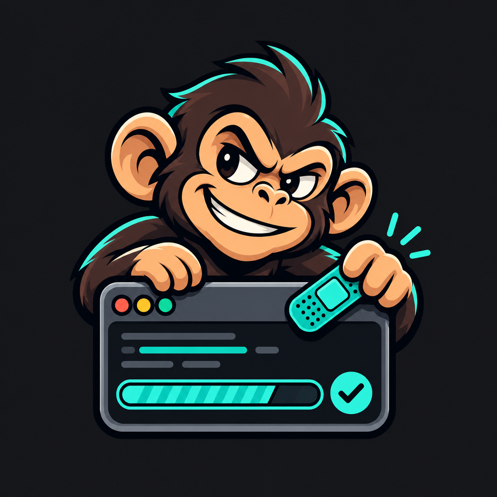

  

<h1 align="center">BadFella Patches</h1>

Community app patches by BadFella.

  

## Get started

1. Install [Morphe Manager](https://github.com/MorpheApp/morphe-manager/releases/latest) **2.2.0 or later**.
2. On your phone, tap **Add to Morphe** above and add the source.
3. Open **TickTick**, **Emby**, **Remote for Android TV**, **MIT Technology Review**, **Pep Talk** or **Wanderlog** in Manager. Refresh Sources if it is missing; enable **Settings → Expert settings → Expert Mode** if needed for custom app selection.
4. Select the unmodified **TickTick 8.2.4.0 APKM**, **Emby 3.5.72 APK**, **Remote for Android TV 6.1.0 APKM** or **MIT Technology Review 3.0 APKM** or **Pep Talk 2.31.0 XAPK** or **Wanderlog 2.227 APKM**, choose the patches below, then patch and install.
5. For updates, refresh this source and patch again using the **same Manager signing key** to preserve app data.

Manual import: download the `.mpp` from [Releases](https://github.com/XBadFellaX/BadFella-Patches/releases/latest) and add it in Manager's **Sources** screen.

**Before replacing an existing installation:** verify your task backup or sync. Apps signed with different keys cannot update each other; uninstalling removes local data.

## Patches

<!-- PATCHES_START EXPANDED -->
> **[v1.5.1](https://github.com/XBadFellaX/BadFella-Patches/releases/tag/v1.5.1)**&nbsp;&nbsp;•&nbsp;&nbsp;`main`&nbsp;&nbsp;•&nbsp;&nbsp;12 patches total

📦 TickTick&nbsp;&nbsp;•&nbsp;&nbsp;5 patches

 

**🎯 Supported versions:**

| 8.2.4.0 |
| :---: |

| 💊&nbsp;Patch | 📜&nbsp;Description | ⚙️&nbsp;Options |
|----------|----------------|-----------|
| [Disable analytics collection](#disable-analytics-collection) | Disables declared analytics and crash collection and removes advertising permissions. Keeps Firebase Messaging and location permissions. Does not guarantee zero tracking. |  |
| [Local lists and backups](#local-lists-and-backups) | Adds BadFella Settings with 299 or 900 local lists, local task assignments, and manual or scheduled local backups of organization and supported task snapshots. Cloud lists and task ownership stay in TickTick; attachment file contents are not included. |  |
| [Restore notifications](#restore-notifications) | Restores Firebase certificate metadata on re-signed apps, with an Android 17 compatible token setup. Push delivery still requires device testing. |  |
| [Restore reminder alarms](#restore-reminder-alarms) | Restores task/reminder alarm scheduling on re-signed apps. |  |
| [TickTick Premium](#ticktick-premium) | Enables client-side premium features and limits. Does not grant server-side AI access or a subscription. |  |

📦 Emby&nbsp;&nbsp;•&nbsp;&nbsp;2 patches

 

**🎯 Supported versions:**

| 3.5.72 |
| :---: |

| 💊&nbsp;Patch | 📜&nbsp;Description | ⚙️&nbsp;Options |
|----------|----------------|-----------|
| [Emby client unlock](#emby-client-unlock) | Enables local in-app feature gates using Kirlif's observed approach. Does not grant server Premiere entitlements. |  |
| [Emby remove Firebase and DataTransport](#emby-remove-firebase-and-datatransport) | Removes Firebase/DataTransport SDK classes and manifest components. Disables Firebase push messaging; keeps Cast and billing libraries. |  |

📦 HBR&nbsp;&nbsp;•&nbsp;&nbsp;1 patch

 

**🎯 Supported versions:**

| 🧪&nbsp;39.4.0 |
| :---: |

| 💊&nbsp;Patch | 📜&nbsp;Description | ⚙️&nbsp;Options |
|----------|----------------|-----------|
| [HBR extended free reading](#hbr-extended-free-reading) | Raises the free-article meter to 1500 per 30-day window for signed-out and signed-in readers, effectively unlimited within a month, and hides the recurring free-views banner so reading stays clean. Does not grant a subscription, unlock subscriber-only content or change server-run entitlements. |  |

📦 MIT Technology Review&nbsp;&nbsp;•&nbsp;&nbsp;1 patch

 

**🎯 Supported versions:**

| 3.0 |
| :---: |

| 💊&nbsp;Patch | 📜&nbsp;Description | ⚙️&nbsp;Options |
|----------|----------------|-----------|
| [MIT Tech Review reading meter](#mit-tech-review-reading-meter) | Removes local article gates and the remaining-views banner, and enables the app's ad-free flag for native and article ads. Keeps account authentication; does not grant a server subscription. |  |

📦 Pep Talk&nbsp;&nbsp;•&nbsp;&nbsp;1 patch

 

**🎯 Supported versions:**

| 🧪&nbsp;2.31.0 |
| :---: |

| 💊&nbsp;Patch | 📜&nbsp;Description | ⚙️&nbsp;Options |
|----------|----------------|-----------|
| [Pep Talk Elite features](#pep-talk-elite-features) | Enables local Elite features, labels the profile status and silences unavailable-purchase warnings from background product lookup. Keeps authentication and purchase handling; does not grant server-side access or a subscription. |  |

📦 Remote for Android TV&nbsp;&nbsp;•&nbsp;&nbsp;1 patch

 

**🎯 Supported versions:**

| 6.1.0 |
| :---: |
| Version 6.1.0, build 45. |

| 💊&nbsp;Patch | 📜&nbsp;Description | ⚙️&nbsp;Options |
|----------|----------------|-----------|
| [Remote ATV ad-free](#remote-atv-ad-free) | Disables advertising, restores startup and replaces premium activation with a local ad-free status. Removes the home banner and its spacing. Does not create a server subscription. |  |

📦 Wanderlog&nbsp;&nbsp;•&nbsp;&nbsp;1 patch

 

**🎯 Supported versions:**

| 🧪&nbsp;2.227 |
| :---: |

| 💊&nbsp;Patch | 📜&nbsp;Description | ⚙️&nbsp;Options |
|----------|----------------|-----------|
| [Wanderlog Pro features](#wanderlog-pro-features) | Enables local Pro feature checks, removes subscription prompts and auto-opening paywalls, hides the home Pro star, labels the profile button Pro Activated and brands the billing screen. Keeps the patched bundle in place by disabling Expo OTA updates. Does not grant server-run AI, downloads, flight tracking or a subscription. |  |

<!-- PATCHES_END -->

**Limits:** these patches do not grant server-side AI access or increase the account's list-sync allowance. Custom AI keys are not supported yet.

### Local lists and Emby

**Local lists and backups** is optional and off by default. Automatic backups
also start off. The Emby patches support both ARM64 and ARMv7 stock APKs.

Local lists: open **Settings → General → BadFella Settings** for local organization,
manual backups and optional scheduled backups. Open that screen once after an
upgrade from the old extension namespace to reconnect any backup schedule.
Emby: Firebase/DataTransport removal disables Firebase push. Client unlock does
not grant server Premiere entitlements.

### Remote for Android TV

The ad-free patch supports **6.1.0, build 45 APKM**, including ARMv7, ARM64 and
x86-64. It works with Morphe's unused-library stripping enabled. Premium purchase
state is unchanged.

[GPLv3](LICENSE) · [Notices and upstream credits](NOTICE) · [Issues](https://github.com/XBadFellaX/BadFella-Patches/issues)
