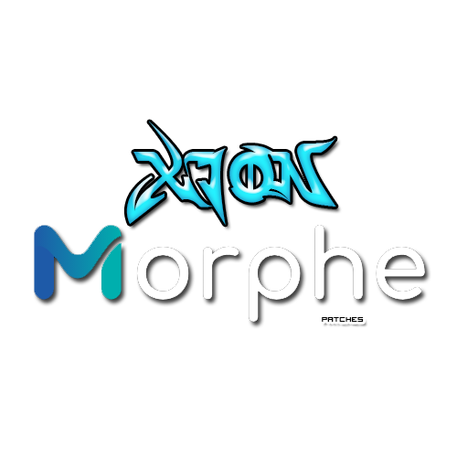
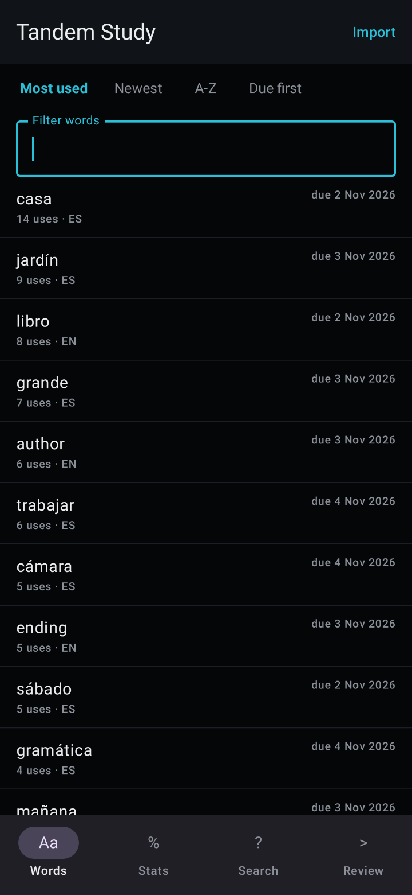
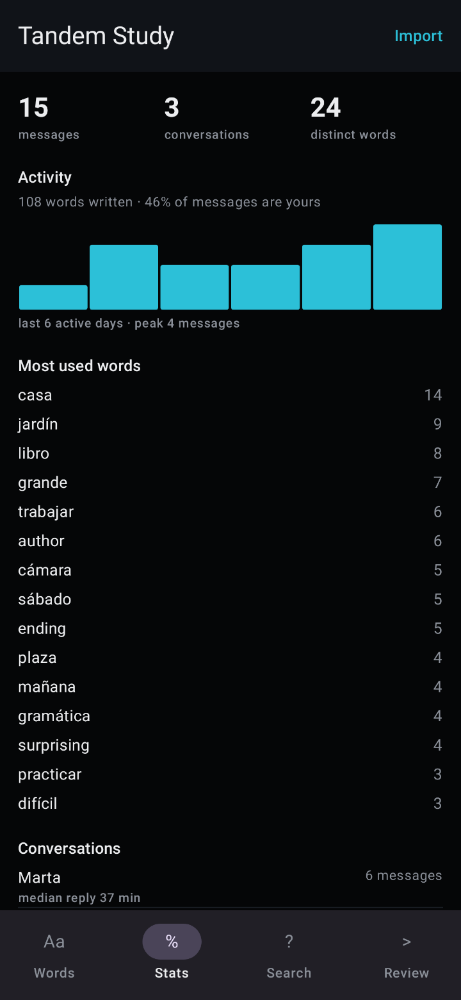
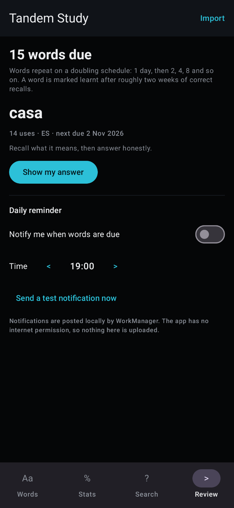

<!-- docs/ holds the GitHub Pages site: a dark editorial page in the same design
     system as xiondigital.net (assets/css/xion.css), with the patch collection as
     its only subject. Edit docs/index.html and docs/style.css; the logo lives at
     docs/assets/xion-morphe-patches.png and is used here and in the site header.

     Styling based on xiondigital.net (assets/css/xion.css):
     Dark editorial palette: bg #050607, panel #0c0e11 / #101318,
     ink #ecedef, body #bdc3cc, muted #8b9099,
     accent blue #3f80ff, blue-hi #79a8ff.
     Type on the site: Sora (display/body), Instrument Serif (italic accents),
     JetBrains Mono (eyebrow/labels). GitHub READMEs cannot load external
     fonts or site CSS, so this translates those cues into GitHub-safe
     elements: centred header, mono eyebrow, italic tagline, and blue badges. -->

<div align="center">

`MORPHE PATCHES — XIONDIGITAL`



*Independent Android patches and adaptations for [Morphe](https://morphe.software).*

[](https://morphe.software)
[](https://github.com/XiONDiGiTaL/MorphePatches/releases/latest)
[](https://github.com/XiONDiGiTaL/MorphePatches#patches)
[](https://github.com/XiONDiGiTaL/MorphePatches#patches)
[](https://github.com/XiONDiGiTaL/MorphePatches/releases)
[](https://xiondigital.net/MorphePatches/)

<a href="#patches">01 / Patches</a> &nbsp; / &nbsp;
<a href="#releases">02 / Releases</a> &nbsp; / &nbsp;
<a href="#requests-and-issues">03 / Requests</a> &nbsp; / &nbsp;
<a href="https://xiondigital.net/MorphePatches/">Site ↗</a>

</div>

<br />

<table>
<tr>
<td width="65%" valign="top">

### What ships here

Seven patches for two apps, written against Morphe's patch API and shipped as one prebuilt bundle.
Five are for **Tandem: Language exchange** 6.38.0 and 6.12.0; two are for **Amazon A to Z**
(`com.amazon.atozm`) and apply to **any version** of it — a universal **Force dark mode** and an
opt-in **Clone package** that installs the patched build under its own application id.

Each app documents its own work in its own folder: [`Tandem/`](Tandem/README.md) and
[`AmazonAtoZ/`](AmazonAtoZ/README.md). The patch sources live under
`patches/src/main/kotlin/app/xiondigital/patches/<app>/`, and the release bundle gathers all of them,
so adding an app is one folder plus one package — not a new mechanism.

</td>
<td width="35%" valign="top">

### Release status

**v0.1.0** — baseline

7 patches · 2 apps · `net.tandem` 6.38.0 / 6.12.0 · `com.amazon.atozm` any version

Every patch is **Experimental**: they apply to the real stock files and the patched output has been
decompiled, but no build has survived launch on hardware yet.

[Downloads ↗](https://github.com/XiONDiGiTaL/MorphePatches/releases/latest)

</td>
</tr>
</table>

<br />

<a id="patches"></a>

## 01 / Morphe Patches

| App | Package | Patches |
| --- | --- | --- |
| [Tandem](Tandem/README.md) | `net.tandem` | [Bypass PairIP checks](Tandem/README.md#bypass-pairip-checks) · [Force dark mode](Tandem/README.md#force-dark-mode) · [Remove ads](Tandem/README.md#remove-ads) · [Disable Adjust tracking](Tandem/README.md#disable-adjust-tracking) · [Clone package](Tandem/README.md#clone-package) (opt-in) — 6.38.0 · 6.12.0 |
| [Amazon A to Z](AmazonAtoZ/README.md) | `com.amazon.atozm` | [Force dark mode](AmazonAtoZ/README.md#force-dark-mode) · [Clone package](AmazonAtoZ/README.md#clone-package) (opt-in) — any version |

### One bundle, every app

The release asset — `patches-<version>.mpp` — is the bundle Morphe reads. It contains every patch for
every app above; you import the same file for all of them, and Morphe shows only the patches that
match the app you selected. The SHA-256 of each asset is on its release page.

| Where | What it is |
| :--- | :--- |
| [Release asset](https://github.com/XiONDiGiTaL/MorphePatches/releases/latest) | `patches-<version>.mpp` — the complete bundle, built and attached by the release workflow |
| [Patch source](https://morphe.software/add-source?github=XiONDiGiTaL/MorphePatches) | `patches-list.json` in this repository — what the add-source link reads |
| [`Tandem/patches.mpp`](Tandem/patches.mpp) | Tandem-only bundle, for a direct import without the other app's patches |
| [`AmazonAtoZ/patches.mpp`](AmazonAtoZ/patches.mpp) | A to Z-only bundle, same version and sources |

Both per-app bundles are derived from the released bundle by the release workflow, so they cannot
fall behind it. `.github/apps.json` is the list it works from.
| `Tandem/`, `AmazonAtoZ/` | Documentation per app: what each patch changes, its anchors, its limits |
| `patches/src/main/kotlin/app/xiondigital/patches/<app>/` | The patch sources, one package per app |

Adding an app means a new folder, a new package under `patches/.../patches/`, a compatibility entry
and one line in `.github/apps.json`. The combined release asset, that folder's own bundle,
`patches-list.json`, the patch table below and the badges at the top are all regenerated from that at
the next release.

The bundle declares `Patcher-Version: 2.1.0`. Import it in Morphe Manager, or point Morphe at the
source link above and it lists the patches itself.

**Amazon A to Z** accepts any version. The dark-mode patch only adds theme items and one call at the
top of `MainApplication.onCreate()`; enable **Clone package** if you want the patched build beside the
official app instead of replacing it.

**Tandem** declares 6.38.0 (versionCode 11568) and 6.12.0 (versionCode 11503), APKM bundle or single
APK, and refuses anything else instead of patching it blindly. The full status is in
[Tandem/README.md](Tandem/README.md#testing-status) and [Tandem/DEVICE-TEST.md](Tandem/DEVICE-TEST.md).

### Companion app — Tandem Study

The learning features a patch cannot add ship as a separate offline app in
[`companion/`](companion/README.md): it imports the archive from Tandem's own
**Profile → Settings → Download my data** and builds a vocabulary list, conversation statistics,
search and spaced-repetition review with reminders. It has no `INTERNET` permission and does not
touch Tandem itself.

<p>



</p>

See [Tandem/README.md](Tandem/README.md#companion-app-tandem-study) for the full set and
[`companion/README.md`](companion/README.md) for how the import works and what it deliberately does
not do.

### Generated patch list

<!-- PATCHES_START EXPANDED -->
> **[v0.1.0](https://github.com/XiONDiGiTaL/MorphePatches/releases/tag/v0.1.0)**&nbsp;&nbsp;•&nbsp;&nbsp;`main`&nbsp;&nbsp;•&nbsp;&nbsp;7 patches total
<details open>
<summary>📦 Tandem: Language exchange&nbsp;&nbsp;•&nbsp;&nbsp;5 patches</summary>
<br>

**Package name:** `net.tandem`

**🎯 Supported versions:**

| 6.38.0 | 6.12.0 |
| :---: | :---: |

| 💊&nbsp;Patch | 📜&nbsp;Description | ⚙️&nbsp;Options |
|----------|----------------|-----------|
| [Bypass PairIP checks](#bypass-pairip-checks) | Skips PairIP's APK signature and Play licence checks, which otherwise stop a re-signed build from starting. Required for any patched Tandem build to run. |  |
| [Clone package](#clone-package) | Installs the patched build under its own application id (app.xiondigital.tandem by default), so it can sit next to the official Tandem app instead of replacing and conflicting with it. Off by default: a clone starts empty, and Google/Facebook sign-in, push tokens, Play purchases and verified App Links stay bound to the original package. | • Package name |
| [Disable Adjust tracking](#disable-adjust-tracking) | Stops the bundled Adjust attribution SDK from initialising, so no install, session or event attribution is sent. |  |
| [Force dark mode](#force-dark-mode) | Turns on Tandem's own dark theme, regardless of the system dark-mode setting. |  |
| [Remove ads](#remove-ads) | Removes Tandem's community ad slot and blocks the bundled AppLovin MAX and Meta Audience Network SDKs from requesting ads. |  |

</details>

<details open>
<summary>📦 Amazon A to Z&nbsp;&nbsp;•&nbsp;&nbsp;2 patches</summary>
<br>

**Package name:** `com.amazon.atozm`

| 💊&nbsp;Patch | 📜&nbsp;Description | ⚙️&nbsp;Options |
|----------|----------------|-----------|
| [Clone package](#clone-package) | Installs the patched build under its own application id (app.xiondigital.atoz by default), so it can sit next to the official Amazon A to Z instead of replacing it. Renames the provider authorities, the app's runtime permission and the launcher label, and drops the Amazon SDK permission declarations a re-signed build cannot own. Off by default: a clone starts empty, and Play services, FCM targeting, attestation and verified App Links stay bound to the original package. | • Package name<br>• App name |
| [Force dark mode](#force-dark-mode) | Turns on Amazon A to Z's night mode before the first screen is created and opts the app into Android's automatic dark transform, so the interface is dark even when the phone is set to light mode. |  |

</details>

<!-- PATCHES_END -->

### How to use these patches

Add this repository as a Morphe source once and the patches show up inside the app, at the version in
the release table below:

```
https://morphe.software/add-source?github=XiONDiGiTaL/MorphePatches
```

Or import a file directly: download `patches-<version>.mpp` from the
[latest release](https://github.com/XiONDiGiTaL/MorphePatches/releases/latest), open it in Morphe
Manager, and select your app's file. Nothing needs to be built locally — the release asset is the
finished artifact.

For **Tandem**, keep **Bypass PairIP checks** enabled (a re-signed build will not start without it)
and turn on **Clone package** if the patched app should install next to the official one.

<a href="https://morphe.software/add-source?github=XiONDiGiTaL/MorphePatches">
  
</a>

Build the bundle locally with `./gradlew :patches:buildAndroid` — the `.mpp` file is created at
`patches/build/libs/patches-*.mpp`.

<br />

<a id="releases"></a>

## 02 / Releases

| Release | Date | Bundle | Contents |
| :--- | :--- | :--- | :--- |
| [`v0.1.0`](https://github.com/XiONDiGiTaL/MorphePatches/releases/tag/v0.1.0) — baseline | 2026-11-13 | `patches-0.1.0.mpp` | First release under the 0.1.x scheme. Seven patches for two apps in one bundle: five Tandem patches (6.38.0 · 6.12.0) and the A to Z dark-mode and clone patches (any version) |

Versions move by **one patch number at a time**: `0.1.0`, `0.1.1`, `0.1.2`, and so on. Every release
bumps the last number by one — adding a patch, fixing one, or adding an app counts the same, so
nothing is skipped and the number no longer says what kind of change is inside. The commit prefix
still drives the changelog sections, not the version.

Releases are automated. `/releases` (in `release.yml`) tags the next patch number, builds the bundle,
attaches it, regenerates `patches-list.json`, `patches-stats.json` and `patches-bundle.json`, and
rewrites the patch table above. The baseline `0.1.0` was published once from
`.github/workflows/baseline-release.yml`, because the release tooling can only count upward from an
existing tag. Earlier `v1.0.x` / `v1.1.x` tags were retired when the collection was renumbered; their
history stays in git.

Only patch bundles are distributed here. Original and prepatched proprietary application packages are not.

<details>
<summary>Patch status guide</summary>

| Status | Meaning |
| :--- | :--- |
| Experimental | Applies cleanly to the stock build; not yet confirmed on a device |
| Tested | Confirmed on a device, with the app version and setup recorded |
| Released | Included in a published bundle |

All seven patches are **Experimental**. The 2026-11-04 Tandem device test did not get past launch —
see [Tandem/DEVICE-TEST.md](Tandem/DEVICE-TEST.md) — and no A to Z build has been run on hardware, so
none of them qualify as Tested.

</details>

<br />

<a id="requests-and-issues"></a>

## 03 / Requests and issues

[Suggest a patch or report an issue ↗](https://github.com/XiONDiGiTaL/MorphePatches/issues)

When reporting a bug, include the app and its version, the bundle version (`v0.1.0` at time of
writing), which patches were selected, your Android version, and reproduction steps. Remove personal
information and credentials from logs.

<br />

## Frequently Asked Questions

#### How do I use this?

Add `XiONDiGiTaL/MorphePatches` as a source in Morphe Manager, or import the
[latest release](https://github.com/XiONDiGiTaL/MorphePatches/releases/latest) bundle. Then pick the
app: for Tandem, a stock 6.38.0 or 6.12.0 file with **Bypass PairIP checks** enabled; for Amazon A to
Z, any version. Turn on **Clone package** if you want the patched app to install next to the official
one instead of replacing it.

#### What version should I use?

Tandem **6.38.0** (versionCode 11568) or **6.12.0** (versionCode 11503), APKM bundle or single APK;
the Tandem patches declare only those, so Morphe refuses anything else. For **Amazon A to Z**, any
version is accepted — the patch has no version list on purpose and fails loudly instead of guessing
if a build ever moves the anchors it uses.

#### Why does the version start at 0.1.0?

Because the collection is one bundle of independent, experimental patches, not an app release. It hit
`1.1.0` once by accident (a `feat:` commit bumps a minor in the old rules), so the numbering was
reset to a single 0.1 line and now advances one patch at a time. Every app added from here gets its
own folder and its own patches inside the same bundle.

#### Are the patches tested?

They have been applied to the real stock files and the results decompiled: for Tandem, all five
patches complete against the APKMirror 6.38.0 and 6.12.0 APKMs; for Amazon A to Z, the dark-mode and
clone patches complete against the 6.0.5098.0 arm64 APK. Tandem has also been run on hardware — the
clone installs as its own app, but the licence gate opens Google Play and kills the process before the
UI. That is why every patch stays Experimental; see [Tandem/DEVICE-TEST.md](Tandem/DEVICE-TEST.md).

#### Can you make a patch for another app?

Suggest it through Issues. Requests do not guarantee implementation or compatibility.

<br />

## 04 / Notice

An independent project by XiONDiGiTaL, not affiliated with, endorsed by, or sponsored by any third-party entity or project referenced here.

Original patches and adaptations are offered freely. Third-party applications, names, trademarks, assets, and other works belong to their respective owners. References identify compatibility targets or provide attribution; no ownership or endorsement is implied.

This project is intended to share independent modifications, not redistribute proprietary works or misrepresent authorship. Incorporated third-party work must retain its applicable licenses, notices, and credits. No repository-wide software license has been selected yet.

[Morphe ↗](https://morphe.software) &nbsp; / &nbsp; [Upstream patches ↗](https://github.com/MorpheApp/morphe-patches) &nbsp; / &nbsp; [Patch template ↗](https://github.com/MorpheApp/morphe-patches-template)

---

<div align="center">

---

<a href="https://xiondigital.net/MorphePatches/">XiØN · Morphe Patches ↗</a>

<sub>Independent patch collection — <a href="https://xiondigital.net">XiONDiGiTaL</a></sub>

</div>
