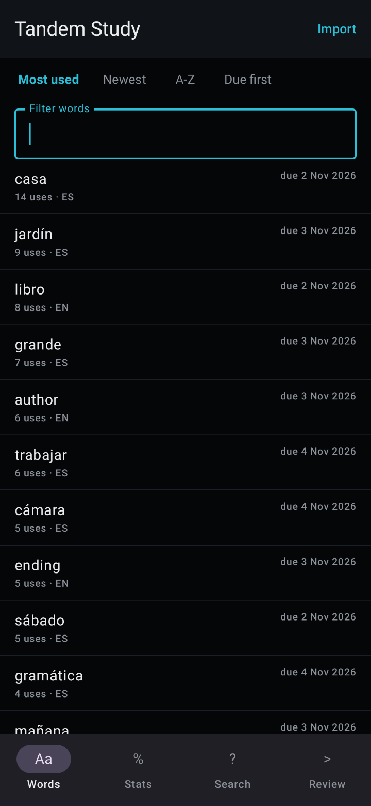
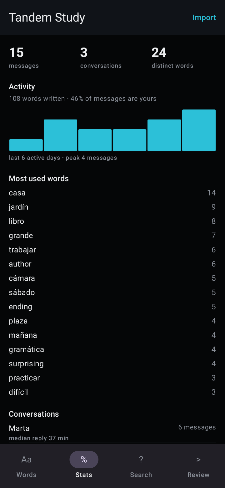
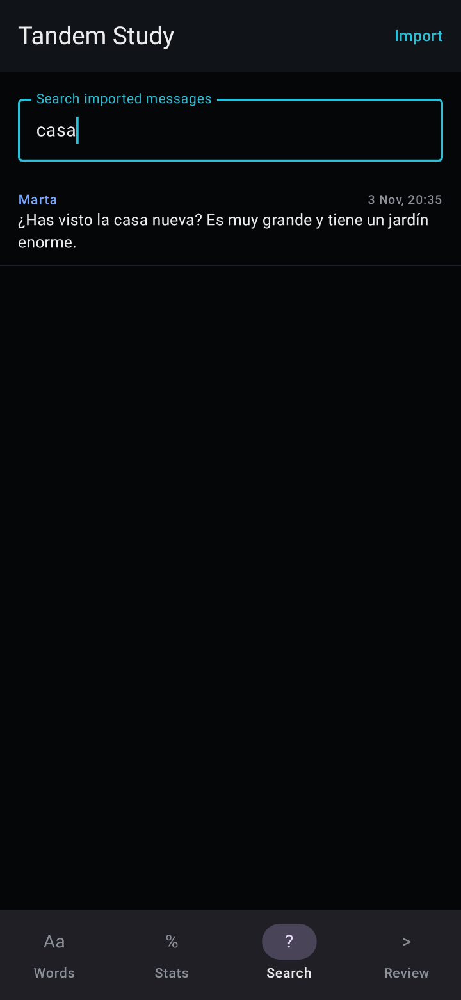
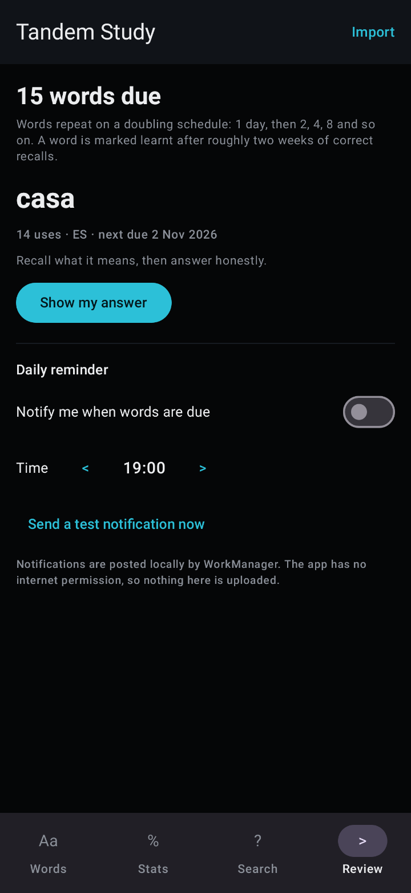

# Tandem

Patches for **Tandem: Language exchange** (`net.tandem`) by XiONDiGiTaL, built for
[Morphe](https://morphe.software).

The patches ship compiled in this folder: **[`patches.mpp`](patches.mpp)**, and as the `v1.1.0`
release asset. Import either file in Morphe Manager and patch a stock Tandem **6.38.0** or **6.12.0** APK or APKM —
nothing else is needed, and no build step is required to use it.

Adding `XiONDiGiTaL/MorphePatches` as a source
(`https://morphe.software/add-source?github=XiONDiGiTaL/MorphePatches`) lists the same five patches
inside Morphe.

The learning features a patch cannot add — vocabulary extraction, statistics, search and spaced
review — live in a separate offline app, [Tandem Study](../companion/README.md), described
[below](#companion-app-tandem-study).

| | |
| :--- | :--- |
| Release | [`v1.1.0`](https://github.com/XiONDiGiTaL/MorphePatches/releases/tag/v1.1.0) — `patches-1.1.0.mpp`, 74,124 bytes (2026-11-04) |
| Bundle | [`patches.mpp`](patches.mpp) — 74,124 bytes (the same build as the release asset) |
| SHA-256 | `0034159ee9a8ba74d7f540f2ca48f5c57cf4d805f68639da575d991e1f5f2af9` (both files) |
| Contents | 5 patches: Force dark mode, Bypass PairIP checks, Remove ads, Disable Adjust tracking, Clone package |
| Target | `net.tandem` — Tandem **6.38.0** (versionCode **11568**, minSdk 32) and **6.12.0** (versionCode **11503**, minSdk 26; the bundle needs API 31) |
| Patcher | Morphe patcher **2.1.0** (the bundle declares `Patcher-Version: 2.1.0`) |
| Format | APK and APKM (compatibility entries for both) |
| Status | **Experimental** — applies to the real 6.38.0 and 6.12.0 APKMs and the patched dex is verified; the first device test installs the clone but is stopped by Tandem's licence gate at launch ([DEVICE-TEST.md](DEVICE-TEST.md)) |

Verify the download before importing:

```bash
sha256sum patches.mpp
# 0034159ee9a8ba74d7f540f2ca48f5c57cf4d805f68639da575d991e1f5f2af9
```

## Patches in the bundle

Four are enabled by default; each can be turned off individually in Morphe Manager. **Clone package** is
off by default, because it changes which app you are installing.

| Patch | What it changes | Methods touched |
| :--- | :--- | :--- |
| [Force dark mode](#force-dark-mode) | Injects an app-level night-mode call at `TandemApp.onCreate()` | 1 (injected) |
| [Bypass PairIP checks](#bypass-pairip-checks) | Empties PairIP's signature and licence checks, and closes the licence screen it falls back to | 6 |
| [Remove ads](#remove-ads) | Empties Tandem's community-ad composable and the ad SDKs' load methods | 11 |
| [Disable Adjust tracking](#disable-adjust-tracking) | Empties `Adjust.initSdk(...)` | 1 |
| [Clone package](#clone-package) (opt-in) | Installs the patched build under its own application id, next to the official app | 10 dex literals, plus the manifest |

Every patch is confined to methods and identifiers that already exist in the APK: nothing is added to
the manifest, no component is redirected, and the only injected code is the single night-mode call in
the dark-mode patch. The one patch that edits the manifest is **Clone package**, which only rewrites the
identifiers Tandem already declares, and only when you enable it.

---

### Force dark mode

**Effect.** Tandem ships a full dark theme — a `values-night` resource overlay plus a Compose theme
that respects `uiMode` — but the app has no appearance setting of its own, so the theme is reachable
only through the system-wide dark-mode switch. This patch turns Tandem's own dark theme on for Tandem
alone. Other apps and the system setting are untouched.

**Change.** One platform call is prepended to `net.tandem.TandemApp.onCreate()`:

```smali
const-string v0, "uimode"
invoke-virtual {p0, v0}, Landroid/content/Context;->getSystemService(Ljava/lang/String;)Ljava/lang/Object;
move-result-object v0
check-cast v0, Landroid/app/UiModeManager;
const/4 v1, 0x2                     # UiModeManager.MODE_NIGHT_YES
invoke-virtual {v0, v1}, Landroid/app/UiModeManager;->setApplicationNightMode(I)V
```

`Application.onCreate()` runs once per process, before the first activity resolves a theme or a
Compose palette, so every screen starts in Tandem's night configuration. `setApplicationNightMode`
exists from API 31 and this build is minSdk 32.

**Anchor.** `net.tandem.TandemApp;->onCreate()V` — inherited unchanged by the PairIP wrapper
(`com.pairip.application.Application` only overrides `attachBaseContext`), so it is neither
obfuscated nor displaced by the integrity patch.

**Not touched.** No theme, colour, activity, layout or resource is renamed or replaced, so user
images, media, icons, dialogs and system bars keep using Tandem's own night resources. Nothing is
force-inverted.

---

### Bypass PairIP checks

**Effect.** Removes the dex-level PairIP gates that reject a patched, re-signed build. 6.38.0 is protected with PairIP:
the manifest declares `com.pairip.application.Application`, whose `attachBaseContext` runs two gates
before Tandem initialises.

| Gate | What it does | Why a patched build trips it |
| :--- | :--- | :--- |
| `SignatureCheck.verifyIntegrity(context)` | Base64 SHA-256 of the APK signing certificate, compared to expected values | Any re-signed APK mismatches and throws `SignatureTamperedException("Apk signature is invalid.")` before the first activity |
| `LicenseClient.checkLicense(context)` | Binds Play's licensing service | A sideloaded build cannot satisfy the licence response |

The licence flow is not only a check. Behind it there is a screen and a kill switch, and reaching
them at launch is what a Play prompt and an app that closes by itself look like:

| Component | What it does |
| :--- | :--- |
| `LicenseClient.startPaywallActivity(PendingIntent)` | Fires the store listing Play's licensing response carries, then calls `closeApp()`: the user is thrown into Google Play and out of Tandem |
| `LicenseClient.startErrorDialogActivity()` | The same for a soft failure |
| `LicenseClient.scheduleAppShutdown()` | Arms a 30-second delayed exit, so a run that looks healthy first still terminates |
| `LicenseActivity.onStart()` | Renders whichever of the two its intent asks for |

**Change.** Five bodies become a single `return-void`, and the licence activity closes itself instead
of drawing its dialog:

```smali
.method private startPaywallActivity(Landroid/app/PendingIntent;)V
    return-void
.end method

.method public onStart()V              # LicenseActivity
    invoke-virtual {p0}, Landroid/app/Activity;->finish()V
    return-void
.end method
```

All five are `void` methods — no state other code reads and no caller expects a result — so emptying
them cannot change how Tandem starts or talks to its servers. The activity is finished rather than
emptied because an empty `onStart()` would leave an invisible window that never closes.

**Anchors** (stock 6.38.0 `base.apk`, `classes2.dex`):

```smali
Lcom/pairip/SignatureCheck;->verifyIntegrity(Landroid/content/Context;)V              # public static
Lcom/pairip/licensecheck/LicenseClient;->checkLicense(Landroid/content/Context;)V     # public static
Lcom/pairip/licensecheck/LicenseClient;->startPaywallActivity(Landroid/app/PendingIntent;)V  # private
Lcom/pairip/licensecheck/LicenseClient;->startErrorDialogActivity()V                  # private
Lcom/pairip/licensecheck/LicenseClient;->scheduleAppShutdown()V                       # private
Lcom/pairip/licensecheck/LicenseActivity;->onStart()V                                 # public
```

**Device result (2026-11-04).** Not sufficient on hardware. With these six stubs installed and verified
in the patched build, launching still opens Play's licence paywall
(`store/license/paywall?id=net.tandem`) and the process then dies with SIGSEGV inside
`libpairipcore.so` — enforcement runs below the layer this patch edits. An unpatched sideloaded copy of
the same APK behaves the same way, so the gate is the app's protection rather than the patches.
Unwrapping PairIP's application class, disabling Play, and stubbing `checkLicense` itself were all
tried on the device; none changed the outcome.

Patching the library does not rescue it either. The first crash is at `0x330c4`, where a range length
is loaded with `ldrsh`, goes negative for lengths over 32,767 and walks 1.5 MB past its buffer; fixing
that length load merely moves the crash to a second copy of the same hash loop (`0x5fd9c`), and fixing
all three such loads moves it to a table walk at `0x50c24`. Each repair reveals the next fault, because
the data the verifier is handed cannot be reconstructed from a re-signed APK. A run therefore needs a
PairIP-free build, not another instruction patch. Details in [DEVICE-TEST.md](DEVICE-TEST.md).

**Not touched.** PairIP's method-level protection (`VMRunner`, `StartupLauncher`) stays active, so the
classes it decrypts at runtime still load. That runtime is why the licence activity is closed rather
than only skipped: code PairIP decrypts at startup cannot be reached by a dex fingerprint, but it can
only put the prompt in front of the user through that one activity.

This patch is on by default because nothing else can run without it: the re-sign every patcher
performs is exactly what the signature check rejects.

---

### Remove ads

**Effect.** Removes Tandem's community ad slot and stops both bundled ad SDKs from requesting ads, so
no app-open, banner, interstitial or native ad is delivered or rendered.

**Change.** Three paths, eleven methods, each reduced to `return-void`:

| Path | Anchors in 6.38.0 | Result |
| :--- | :--- | :--- |
| Tandem's community ad slot | `Ljhp;->a(Lex4;Lf79;Lpw4;Leh;Lbg5;I)V` — the one composable consuming `CommunityAdConfig(adUnitId, adSize)` for unit `ca-app-pub-4507927355231659/3667237836` | The slot emits nothing, which is the `config == null` branch the screen already handles; no ad view is created |
| AppLovin MAX | `MaxAppOpenAd.loadAd()`, `MaxInterstitialAd.loadAd()`, `MaxAdView.loadAd()`, `MaxAdView.startAutoRefresh()` | No request is made; `isReady()` stays false; banner refresh never arms |
| Meta Audience Network | `InterstitialAd.loadAd()` and `loadAd(InterstitialLoadAdConfig)`, `AdView.loadAd()` and `loadAd(AdViewLoadConfig)`, `NativeAdBase.loadAd()` and `loadAd(NativeLoadAdConfig)` | Same, for both call styles |

Both the no-argument and the `…LoadAdConfig` overloads are replaced because either call style reaches
the SDK.

**Anchors** (stock 6.38.0 `base.apk`, `classes.dex` / `classes4.dex`):

```smali
Ljhp;->a(Lex4;Lf79;Lpw4;Leh;Lbg5;I)V                                      # public static
Lcom/applovin/mediation/ads/MaxAppOpenAd;->loadAd()V                      # public
Lcom/applovin/mediation/ads/MaxInterstitialAd;->loadAd()V                 # public
Lcom/applovin/mediation/ads/MaxAdView;->loadAd()V                         # public
Lcom/applovin/mediation/ads/MaxAdView;->startAutoRefresh()V               # public
Lcom/facebook/ads/InterstitialAd;->loadAd()V                              # public
Lcom/facebook/ads/InterstitialAd;->loadAd(Lcom/facebook/ads/InterstitialAd$InterstitialLoadAdConfig;)V
Lcom/facebook/ads/AdView;->loadAd()V                                      # public
Lcom/facebook/ads/AdView;->loadAd(Lcom/facebook/ads/AdView$AdViewLoadConfig;)V
Lcom/facebook/ads/NativeAdBase;->loadAd()V                                # public
Lcom/facebook/ads/NativeAdBase;->loadAd(Lcom/facebook/ads/NativeAdBase$NativeLoadAdConfig;)V
```

R8 relocated Tandem's own classes into the default package (jadx shows them under `defpackage/`),
which is why the community composable's descriptor is the one-letter `Ljhp;`; the SDK classes keep
their package names because their consumer rules preserve the public API surface.

**Not touched.** Rewarded formats (`MaxRewardedAd`, `RewardedVideoAd`, `RewardedInterstitialAd`) stay:
they are requested only when the user chooses to earn something, so blocking them would remove a
feature rather than an annoyance. SDK initialisation also stays — nothing loads without one of the
replaced methods, and gutting `init` would break the mediation callbacks Tandem registers.

Ad delivery is decided on-device — the SDK decides what to request and the slot decides what to draw —
so replacing the load methods removes the ads without touching anything the server sends.

---

### Disable Adjust tracking

**Effect.** Stops Tandem's bundled Adjust attribution SDK (246 classes) from initialising, so no
install, session, event or deep-link attribution is sent.

**Change.** `Adjust.initSdk(AdjustConfig)` becomes `return-void`. Tandem calls it once with app token
`w9jqbcact05c`, then calls `Adjust.enable()` and `Adjust.onResume()`.

**Anchor** (stock 6.38.0 `base.apk`, `classes2.dex`):

```smali
Lcom/adjust/sdk/Adjust;->initSdk(Lcom/adjust/sdk/AdjustConfig;)V # public static
```

**Not touched.** The two follow-up calls are left in place deliberately: `AdjustInstance.enable()`
guards itself with `checkActivityHandler(...)`, which logs and returns when no session exists, so they
are already no-ops. Tandem's deep-link handler is registered separately on the application object and
is unaffected. Tandem's Firebase Analytics usage is a different SDK and is not touched by this patch.

---

### Clone package

**Effect.** Installs the patched build under its own application id — `app.xiondigital.tandem` by
default — so it sits next to the official Tandem app instead of replacing it. Android treats the two as
different apps: separate icon, separate data directory, separate notification channels, and no
uninstall of the store build just to run the patched one.

**Change.** Android identifies an installed app by its manifest's `package` attribute, and several
other identifiers are matched against that value elsewhere. All of them move together:

| Where | What changes | Why it has to |
| :--- | :--- | :--- |
| `AndroidManifest.xml` | `package="net.tandem"` → the clone's id | The application id itself |
| Manifest permissions | `net.tandem.DYNAMIC_RECEIVER_NOT_EXPORTED_PERMISSION` (the declaration **and** the `<uses-permission>`) | It is a signature-level permission the app declares; a second app declaring that name with a different certificate is refused at install. AndroidX derives the same name from `getPackageName()` at runtime, so both sides stay consistent |
| Manifest providers | All nine authorities, e.g. `net.tandem.fileprovider`, `net.tandem.firebaseinitprovider`, `net.tandem.FacebookInitProvider` | An authority is a device-wide name; two apps holding one collide, and whichever installed first wins |
| Manifest activity | `net.tandem.wxapi.WXEntryActivity`'s `android:taskAffinity` | Task affinity is matched across packages, so keeping Tandem's could route the clone into the official app's task |
| Dex literals | `net.tandem.fileprovider`; `android.resource://net.tandem/raw/sound_chat_received` and `…/sound_call_incoming`; `net.tandem.call.ACTION_HANG_UP`, `ACTION_TOGGLE_MIC`, `ACTION_TOGGLE_CAM`; `net.tandem.chat_ui.AUDIO_PLAYER_START`, `STOP`, `PAUSE`, `RESUME` | Tandem compiles these in as strings instead of deriving them. The FileProvider authority and the two notification sounds are resolved against the installed package, and the seven broadcast actions are dispatched by the in-call screen and the chat audio player — `sendBroadcast` is system-wide, so a shared action would let a call in the clone toggle the microphone of a call in the official app |

```smali
# before
const-string v0, "net.tandem.fileprovider"

# after (default option)
const-string v0, "app.xiondigital.tandem.fileprovider"
```

A **Package name** option sets the id; it must be a valid, dotted application id and cannot be
`net.tandem`. Morphe validates it before the patch runs: an invalid value is refused with a warning and
the default is used, so this patch cannot produce a build that keeps the original id. The manifest
rewrites also refuse a manifest that does not declare `net.tandem`, and each of the ten literals must
still be present in the dex, so an app update that stops referencing one of them fails the patch instead
of shipping a clone whose authority or broadcasts point at the app it was cloned from.

**Left alone on purpose.** Tandem's own class descriptors (`Lnet/tandem/…;`), its kotlinx.serialization
class names, its notification channel and group ids (Android already scopes those to the package), its
MQTT topics (`net.tandem.core.chats.event.p2p.typing_indicator.v1`) and its navigation route keys — none
of those are matched against the installed package, and renaming them would break serialization, channel
history or the server-side topic.

**Not carried over.** A renamed application id is bound to the original package and signing certificate
by the platform, so these stay attached to the official install:

- Google and Facebook sign-in (OAuth clients are registered per package + certificate)
- Firebase Cloud Messaging tokens, so push notifications do not arrive in the clone
- Play Billing purchases / the Pro subscription
- Verified App Links

Tandem's own backend and its MQTT session are package-agnostic and keep working — a clone signs in with
the same account, and both installs can be logged in at once.

**Install order.** The clone is a separate app with its own data directory, so it starts empty; Tandem's
local data is not migrated, and there is no supported way to copy it across without root.

---

## Install

1. Use Tandem **6.38.0** (versionCode 11568) — APKM bundle or single APK.
2. In Morphe Manager, either import [`patches.mpp`](patches.mpp) (or the [`v1.1.0`](https://github.com/XiONDiGiTaL/MorphePatches/releases/tag/v1.1.0) asset), or add `XiONDiGiTaL/MorphePatches` as a patch source and let it list the five patches.
3. Select your Tandem file. Keep **Bypass PairIP checks** enabled (a re-signed build will not start
   without it); enable the others as wanted.
4. **Either** keep **Clone package** off and uninstall the stock app first — the result is signed
   differently from the store build, so it cannot install over it — **or** enable **Clone package** and
   leave the stock app where it is: the patched build then installs beside it under its own id. A clone
   starts with no local Tandem data and no push notifications, and has your login details ready.

## Compatibility

Two builds are declared, so Morphe refuses the bundle on any other version instead of silently
patching it. Adding a version is a claim that the fingerprints and the injected code were verified
against that exact build.

| Build | versionCode | minSdk | Reference APKM (universal bundle) |
| :--- | :--- | :--- | :--- |
| 6.38.0 | 11568 | 32 | `sha256 17539cc675654353e5971a8fd2bea6384876c71f63b387f8d95ef6cf7502e3ca`, `base.apk` `sha256 940797a624210ba555fc0e67e9b7ce9456c4dd811450d4e973ac716ee721942b` |
| 6.12.0 | 11503 | 26 (31 with the dark-mode patch) | `sha256 f3838444ab06fa5d14adaa43a3725c20f4b48f8247d8f7c5874e55a1f88e8e0f`, `base.apk` `sha256 7ea914f077c8e727ebacc4e14445aba3dcd4af58236fe3797084992363c4fcda` |

The two builds do not agree on every anchor, and the differences are handled where they occur:

| What | 6.38.0 | 6.12.0 | How it is matched |
| :--- | :--- | :--- | :--- |
| Community-ad composable | `Ljhp;->a(Lex4;Lf79;Lpw4;Leh;Lbg5;I)V` | `Lcl3;->a(…CommunityCard$BannerAd;Lpy6;Lik3;Lrc;Lp14;I)V` | by the `"communityAd"` tag it assigns — one method per build |
| `TandemApp.onCreate()` | references `"coroutineScope"` | different body, no such string | by class, name, visibility and empty parameters |
| Licence entry | `checkLicense(Context)`, `startPaywallActivity(PendingIntent)`, `startErrorDialogActivity()`, `scheduleAppShutdown()` | `connectToLicensingService()`, `showPaywallAndCloseApp()` | per method, applied only where the build declares it |

6.12.0 is **not** a way around the Play licence gate: it ships the same PairIP application class,
the same `com.pairip.licensecheck` components and its own `libpairipcore.so`, so it is subject to
the same native check described in [DEVICE-TEST.md](DEVICE-TEST.md).

## Testing status

| Check | Result |
| :--- | :--- |
| Kotlin compiles against patcher 2.1.0 | Pass |
| `:patches:buildAndroid` produces the bundle | Pass |
| Bundle loads via Morphe's `loadPatchesFromJar` | Pass |
| Metadata identifies `net.tandem`, 6.38.0, minSdk 32 | Pass |
| Bundle applies to the APKMirror 6.38.0 APKM (fingerprint match + dex assembly) | Pass — all five patches complete; 20 classes rewritten |
| Bundle applies to the APKMirror 6.12.0 APKM | Pass — applied with Morphe's patcher, five patches, zero failures, `--validate` on |
| Patched 6.12.0 dex contains the intended changes | Pass — `verifyIntegrity`, `connectToLicensingService`, `showPaywallAndCloseApp`, `initSdk` and `Lcl3;->a` are a single `return-void`; `LicenseActivity.onStart()` is `finish()`; `TandemApp.onCreate()` gained the night-mode call |
| Every patch applies in CI on each push | [`patch-regression.yml`](../.github/workflows/patch-regression.yml), against the pinned reference APKM — including the opt-in clone patch, whose result is checked for the clone's id in the manifest |
| Clone package renames the installed app | Pass — applied to the reference APKM and the result decompiled: `package="app.xiondigital.tandem"`, all nine authorities, the signature permission and `WXEntryActivity`'s task affinity renamed, and all ten dex literals rewritten |
| Package name option takes a custom id | Pass — patched with `packageName=dev.xion.tandem` and the manifest and all ten literals followed it |
| Clone patch rejects the original id | Pass — passing `packageName=net.tandem` logs `failed validation for packageName` and patches with the default id instead; no build can come out of this patch still called `net.tandem` |
| Injected night-mode call present in the patched dex | Pass — decompiles to `((UiModeManager) getSystemService("uimode")).setApplicationNightMode(2)` as the first statement of `onCreate()` |
| All 18 anchor methods for the other three patches present in the stock dex | Pass — ad, PairIP and Adjust anchors match in `classes.dex`, `classes2.dex`, `classes4.dex` of the reference `base.apk` |
| Patched dex contains the intended changes | Pass — decompiled: `verifyIntegrity`, `checkLicense`, `startPaywallActivity`, `startErrorDialogActivity`, `scheduleAppShutdown`, `initSdk`, `Ljhp;->a` and all ten ad load methods are a single `return-void`; `LicenseActivity.onStart()` is `finish()`; `onCreate()` starts with `setApplicationNightMode(2)` |
| Unsupported versions rejected | Pass by construction — only 6.38.0 is declared |
| Installs as a separate clone on hardware | Pass — SM-S918U, Android 17: `adb install` succeeds, `app.xiondigital.tandem` listed beside `net.tandem` |
| Launches and reaches sign-in | **Fail** — Play's licence paywall opens, then the process dies with SIGSEGV in `libpairipcore.so`; see [DEVICE-TEST.md](DEVICE-TEST.md) |
| Dark mode on screens, dialogs, navigation | **Not tested** — the app never gets past the licence gate |
| Ad slot absence, login, messaging | **Not tested** — same reason |

The last rows decide whether this bundle is usable. It stays experimental until a build survives launch
on hardware.

## Known limitations

- **Does not launch on a device yet.** The 2026-11-04 hardware test installs the clone but Tandem's
  licence gate opens Google Play and the process dies inside `libpairipcore.so`; see
  [DEVICE-TEST.md](DEVICE-TEST.md). Every other result above is a check against the APK's own dex and
  resources, not screen behaviour.
- **No in-app toggle.** Each patch is on or off at patch time; a runtime switch would need a settings
  destination and a persisted preference inside Tandem's settings architecture.
- **Only night-aware UI changes.** Screens, WebViews or creatives that ignore `uiMode` look the same as
  they do with the system dark mode on.
- **Rewarded ads stay** — by design, as described above.
- **PairIP risk remains.** The signature check, the licence check and the licence UI are gone, but a
  future server-side integrity signal could still refuse a patched client.
- **Signing is still not Play's.** The patched build is signed with the patcher's key, so Play's own
  "installed by Play" checks and store updates will not recognise it; that is inherent to patching,
  not something a patch can restore.
- **A clone is a second app.** It has its own data directory, so it starts signed out with no local
  history, and Google/Facebook sign-in, push notifications, Play purchases and verified App Links stay
  with the official install, as described under [Clone package](#clone-package).
- **A clone does not hide its origin.** The application id and icon differ, but the code, resources and
  network behaviour are Tandem's, so anything Tandem's servers decide from a client signal is unaffected.

## Warnings

- Do not apply to any Tandem build other than 6.38.0, and do not force a version mismatch.
- Do not combine with another Tandem patch that injects at `Application.onCreate()`.
- Store updates will not install over the patched, differently-signed build.

## Building the bundle

```bash
# JDK 21, from the repository root
./gradlew :patches:buildAndroid
# -> patches/build/libs/patches-*.mpp   (copy over Tandem/patches.mpp when it changes)
```

Patch sources live in `patches/src/main/kotlin/app/xiondigital/patches/tandem/` — one package per
patch plus `shared/Constants.kt` for the compatibility declarations.

The Morphe Gradle plugin is published only to GitHub Packages, which needs credentials even for public
packages: export `GITHUB_ACTOR` and a `GITHUB_TOKEN` with `read:packages`, or set `gpr.user` /
`gpr.key` in `~/.gradle/gradle.properties`.

## Regression check

[`patch-regression.yml`](../.github/workflows/patch-regression.yml) builds the bundle, applies every
patch it advertises to the reference 6.38.0 APKM with Morphe's own patcher, and fails unless the run
reports all of them applied. Morphe aborts on the first fingerprint that stops matching, so this is the
check that `v1.0.0` and the first `v1.0.2` never ran. The patcher release is pinned by tag and SHA-256
in the workflow.

The reference APK is proprietary and is not committed. It is configured for this repository already:

1. The APKM lives as a release asset in a **private** fixture repository, so it is never redistributed
   with the patches.
2. The repository variable `TANDEM_APKM_URL` points at that asset, and the secret `TANDEM_APKM_TOKEN`
   holds a token that can read it. Neither value belongs in the workflow file.
3. Its SHA-256 has to match [`.github/fixtures/net.tandem-6.38.0.apkm.sha256`](../.github/fixtures/net.tandem-6.38.0.apkm.sha256);
   change that line only when the reference build itself changes. A different file fails the job with
   a configuration error instead of patching the wrong build.

Without the variable the job still builds the bundle and reports the apply step as skipped, which is
also what happens on pull requests from forks, where the token is not available.

## Changelog

### 1.1.1 — 2026-11-06

Tandem **6.12.0** (versionCode 11503) is now a declared target, so the bundle patches that build
instead of refusing it.

- Anchors that move between builds are matched by something stable instead of by a descriptor that
  only holds in one release: the community-ad composable by its `"communityAd"` tag (its R8 name and
  parameter types differ per build), `TandemApp.onCreate()` by class, name, visibility and empty
  parameter list (_6.12.0's body does not contain the `"coroutineScope"` string 6.38.0's does_), and
  PairIP's licence plumbing per method — `checkLicense`/`startPaywallActivity`/
  `startErrorDialogActivity`/`scheduleAppShutdown` in 6.38.0, `connectToLicensingService`/
  `showPaywallAndCloseApp` in 6.12.0 — each applied only where the build still declares it.
- `TandemApp.onCreate()` declares 12 registers and takes no parameters in both builds, so the
  night-mode injection's `v0`/`v1` scratch registers are free in either.
- 6.12.0's target declares minSdk 31 rather than the APK's own 26, because the dark-mode patch
  (on by default) calls `UiModeManager.setApplicationNightMode`, which exists from API 31.
- Verified by applying the built bundle with Morphe's patcher to both reference APKMs — five patches,
  zero failures, `--validate` on — and by reading the patched 6.12.0 dex back.

### 1.1.0 — 2026-11-04

A patched build is signed differently from the store APK, so installing it meant uninstalling Tandem
first. The new **Clone package** patch installs it under its own application id instead, beside the
official app.

- `Clone package` (opt-in): rewrites the application id to `app.xiondigital.tandem` by default — a
  `packageName` option takes any other valid id — together with the signature-level
  `DYNAMIC_RECEIVER_NOT_EXPORTED_PERMISSION`, all nine provider authorities, `WXEntryActivity`'s
  task affinity, and the ten package-name literals Tandem compiles into its dex (FileProvider
  authority, both notification sound URIs, and the seven call and audio-player broadcast actions that
  would otherwise reach both installs).
- `patch-regression.yml` now also applies the clone patch, asserts all five patches are reported, and
  checks the clone's id in the patched manifest — so the ten literal anchors are exercised on every
  push.

### 1.0.2 — 2026-11-04

A patched build could apply all four patches, start, and then be sent to Google Play, because
PairIP's licence flow is a screen and a kill switch as well as a check.

- `Bypass PairIP checks` now also empties `LicenseClient.startPaywallActivity` (fires the store
  listing Play's licensing response carries, then calls `closeApp()`),
  `LicenseClient.startErrorDialogActivity` and `LicenseClient.scheduleAppShutdown` (a 30-second
  delayed exit).
- `LicenseActivity.onStart()` finishes instead of drawing the paywall, so a licence activity started
  from the runtime PairIP decrypts at startup cannot surface the prompt either.
- `.github/workflows/patch-regression.yml` applies the built bundle to the pinned reference APKM on
  every push and fails when a patch or fingerprint stops matching, and keeps the bundle it verified
  as an artifact.
- The reference APKM is configured as a release asset in a private fixture repository, reached
  through `TANDEM_APKM_URL` and `TANDEM_APKM_TOKEN`.

### 1.0.1 — 2026-11-03

Re-release of 1.0.1 with the bundle that actually applies. The first 1.0.1 asset, like 1.0.0, aborted
at patch time, so it was withdrawn.

- `Bypass PairIP checks`, `Remove ads` and `Disable Adjust tracking` emptied bodies with
  `instructions.clear()`, which always throws `UnsupportedOperationException` on dexlib2's read-only
  instruction list. They now go through the implementation's own `removeInstruction`.
- The community-ad fingerprint declared `public static`, but Morphe compares `accessFlags` exactly and
  the method is `public static final`. It now matches with `isStatic`.
- The offline companion app, [Tandem Study](../companion/README.md), ships alongside the bundle.

### 1.0.0 — 2026-11-01 (retired)

The first published bundle. It contains the same patch-time defects fixed in 1.0.1, so patching with
it aborts before any change; use 1.0.1.

First tagged release: [`v1.0.0`](https://github.com/XiONDiGiTaL/MorphePatches/releases/tag/v1.0.0)
with `patches-1.0.0.mpp` attached, and `patches-list.json` published so the Morphe source link lists
all four patches.

- `Remove ads`: community-ad composable (`Ljhp;->a`) plus ten AppLovin MAX / Meta Audience Network load
  methods reduced to `return-void`; rewarded formats and SDK init left intact. Eleven anchors verified
  in the stock `base.apk`.
- `Bypass PairIP checks`: `SignatureCheck.verifyIntegrity` and `LicenseClient.checkLicense` reduced to
  `return-void`; anchors verified in `classes2.dex`.
- `Disable Adjust tracking`: `Adjust.initSdk(AdjustConfig)` reduced to `return-void`; anchor verified
  in `classes2.dex`.
- `Force dark mode`: `UiModeManager.setApplicationNightMode(2)` injected at `TandemApp.onCreate()`;
  verified against the real APK.

## Companion app: Tandem Study

The requested learning features — vocabulary extraction, conversation statistics, search over your
own history, spaced-repetition review and daily reminders — need a store, an algorithm and a screen,
which a dex patch cannot add. They ship as a separate offline app in
[`../companion`](../companion/README.md), built on the archive Tandem already gives you through
**Profile → Settings → Download my data**. No `INTERNET` permission, nothing uploaded, and Tandem
itself is untouched.

| Words | Statistics |
| :---: | :---: |
|  |  |
| **Search** | **Review and reminders** |
|  |  |

These are rendered from the app's own screens by `ScreenshotTest` (Robolectric with seeded data), not
mock-ups, and regenerated the same way.

## Back to the collection

[../README.md](../README.md)
