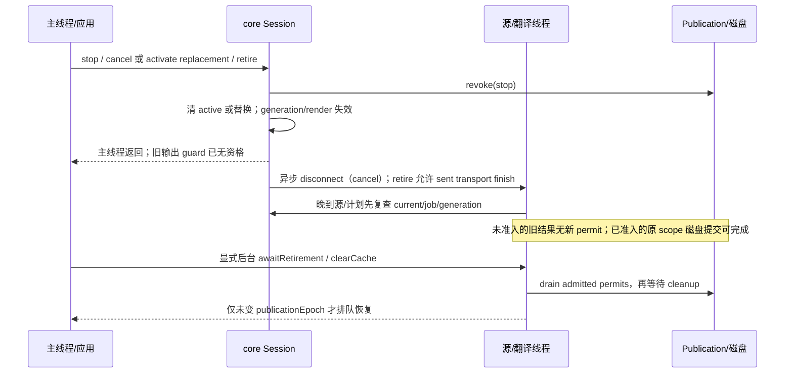

# 当前字幕状态职责、失效边界与事件合同

当前核对日期：2026-10-25；M3a状态合同 / M5c v1 F4已接受 / M5d-R1补正01已统筹接受。现行本地候选为 **1.5.8 / local-1.5.8-m6a**（M6a完成待复核、统筹待复核；最后接受M5i candidate-01），公开版为 1.5.7；原M3a交付身份local-1.5.8-m2a保留为历史。本文说明当前工作树的实现，不把长期路线中的提取方案当作现状。M5d等待覆盖缺口及补正状态见文末和当前网络合同；M3a测试与其输入指纹、包对比见 [M3a 结果](../maintenance/results/M3a-RESULT.md)；可检查的事件矩阵在 `validation/runs/20261024-M3a-01/event-matrix.json` 和 `.csv`。

## 1. 职责及入口

| 状态或决策 | 当前保存者、有效写入入口 | 读取或执行边界 |
| --- | --- | --- |
| 用户 AI 记录之一 | [DeepSeekConfig](../../infrastructure/src/main/java/app/yydarlinker/deepseekcaptions/DeepSeekConfig.java) `deepseek_caption_translator.enabled`，默认 false；生产 `saveEnabled` 的调用者为 Reconciler.onUserSwitched | 设置页/快捷开关展示、NativeCaptionBridge.enabled/suppressNativeDraw、Hook.rewriteUrl、Reconciler.displayAllowed、ProviderSettings/TranslationSettings.enabled |
| 用户 AI 记录之二 | [CaptionSessionIntent](../../application-host/src/main/java/app/yydarlinker/deepseekcaptions/CaptionSessionIntent.java) `deepseek_caption_session.ai_enabled/revision/provenance`；userToggled 每次 revision+1，移除旧语言键 | Reconciler.apply 额外读取 aiEnabled；revision 参与应用键及最终复查。不保存本次语言，也不在 beginVideo 时恢复旧语言 |
| 当前选轨/CC 投影 | [CaptionNativeProjection](../../application-host/src/main/java/app/yydarlinker/deepseekcaptions/CaptionNativeProjection.java) selection、beginVideo、ccState；[NativeCaptionBridge](../../application-host/src/main/java/app/yydarlinker/deepseekcaptions/NativeCaptionBridge.java) 采集原生模型；[CaptionButtonController](../../ui/src/main/java/app/yydarlinker/deepseekcaptions/CaptionButtonController.java) 观察真实 CC 控件 | Reconciler.currentSelection 校验前台视频、hasTarget；displayAllowed 校验 CC ON。语言来自当前原生选择，不来自目录、旧偏好或请求 URL |
| Activity/视频/播放器资格 | [CaptionPlayerAuthority](../../application-host/src/main/java/app/yydarlinker/deepseekcaptions/CaptionPlayerAuthority.java) setOwner/setVideo/close、onNotification、Shorts 生命周期及几何恢复；[CaptionSurface](../../application-host/src/main/java/app/yydarlinker/deepseekcaptions/CaptionSurface.java) 验证宿主/表面 | ownerEpoch、state、shortsExitBlocked、displayPermitted 与可见几何各有用途；引擎启动/停止不能代替真实播放器退出 |
| 应用会话协调/ready 合并 | [CaptionSessionReconciler](../../application-host/src/main/java/app/yydarlinker/deepseekcaptions/CaptionSessionReconciler.java) onVideo/onNativeSelection/onCcState/onPlayerRegular/onPlayerReady | 应用键为 video + owner epoch + intent revision + selection revision；ready 是一次主线程重试，不是计时器或长期轮询 |
| 命令/服务适配 | [CaptionActions](../../ui/src/main/java/app/yydarlinker/deepseekcaptions/CaptionActions.java) → [CaptionApplication](../../application-host/src/main/java/app/yydarlinker/deepseekcaptions/CaptionApplication.java).command | 真实 ACTIVATE/PREWARM/SOURCE 端口再次检查 displayAllowed/currentSelection；然后调用 core。Actions 本身不保存会话，不保证线程切换 |
| 翻译/源任务与提交 | [RebuildController](../../translation-core/src/main/java/app/yydarlinker/deepseekcaptions/RebuildController.java) active Session/Job；[RebuildCache](../../translation-core/src/main/java/app/yydarlinker/deepseekcaptions/RebuildCache.java).Publication/Prepared | 当前会话、generation、job identity、输出 guard、publication permit、磁盘候选 ordinal 分别检查不同边界 |
| 实际可见文本 | [CaptionOverlayV2.java 中 CaptionOverlay](../../ui/src/main/java/app/yydarlinker/deepseekcaptions/CaptionOverlayV2.java) show/accepts/render/geometryFrame | core guard 和 UI 的 command/playerRenderEpoch/owner/CC/几何检查叠加；应用 active 不等同于 TextView 已显示 |

双 AI 记录是现行兼容设计事实，不能简写成“只有一个权威值”。`onUserSwitched` 依次写 Intent 和 Config，清应用键，再按 enabled 应用或停引擎；两个 SharedPreferences 的 apply **不是跨存储事务**。`onUserActivated` 先记录 CC ON，仅 Config.enabled 为真时，才把旧版缺失/false 的 Intent.aiEnabled 回填为 true，再 apply。Config 为 false 时，原生 CC ON/语言选择不会启用 AI。Bridge 没有直接调用 userToggled，但 explicit 原生选择可经 onUserActivated 触发这个兼容回填，不能据类注释声称“所有原生路径绝不写 Intent”。

正常用户入口为 DeepSeekEnabledPreference 的 change listener、CaptionQuickToggle.toggle/setEngine（普通/Shorts 菜单开关也走这里）→ onUserSwitched。setEngine 开启时要求凭据存在，并发送 refreshConfiguration；它不改 CC 或当前语言。`onUserSwitched` 自身没有这个 UI 凭据前置条件。`displayAllowed` 只查 Config/CC/Shorts 退出，并不查 Intent；**apply** 才同时要求两个记录为 true。直接 application 端口同样不重新查 Intent，而是依赖 displayAllowed/currentSelection 与 core 的 settings.enabled；不可把双记录条件夸大成每个内部调用的统一入口约束。

断言依据：`CaptionSessionIntentTest.theAiSwitchIsStoredAndReadBack / aLegacyTargetIsIgnoredAndRemovedByTheNextSwitchAct / nativeLanguageSelectionNeverWritesTheAiMode`；`CaptionSessionReconcilerTest.dualAiRecordsGateDifferentDecisionsAndCcOnBackfillsLegacyModeM3a` 对 Config=true/Intent=false 的 display gate 与 apply 差别、CC 回填、反向不一致及用户 OFF 同步逐项断言；`ReintegratedApplicationTest.ccOnAndNativeLanguageSelectionNeverEnableADisabledAiSwitch` 用真实端口确认关闭态。测试链接见第 7 节。

## 2. 原生选轨和 CC 的事实边界

`DeepSeekCaptionHook.onVideoId` 的调用顺序是 Authority.setVideo → ButtonController.onVideoId → TokenCostAudit → Bridge.onVideoId → Actions.VIDEO。不同视频先清 CC 至 UNKNOWN，再消费有效 incoming track，最后让应用协调；同 ID 的 VIDEO 不必增加 ownerEpoch，Shorts close 则清 Bridge.visibleVideo 和 projection，令下次同 ID 成为一次新的选轨访问。`CaptionNativeProjection.beginVideo` 清语言/URL/observed 等并增加 selection revision，**本方法自己不清 CC**，CC 清理由上述独立入口负责。

Bridge `onNativeAppliedEvent` 接收 post-filter committed/requested、origin、reason 和 modelOwner。requested Off 即使有 forced committed track 也投影 Off；modelOwner 是模型 videoId，不是 CPN。`captureSelection` 拒绝模型与轨道 video 不一致、无法识别归属的 null、非 timedtext；后台选择只进入有限的按视频记录，不覆盖当前投影。`pendingHandoff` 以 Bridge 的 visibleVideo 判断；onVideoId 仅消费尚未消费的 incoming 记录一次，并重查 weak manager 的当前模型视频和 track 存活，旧手选不可重放。

| 证据 | 实际含义 | 不能推出的结论 |
| --- | --- | --- |
| DEFAULT | 自动/默认选择同样能确定当前语言 | DEFAULT 本身不能越过用户 CC OFF |
| explicit | PREFERRED_TRACK，或 committed 且 reason=1（真实 CC 点击可为 DEFAULT/reason=1） | 不等于“AI ON 命令”；Config=false 不开启 AI |
| committed | applied 入口给出 modelOwner，即 post-filter 结果 | 原始 requested selection 不具有同等初始化 CC 的资格 |
| Shorts committed + observed + 当前视频 + displayPermitted + Shorts surface + UNKNOWN CC | reconcileShortsCc 可将选中有效轨道的 UNKNOWN 初始化为 ON | 不能覆盖显式 CC OFF；普通播放器不能靠旧 Shorts open 标志授予 CC |
| 自动 off/reset | 清应用/停止，Shorts 可回到 UNKNOWN 等待后续有效默认轨 | 不是持久用户 OFF；不能把 forced fallback 当作 ON |
| track list/catalog | 选定目标后可供 SourceTrackPolicy 找原始/同目标轨、选择源 | 不选择目标，不写 AI 意图，不是 CC 命令 |
| rewriteUrl / 预取请求 | 对前台且匹配当前目标的请求只唤醒 observation；URL 原样返回 | 不恢复旧 tlang、不因请求新语言而选轨、后台请求不重定向当前会话 |

对应实际断言：NativeLanguageAuthorityTest 检查 handoff、manager 已改视频、旧视频/default 更新、目标来自 URL、目录/预取不能选轨；ShortsCaptionAuthorityTest 检查 raw requested、forced Off、explicit Off/default、reason=1；M2a 的两个 ReintegratedApplicationTest 用真实引擎/模拟服务同时检查 URL、原生 draw mask、文本及请求数。

## 3. 运行、显示与恢复不是同一个许可

| 当前事实 | 运行/显示结果与恢复触发 |
| --- | --- |
| AI OFF | Config/Intent 用户入口都保存 false，停 core，原生 draw mask 立即返回 false；CC/选轨保留。CC ON 或自动语言观察不能自己开启 AI；用户再开时使用当前选择 |
| AI ON + CC UNKNOWN | displayAllowed=false，真实应用端口不启动源/翻译；等待真实 CC 控件或合格的 Shorts commit/ready 初始化 |
| AI ON + CC OFF | 停 core/撤销输出，保留 AI 选择；默认轨或 AI 重开不覆盖 OFF。原生 CC ON/explicit 当前选择可恢复 |
| AI ON + CC ON + 当前选择 | apply 可发 SOURCE 或 ACTIVATE；若 ownTargetTrack 存在，原本 translated 的选择可用视频自带目标轨走 SOURCE，零翻译提供方请求 |
| COMPACT / TRANSITIONING_TO_REGULAR / CLOSED | 资格/几何检查抑制绘制，等待官方类型、有效几何或合法 Shorts 表面恢复；不是用户关闭 AI |
| Shorts close / teardown | 前者撤显示、清本次原生观察/CC UNKNOWN、取消 ready；后者清 reconciler Session、取消 ready、stop core，均不写用户 AI 意图 |

Authority.displayPermitted 要求 REGULAR + 有效 Activity；Shorts owner 还需未关闭及有效 Shorts 表面。Reconciler.displayAllowed 的条件比这个少，不能把它称作最终可见许可。Overlay.blocked 又单独检查 CC、Shorts 退出、compact/transition；其 suppressed 对 UNKNOWN 有兼容例外，随后仍需有效 Activity、guard、attach 和有效 captionVideoBounds。不能声称 UNKNOWN 在所有内部路径都等价 CLOSED，也不能从引擎 visible() 推导屏幕上一定有文本。

`CaptionApplication.sessionOpened/stopped` 当前均不写 player authority；core stop 只停止字幕引擎。N73 的真实应用测试反复 AI/CC OFF/ON，断言 player owner/type 保持、无需新的 type/time 事件便恢复，防止误把引擎会话当作播放器访问。

## 4. 各种标识及失效对象

| 标识 | 产生/变更 | 谁检查；实际撤销范围 |
| --- | --- | --- |
| player ownerEpoch | Authority 的不同 setOwner/setVideo、close 增加；同视频重复通知/AI 切换不必增加 | ReadyTask、reconciler Session bind、旧观察拒绝、UI denyDisplay/位置回调；不能充当所有翻译任务的 generation |
| native selection revision | Projection 内容视频/语言/URL/off/translated/observed 变化或 beginVideo 增加 | apply 最后复查、appliedKey；仅 explicit/committed/epoch 或 CC 改变不必增加（已有 repeatedIdenticalNativeSelectionsKeepTheSameIdentity 断言） |
| Intent revision | userToggled 每次增加，包括兼容回填/同值切换 | apply 复查并参与应用键；不是 native owner epoch，也不代表配置 profile 版本 |
| ready generation + task identity | cancelPlayerReadyLocked 增加 generation、removeCallbacks、清 slot；fresh session、teardown、Shorts close/resetForTests 调用 | ReadyTask.run 检查当前 slot=this、generation、ownerEpoch、video；再查 ownerValid/REGULAR/shortsRecoveryCandidate。AI/CC OFF 通常由执行时 gate 拒绝，不必删除 ready callback |
| appliedKey / appliedSelection | apply 接纳后记录 video/epoch/Intent rev/selection rev；retireApplication 只清 key | 同事实幂等；选轨变更需先 deactivate 旧语言。它不代表任务已经发送或 TextView 已画出 |
| translation Session.id / active identity | core activate 以源轨 identity、配置 fingerprint、key hash、目标、original 等复用或更换 active；video/stop 可清 active | current(s) 要求 active==s、publication OPEN、!cancelled、video 匹配。id 也用于输出身份/诊断；Session.config/credential 是本会话快照 |
| Session.generation | seek 的新一代、首次 requestRetirement 增加 | positionGuard、load/cache恢复、run Job/repair/render 检查；不与 player epoch 同步递增 |
| renderRevision / renderSubmission / UI playerRenderEpoch / COMMAND | 文本/页面输出和 UI 清理/播放器重绘分别推进 | render guard 检查 current/generation/revision/submission/visible；Overlay 接受投递前/后再查 guard、UI epoch，横向定位回调再查 owner/identity/guard/blocked |
| publicationEpoch | core active 替换、video 失效、stop 推进 | guarded clear 不清新会话；clearCache 的后台排空后 MAIN restart 只在 epoch 未变且 active=null 时执行 |
| Publication mode/outstanding | OPEN→RETIRED 或 STOPPED；STOPPED 不可退回；reserve 仅 OPEN 增加 outstanding | 不再授予新 permit；已有 permit 可完成，drain 等它们关闭。它不是 generation 数字 |
| Prepared ordinal / WriteOrder | 同一缓存目标 prepare 时增加全局 ordinal；commit 保存该目标最新成功 ordinal | 旧候选不能覆盖较新已提交候选；已准备文件本身不是提交许可，调用者必须取得 Publication permit |
| CC 控件 generation / scanGeneration | ButtonController 新视频、控件绑定/观察、transition 等分别更新 | 拒绝旧控件/扫描；不是 native selection revision，不能用旧按钮给新视频 CC ON |

ReadyTask 不捕获选轨语言。合并相同 video/epoch 任务时仅把强就绪信号并入 forceProbe，执行时重新取 projection；选轨更新后必须使用新语言。source-only 和 translation 会话共用很多生命周期防护，但 source-only 不调用 RebuildApi，不拥有 core 的 native track；应用 ownsNativeTrack 还把 visible source overlay 计入屏幕拥有者。

## 5. 逻辑撤销、网络完成和磁盘屏障

`stop`/video 改变/refresh 走 STOPPED，撤销 active/guard 并 cancel；主线程不等 disconnect 或磁盘。`activate` 直接替换不同 scope 时走 RETIRED，Job.isCancelled 允许 **sent && finishSent** 的原已发送HTTP继续读取/完成；M5c新增每次HTTP的tryBeginAttempt，Job要求current，退休后不批准参数协商/两种stream回退的新POST。未发送旧 Job 无权发送，run/stream/provisional 仍需 current，不能发布进新会话。原生选轨更改的 reconciler 路径先 deactivate，所以它常走 stop/cancel；不能把所有语言/配置切换笼统写成 retire。

`run(Job)` 在 session 锁外调用提供方、校验、prepare/fsync；再在 session 锁中重查 current/job/generation/旧 plan 并 reserve。reserve 与 revoke 通过 Publication 的 monitor 排序。commit 在生命周期锁外执行；如果 revoke 前已经取得 permit，旧原 scope 的持久化可在撤销后完成，随后内存 plan/显示更新仍会因 current/generation 拒绝。**退出不等于清除一切旧缓存，也不保证网络立刻消失。** `awaitRetirement` 等已经准入的工作和物理 cleanup；clearCache 先 stop、后台 drain、再清译文/源缓存，用 publicationEpoch 防止旧 restart 重开新状态。

源缓存另有作用域：RawCaptionSource.loadTrack 检查 consumer active 后再 SourceCaptionCache.put；SourceLoadFlights 的共享原始网络任务按 key 复用，单个 consumer 退出不能取消其他 consumer，最后一个退出才 abandon 并异步断开。源缓存没有译文 Publication permit；不要把两个缓存协议混成一个“epoch 原子屏障”。测试没有证明任意线程下 checkActive 与 put 之间零竞态，也没有要求可复用原视频源字节被删除；本卡保证范围为当前选择、输出和译文提交的实际检查。

本轮 PublicationLifecycleTest 用真实 Session/Job/Publication/Prepared 和磁盘文件确认：main cancel 即刻撤销、新 reserve=null；受控 disconnect 未释放时主线程能返回；off-main barrier 在已准入 permit 关闭前不能完成；retire 允许 sent、拒绝 unsent、cancel 可升级；旧 scope 已准入提交可完成但不能在新 model 的实际 cache key 命中；仍持有的旧 Prepared 不能覆盖较新提交的不同文本。它不声称跑了完整网络引擎；真实应用输出由 ReintegratedApplicationTest 配合覆盖。

## 6. 线程与锁的当前事实

| 入口/工作 | 实际线程和锁 | 限制 |
| --- | --- | --- |
| Activity/设置/触摸、绘制 | Android UI 回调通常在主线程；Authority.setOwner/setVideo/close/onNotification/onShortsStateChanged 显式 toMain；Overlay.main 把 View 操作投递 MAIN | Hook.onVideoId 的整个流水线、Bridge.observe、Reconciler 多数入口没有统一 toMain。不能仅因 Authority 内部投递就声称整个链路被串行化 |
| 原生观察与投影 | Bridge.SELECTION_LOCK 保护按视频记录、pending handoff、visibleVideo；Projection.LOCK 保护快照与 CC；ButtonController.NATIVE_STATE_LOCK 保护原生控件/菜单证据 | Bridge 部分目录发布/诊断/回调仍在 SELECTION_LOCK 范围，不能称作“所有锁内均无外部调用”。来源端实际线程需按宿主 hook 审核 |
| Reconciler | LOCK 保护 Session、ready slot/generation、应用键；ReadyTask 在 MAIN；apply 在选择源策略前后分别复查 | 它不是全局状态机锁；context 等静态字段和外部调用不都被同一锁保护。SharedPreferences 双写不提供跨 store CAS |
| core 调度/源读取 | SOURCE_IO=1；PRIORITY_IO=2、PREFETCH_IO=2；MAIN 80ms engine tick（与 N75 ready 单次任务不同） | 不能声称系统没有 timer；N75 只是没有新增长期 ready 轮询。SourceLoadFlights 另有 2 个共享 worker、8 排队、1 个断开 worker |
| core 生命周期和提交 | RebuildController.class 保护 active/publicationEpoch；Session monitor 保护任务/计划更新；Publication monitor 仅 mode/outstanding；连接集合和 Prepared 写序各自锁 | 网络、prepare/fsync、commit、disconnect、await barrier 不在 core 生命周期 monitor 内等待；不能在 MAIN 调 awaitRetirement（明确抛异常） |
| cleanup/config/UI 页面 | CaptionRetirementIO=1、队列16；源 disconnect 独立线程；配置/凭据快照在 ApiProfiles.LOCK 内；Overlay 的页面规划异步/主线程应用 | cleanup 容量/失败会诊断且显式 barrier 可失败，不是无条件最终成功；不是设备延迟/耗电认证 |

当前测试主要在 PAUSED main looper 驱动业务入口，网络/源/cleanup 实际在后台线程。没有用这些结果证明任意宿主线程调用顺序的全局线程安全，也没有运行真实设备主线程性能测量。

## 7. 事件、源码和实际测试断言矩阵

下表方法均已检查方法体；“端口替身”只覆盖真实 bridge/reconciler/authority 决策，“真实应用”含 CaptionApplication、core、源网络适配、Overlay/TextView，网络均为 MockWebServer。类入口：[ShortsCaptionAuthorityTest](../../extensions/extension/src/test/java/app/yydarlinker/deepseekcaptions/ShortsCaptionAuthorityTest.java)（S）、[NativeLanguageAuthorityTest](../../extensions/extension/src/test/java/app/yydarlinker/deepseekcaptions/NativeLanguageAuthorityTest.java)（N）、[CaptionSessionReconcilerTest](../../extensions/extension/src/test/java/app/yydarlinker/deepseekcaptions/CaptionSessionReconcilerTest.java)（R）、[ReintegratedApplicationTest](../../extensions/extension/src/test/java/app/yydarlinker/deepseekcaptions/ReintegratedApplicationTest.java)（A）、[CoreSessionIntegrationTest](../../translation-core/src/test/java/app/yydarlinker/deepseekcaptions/CoreSessionIntegrationTest.java)（C）、[PublicationLifecycleTest](../../translation-core/src/test/java/app/yydarlinker/deepseekcaptions/PublicationLifecycleTest.java)（P）、[CaptionSessionIntentTest](../../extensions/extension/src/test/java/app/yydarlinker/deepseekcaptions/CaptionSessionIntentTest.java)（I）。

| ID；初始状态 → 事件顺序 | 期望/执行或拒绝判据；源码方法 | class.method 和已检查断言；层级/限制 |
| --- | --- | --- |
| E01 AI ON/Shorts CC UNKNOWN，surface 未就绪 → commit fr → VIDEO → geometry，无 type/time | 当前 committed + 同 video + 有效表面初始化 CC，执行一次；Bridge.onVideoId、Reconciler.ReadyTask/onPlayerRegular/reconcileShortsCc | S.aHistoryReentryStartsWhenItsSurfaceBecomesReadyWithoutATimeTickN75：active=true、fr、starts=1；A.historyShortsReentryWithLateGeometryRestoresFreshTranslationWithoutATimeTickN75：真实法语可见。原有覆盖，表面为 geometry shadow |
| E02 表面先就绪/CC UNKNOWN → DEFAULT commit | 只接受当前合格 commit；Reconciler.onNativeSelection/reconcileShortsCc | S.committedDefaultStartsShortsWithoutOpeningTheLanguageMenu：CC ON、active、starts=1、URL 目标；A.aShortsDefaultStartsTheRealEngineWithoutAManualLanguageChoice：真实文本。原有覆盖 |
| E03 离开再进同 ID，无新 type/time → fresh DEFAULT + late geometry；以及无新 committed 的对照 | pendingHandoff 仅消费新访问；已消费语言不回放；Bridge.onShortsClosed/onVideoId | A.sameShortReentryWithDefaultBeforeVideoIdShowsTheFreshTargetN73 / historyShortsSourceTrackRestartsAfterGeometryWithoutAnApiRequestN75；S.noFreshNativeTrackMeansNoRememberedLanguageOnReadyN75：无 starts/selection、inactive。原有覆盖 |
| E04 ready 已排队 → CC OFF → 放行 | CC gate 执行时拒绝、OFF 不被默认恢复；Reconciler.displayAllowed/reconcileShortsCc | S.aQueuedReadinessPassCannotUndoCcOffN75：inactive、starts 空、CC OFF。原有端口替身覆盖 |
| E05 ready 已排队 → AI OFF → 放行 → 用户 ON | Config/Intent gate；onUserSwitched/apply | S.aReadyShortWithAiOffKeepsNativeModeUntilTheUserEnablesAiN75：OFF 无 starts/Config=false，用户 ON 后 active/starts=1。原有覆盖 |
| E06 ready 已排队 → Shorts close → 放行 | cancel slot/generation、清 native visit/CC；onShortsClosed | S.closingBeforeAReadyPassRunsCannotReviveTheOldShortN75：inactive/starts 空/currentSelection=null；A.leavingShortsRemovesTheRealTranslationAndCannotBeRepaintedByATick：真实文本撤回。原有覆盖 |
| E07 扣住实际 ReadyTask → teardown → 手动释放旧 task + idle | slot/generation/session 已失效；onTeardown/ReadyTask.run | S.aHeldReadyCallbackCannotApplyAfterTeardownM3a：inactive、starts 空、sessionVideo 空、AI 意图仍真。新增；真实协调，应用端口替身，无物理网络 |
| E08 扣住实际 ReadyTask → 更换 Activity owner → 允许新表面 → 释放旧 task；再发有效 ready | 旧 epoch 不能取得 CC/应用资格；ReadyTask.run | S.aHeldOldOwnerReadyCallbackCannotTakeOverTheNewOwnerM3a：旧回调 inactive/starts 空/CC UNKNOWN，新回调 starts=1/fr。新增；同一测试的当前 owner 为正向对照 |
| E09 重复 ready/observation → 排队期间 fr 改 ja → strong geometry → 放行 | 合并同 task、forceProbe 升级，执行时读最新 projection；onPlayerReady/apply | S.coalescedReadyReadsTheLatestSelectionInsteadOfTheQueuedLanguageM3a：扣住期间 starts 空/同一 task，释放后只发一次 ja。新增；S.repeatedReadySignalsApplyTheCurrentTrackOnlyOnceN75、N.duplicateDefaultObservationsDoNotRestartTheEngine 原有幂等覆盖 |
| E10 当前 B 已选目标 → A/预取/旧 epoch 观察晚到 | foreground/model/epoch 拒绝；Bridge.observe/captureSelection、Hook.rewriteUrl | N.aLateDepartedVideoSelectionCannotReplaceTheForegroundLanguage / aCachedTrackWhoseManagerHasMovedToAnotherVideoCannotBeHandedOff；R.anOldEpochTrackListChangesNothing：key/applications 不变，stale 增一次，当前 epoch 不再增；A.v2PrefetchAndDepartedRequestsCannotRetargetTheRealSessionM2a：文本/CC/请求计数不变。原有覆盖 |
| E11 中文提供方回复被扣住 → 原生目标 fr → 新回复先显示 → 放旧回复 | current/session/generation/guard；Reconciler.apply、core.run/render | A.anOldLanguageResponseCannotPaintAfterTheNativeTargetChanges：法语可见、中文不见；C.videoAndTargetReplacementRejectsTheOldSession：旧 guard=false、旧文本不进入 recorder、calls=2。原有；A 旧回复释放后的 idle 不等同物理 transport drain |
| E12 旧 model 请求扣住 → saveModel + CONFIGURATION → 放旧回复 | refresh stop/cancel + 新 Session.config；RebuildController.refresh/activate | A.configurationChangeUsesTheNewModelAndRetiresTheOutstandingRequest：posts=2、译文可见、lastModel 新值。原有；单独不证明旧缓存磁盘屏障，配合 P 案例 |
| E13 源回复扣住 → VIDEO B → 释放 → source lane barrier → B 有效 SOURCE | current/sourceJob/consumer 失效拒绝旧输出；Application.VIDEO、core.load、RawCaptionSource.checkActive | A.aHeldSourceReplyCannotPublishIntoTheNextVideoM3a：旧 source 完成后 inactive/无原文或译文/posts=0；当前 B 正向对照显示原文、sourceGets=2/posts=0。新增；真实应用/网络/UI，无任意 sleep；barrier 等 core 单源 lane，不宣称所有共享 worker 均排空 |
| E14 permit 已准入、disconnect 扣住 → main cancel → 后台 drain → 依次释放 | 撤销先于物理完成；Session.requestRetirement/awaitRetirement、Publication.reserve/drain | P.mainCancelRevokesImmediatelyWhileDisconnectAndAdmittedWorkAreHeldM3a：cancelled/generation 变、新 reserve=null、main barrier 抛指定原因、未关 permit 的 Future 超时、关闭后完成。新增；真实 Session/Publication，假连接 |
| E15 sent/unsent Job → retire → cancel 升级；旧 cache candidate 与新提交交错 | finishSent 只放旧已发送网络，不放新提交/显示；Prepared ordinal 防覆盖，配置 key 隔离 | P.retireAllowsOnlySentTransportAndCancelEscalatesItM3a；P.admittedOldCacheWriteCanFinishButCannotReplaceANewerCommittedCandidateM3a：sent 可继续/unsent 拒绝/STOPPED 全拒绝；旧 key 命中新 key 不命中、较新 JSON 保留、tmp=0。新增隔离合同，非完整网络端到端 |
| E16 CC OFF 与 AI OFF 后分别恢复；原文零提供方调用；双记录兼容 | CC 是显示事实、AI 是持久选择；onCcState/onUserActivated/onUserSwitched；core sourceOnly | A.ccCyclingAlsoRestoresAiSourceCaptionsWithoutCallingTheProvider / enablingAiWhileCcIsOffWaitsForCcAndBlocksEveryActivationEntry / ccOnAndNativeLanguageSelectionNeverEnableADisabledAiSwitch；C.originalSourceSelectionHasNoTranslationRequests：原文内容、calls=0、core ownsNativeTrack=false；R.dualAiRecordsGateDifferentDecisionsAndCcOnBackfillsLegacyModeM3a 新增双记录对照。原有行为 + 一个兼容缺口补测 |

## 8. 覆盖结论、待确认和建议

当前事实：原有 N69–N75/M2a 的大部分事件顺序已被有效断言覆盖；本轮只增加 8 项合同（core 3，extension 5），没有改名/移动旧测试或减少旧断言。新增 ready 测试用 PAUSED looper 和真实排队 Runnable，旧 owner/teardown 输入为负向，当前 owner 为正向；源回复测试使用真实 application port、core、RawCaptionSource/共享源 worker、MockWebServer 和 TextView，只有几何、安装标志、KeyStore、原生混淆模型 accessor/Cronet 路由使用既有替身。P 使用真实缓存磁盘实现；没有付费服务。

待确认：实际宿主每个 native hook 的线程约束，任意线程下跨对象顺序的一致性；真实设备上的 Activity/Shorts 几何与导航；任意供应商的取消/计费效果；共享源缓存 checkActive→put 的所有并发交错。这些未被本轮测试证明，不据此判定既有产品缺陷。本卡未发现有效生产缺陷，首次 owner 用例失败来自 Activity setup 推进队列的测试前置错误，原失败日志和修正原因保留在结果中。

建议（尚未实现）：后续 M4 提取前保留应用键、ready、翻译 generation 和 publication 的不同职责；若要收敛 AI 双记录或统一线程入口，先明确迁移/宿主线程契约并另卡验证。不要删除兼容回填、把 CC UNKNOWN 写成用户 OFF，或把 retire 改成所有已发送请求立即物理终止。本卡不进入 M4。

M5a补充：[网络失败合同](NETWORK-FAILURE-CONTRACT.md)核实传输、协商和配置的实际作用域。上文M3a所述旧/新cache key隔离由新model测试证明，不能推导为凭据/profile隔离；现行semantic disk identity不含key/profile ID。m4a/m5b历史实测中，retire允许sent逻辑调用继续时也可能以旧key发后续协商POST；M5c已按明确产品决定收紧新尝试准入，保留原传输读取，publication撤权与物理HTTP请求数仍需分别判断。

M5c权限补充（已统筹接受）：每次模型POST都先在RebuildApi循环、beginAttempt/send前调用tryBeginAttempt；Job通过current中的Publication.isOpen同步读取与revoke排序，退休先发生时不批准。准入后发生的重叠退休仍受既有onConnection/isCancelled/STOPPED检查约束，不承诺物理零字节。该读取不预留输出/缓存permit、不持生命周期锁做I/O。Job.sent/isCancelled、Publication与旧scope已准入提交保持原义。九项真实Job/HTTP回归和原M3a Publication/真实应用旧回复、配置/视频切换回归共同约束；详见[当前网络失败合同](NETWORK-FAILURE-CONTRACT.md#8-m5c-每次尝试准入与读取权限)及[M5c结果](../maintenance/results/M5c-RESULT.md)。M5c交付时F2 page/hole等待/过滤门未闭环，M5d当前实现见下段；F3语义缓存及F5诊断分类不变。

M5d状态资格补充（原交付保留，当前补正见末段）：Session.filteredBlocks与terminal决定后续模型发送资格，READY/Plan只表示保留的内容。普通/page/hole在调度入口及实际逻辑调用前读同一providerRetry/retryAt/停止门，子失败共用原因更新且不清理别的普通Job。过滤在同Session的seek/resetDisplay后保持；新有效Session重建集合。临时门拒绝的普通预约退回WAITING及原额度，未准入page退回key/count，尚未花费的hole由已有kick恢复，不新增长期timer或次数。configuration/content_filter子失败保留旧Plan与已显示译文；render仅在无有效内容时继续原终态提示。子成功仍检查原Plan/generation，旧代际失败的Session/父块停止理由不随display reset消失。F1安全等待、F4每物理attempt生命周期、finishSent/STOPPED、publication/cache及源模式零模型请求继续回归。完整原因/计数/验证映射见[网络合同第9节](NETWORK-FAILURE-CONTRACT.md#9-m5d逻辑发送资格子修复失败与保留内容)及[M5d结果](../maintenance/results/M5d-RESULT.md)。

M5d统筹原复现限制（原证据保留）：子修复已建立的较晚retryAt曾被同Session/父块晚到普通失败改短，导致后续page提前POST。见[M5d复核](../maintenance/reviews/M5d-REVIEW.md)；原770项/组合不重写。当前[补正M5d-R1结果](../maintenance/results/M5d-R1-RESULT.md)经[统筹复核](../maintenance/reviews/M5d-R1-REVIEW.md)接受，F2在原卡及补正规定范围关闭；原缺陷证据不重写。

M5d-R1等待状态补充（已统筹接受）：同一有效Session/父块的既有较晚retryAt，与后来的普通/子失败及取消、slot释放、语义review收尾以同一max+RetryAfter.after规则合并。显示generation变化不清等待；新有效Session/首次源接纳仍按原失效边界初始化。provider继续取max。真实seek取消未sent普通任务返还原额度而保留并发hole300秒父门；pendingFocus在schedule前置gate检查后返还预约，不改门。已合法准入成功hole可以合并旧有效事件，同时保留普通失败建立的父门；普通成功若按原语义资格安排review，不能用1200ms覆盖既有长门。READY/WAITING/Plan仍不替代发送资格，Publication、finishSent/STOPPED、过滤、terminal和原次数不变。7项补正实际HTTP用例、原24项及777完整结果/组合见[网络合同第10节](NETWORK-FAILURE-CONTRACT.md)与本轮结果；未声称穷举所有提交或宿主线程窗口。

M5e已验证并经[统筹复核](../maintenance/reviews/M5e-REVIEW.md)接受：受控连续播放下hole可合并并经有效guard/showEvent显示缺失半句；原式位置跳转可触发seek，响应晚到时旧generation按合同拒绝合并、旧guard失效。当前夹具固定相应顺序，失败清理/端口恢复有证据。历史原始失败和未观察入场失败缺当时完整链，根因仍未定，不能由受控解释或随后通过反推；旧generation保护未改。

M5i缓存边界补充（经统筹接受本轮规定范围与限制）：[缓存故障合同](CACHE-FAILURE-CONTRACT.md)记录译文read/review/实际调度、源LoadedTrack重解析/本地回源、prepare/替换失败、clear epoch和已准入提交。生产只局部修复SourceCaptionCache文件替换及进程内成对读写；RebuildCache/Controller、F1/F2/F4、finishSent/STOPPED、F3语义复用和F5计账分类不变。checkActive→put窗口与跨文件崩溃原子性仍有限制，不把源写入等同新Session显示权。完整861项及规定组合见[M5i结果](../maintenance/results/M5i-RESULT.md)，接受范围及限制见[M5i复核](../maintenance/reviews/M5i-REVIEW.md)。

M6a补充（完成待复核）：[诊断/性能合同](DIAGNOSTICS-PERFORMANCE-CONTRACT.md)将原始原因、旧计账桶和当时实际门分开。Controller.applyFailure只增加原Job/scope的只读事实，不改变状态职责或请求权；缺失事实保持未知。CaptionApplication.settings复用一次严格读取的临时RequestSettings凭据，仍在ApiProfiles.LOCK中得到原不可变TranslationSettings；不增加全局明文、持久格式或跨store事务。6源会话/120播放time验证热路径新增key/严格配置读取0，实际源getLocked在CaptionSharedSourceIO、提交重入读在DeepSeekCaptionSourceCache，off-main退休屏障/队列排空和旧Publication拒绝有效。原16行事件合同及Publication、源put前窗口和设备/任意交错限制保持。
