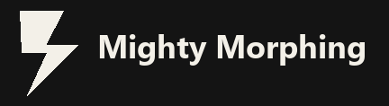

# Mighty Morphing Patches

Patches for Joey for Reddit (last published release)

Click the following to add to morphe sources

https://morphe.software/add-source?github=ZoomSass/Mighty-Morphing

<!-- PATCHES_START EXPANDED -->
- **Backup and restore:** Save Joey and Morphe settings to a file and restore them later, including splash, theme, fonts, comments, and show and hide. Log in to the same Reddit account before restoring subscriptions. Access via Joey Settings - Morphe Settings.
- **Disable tooltips:** Turns off the first-run tips Joey shows.
- **Dismiss without tearing:** Swiping a photo away to close it looks smooth instead of tearing.
- **Editor image and GIF upload:** Uploads images and GIFs to Reddit directly when adding comments. Both can be uploaded via the image button. Also adds keyboard gif auto upload to reddit (click markdown in editor (far left icon) to enable keyboard gif support).
- **Fix collapsed replies:** Loads replies that stay hidden when Reddit will not open them. Based on the Patcheddit fix.
- **Fix login page:** Makes Reddit's login page load and work properly inside Joey, and clears the cookie banner out of the way.
- **Inline comment media:** Shows GIFs, pictures, subreddit emojis and Reddit videos in comments instead of links. Tap to open, drag left or right to resize, and scroll past them as normal. YouTube links use a 16:9 preview with the title. Extra settings in Joey Settings - Morphe Settings.
- **Log in with your own client ID:** Lets Joey log in with another app's client ID, for when Joey's own login stops working. Normal option here is to sign in to RedReader once, then paste the App ID from Reddit's "you authorized an app" email into this patch's settings in expert mode.
- **Modern UI:** [v1.4.0: Post actions editor for the post bar and ⋮ menu. Full screen media, optionally opening without controls. New album viewer with thumbnails, grid and captions. Separate Modern fonts. Sidebar subreddit search keyboard fixed. Performance improvements, comparably smooth to Joey or better.] A cleaner layout for Joey, on by default, with a choice of themes. Joey's own themes and colours are off while it's on, and Classic Joey can be switched back on any time. Posts use one compact list with adjustable post style, details and images. Settings in Joey Settings - Morphe Settings.
- **Open Reddit share links:** Opens modern Reddit share links directly to the right post or comment in Joey instead of loading the web page. To open Reddit links from other apps, make sure all links are ticked in Android Settings -> Apps -> Joey -> Open by default.
- **RedGifs with sound:** RedGifs clips play with their sound, in HD when it's available.
- **Search auto open keyboard:** Opens the keyboard automatically for homepage search and comment search. The Enter and Search keys start the search.
- **Seasonal sidebar banner:** Shows a picture in the sidebar header that changes with the season, or one you choose. If you set it back to Joey's image, any picture Joey had already saved is still there and gets used again.
- **Show/Hide:** Choose which comment editor buttons, sidebar entries, subreddit toolbar items and post actions are shown, and drag to reorder them. What doesn't fit on a post goes in its menu. Adjust in Joey Settings - Morphe Settings.
- **Skip ads and checks:** Removes ads everywhere and also drops the Play Store install check and crash reporting.
- **Splash Screen:** [v1.4.0: Match theme keeps your chosen animation.] Logo inspired by u/otheast. Logo, colours and animation can be customised, follow your theme, or the animation can be turned off, in Joey Settings - Morphe Settings.
- **Subreddit filter options:** Adds a subreddit suffix filter and lets you toggle subreddit filters on or off without deleting them. Configure in Joey - Settings - Filters, or from the feed Filter out posts menu.

<!-- PATCHES_END -->

## To be added
- **Video upload support:** In-comment video uploads to Reddit.
- **Album downloads:** Save every file in a Reddit gallery.
- **Internal browser domains:** Specific domains list to always open inside Joey's internal WebView browser.
- **Account stats:** Reactivate account age and karma indicators on posts and comments.
- **Pinned sidebar:** A sidebar that can stay open beside the feed.
- **Post details overflow menu:** Choose which post details stay on the line and which go in an overflow menu.
- **Feed UI tweaks:** Further adjustments to the feed layout.
- **Modern UI:** Further theme enhancements. Full post style settings integration.
- **Show and hide previews:** Live previews for the show and hide options that do not have one yet.
- **Arctic Shift undelete:** Look up removed posts and comments through https://arctic-shift.photon-reddit.com.

## License

Mighty Morphing Patches are licensed under the [GNU General Public License v3.0](LICENSE).
