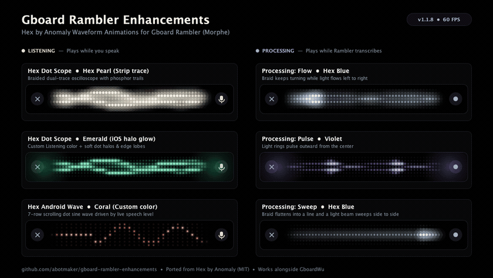
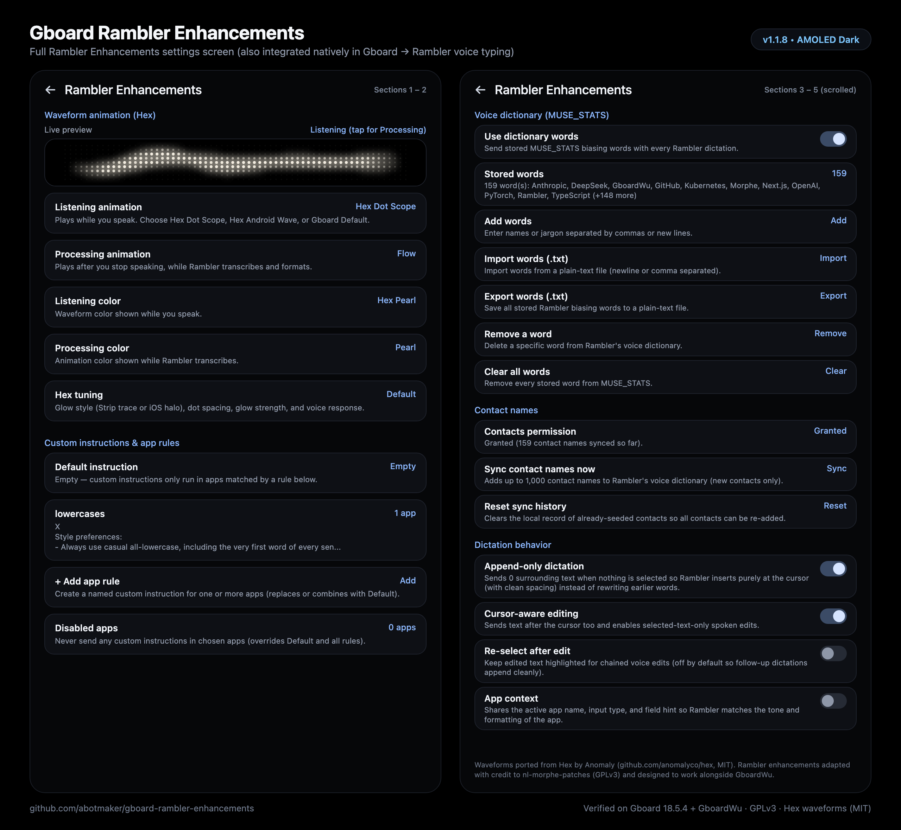

# Gboard Rambler Enhancements

Standalone [Morphe](https://morphe.software) patch pack for **Gboard Rambler** (Agentic Voice Typing), bringing **[Hex by Anomaly](https://github.com/anomalyco/hex)** waveform animations plus Rambler power-user enhancements — designed to patch cleanly **alongside upstream [GboardWu](https://github.com/jasonwu1994/Gboard-patches)** without conflicts.

  

  
Preview: Native <strong>Rambler voice typing</strong> settings &amp; <strong>Per-app custom instructions</strong>

  

    
  

---

## Compatibility & Version Honesty

| Gboard Version | Status | Notes |
|---|---|---|
| **`18.5.4.993608717-release-arm64-v8a`** (current GboardWu target) | **Verified working** | Tested end-to-end both standalone and combined with upstream GboardWu (`v4.4.0`) |
| **Other / newer Gboard `18.5.4+` versions** | **Unverified / best-effort** | Patches are **not** version-pinned and use dynamic bytecode fingerprinting (zero hardcoded obfuscated class/method/field names), so they *may* continue working on newer versions, **but are not guaranteed** if Google refactors internal classes |

> **Android requirement:** Rambler's AGSL light bar (which `Rambler Waveform Animation` hooks) requires **Android 13+ (API 33+)**.

---

## Included Patches

All 7 patches appear **directly inside Gboard Settings → Voice typing → Rambler voice typing** in native Material You style (as well as in the unified **Voice typing → Rambler Enhancements** screen). Only controls for the patches you selected in Morphe are shown:

- **Custom instructions & Per-app rules** — inline Default editor + per-app rules (apply custom instructions only to selected apps, create named style presets, override **Append-only**, **App context**, and **Strip trailing period** per app, or exclude apps via a zero-permission searchable app picker)
- **Waveform** — **Waveform animation (Hex)** (jumps straight into Listening/Processing style, colors, and Hex tuning)
- **Voice dictionary & contacts** — live **Use dictionary words** switch + **Manage voice dictionary (MUSE_STATS)** + **Contact names sync** (alongside stock *Rambler dictionary* and *Clear all corrected words*)
- **Dictation behavior** — live switches right on the page for **Append-only dictation**, **Cursor-aware editing**, **Re-select after edit** *(off by default)*, **App context**, **Auto parallel retry**, plus **Max dictation duration**
- **Productivity tools** — **Voice snippets, replace & actions** (opt-in Hands-Free Voice Send & Search suffixes, deterministic Voice Snippets, Find & Replace, Strip Trailing Period), **Dictation history** (last 50 on-device dictations), and **Backup & restore (.json)**

1. **`Rambler Waveform Animation`** *(ported from [Hex by Anomaly](https://github.com/anomalyco/hex))*
   - Replaces Rambler's header light bar with Hex's **Listening** and **Processing** animations, independent colors, and minimal tuning (**Strip trace** vs **iOS halo**, dot spacing, glow strength, voice response).
2. **`Rambler Custom Instructions`** *(credit: [nl-morphe-patches](https://gitlab.com/johninnld/nl-morphe-patches))*
   - Enables persistent custom style/formatting rules sent with Rambler dictations, plus **Per-app rules** (keep Default empty to run only in selected apps, add named rules for different app groups, set per-app **Append-only / App context / Strip trailing period** overrides, or exclude apps via **Disabled apps**).
3. **`Rambler Personal Dictionary`** *(credit: [nl-morphe-patches](https://gitlab.com/johninnld/nl-morphe-patches))*
   - Enables Gboard's `UserFeatureCache` `MUSE_STATS` voice biasing dictionary with add, `.txt` import/export, remove, and clear controls.
4. **`Rambler Contact Names`** *(credit: [nl-morphe-patches](https://gitlab.com/johninnld/nl-morphe-patches); depends on `Rambler Personal Dictionary`)*
   - Automatically seeds up to 1,000 phone contact names into Rambler's `MUSE_STATS` list (requires Android Contacts permission for Gboard) with manual sync & history reset.
5. **`Rambler Cursor-Aware Editing`** *(credit: [nl-morphe-patches](https://gitlab.com/johninnld/nl-morphe-patches))*
   - Enables cursor-aware editing, selected-text-only spoken edits, a live **Re-select after edit** toggle *(off by default so follow-up dictations append cleanly instead of re-editing)*, and a live **Append-only dictation** switch (sends `0` surrounding text when nothing is selected so Rambler inserts purely at the cursor with clean boundary spacing).
6. **`Rambler App Context`** *(credit: [nl-morphe-patches](https://gitlab.com/johninnld/nl-morphe-patches))*
   - Enables sharing the active app name, input type, and field hint so Rambler adapts formatting to the current app (with a live toggle).
7. **`Rambler Productivity Tools`**
   - Adds opt-in **Hands-Free Voice Send & Search Suffixes** (e.g. `"pls send the link, hit send"` in Send-capable chat fields), deterministic **Voice Snippets**, post-dictation **Find & Replace** (plain or regex, global or per-app) + **Strip Trailing Period**, private **Local Dictation History** (last 50 entries), **Auto Parallel Retry** on flaky networks, configurable **Longer Dictation Sessions**, and one-tap **JSON Settings Backup & Restore**.

---

## Hex Waveform Animations — When Do You See Each One?

| Setting | Options | When You See It |
|---|---|---|
| **Listening animation** | **Hex Dot Scope** *(braided dual-trace dot oscilloscope with phosphor trails)* **Hex Android Wave** *(7-row scrolling dot sine wave)* **Gboard Default** *(stock Gboard light bar)* | Plays **while you are speaking** into Rambler |
| **Processing animation** | **Flow** *(braid turns as light flows left → right)* **Pulse** *(light rings pulse outward from center)* **Sweep** *(braid flattens and a light beam sweeps side to side)* | Plays **briefly after you stop speaking**, while Rambler transcribes and formats your speech |
| **Listening / Processing color** | Hex defaults (**Hex Pearl** / **Hex Blue**), **Theme accent**, presets, or custom HSV/Hex picker | Tints the Listening and Processing stages independently |
| **Hex tuning** | **Glow style** (`Strip trace` vs `iOS halo`), **Dot spacing**, **Glow**, **Voice response** | Adjusts look and sensitivity across both stages |

---

## Using Alongside GboardWu — What to Select (So Nothing Breaks)

This pack is engineered specifically to coexist cleanly with **upstream [GboardWu (`jasonwu1994/Gboard-patches`)](https://github.com/jasonwu1994/Gboard-patches)** in a single Morphe patch run:

1. **Add both sources in Morphe Manager:**
   - Upstream GboardWu: `https://raw.githubusercontent.com/jasonwu1994/Gboard-patches/main/patches-bundle.json`
   - **Gboard Rambler Enhancements**: `https://raw.githubusercontent.com/abotmaker/gboard-rambler-enhancements/main/patches-bundle.json`
   *(Tip: you can apply both sources together in a single Morphe run on stock Gboard `com.google.android.inputmethod.latin`, or apply this pack on top of an already-renamed GboardWu APK `dev.jason.com.google.android.inputmethod.latin`.)*
2. **What to select in GboardWu (`jasonwu1994/Gboard-patches`):**
   - **Required:** **`Advanced Voice Typing`** *(this unlocks Rambler voice typing on unsupported devices and includes GboardWu's Rambler header reset fix)*.
   - **Optional & fully compatible:** **`Package Rename`**, **`Signature Bypass`**, **`Custom Theme`**, **`Clipboard Enhancements`**, and all other GboardWu patches work cleanly alongside this pack (our settings entry uses an internal non-exported intent action, so `Package Rename` never breaks it).
3. **What to select in `Gboard Rambler Enhancements` (`abotmaker/gboard-rambler-enhancements`):**
   - Pick any combination of the 6 patches (`Rambler Waveform Animation`, `Rambler Custom Instructions`, `Rambler Personal Dictionary`, `Rambler Contact Names`, `Rambler Cursor-Aware Editing`, `Rambler App Context`).
   - Note: `Rambler Contact Names` automatically requires `Rambler Personal Dictionary`.
4. **Do NOT double-select duplicate Rambler patches from another fork!**
   - Use **upstream `jasonwu1994/Gboard-patches` + `abotmaker/gboard-rambler-enhancements`** together.
   - Do **not** also enable the same Rambler enhancement patches from `nl-morphe-patches` or a combined fork in the same APK — patching the same Rambler hooks twice from two different sources can cause conflicts.

---

## Why This Doesn't Break GboardWu

- **Flag hooks:** Upstream GboardWu strictly validates `Loki;->g()`. This pack never touches `oki.g()`; instead it hooks Gboard's internal flag resolution (`oki.x()`), keeping GboardWu's flag composer 100% untouched regardless of patch order.
- **Contact names hook:** Upstream GboardWu wraps `AgenticDictationExtension.hU()`. This pack hooks `AgenticDictationExtension.<init>` instead.
- **Settings UI:** Injected via a standard Android `<Preference><intent ... /></Preference>` targeting a `android:exported="false"` activity — zero AndroidX dependency, no app chooser, and 100% immune to `Package Rename`.

---

## Credits & License

- **Waveform animations:** Ported from **[Hex by Anomaly](https://github.com/anomalyco/hex)** by Christopher Langton — **MIT License** (full notice preserved in [`THIRD-PARTY-NOTICES.md`](THIRD-PARTY-NOTICES.md)).
- **Rambler enhancements:** Inspired by and adapted from **[`nl-morphe-patches`](https://gitlab.com/johninnld/nl-morphe-patches)** — **GNU GPL v3**.
- **Gboard base patching:** Designed to complement **[GboardWu (`jasonwu1994/Gboard-patches`)](https://github.com/jasonwu1994/Gboard-patches)** — **GNU GPL v3**.
- **Patcher framework:** Built for **[Morphe](https://morphe.software)** — **GNU GPL v3**.

This project is released under the **GNU General Public License v3.0** ([`LICENSE`](LICENSE)) so anyone can freely use, modify, and share it. See [`THIRD-PARTY-NOTICES.md`](THIRD-PARTY-NOTICES.md) for full third-party license notices.
