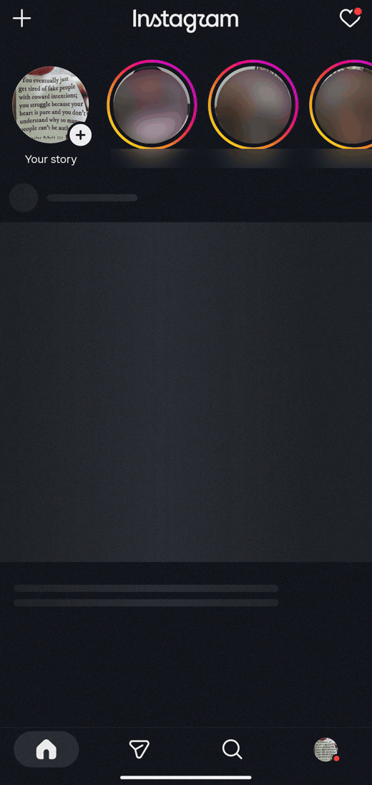
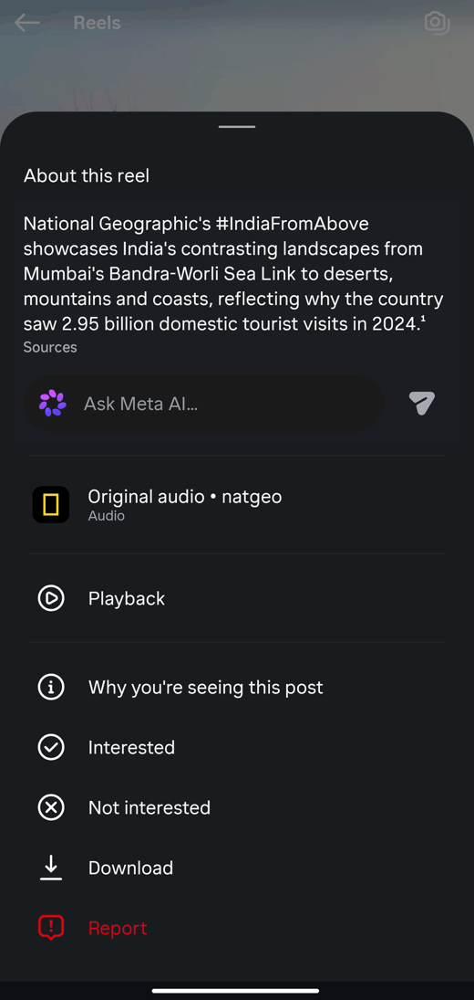
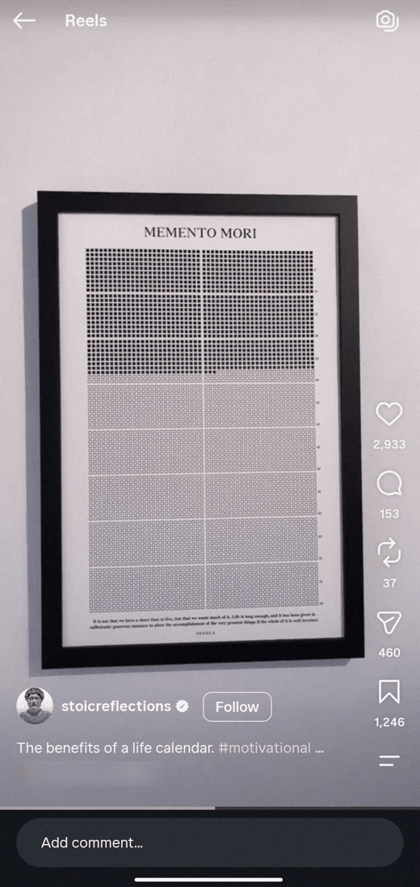
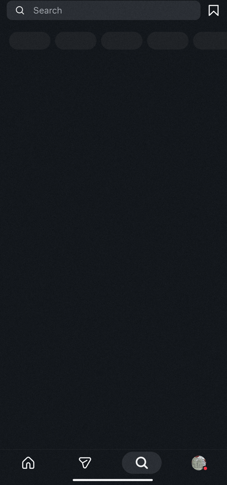
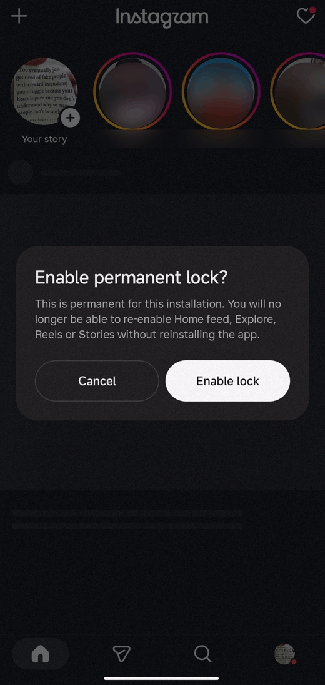
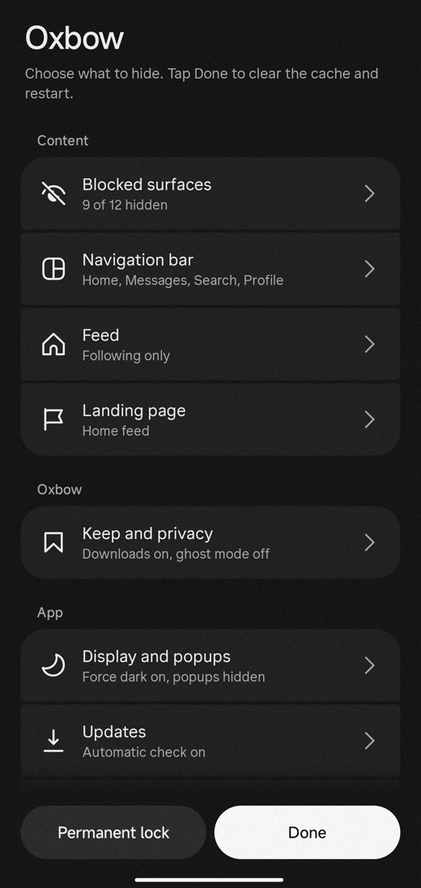
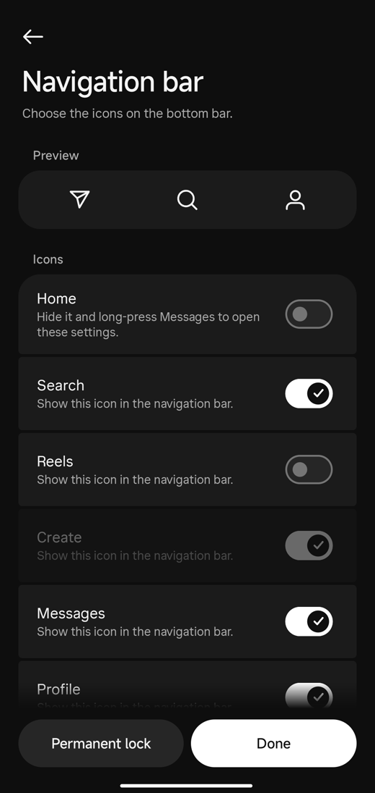
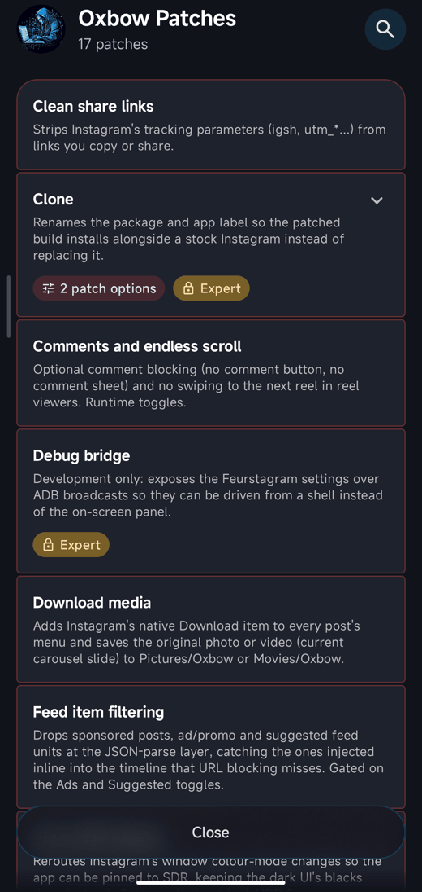

<p align="center">
  <picture>
    <source media="(prefers-color-scheme: dark)" srcset="brand/lockup.svg">
    
  </picture>
</p>

<h1 align="center">Oxbow: Instagram without Reels or ads for Android, feed optional</h1>
<h3 align="center">Instagram, cut off from the current.</h3>

<p align="center">
  <a href="https://github.com/aic0d3r/oxbow/releases/latest"></a>
  <a href="LICENSE"></a>
  <a href="https://github.com/aic0d3r/oxbow/releases"></a>
</p>

Oxbow is a free, open-source patched Instagram for Android that is calm from the first
launch. It keeps **messages, stories and the people you know**, cuts **the feed, Reels,
Explore and ads** by default, and lets you *keep* the things worth keeping: downloads, HD
profile pictures, ghost mode and tracker-free links.

Nothing to configure to get started, and every block still has its own switch. Want the home
feed? Leave it on, or show only people you follow, and cut just the Reels. Want to make sure
you stay out? Turn on the permanent lock: you can tighten your blocks, never loosen them.

The name: an oxbow is a lake that used to be part of a river, until the river found a
shorter way and left it behind. Still water, cut off from the current.

**[Download the latest APK](https://github.com/aic0d3r/oxbow/releases/latest)** ·
[Patch it yourself](#install) · [FAQ](#faq) · [How it compares](#how-it-compares)

<p align="center">
  
  
</p>
<p align="center"><em>Stories stay, the feed never loads. Anything worth keeping saves from Instagram's own ⋯ menu.</em></p>

## Why I made this

I open Instagram to answer a friend or see their story, and half an hour later I'm deep in
Reels I never chose. Screen-time limits only nagged me, and the website is missing too
much. So I wanted the real app with the current switched off: everything I came for, and
nothing built to keep me there. Oxbow is that app, and the things I kept wishing it had.

It's a crossover of [FeurStagram](https://github.com/jean-voila/FeurStagram)'s calm,
lockable blocking and [piko](https://github.com/crimera/piko)'s utilities, plus some
extras of its own for the community.

## What goes

Blocked by default, each with its own switch:

- **Home feed, Reels and Explore**, and the suggested posts mixed into them
- **Ads**, plus Notes, Instants and the Friends lane
- **Meta AI and Muse**: Muse's target in the share sheet, Meet Muse promo cards, the
  generated "About this reel" summary with its Ask Meta AI box in post and Reels menus, and
  Vibes, Meta AI chats and Imagine units in the feed. (Search bar and inbox Meta AI entries
  are not covered yet.)
- **Endless scrolling**: a reel opened from a DM, profile or search stays one reel, with
  no "more like this" feed under it
- **Accidental story replies**: swiping up on a story doesn't open the reply box,
  reactions or keyboard. Tap Send message to reply on purpose.

Off by default, one tap away: **comments** (no comment buttons or sheets), **stories** and
the **notifications button**. Telemetry is always blocked.

Want your choices to stick, but not forever? **Cooldown** (Settings > Lock, off by default)
makes loosening a block wait 1 to 72 hours, then you confirm it; you can cancel meanwhile.
Want them to stick for good? **Permanent lock** lets you tighten blocks but not loosen them
until you reinstall.

<p align="center">
  
  
  
</p>
<p align="center"><em>One reel, then nothing. Search without Explore. A lock you can't talk yourself out of.</em></p>

## What you can keep

- **Downloads**: posts, carousel slides, videos, Reels, stories and highlights, from a
  native "Download" row in Instagram's own `⋯` menu. Saved in the highest quality
  Instagram serves, to `Pictures/Oxbow` and `Movies/Oxbow`, with no storage permission.
  Optionally save every slide of a carousel at once, or hold the Download row to do it
  just this once.
- **Copy caption**: a row beside Download in the `⋯` menu of posts and Reels.
- **HD profile pictures**: long-press the avatar on a profile to save it in full
  resolution (a short tap still opens Instagram's preview).
- **Ghost mode** (off by default): watch stories without appearing as a viewer, read DMs
  without sending read receipts, type without the typing indicator. Chats you read stay
  cleared in your own inbox. Long-press **New message** at the top of your inbox to flip all
  three at once.
- **Tracker-free links**: copied and shared links keep only what's needed to open them;
  `igsh`, `utm_*`, `obrf` and the rest are stripped.

Downloads use media the app has already loaded, so Oxbow makes no extra requests to
Instagram.

## Quieter by design

- **Hide the Home tab** entirely; settings then open from a long-press on Messages.
- **Following-only feed**, if you'd rather keep the feed but only see people you follow.
- **Force dark**: no HDR brightness spikes from bright photos and videos.
- **No Instagram popups** like "Couldn't refresh feed".

Everything lives in one settings page: **long-press the Home tab** to open it.

<p align="center">
  
  
</p>
<p align="center"><em>Every switch in one place. Hide Home and Reels from the tab bar entirely.</em></p>

Every default on a fresh install, in one table: [OXBOW.md](OXBOW.md#defaults-fresh-install).

## Install

No root needed. You log in with your normal Instagram account.

**Option 1: prebuilt APK** (simplest). From
[Releases](https://github.com/aic0d3r/oxbow/releases/latest):

- `oxbow.apk` replaces Instagram (uninstall Instagram first)
- `oxbow-clone.apk` installs next to your existing Instagram (you log in separately)

Each release lists SHA256 checksums; check yours with `sha256sum oxbow.apk`. The app
checks for updates on launch. For [Obtainium](https://github.com/ImranR98/Obtainium), add
`https://github.com/aic0d3r/oxbow` and filter APKs by `oxbow\.apk$` (or
`oxbow-clone\.apk$`).

**Option 2: patch it yourself with [Morphe Manager](https://morphe.software)**, so no
prebuilt APK is involved and updates arrive through the Manager. On your phone, open
[`morphe.software/add-source?github=aic0d3r/oxbow`](https://morphe.software/add-source?github=aic0d3r/oxbow&name=Oxbow&app=com.instagram.android)
(or add the source `github.com/aic0d3r/oxbow` by hand), then patch an Instagram `.apkm`
bundle from APKMirror. Enable *Clone* to keep the official app too.

<p align="center">
  
</p>

**Option 3: [build it from source](#build-it-yourself).**

First launch shows where settings live: **long-press the Home tab**.

### If something goes wrong

- **Android or Play Protect warns before installing.** Expected for any APK from outside
  the Play Store. Allow installs from your browser or file manager, and only use APKs from
  this repo's Releases.
- **"App not installed".** `oxbow.apk` can't install over the official Instagram (different
  signature): uninstall Instagram first, or use `oxbow-clone.apk`.
- **A feature stopped working.** Oxbow supports one Instagram version at a time (see the
  badge). Check [open issues](https://github.com/aic0d3r/oxbow/issues) and the latest
  release, then [report it](#support-and-contributing).

More in [docs/INSTALL.md](docs/INSTALL.md).

## What Oxbow doesn't do

- collect, store or proxy your password or session
- route your traffic through any server
- add analytics or tracking of its own
- make extra requests to Instagram for downloads
- claim any affiliation with Instagram or Meta

Every patch is open source. Details in [docs/PRIVACY.md](docs/PRIVACY.md).

## FAQ

**Can I turn off Reels in the official Instagram app?** No, Instagram has no setting for
it. Oxbow removes the Reels tab, Reels in the feed and the endless Reels viewer.

**Is there an iPhone version?** No. Oxbow is Android only.

**Can I keep the official Instagram app?** Yes: install `oxbow-clone.apk`, or enable
*Clone* in Morphe Manager.

**Is it safe? Can my account get banned?** Oxbow never touches your credentials, and you
can read every patch. But it's an unofficial modified client: using it may break
Instagram's terms, and ghost mode or downloads give Instagram more signs of a modified
client. Use it at your own risk.

**Why isn't it on F-Droid?** F-Droid only ships apps it builds from source, and Oxbow is
a patch on top of Meta's closed Instagram APK. Obtainium works instead.

**Does ghost mode have side effects?** Turning off read receipts leaves the message unread for
the sender, which is the point. On your phone the chat still clears when you open it or reply,
and stays cleared after a refresh or a restart. Counts Instagram keeps on its own side, like the
account switcher or another device, still show the chat unread. Known limits are listed in
[OXBOW.md](OXBOW.md#not-done--known-limits).

More answers in [docs/FAQ.md](docs/FAQ.md).

## How it compares

Piko and HushGram are bigger toolkits: you pick from dozens of patches and switch on what
you want. Oxbow is the other way round, set up calm on first launch.

| | FeurStagram | piko | HushGram | **Oxbow** |
|---|---|---|---|---|
| Calm out of the box | Yes | No | No, most switches start off | **Yes** |
| Blocks feed, Reels, Explore, ads | Yes | Partly | Yes, as switches | **Yes** |
| Permanent lock | Yes | Focus Lock (timed, 24 h cooldown) | Chat lock only | **Yes**, until you reinstall |
| Downloads | No | Yes | Yes | **Yes**, native menu row + HD avatars |
| Download a whole carousel | No | No | Partly, carousels with music | **Yes**, optional |
| Ghost mode | No | Yes | Yes | **Yes** |
| Tracker-free links | No | Yes | Yes | **Yes** |
| Comments off | No | Yes | Yes | **Yes** |
| Latest Instagram supported | 452.0 | 452.1, pre-release | 452.1 | **453.0** |

*Compared from each project's README and changelog in October 2026. Spot an error? [Open an
issue](https://github.com/aic0d3r/oxbow/issues/new/choose).*

## Build it yourself

Needs JDK 21, the Android SDK, a GitHub token with `read:packages` (for the Morphe
patcher) and an Instagram `.apkm` from APKMirror. Details, including a Docker setup, in
[docs/BUILD_FROM_SOURCE.md](docs/BUILD_FROM_SOURCE.md).

```sh
./build.sh instagram.apkm            # -> oxbow.apk
./build.sh instagram.apkm --clone    # -> oxbow-clone.apk
./release.sh instagram.apkm          # both, signed, published as a GitHub release
```

How the patches find their way into Instagram's obfuscated code, and why they survive
updates: [OXBOW.md](OXBOW.md).

## Support and contributing

- **Found a bug?** [Open an issue](https://github.com/aic0d3r/oxbow/issues/new/choose)
  with your Android version, device, Oxbow version and which APK you installed.
- **Want to help?** Testing on other devices, docs and patch updates for new Instagram
  versions are all welcome: [CONTRIBUTING.md](CONTRIBUTING.md), [ROADMAP.md](ROADMAP.md).
- **Want to say thanks?** A star on the repo helps others find it, and you can also
  [sponsor on GitHub](https://github.com/sponsors/aic0d3r).

## Credits and license

Oxbow is a fork of [FeurStagram](https://github.com/jean-voila/FeurStagram) by Jean
Herail. Its blocking, settings page and update system come from there, and Oxbow follows
it for new Instagram versions. Some patch techniques (network blocking, clone, the hooks
behind downloads and ghost mode) are adapted from [piko](https://github.com/crimera/piko).
Built with [Morphe](https://morphe.software). GPL-3.0: see [LICENSE](LICENSE) and
[NOTICE](NOTICE).
