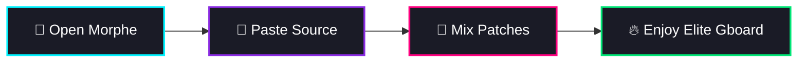

<div align="center">


<div align="center">

<div align="center">

<!-- HERO GLOW & TITLE -->
<p align="center">
  
</p>

### 🧊 *Your keyboard just got a whole personality upgrade.*
**The ultimate bespoke Morphe patch suite for Gboard.**
<br>
Zero bloat. Pure aesthetics. Unmatched ergonomics. Complete privacy.

<br>

<!-- GLASS BADGES ROW -->
<p align="center">
  <a href="https://github.com/assc0d3r/GLYPHCHEMY/releases/latest">
    
  </a>
  <a href="https://morphe.software/add-source?github=assc0d3r/GLYPHCHEMY">
    
  </a>
  
  
  
</p>

<!-- QUICK JUMP PILLS -->
<p align="center">
  <b><a href="#-the-vibe-tldr">✨ The Vibe</a></b> • 
  <b><a href="#-quick-run-install">⚡ Install</a></b> • 
  <b><a href="#-compatibility-check">📱 Compatibility</a></b> • 
  <b><a href="#-the-patch-stash-89-patches">🧩 89 Patches</a></b> • 
  <b><a href="#-tasker-god-mode">⚡ Tasker</a></b> • 
  <b><a href="#%EF%B8%8F-cook-it-yourself-local-build">🛠️ Build</a></b>
</p>

---

</div>

## ✨ The Vibe (TL;DR)

Stock Gboard is fine, but **Glyphchemy makes it elite.** It’s an open-source chemistry kit of **89 runtime patches** injected straight via Morphe. We unlock locked Google features, hook native shaders for pure frosted glass blur, build in offline local AI voice typing, and wipe telemetry off the map.

<div align="left">

### 🍱 The Bento Drop

<table>
  <tr>
    <td width="50%" align="left">
      <h3>🧊 Frosted Glass Everything</h3>
      Real-time live Gaussian background blur, OriginOS-style liquid glass touch blooms, and transparent keypads that melt seamlessly into your wallpaper.
      <br><br>
      <code>#blur</code> <code>#liquid-press</code> <code>#sheen</code>
    </td>
    <td width="50%" align="left">
      <h3>🎙️ Local AI Voice (Zero Cloud)</h3>
      Full on-device transcription with <b>NVIDIA Parakeet</b> across 25+ languages, or tap into <b>Rambler</b> with smart context awareness and custom prompts.
      <br><br>
      <code>#offline-ai</code> <code>#parakeet</code> <code>#zero-latency</code>
    </td>
  </tr>
  <tr>
    <td width="50%" align="left">
      <h3>🛡️ Ghost Mode Privacy</h3>
      Total tracker decapitation. Cut off background sync, disable cloud backups, bypass signature checks, or seal Gboard entirely offline.
      <br><br>
      <code>#no-telemetry</code> <code>#firewall</code> <code>#airgapped</code>
    </td>
    <td width="50%" align="left">
      <h3>⚡ Speed-Typing Ergonomics</h3>
      Swipe left across keys to delete words, double-tap space for Tab / Undo, flick up/down for instant case flips, and trigger Tasker automations on Enter.
      <br><br>
      <code>#flow-state</code> <code>#flick-case</code> <code>#trackpad</code>
    </td>
  </tr>
</table>

</div>

---

## 📱 Compatibility Check

> [!TIP]
> **No crash policy:** If a target method changed in your Gboard build, Morphe automatically skips that single patch instead of bricking your install.

| Gboard Target Build | Status | Coverage |
| :--- | :---: | :--- |
| `18.6.3.1002251336-release-arm64-v8a` | `🟢 Verified Fire` | **100% Support (All 89 Patches)** |
| `18.8.0.1022711984-beta-arm64-v8a` | `🟡 Experimental` | Frosted Glass, Smart Bar Swipe, Spacing & Rambler |
| `18.5.4.993608717-release-arm64-v8a` | `🟢 Smooth` | Gestures, Themes, Profiles & Dynamic Fields |
| `18.0.3.954559732-release-arm64-v8a` | `⚪ OG Builds` | Glide Trail, Backspace Haptics & Enter Intent |

---

## ⚡ Quick Run (Install)



### The 1-Tap Route
Open this page on your Android phone and smash this button:  
👉 **[🔗 Add GLYPHCHEMY to Morphe Directly](https://morphe.software/add-source?github=assc0d3r/GLYPHCHEMY)**

### The Manual Route
1. Open **Morphe** ➔ **Settings** ➔ **Sources**.
2. Tap **Add Source** and paste:
   ```text
   https://github.com/assc0d3r/GLYPHCHEMY
   ```
3. Head to the **Patcher** tab, choose **Gboard** `18.6.3`, toggle the patches that fit your style, and tap **Patch**.
4. Install your newly minted APK!

> [!CAUTION]
> Patched APKs have custom signatures. You cannot overwrite stock Gboard unless using root mount. If unrooted, turn on the **`Change package name`** patch to run it cleanly side-by-side!

---

## 🧩 The Patch Stash (89 Patches)

> *🏷️ Badges marked `⚠️ OFF BY DEFAULT` mean the patch changes core package names, locks network access, or activates shell bridges. Turn them on intentionally.*

<br>

### 🧊 Aesthetic Alchemy (Themes, Blur & FX)

<details>
<summary><b>Frosted Glass</b> <code>frosted-glass</code> • <i>Live Gaussian Blur</i></summary>
<br>

> Delivers real-time background blur and deep transparency controls straight to the keyboard deck. Adjust background and key opacity independently, with optional seamless spill into the system navigation bar. *(Requires Android 12+)*
</details>

<details>
<summary><b>Glass Panel & Glass Press Effect</b> <code>glass-panel-press</code></summary>
<br>

> Straight out of vivo OriginOS: turns the keyboard panel into glossy glass with illuminated edges and a liquid touch bloom that radiates light beneath your fingertips while keys compress and spring back.
</details>

<details>
<summary><b>Glide Trail Customizer</b> <code>glide-trail</code> • <i>RGB Rainbow Wave</i></summary>
<br>

> Dial in your glide trail aesthetics: fade duration (200–4000ms), line thickness (2–40dp), length, and custom hex colors via a live HSV wheel or animated dynamic RGB spectrum.
</details>

<details>
<summary><b>Theme Follows Dark Mode</b> <code>theme-follow-dark</code></summary>
<br>

> Pairs light and dark themes together. When your phone shifts to dark mode, your keyboard and wallpaper shift along with it automatically.
</details>

<details>
<summary><b>Pure AMOLED Black</b> <code>amoled-dark-keyboard</code> <code>⚠️ OFF BY DEFAULT</code></summary>
<br>

> Purges Google's muted dark-grey tones for `#000000` pitch black pixels across all keys, panels, and preference screens. Saves battery, looks legendary.
</details>

<details>
<summary><b>Custom Icon Packs & Spacebar Branding</b> <code>custom-icons-spacebar</code></summary>
<br>

> Slap raster icon packs onto the key cluster, or replace the spacebar logo with any personal PNG, WebP, or vector badge of your choice.
</details>

<details>
<summary><b>Key Shape Customizer & Rounded Panels</b> <code>key-shape-rounded</code></summary>
<br>

> Break free from boring squares: enable custom rounded key profiles and tune independent top/bottom corner radii for docked or floating keyboards.
</details>

<details>
<summary><b>Immersive Landscape Deck</b> <code>immersive-landscape</code></summary>
<br>

> Extends the keyboard cleanly underneath camera punch-holes and notches in landscape mode—no dead screen cutouts.
</details>

<br>

### ⚡ Frictionless Typing & God-Tier Gestures

<details>
<summary><b>Per-App Profiles</b> <code>per-app-profiles</code> • <i>Smart Context Switcher</i></summary>
<br>

> Set custom keyboard personalities per app. Force incognito mode in browsers, compact layouts in Discord, or dedicated numeric heights in banking apps automatically.
</details>

<details>
<summary><b>Swipe Left to Delete</b> <code>swipe-delete</code></summary>
<br>

> Drag left anywhere across the key field to erase characters like backspace; hold and slide to highlight and obliterate entire words.
</details>

<details>
<summary><b>Smart Bar Case Swipe</b> <code>smart-bar-case-swipe</code></summary>
<br>

> Swipe **UP** on any candidate chip to capitalize it; swipe **DOWN** to lowercase it instantly prior to committing.
</details>

<details>
<summary><b>Spacebar Tab / Undo Double-Tap</b> <code>spacebar-doubletap</code></summary>
<br>

> Double-tap the left half of the spacebar for a true Tab indent; double-tap the right half to undo your last edit.
</details>

<details>
<summary><b>Punctuation Spacing</b> <code>punctuation-spacing</code></summary>
<br>

> Cleans up sloppy auto-spaces behind punctuation automatically (`Hello .` ➔ `Hello.`). Fully preserves French dual-punctuation spacing rules (`: ; ! ?`).
</details>

<details>
<summary><b>Flick Up/Down Case Flipping</b> <code>qwerty-flick-case</code></summary>
<br>

> Flick upward on any letter for instant caps; flick downward for lowercase without fighting auto-capitalization.
</details>

<details>
<summary><b>Spacebar Precision Trackpad Mode</b> <code>spacebar-trackpad</code></summary>
<br>

> Long-press the spacebar to glide across text with pixel-precise cursor control and text-selection locks.
</details>

<details>
<summary><b>Haptic Backspace Pulse</b> <code>backspace-haptics</code></summary>
<br>

> Delivers continuous, crisp physical haptic ticks for every character eaten while holding down backspace, snapping shut the millisecond you hit the start of the field.
</details>

<br>

### 🎙️ Voice & Intelligence (Local + Cloud)

<details>
<summary><b>NVIDIA Parakeet (100% Offline AI Voice)</b> <code>voice-parakeet</code></summary>
<br>

> Runs NVIDIA's Parakeet model directly on your device. Zero internet connection required. Blazing fast, transcribes 25+ languages on the fly, and supports a custom local voice dictionary.
</details>

<details>
<summary><b>Google Rambler Suite</b> <code>voice-rambler</code></summary>
<br>

> Unlocks Google's server-side conversational voice model with cursor awareness (edits text mid-sentence), contact name recognition, custom instructions ("write numbers as digits"), and silence auto-stops.
</details>

<details>
<summary><b>Offline Camera OCR / Scan Text</b> <code>ocr-scan-text</code></summary>
<br>

> Strips Google Play Services dependencies from the camera text scanner: point your camera at physical text to paste it directly into your keyboard.
</details>

<details>
<summary><b>AI Writing Tools & Smart Compose</b> <code>ai-writing-tools</code></summary>
<br>

> Force-enables Gboard's locked AI Rewrite, Tone Switcher, Grammar Checker, and Smart Compose across any language and device.
</details>

<br>

### 📋 Power Tools & Clipboard Portal

<details>
<summary><b>Web Clipboard Portal</b> <code>web-clipboard</code> • <i>LAN Desktop Sync</i></summary>
<br>

> Turns Gboard into a local web server. Pair your phone with your PC browser over Wi-Fi using a security PIN and beam clipboards back and forth seamlessly.
</details>

<details>
<summary><b>Clipboard Supercharger</b> <code>clipboard-enhancer</code></summary>
<br>

> Unlimited pin retention, custom item limits, character caps beyond stock 20,000 limits, and creation date stamps.
</details>

<details>
<summary><b>Inline Calculator</b> <code>inline-calculator</code></summary>
<br>

> Type arithmetic directly into any chat (`124*3.5`) and get the answer live in your suggestion bar. Tap to insert or long-press to copy.
</details>

<details>
<summary><b>Local FTP Server & Floating Browser</b> <code>ftp-floating-search</code></summary>
<br>

> Spin up a quick FTP server from your keyboard toolbar to browse device storage from another machine, or open a floating web browser without exiting your game or chat.
</details>

<br>

### 🛡️ Ironclad Privacy & De-Googling

<div align="center">

| Shield Feature | What It Does | Vibe |
| :--- | :--- | :---: |
| **Block Trackers** | Disables Clearcut analytics, metrics, telemetry & crash reporters | `🔥 Active` |
| **Stop Remote Updates**| Freezes Google from pushing silent server-side overrides | `🔥 Active` |
| **Signature Bypass** | Allows full theme engine access on re-signed builds | `🔥 Active` |
| **Offline Only** | Airgaps Gboard entirely; cuts all network permissions | `⚠️ Opt-In` |
| **Disable Play Services**| Strips Google Play Services / microG dependency entirely | `⚠️ Opt-In` |
| **Key Mapper Bridge** | Reconnects Shizuku system automation when halted | `⚠️ Opt-In` |

</div>

---

## ⚡ Tasker God-Mode

Every time you hit **Enter** or fire an **IME Action** (Send, Search, Next), Glyphchemy sends a background broadcast to Tasker:

```text
Intent Action: dev.custom.gboard.ENTER_PRESSED
```

### The Payload

| Variable | Breakdown | Real Example |
| :--- | :--- | :--- |
| `%package` | App currently in focus | `org.telegram.messenger` |
| `%action_type` | Action triggered | `SEND`, `ENTER`, `SEARCH`, `DONE` |
| `%key_code` | Raw Android keycode | `66` *(Enter)*, `-10018` *(IME Action)* |
| `%text_before`| Last 100 characters typed | `"Payment confirmed #8902"` |
| `%timestamp` | Unix epoch time in ms | `1726831000000` |

---

## 🛠️ Cook It Yourself (Local Build)

Want to inspect the bytecode or compile the `.mpp` yourself? Grab your terminal:

```bash
# 1. Clone the codebase
git clone https://github.com/assc0d3r/GLYPHCHEMY.git
cd GLYPHCHEMY

# 2. Fire the build script
chmod +x build.sh
./build.sh
```

The script compiles the Kotlin patch sources, validates bytecode hooks, generates `colorwheel.dex`, and bundles everything into:
- 📦 `dist/patches-<version>.mpp` *(Ready for Morphe)*
- ☕ `dist/gboard-backspace-haptics.jar` *(Standalone JAR)*

### Regenerating `patches-list.json`
```bash
java -cp "libs/morphe-cli.jar:libs/gson.jar" tools/bindings/Inventory.java \
  dist/patches-$(sed -n 's/^version=//p' gradle.properties).mpp \
  $(sed -n 's/^version=//p' gradle.properties) \
  patches-list.json
```
*(On Windows PowerShell, use `;` instead of `:`)*

---

<div align="center">

### 📜 Licensing & Vibes

Distributed under the **GNU General Public License v3.0**. Read [LICENSE](LICENSE) for the fine print.

*Gboard is a registered trademark of Google LLC. Glyphchemy is an independent project with no Google affiliation.*

<br>

**Leave a ⭐ if your keyboard has never looked cleaner.**

<p align="center">
  
</p>

</div>
