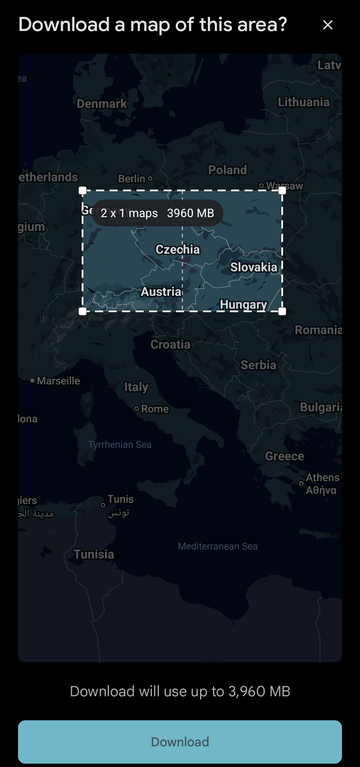
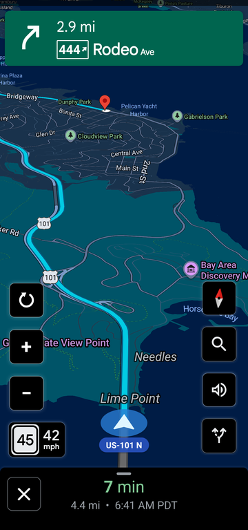
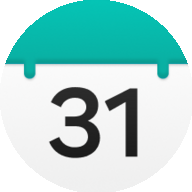
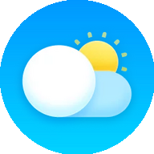
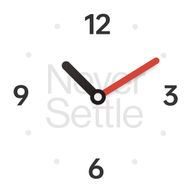

<h1> bearinmind patches</h1>

I'll continue to support patches for apps I use & apps that I get requests for (either for specific features or premium unlocking). Below is a short description of how to install my patches on morphe!

Install Morphe Manager if you have not yet: https://morphe.software

[Click here to add bearinmind patches to Morphe Manager](https://morphe.software/add-source?github=bearinmindcat/morphe-patches)

Select the app you want to patch inside Morphe Manager, follow all instructions shown.

## Patches

<!-- PATCHES_START -->
> **[v2.8.5](https://github.com/bearinmindcat/morphe-patches/releases/tag/v2.8.5)**&nbsp;&nbsp;•&nbsp;&nbsp;`main`&nbsp;&nbsp;•&nbsp;&nbsp;123 patches total

 Google Maps&nbsp;&nbsp;-&gt;&nbsp;&nbsp; Ungoogled Maps&nbsp;&nbsp;•&nbsp;&nbsp;30 patches

 

**Supported version(s):** 26.36.04.973607363

| Patch | Description | Options |
|----------|----------------|-----------|
| [120 refresh rate](#120-refresh-rate) | Lifts the 60 Hz limit Maps puts on itself, on the app and on the map, so it can run at your screen's full refresh rate (such as 120 Hz). Uses more battery, most of all while navigating. Off by default: switch it on on the Customization screen. |  |
| [Account sheet cleanup](#account-sheet-cleanup) | Removes the "More from this app" label from the account sheet, and keeps the sheet open when you come back from Settings or Customization or tap "Your profile", instead of dropping back to the map. |  |
| [Add microG-RE support](#add-microg-re-support) | Builds microG Maps, a separate app that signs in to your Google account through microG-RE (MicroG-RE or ReVanced GmsCore). Not for root installs; for original microG, use Add original microG support. |  |
| [Add original microG support](#add-original-microg-support) | Signs in through original microG on ROMs with signature spoofing. Keeps Maps' own package name; allow signature spoofing for it. |  |
| [Any media app](#any-media-app) | Navigation's Default media app (Settings > Navigation) offers every music and podcast app that works with Android Auto, such as Poweramp, also where Google switches media controls off. YouTube Music and Spotify only connect to Google's own Maps. |  |
| [Avoid Flock cameras](#avoid-flock-cameras) | Steers driving directions around Flock cameras: when Google's route passes one, a camera-free way is worked out with BRouter, an OpenStreetMap router, and Maps asks Google again for a route through it, so Google still times and navigates the trip, and keeps it through reroutes. A detour longer than half again the distance is dropped. Off until turned on in Waze & external data source, with Flock cameras; your route's start and end go to brouter.de. Trips with stops are left as they are. |  |
| [Better offline maps](#better-offline-maps) | Reworks the offline area picker: zooming out really selects more instead of being shrunk to Google's size cap, the box can be resized by dragging its edges and corners, a large area is split into several downloads whose true total size is shown, and areas already downloaded are drawn on the map. Can be turned off on the Customization screen. |  |
| [Black theme](#black-theme) | AMOLED-black theme. Pins Maps' own dark mode and its separate navigation colour scheme, and remaps colour resources, drawable fills and draw-time paints so no surface is left grey. |  |
| [Blue pin](#blue-pin) | Chromium-coloured flat map pin on every in-app product logo and the search bar's leading icon. |  |
| [Bypass Play Services checks](#bypass-play-services-checks) | Makes Maps' bundled Play services signature and availability checks always pass, so it runs re-signed and with Play services disabled or absent, and lets it load tiles, search and routing by sending Google's own package and certificate in the identity headers the Maps backend checks. Where Play services rejects the re-signed app, Maps degrades instead of crashing. Also skips Google's "isn't Play Protect certified" page, and with no Play services at all uses Android's own Cronet so the map still loads. |  |
| [Change app name](#change-app-name) | Sets the launcher and in-app app name. | • App name |
| [Change package name](#change-package-name) | Installs alongside stock Google Maps under its own package name. On by default, because stock Maps comes built into most phones and cannot be replaced by a patched copy. | • Package name |
| [Customization screen](#customization-screen) | Adds a Customization row under Settings on the account sheet, with switches for the patches here that can be turned back off inside the app. |  |
| [Flock cameras](#flock-cameras) | Puts Flock and other license plate reader cameras on the map, from OpenStreetMap -- the cameras DeFlock's volunteers map -- and chimes and shows a note when one is coming up ahead. Off until turned on in Waze & external data source, a row on the account sheet, because it downloads the ones near you from an OpenStreetMap server, over the same area as the speed cameras. |  |
| [Follow playing media](#follow-playing-media) | Navigation's media controls show what an app is playing, also apps that refuse Maps such as Pocket Casts and TIDAL. Needs notification access (Customization), not on root mount installs. |  |
| [Hide ads and clutter](#hide-ads-and-clutter) | Hides promoted map pins (on the map, in search results and along a route) and "Sponsored" search results, Gemini's AI summaries ("Know before you go" and the review summary), the row of businesses under an address on its place sheet, the home tab's Explore feed and the Explore / Contribute / You tabs. Each can be switched back on on the Customization screen. |  |
| [Legacy icon](#legacy-icon) | Uses the flat multicolour pin Maps had before the 2025 gradient icon as the launcher icon and on the screen Maps opens with. With Add microG-RE support, microG's C sits in the pin's circle. |  |
| [Location provider toggle](#location-provider-toggle) | Adds a Location source choice to the Customization screen: Android's own location providers, microG-RE's or Google Play services' fused provider. With Android, neither is ever asked for a location. A source that is missing or disabled is never used, so location keeps working without it. Also keeps the network (Wi-Fi/cell) provider registered when no fused provider answers, instead of GPS only, so a fix does not go stale indoors. | • Default to Play services location |
| [Offline saved places](#offline-saved-places) | Save places without a Google account, kept only on the phone: Save opens Maps' own "Place saved" sheet (Want to go, Travel plans, Starred places, Favorites, your own lists, a note), and a "Local saved" row on the account sheet rebuilds Maps' You tab -- your recent places, your lists and labels (Home, Work, your own) -- with export and import (backup file, KML, Google Takeout's saved lists and Saved Places.json, several files or the whole Takeout .zip at once). It also has a Timeline: where the phone has been, grouped into days and visits, kept only on the phone, with GPX export. Recording is off until switched on there; it shows a notification while it runs. With Add microG-RE support, Maps' own Save keeps syncing to your account and Local saved instead copies the account's saved lists to the phone (Pull from Google account). |  |
| [Power saving mode](#power-saving-mode) | Brings the Pixel-only power saving mode to every phone: while driving with navigation, press the power button and Maps shows only key information such as the next turn on a black screen. Turn it on or off in Settings > Navigation > Power saving mode. Pixels that have it built in keep Google's own version unless Power saving mode is turned on in Power Saving Options, a row on the account sheet under Customization, which also has: a navigation button that opens the power saving screen without locking the phone, switching to it by itself when idle, a speedometer on it, a lower frame rate, and its black map in navigation or all over Maps. |  |
| [Proxy](#proxy) | Adds a Proxy screen to Customization that sends Maps' own traffic, map data included, through an HTTP proxy -- for example Orbot's (127.0.0.1:8118) to use Tor. Map data never falls back to a direct connection: if the proxy stops, Maps stops loading. Needs a recent Play services network engine (Cronet); Maps warns when it cannot take the proxy. |  |
| [Rectangle shapes](#rectangle-shapes) | Squares off rounded corners across the UI, including the two round navigation buttons. |  |
| [Remove permissions](#remove-permissions) | Removes permissions that only serve Google-account features or Google's data collection: background location, physical activity, contacts, microphone (voice search stops working), camera (Lens and Live View stop working), car speed, advertising ID, push messages and Google services settings. Left out with Add microG-RE support, whose account features need them. |  |
| [Remove sign-in prompts](#remove-sign-in-prompts) | Removes Google's sign-in prompts: the first-launch "Make it your map" page, the search screen's "Tired of typing?" card and the account sheet's "Sign in" pill. Tapping "Your profile" (or the pill, where it still shows) answers with a "Can't sign in" toast instead of nothing. With Add microG-RE support, which signs in, only the first-launch page and the card go. |  |
| [Remove telemetry](#remove-telemetry) | Points the Firebase Installations and Play services compliance check-ins at an unresolvable host, stops every ad impression and click ping from being sent, and deregisters Google's logging, performance-monitoring, survey and Location History libraries and the on-device federated-learning services. With Add microG-RE support, Firebase Installations and Location History are left alone, so Timeline, account sync and push messages keep working. |  |
| [Speed cameras](#speed-cameras) | Chimes and shows a note when a speed or red light camera is coming up ahead, and puts the cameras on the map, from OpenStreetMap. Off until turned on in Waze & external data source, a row on the account sheet, because it downloads the cameras near you from an OpenStreetMap server -- an area you choose there, about 25 to 175 km across. |  |
| [Speeding chime](#speeding-chime) | Plays a chime when your speed passes the speed limit during navigation, as Waze does. Maps itself only turns its speedometer red. When it chimes is chosen in Waze & external data source, a row on the account sheet. |  |
| [Trim account menu](#trim-account-menu) | Removes Your Timeline, Location sharing, Your data in Maps and Help & feedback from the account sheet. Left out with Add microG-RE support, whose account features need them. |  |
| [Waze alerts](#waze-alerts) | Shows the alerts a Waze on the same phone is tracking -- police to begin with, and any of crashes, hazards, traffic jams, closures and speed cameras -- as pins on the map, with a chime and a note as one comes up ahead. Off until turned on in Waze & external data source. Waze has to be patched with Share alerts with Maps, signed in and open; in the background is enough. |  |
| [Zoom controls in navigation](#zoom-controls-in-navigation) | Adds +, − and reset tiles during turn-by-turn that change the navigation zoom while the camera keeps following the car. |  |

 AllTrails&nbsp;&nbsp;-&gt;&nbsp;&nbsp; AllTrails&nbsp;&nbsp;•&nbsp;&nbsp;8 patches

 

**Supported version(s):** 26.3.20

| Patch | Description | Options |
|----------|----------------|-----------|
| [2D / 3D compass](#2d-3d-compass) | Adds a 2D / 3D compass switch to the Experimental screen. With it on, tapping the compass in navigate mode switches the map between the tilted 3D view and a flat, north-up 2D map the way Google Maps' does, from any state (following you, panned away, paused), and brings the map back to you. The compass shows a single north arrow in 2D, and the next navigation starts in the mode you used last. |  |
| [Better filters](#better-filters) | Adds a Better filters switch to the Experimental screen. With it on, the trail filter's sliders move in finer steps over the same ranges: Rating in 0.1 stars (instead of Any, 3.5, 4 and 4.5), Length in 0.1 mi, Elevation gain in 10 ft, Highest point in 100 ft and Distance away in 1 mi (metric: 0.1 km, 5 m, 50 m, 1 km). |  |
| [Better tracking](#better-tracking) | Adds a Better tracking switch to the Experimental screen. With it on, recordings work the way Gaia GPS records: the phone's GPS directly with every fix delivered live (no Play services batching), fixes worse than 65 m or physically impossible dropped, points kept 3 m apart, no trail-biased smoothing, and elevation converted to sea level and counted in 2 m steps. |  |
| [Black icon](#black-icon) | Uses a white AllTrails logo on black for the launcher icon and the splash screen, instead of green on dark green, so this build is easy to tell apart from the stock app. |  |
| [Change package name](#change-package-name) | Installs alongside stock AllTrails under its own package name. | • Package name |
| [Experimental screen](#experimental-screen) | Adds an Experimental row to your profile's menu, under Edit profile and Share profile, that opens an Experimental screen. |  |
| [Remember filters](#remember-filters) | Adds a Remember filter states switch to the Experimental screen. With it on, the trail filters you set (length, elevation, rating, difficulty, activities, features and the rest, but not Distance away) stay set when you go back to the home screen and after the app restarts, instead of resetting. |  |
| [Theme](#theme) | Adds a Theme choice to the Experimental screen: Follow phone, Light, Dark or AMOLED black (dark with pure black backgrounds). AllTrails itself only follows the phone. |  |

 Waze&nbsp;&nbsp;-&gt;&nbsp;&nbsp; De-Waze&nbsp;&nbsp;•&nbsp;&nbsp;24 patches

 

**Supported version(s):** 5.24.5.0

| Patch | Description | Options |
|----------|----------------|-----------|
| [Alert distances](#alert-distances) | How early each alert is announced. | • Police • Hazards • Crashes • Traffic jams • Speed cameras on streets • Speed cameras on highways • Speed cameras on freeways • Blocked lanes • Least distance between two alerts |
| [All moods](#all-moods) | Unlocks every mood, beta ones too. |  |
| [Average speed zone bar](#average-speed-zone-bar) | Bar with progress and your average speed in an average speed zone. Off until switched on. |  |
| [Bigger alert pins](#bigger-alert-pins) | Bigger alert pins on the map. | • Pin size (%) |
| [Bigger speedometer](#bigger-speedometer) | Bigger speedometer and speed limit digits. | • Speed digits (dp) • Unit label (dp) • Speed limit sign digits (sp) • Speed limit sign digits, 100 and over (sp) |
| [Change app name](#change-app-name) | Renames Waze. | • App name |
| [Flock cameras](#flock-cameras) | Chime when a Flock camera is ahead, from OpenStreetMap. No map pins or routing. Off until switched on. |  |
| [Full black](#full-black) | True black dark mode for AMOLED screens. | • Black night map |
| [Hide ads](#hide-ads) | Removes sponsored pins, stop ads and ad tracking. |  |
| [Map skin](#map-skin) | Bigger map labels, a wider arrow and a warm day background. | • Map labels: huge • Map labels: big • Map labels: medium • Map labels: small • Navigation arrow head width • Day map background (hex) |
| [Navigation distances](#navigation-distances) | Android Auto heads-up distances and the traffic bar threshold. | • Android Auto heads-up, normal roads (m) • Android Auto heads-up, freeways (m) • Traffic bar: time in traffic (s) |
| [No AI reporting](#no-ai-reporting) | Turns off Gemini voice reporting. |  |
| [No Google Assistant](#no-google-assistant) | Removes Google Assistant from Waze. |  |
| [Open without device location](#open-without-device-location) | Opens Waze with location off and uses it once it is on. Still needs the location permission. |  |
| [Remove permissions](#remove-permissions) | Removes contacts, calendar, phone, camera and advertising ID access. |  |
| [Remove sign-in prompts](#remove-sign-in-prompts) | Stops Waze's own reminder to register your account. |  |
| [Remove telemetry](#remove-telemetry) | No crash reports, usage stats or performance data. Traffic reporting stays. |  |
| [Report speed limit](#report-speed-limit) | Lets you correct speed limits from the speedometer (unverified). |  |
| [Share alerts with Maps](#share-alerts-with-maps) | Shows Waze alerts in Ungoogled Maps on this phone. Waze must be signed in and open. |  |
| [Speed camera alerts](#speed-camera-alerts) | Chime when a speed camera is ahead, from OpenStreetMap, in any country. No map pins or routing. Off until switched on. |  |
| [Speed camera sound at any speed](#speed-camera-sound-at-any-speed) | Plays the camera sound even when you are not speeding. |  |
| [Speed cameras everywhere](#speed-cameras-everywhere) | Camera and police alerts in every country. Camera warnings are illegal in some. |  |
| [Speed limit sign](#speed-limit-sign) | One speed limit sign style in every country. | • Sign style |
| [Stay awake in the background](#stay-awake-in-the-background) | Keeps Waze running without a route so its alerts keep reaching Maps. Uses more battery. | • Minutes in the background |

 PdfCraft&nbsp;&nbsp;-&gt;&nbsp;&nbsp; PdfCraft&nbsp;&nbsp;•&nbsp;&nbsp;2 patches

 

| Patch | Description | Options |
|----------|----------------|-----------|
| [Change app name](#change-app-name) | Renames PdfCraft on the home screen. | • App name |
| [Custom icon](#custom-icon) | Replaces the launcher icon with a PDF icon or your own image. | • Icon • Your own image • Background • Fill the whole icon |

📱 Samsung Apps&nbsp;&nbsp;•&nbsp;&nbsp;18 apps&nbsp;&nbsp;•&nbsp;&nbsp;28 patches

 
<blockquote>

 Samsung Calculator&nbsp;&nbsp;-&gt;&nbsp;&nbsp; Samsung Calculator&nbsp;&nbsp;•&nbsp;&nbsp;1 patch

 

**Supported version(s):** 12.4.00.13

| Patch | Description | Options |
|----------|----------------|-----------|
| [Enable non-One UI ROM support](#enable-non-one-ui-rom-support) | Makes Samsung Calculator usable on non-One UI ROMs. |  |

 Samsung Calendar&nbsp;&nbsp;-&gt;&nbsp;&nbsp; Samsung Calendar&nbsp;&nbsp;•&nbsp;&nbsp;1 patch

 

**Supported version(s):** 12.8.01.0

| Patch | Description | Options |
|----------|----------------|-----------|
| [Enable non-One UI ROM support](#enable-non-one-ui-rom-support) | Makes Samsung Calendar installable and usable on non-One UI ROMs. |  |

 Samsung Clock&nbsp;&nbsp;-&gt;&nbsp;&nbsp; Samsung Clock&nbsp;&nbsp;•&nbsp;&nbsp;1 patch

 

**Supported version(s):** 12.4.02.38

| Patch | Description | Options |
|----------|----------------|-----------|
| [Enable non-One UI ROM support](#enable-non-one-ui-rom-support) | Makes Samsung Clock installable and usable on non-One UI ROMs. |  |

 Samsung Contacts&nbsp;&nbsp;-&gt;&nbsp;&nbsp; Samsung Contacts&nbsp;&nbsp;•&nbsp;&nbsp;1 patch

 

**Supported version(s):** 16.3.00.87

| Patch | Description | Options |
|----------|----------------|-----------|
| [Enable non-One UI ROM support](#enable-non-one-ui-rom-support) | Makes Samsung Contacts installable and usable on non-One UI ROMs. |  |

 Samsung Gallery&nbsp;&nbsp;-&gt;&nbsp;&nbsp; Samsung Gallery&nbsp;&nbsp;•&nbsp;&nbsp;3 patches

 

**Supported version(s):** 15.9.01.7

| Patch | Description | Options |
|----------|----------------|-----------|
| [Disable telemetry](#disable-telemetry) | Turns off Samsung Analytics and crash reports. |  |
| [Enable non-One UI ROM support](#enable-non-one-ui-rom-support) | Makes Samsung Gallery installable and usable on non-One UI ROMs. |  |
| [Stop remote updates](#stop-remote-updates) | Ignores policies pushed from Samsung's servers. |  |

 Samsung Health Monitor&nbsp;&nbsp;-&gt;&nbsp;&nbsp; Samsung Health Monitor&nbsp;&nbsp;•&nbsp;&nbsp;1 patch

 

**Supported version(s):** 1.5.3.011

| Patch | Description | Options |
|----------|----------------|-----------|
| [Enable non-One UI ROM support](#enable-non-one-ui-rom-support) | Makes Samsung Health Monitor usable on non-One UI ROMs. |  |

 Samsung Keyboard&nbsp;&nbsp;-&gt;&nbsp;&nbsp; Samsung Keyboard&nbsp;&nbsp;•&nbsp;&nbsp;7 patches

 

**Supported version(s):** 5.9.40.75

| Patch | Description | Options |
|----------|----------------|-----------|
| [Always incognito](#always-incognito) | Never learns from what you type. |  |
| [Change app name](#change-app-name) | Renames Samsung Keyboard, so the two keyboards can be told apart. | • App name |
| [Change package name](#change-package-name) | Installs next to the system Samsung Keyboard under its own package name. | • Package name |
| [Disable telemetry](#disable-telemetry) | Turns off Samsung Analytics, crash reports and typed-text collection. |  |
| [No GIF tracking](#no-gif-tracking) | Stops GIPHY and Tenor view and share pings. |  |
| [Remove internet permission](#remove-internet-permission) | Keeps the keyboard offline. GIFs, stickers, translation, AI tools and language downloads stop working. |  |
| [Stop remote updates](#stop-remote-updates) | Ignores keyboard policies pushed from Samsung's servers. |  |

 Samsung Messages&nbsp;&nbsp;-&gt;&nbsp;&nbsp; Samsung Messages&nbsp;&nbsp;•&nbsp;&nbsp;1 patch

 

**Supported version(s):** 16.3.21.1

| Patch | Description | Options |
|----------|----------------|-----------|
| [Enable non-One UI ROM support](#enable-non-one-ui-rom-support) | Makes Samsung Messages installable and usable on non-One UI ROMs. |  |

 Samsung Modes and Routines&nbsp;&nbsp;-&gt;&nbsp;&nbsp; Samsung Modes and Routines&nbsp;&nbsp;•&nbsp;&nbsp;1 patch

 

**Supported version(s):** 5.1.03.1

| Patch | Description | Options |
|----------|----------------|-----------|
| [Enable non-One UI ROM support](#enable-non-one-ui-rom-support) | Makes Samsung Modes and Routines installable and usable on non-One UI ROMs. |  |

 Samsung Music&nbsp;&nbsp;-&gt;&nbsp;&nbsp; Samsung Music&nbsp;&nbsp;•&nbsp;&nbsp;1 patch

 

**Supported version(s):** 16.2.45.1

| Patch | Description | Options |
|----------|----------------|-----------|
| [Enable non-One UI ROM support](#enable-non-one-ui-rom-support) | Makes Samsung Music installable and usable on non-One UI ROMs. |  |

 Samsung My Files&nbsp;&nbsp;-&gt;&nbsp;&nbsp; Samsung My Files&nbsp;&nbsp;•&nbsp;&nbsp;1 patch

 

**Supported version(s):** 15.2.03.2

| Patch | Description | Options |
|----------|----------------|-----------|
| [Enable non-One UI ROM support](#enable-non-one-ui-rom-support) | Makes Samsung My Files installable and usable on non-One UI ROMs. |  |

 Samsung Notes&nbsp;&nbsp;-&gt;&nbsp;&nbsp; Samsung Notes&nbsp;&nbsp;•&nbsp;&nbsp;2 patches

 

**Supported version(s):** 4.4.48.15

| Patch | Description | Options |
|----------|----------------|-----------|
| [Disable telemetry](#disable-telemetry) | Turns off Samsung Analytics, crash reports, usage surveys and marketing data. |  |
| [Enable non-One UI ROM support](#enable-non-one-ui-rom-support) | Makes Samsung Notes installable and usable on non-One UI ROMs. |  |

 Samsung Photo Editor&nbsp;&nbsp;-&gt;&nbsp;&nbsp; Samsung Photo Editor&nbsp;&nbsp;•&nbsp;&nbsp;1 patch

 

**Supported version(s):** 3.9.04.6

| Patch | Description | Options |
|----------|----------------|-----------|
| [Enable non-One UI ROM support](#enable-non-one-ui-rom-support) | Makes Samsung Photo Editor installable and usable on non-One UI ROMs. |  |

 Samsung Reminder&nbsp;&nbsp;-&gt;&nbsp;&nbsp; Samsung Reminder&nbsp;&nbsp;•&nbsp;&nbsp;1 patch

 

**Supported version(s):** 12.8.00.62

| Patch | Description | Options |
|----------|----------------|-----------|
| [Enable non-One UI ROM support](#enable-non-one-ui-rom-support) | Makes Samsung Reminder installable and usable on non-One UI ROMs. |  |

 Sound Assistant&nbsp;&nbsp;-&gt;&nbsp;&nbsp; Sound Assistant&nbsp;&nbsp;•&nbsp;&nbsp;2 patches

 

**Supported version(s):** 8.1.00.6

| Patch | Description | Options |
|----------|----------------|-----------|
| [Disable telemetry](#disable-telemetry) | Turns off Samsung Analytics and crash reports. |  |
| [Enable non-One UI ROM support](#enable-non-one-ui-rom-support) | Runs Sound Assistant on non-One UI ROMs, where only Individual app volumes work. |  |

 Samsung Video Player&nbsp;&nbsp;-&gt;&nbsp;&nbsp; Samsung Video Player&nbsp;&nbsp;•&nbsp;&nbsp;1 patch

 

**Supported version(s):** 7.3.47.1

| Patch | Description | Options |
|----------|----------------|-----------|
| [Enable non-One UI ROM support](#enable-non-one-ui-rom-support) | Makes Samsung Video Player installable and usable on non-One UI ROMs. |  |

 Samsung Voice Recorder&nbsp;&nbsp;-&gt;&nbsp;&nbsp; Samsung Voice Recorder&nbsp;&nbsp;•&nbsp;&nbsp;1 patch

 

**Supported version(s):** 21.5.91.33

| Patch | Description | Options |
|----------|----------------|-----------|
| [Enable non-One UI ROM support](#enable-non-one-ui-rom-support) | Makes Samsung Voice Recorder usable on non-One UI ROMs. |  |

 Samsung Weather&nbsp;&nbsp;-&gt;&nbsp;&nbsp; Samsung Weather&nbsp;&nbsp;•&nbsp;&nbsp;1 patch

 

**Supported version(s):** 1.7.30.50

| Patch | Description | Options |
|----------|----------------|-----------|
| [Enable non-One UI ROM support](#enable-non-one-ui-rom-support) | Makes Samsung Weather usable on non-One UI ROMs. |  |

</blockquote>

📱 Xiaomi Apps&nbsp;&nbsp;•&nbsp;&nbsp;9 apps&nbsp;&nbsp;•&nbsp;&nbsp;9 patches

 
<blockquote>

 Xiaomi Calendar&nbsp;&nbsp;-&gt;&nbsp;&nbsp; Xiaomi Calendar&nbsp;&nbsp;•&nbsp;&nbsp;1 patch

 

**Supported version(s):** 18.0.2.0

| Patch | Description | Options |
|----------|----------------|-----------|
| [Enable non-HyperOS ROM support](#enable-non-hyperos-rom-support) | Makes Xiaomi Calendar usable on non-Xiaomi ROMs. |  |

 Xiaomi Compass&nbsp;&nbsp;-&gt;&nbsp;&nbsp; Xiaomi Compass&nbsp;&nbsp;•&nbsp;&nbsp;1 patch

 

**Supported version(s):** 17.1.4.1

| Patch | Description | Options |
|----------|----------------|-----------|
| [Enable non-HyperOS ROM support](#enable-non-hyperos-rom-support) | Makes Xiaomi Compass usable on non-Xiaomi ROMs. |  |

 Xiaomi Gallery&nbsp;&nbsp;-&gt;&nbsp;&nbsp; Xiaomi Gallery&nbsp;&nbsp;•&nbsp;&nbsp;1 patch

 

**Supported version(s):** 4.3.1.15-global

| Patch | Description | Options |
|----------|----------------|-----------|
| [Enable non-HyperOS ROM support](#enable-non-hyperos-rom-support) | Makes Xiaomi Gallery installable and usable on non-Xiaomi ROMs. |  |

 Xiaomi Gallery Editor&nbsp;&nbsp;-&gt;&nbsp;&nbsp; Xiaomi Gallery Editor&nbsp;&nbsp;•&nbsp;&nbsp;1 patch

 

**Supported version(s):** 2.10.40.4.8-global

| Patch | Description | Options |
|----------|----------------|-----------|
| [Enable non-HyperOS ROM support](#enable-non-hyperos-rom-support) | Makes Xiaomi Gallery Editor installable and usable on non-Xiaomi ROMs. |  |

 Xiaomi Notes&nbsp;&nbsp;-&gt;&nbsp;&nbsp; Xiaomi Notes&nbsp;&nbsp;•&nbsp;&nbsp;1 patch

 

**Supported version(s):** 3.2.7.9

| Patch | Description | Options |
|----------|----------------|-----------|
| [Enable non-HyperOS ROM support](#enable-non-hyperos-rom-support) | Makes Xiaomi Notes installable and usable on non-Xiaomi ROMs. |  |

 Xiaomi Recorder&nbsp;&nbsp;-&gt;&nbsp;&nbsp; Xiaomi Recorder&nbsp;&nbsp;•&nbsp;&nbsp;1 patch

 

**Supported version(s):** 7.7.9

| Patch | Description | Options |
|----------|----------------|-----------|
| [Enable non-HyperOS ROM support](#enable-non-hyperos-rom-support) | Makes Xiaomi Recorder installable and usable on non-Xiaomi ROMs. |  |

 Xiaomi Scanner&nbsp;&nbsp;-&gt;&nbsp;&nbsp; Xiaomi Scanner&nbsp;&nbsp;•&nbsp;&nbsp;1 patch

 

**Supported version(s):** 15.9.78

| Patch | Description | Options |
|----------|----------------|-----------|
| [Enable non-HyperOS ROM support](#enable-non-hyperos-rom-support) | Makes Xiaomi Scanner usable on non-Xiaomi ROMs. |  |

 Xiaomi Screen Recorder&nbsp;&nbsp;-&gt;&nbsp;&nbsp; Xiaomi Screen Recorder&nbsp;&nbsp;•&nbsp;&nbsp;1 patch

 

**Supported version(s):** 4.16.2.9.1

| Patch | Description | Options |
|----------|----------------|-----------|
| [Enable non-HyperOS ROM support](#enable-non-hyperos-rom-support) | Makes Xiaomi Screen Recorder installable and usable on non-Xiaomi ROMs. |  |

 Xiaomi Weather&nbsp;&nbsp;-&gt;&nbsp;&nbsp; Xiaomi Weather&nbsp;&nbsp;•&nbsp;&nbsp;1 patch

 

**Supported version(s):** G-17.0.3.26

| Patch | Description | Options |
|----------|----------------|-----------|
| [Enable non-HyperOS ROM support](#enable-non-hyperos-rom-support) | Makes Xiaomi Weather usable on non-Xiaomi ROMs. |  |

</blockquote>

📱 Nothing Apps&nbsp;&nbsp;•&nbsp;&nbsp;2 apps&nbsp;&nbsp;•&nbsp;&nbsp;2 patches

 
<blockquote>

 Nothing Gallery&nbsp;&nbsp;-&gt;&nbsp;&nbsp; Nothing Gallery&nbsp;&nbsp;•&nbsp;&nbsp;1 patch

 

**Supported version(s):** 3.1.3.1019

| Patch | Description | Options |
|----------|----------------|-----------|
| [Enable non-Nothing OS ROM support](#enable-non-nothing-os-rom-support) | Makes Nothing Gallery usable on non-Nothing OS ROMs. |  |

 Nothing Recorder&nbsp;&nbsp;-&gt;&nbsp;&nbsp; Nothing Recorder&nbsp;&nbsp;•&nbsp;&nbsp;1 patch

 

**Supported version(s):** 4.0.0

| Patch | Description | Options |
|----------|----------------|-----------|
| [Enable non-Nothing OS ROM support](#enable-non-nothing-os-rom-support) | Makes Nothing Recorder installable and usable on non-Nothing OS ROMs. |  |

</blockquote>

📱 Honor Apps&nbsp;&nbsp;•&nbsp;&nbsp;8 apps&nbsp;&nbsp;•&nbsp;&nbsp;8 patches

 
<blockquote>

 Honor Calculator&nbsp;&nbsp;-&gt;&nbsp;&nbsp; Honor Calculator&nbsp;&nbsp;•&nbsp;&nbsp;1 patch

 

**Supported version(s):** 12.0.1.217

| Patch | Description | Options |
|----------|----------------|-----------|
| [Enable non-MagicOS ROM support](#enable-non-magicos-rom-support) | Makes Honor Calculator usable on non-Honor ROMs. |  |

 Honor Calendar&nbsp;&nbsp;-&gt;&nbsp;&nbsp; Honor Calendar&nbsp;&nbsp;•&nbsp;&nbsp;1 patch

 

**Supported version(s):** 13.3.0.345

| Patch | Description | Options |
|----------|----------------|-----------|
| [Enable non-MagicOS ROM support](#enable-non-magicos-rom-support) | Makes Honor Calendar usable on non-Honor ROMs. |  |

 Honor Clock&nbsp;&nbsp;-&gt;&nbsp;&nbsp; Honor Clock&nbsp;&nbsp;•&nbsp;&nbsp;1 patch

 

**Supported version(s):** 12.0.1.196

| Patch | Description | Options |
|----------|----------------|-----------|
| [Enable non-MagicOS ROM support](#enable-non-magicos-rom-support) | Makes Honor Clock usable on non-Honor ROMs. |  |

 Honor Compass&nbsp;&nbsp;-&gt;&nbsp;&nbsp; Honor Compass&nbsp;&nbsp;•&nbsp;&nbsp;1 patch

 

**Supported version(s):** 14.0.1.174

| Patch | Description | Options |
|----------|----------------|-----------|
| [Enable non-MagicOS ROM support](#enable-non-magicos-rom-support) | Makes Honor Compass usable on non-Honor ROMs. |  |

 Honor Files&nbsp;&nbsp;-&gt;&nbsp;&nbsp; Honor Files&nbsp;&nbsp;•&nbsp;&nbsp;1 patch

 

**Supported version(s):** 10.0.0.641

| Patch | Description | Options |
|----------|----------------|-----------|
| [Enable non-MagicOS ROM support](#enable-non-magicos-rom-support) | Makes Honor Files usable on non-Honor ROMs. |  |

 Honor Notes&nbsp;&nbsp;-&gt;&nbsp;&nbsp; Honor Notes&nbsp;&nbsp;•&nbsp;&nbsp;1 patch

 

**Supported version(s):** 18.0.4.817

| Patch | Description | Options |
|----------|----------------|-----------|
| [Enable non-MagicOS ROM support](#enable-non-magicos-rom-support) | Makes Honor Notes usable on non-Honor ROMs. |  |

 Honor Recorder&nbsp;&nbsp;-&gt;&nbsp;&nbsp; Honor Recorder&nbsp;&nbsp;•&nbsp;&nbsp;1 patch

 

**Supported version(s):** 14.0.1.197

| Patch | Description | Options |
|----------|----------------|-----------|
| [Enable non-MagicOS ROM support](#enable-non-magicos-rom-support) | Makes Honor Recorder usable on non-Honor ROMs. |  |

 Honor Video Player&nbsp;&nbsp;-&gt;&nbsp;&nbsp; Honor Video Player&nbsp;&nbsp;•&nbsp;&nbsp;1 patch

 

**Supported version(s):** 8.0.0.032

| Patch | Description | Options |
|----------|----------------|-----------|
| [Enable non-MagicOS ROM support](#enable-non-magicos-rom-support) | Makes Honor Video Player installable and usable on non-Honor ROMs. |  |

</blockquote>

📱 RedMagic Apps&nbsp;&nbsp;•&nbsp;&nbsp;1 app&nbsp;&nbsp;•&nbsp;&nbsp;1 patch

 
<blockquote>

 RedMagic Game Space&nbsp;&nbsp;-&gt;&nbsp;&nbsp; RedMagic Game Space&nbsp;&nbsp;•&nbsp;&nbsp;1 patch

 

**Supported version(s):** 15.0.000.001.2512060958

| Patch | Description | Options |
|----------|----------------|-----------|
| [Enable non-RedMagic ROM support](#enable-non-redmagic-rom-support) | Makes RedMagic Game Space usable on non-RedMagic ROMs. |  |

</blockquote>

📱 LG Apps&nbsp;&nbsp;•&nbsp;&nbsp;2 apps&nbsp;&nbsp;•&nbsp;&nbsp;2 patches

 
<blockquote>

 LG Health&nbsp;&nbsp;-&gt;&nbsp;&nbsp; LG Health&nbsp;&nbsp;•&nbsp;&nbsp;1 patch

 

**Supported version(s):** 5.60.16

| Patch | Description | Options |
|----------|----------------|-----------|
| [Remove telemetry](#remove-telemetry) | Stops the Facebook SDK and Firebase Analytics from contacting their servers. |  |

 LG QuickMemo+&nbsp;&nbsp;-&gt;&nbsp;&nbsp; LG QuickMemo+&nbsp;&nbsp;•&nbsp;&nbsp;1 patch

 

**Supported version(s):** 10.0.30

| Patch | Description | Options |
|----------|----------------|-----------|
| [Enable non-LG ROM support](#enable-non-lg-rom-support) | Makes LG QuickMemo+ installable and usable on non-LG ROMs. |  |

</blockquote>

📱 ColorOS Apps&nbsp;&nbsp;•&nbsp;&nbsp;9 apps&nbsp;&nbsp;•&nbsp;&nbsp;9 patches

 
<blockquote>

 OnePlus Calculator&nbsp;&nbsp;-&gt;&nbsp;&nbsp; OnePlus Calculator&nbsp;&nbsp;•&nbsp;&nbsp;1 patch

 

**Supported version(s):** 17.0.0

| Patch | Description | Options |
|----------|----------------|-----------|
| [Enable non-ColorOS ROM support](#enable-non-coloros-rom-support) | Makes OnePlus Calculator installable and usable on non-ColorOS ROMs. |  |

 OnePlus Clock&nbsp;&nbsp;-&gt;&nbsp;&nbsp; OnePlus Clock&nbsp;&nbsp;•&nbsp;&nbsp;1 patch

 

**Supported version(s):** 16.19.8

| Patch | Description | Options |
|----------|----------------|-----------|
| [Enable non-ColorOS ROM support](#enable-non-coloros-rom-support) | Makes OnePlus Clock installable and usable on non-ColorOS ROMs. |  |

 OnePlus Compass&nbsp;&nbsp;-&gt;&nbsp;&nbsp; OnePlus Compass&nbsp;&nbsp;•&nbsp;&nbsp;1 patch

 

**Supported version(s):** 17.0.0

| Patch | Description | Options |
|----------|----------------|-----------|
| [Enable non-ColorOS ROM support](#enable-non-coloros-rom-support) | Makes OnePlus Compass installable and usable on non-ColorOS ROMs. |  |

 OnePlus My Files&nbsp;&nbsp;-&gt;&nbsp;&nbsp; OnePlus My Files&nbsp;&nbsp;•&nbsp;&nbsp;1 patch

 

**Supported version(s):** 16.12.4

| Patch | Description | Options |
|----------|----------------|-----------|
| [Enable non-ColorOS ROM support](#enable-non-coloros-rom-support) | Makes OnePlus My Files installable and usable on non-ColorOS ROMs. |  |

 OnePlus Notes&nbsp;&nbsp;-&gt;&nbsp;&nbsp; OnePlus Notes&nbsp;&nbsp;•&nbsp;&nbsp;1 patch

 

**Supported version(s):** 16.6.14

| Patch | Description | Options |
|----------|----------------|-----------|
| [Enable non-ColorOS ROM support](#enable-non-coloros-rom-support) | Makes OnePlus Notes installable and usable on non-ColorOS ROMs. |  |

 OnePlus Photos&nbsp;&nbsp;-&gt;&nbsp;&nbsp; OnePlus Photos&nbsp;&nbsp;•&nbsp;&nbsp;1 patch

 

**Supported version(s):** 16.45.2

| Patch | Description | Options |
|----------|----------------|-----------|
| [Enable non-ColorOS ROM support](#enable-non-coloros-rom-support) | Makes OnePlus Photos installable and usable on non-ColorOS ROMs. |  |

 OnePlus Recorder&nbsp;&nbsp;-&gt;&nbsp;&nbsp; OnePlus Recorder&nbsp;&nbsp;•&nbsp;&nbsp;1 patch

 

**Supported version(s):** 16.17.6

| Patch | Description | Options |
|----------|----------------|-----------|
| [Enable non-ColorOS ROM support](#enable-non-coloros-rom-support) | Makes OnePlus Recorder installable and usable on non-ColorOS ROMs. |  |

 OnePlus Screen Recording&nbsp;&nbsp;-&gt;&nbsp;&nbsp; OnePlus Screen Recording&nbsp;&nbsp;•&nbsp;&nbsp;1 patch

 

**Supported version(s):** 16.5.12

| Patch | Description | Options |
|----------|----------------|-----------|
| [Enable non-ColorOS ROM support](#enable-non-coloros-rom-support) | Makes OnePlus Screen Recording installable and usable on non-ColorOS ROMs. |  |

 OnePlus Weather&nbsp;&nbsp;-&gt;&nbsp;&nbsp; OnePlus Weather&nbsp;&nbsp;•&nbsp;&nbsp;1 patch

 

**Supported version(s):** 17.6.30

| Patch | Description | Options |
|----------|----------------|-----------|
| [Enable non-ColorOS ROM support](#enable-non-coloros-rom-support) | Makes OnePlus Weather installable and usable on non-ColorOS ROMs. |  |

</blockquote>

<!-- PATCHES_END -->

## Building

To build bearinmind patches, follow the [Morphe documentation](https://github.com/MorpheApp/morphe-documentation).

## Want more patches & features?

Open up an issue request and I'll do my best to fulfil your feature ideas for any specific apps you ask for, I enjoy working on random things so just ask!

## Misc info for myself
Always use Semantic commit (https://kapeli.com/cheat_sheets/Semantic_Commits.docset/Contents/Resources/Documents/index) messages. 
To keep it simple use only 3 commit message types:
feat: / fix: / chore:
Commits of fix: and feat: will automatically generate new pre-releases and chore: will not create a new release.

feat:/fix: make pre-releases on dev, and stable releases on main.

