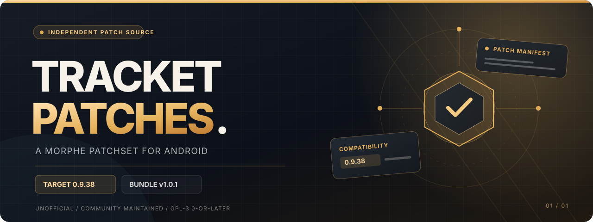
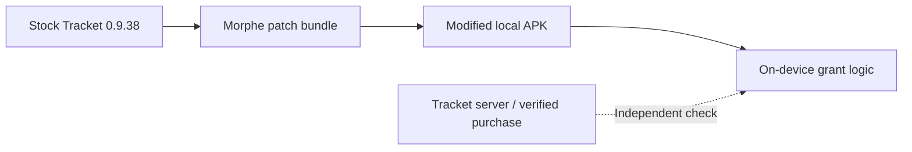

<p align="center">
  
</p>

<p align="center">
  <a href="https://github.com/contactjayclatty/tracket-patches/releases/latest"></a>
  <a href="#compatibility"></a>
  <a href="LICENSE"></a>
  <a href="https://github.com/MorpheApp/morphe-cli"></a>
</p>

<p align="center">
  <strong>Small patchset. Specific target. Fully documented.</strong><br>
  An unofficial, community-maintained <a href="https://github.com/MorpheApp/morphe-manager">Morphe</a> source for <strong>Tracket for Android</strong>.
</p>

<p align="center">
  <a href="#overview">Overview</a> &nbsp;·&nbsp;
  <a href="#compatibility">Compatibility</a> &nbsp;·&nbsp;
  <a href="#getting-started">Getting started</a> &nbsp;·&nbsp;
  <a href="#under-the-hood">Under the hood</a> &nbsp;·&nbsp;
  <a href="#documentation">Docs</a> &nbsp;·&nbsp;
  <a href="#support-the-developer">Support Tracket</a>
</p>

<p align="center">
  <a href="https://contactjayclatty.github.io/tracket-patches/"></a>
  <a href="https://contactjayclatty.github.io/tracket-patches/docs/#add-source"></a>
  <a href="https://github.com/contactjayclatty/tracket-patches/releases/latest"></a>
</p>

> [!IMPORTANT]
> **Please support Tracket's original developer.** If you use and enjoy Tracket, consider buying an official subscription or Lifetime option through the [Tracket app on Google Play](https://play.google.com/store/apps/details?id=com.tracket.app). Supporting the developer helps sustain the original app.
>
> **A direct note to the Tracket developer:** I am willing to remove this entire project under my control, including its patch source, releases, downloadable files and website, if you request it. Please email **[contactjayclatty@pm.me](mailto:contactjayclatty@pm.me?subject=Tracket%20Patches%20-%20Full%20Removal%20Request)** directly. I cannot remove independent copies or forks maintained by others.

---

## Overview

**Tracket Patches** publishes a Morphe patch bundle for the stock Tracket Android app, package `com.tracket.app`. The current release includes one patch, **Unlock lifetime**, which changes local entitlement handling and the client-side Play license check in the examined app version.

<table>
  <tr>
    <td width="33%" align="center"><sub>01 / APP TARGET</sub><br><strong>Tracket 0.9.38</strong><br><sub>versionCode 237</sub></td>
    <td width="33%" align="center"><sub>02 / RELEASE</sub><br><strong>Patchset v1.0.1</strong><br><sub>One published patch</sub></td>
    <td width="33%" align="center"><sub>03 / SCOPE</sub><br><strong>On-device only</strong><br><sub>Not a verified purchase</sub></td>
  </tr>
</table>

> [!IMPORTANT]
> **A patched app is not a paid subscription.** This project changes local application behavior; it does not produce a Google Play receipt, activate a genuine lifetime purchase, or guarantee server-side access. Tracket's servers may still refuse the account.

### What's included?

| Patch | Default | Effect | Target |
| :-- | :--: | :-- | :-- |
| **Unlock lifetime** | On | Changes the local pro-grant path and re-signed APK license-check behavior | **Stock Tracket 0.9.38 only** |

The bundle is version-locked because the relevant implementation uses obfuscated classes. Unknown builds are deliberately not advertised as compatible.

## Compatibility

| Requirement | Version / value |
| :-- | :-- |
| Application | Tracket (`com.tracket.app`) |
| Supported app build | **0.9.38**, `versionCode 237` |
| Bundle | `patches-1.0.1.mpp` |
| Published release | [v1.0.1](https://github.com/contactjayclatty/tracket-patches/releases/tag/v1.0.1) |
| Desktop tool documented for this bundle | Morphe desktop **1.18.1** |
| Desktop bytecode mode used in project checks | `FULL` |
| Project license | [GPL-3.0-or-later](LICENSE) |

> [!WARNING]
> Only use a **stock 0.9.38 APK** as documented. Different versions may have different internal class names and method signatures. A patch source can modify application bytecode, so only import sources you trust.

## Getting started

There are three ways to access the same versioned bundle. Choose the workflow appropriate for your environment.

### 01 &nbsp; Morphe Manager · remote source

**Recommended source-management workflow.** The remote source follows repository release metadata.

1. Get [Morphe Manager](https://github.com/MorpheApp/morphe-manager).
2. Open `Sources` → `+` → `Remote` in Manager. The **Set up Morphe Manager** button above opens these setup instructions.
3. For manual entry, supply:

   ```text
   https://raw.githubusercontent.com/contactjayclatty/tracket-patches/main/patches-bundle.json
   ```

4. Confirm the source displays **Tracket Patches**, **1.0.1**, and **1 patch**. If an earlier failed import still shows **Unnamed / N/A / 0 patches**, delete only that failed source and add the URL above again.

This exact remote URL has been confirmed working on a user's device and keeps automatic updates. Use it instead of the repository shorthand or the older add-source deep link. Local imports also work but do not update automatically.

Manager reads [`patches-bundle.json`](patches-bundle.json) from the default branch, and that manifest identifies the release asset. Adding a remote source requires trust in its maintainer.

### 02 &nbsp; Local bundle · pinned version

Already downloaded or built the `.mpp` file? In Manager, use `Sources` → `+` → `Local`, then choose [`dist/patches-1.0.1.mpp`](dist/patches-1.0.1.mpp).

A local import is a **snapshot**, not a subscription to future releases. Import a new bundle manually when you intentionally upgrade.

<details>
<summary><strong>03 &nbsp; Desktop CLI · advanced usage</strong></summary>

For the documented stock 0.9.38 APK and Morphe desktop CLI 1.18.1, the repository provides this command:

```powershell
morphe patch --bytecode-mode=FULL -p patches-1.0.1.mpp -o tracket-0.9.38-morphe.apk tracket-0.9.38.apk
```

The `FULL` setting is the bytecode mode checked with this bundle.

The patch is enabled by default. The following options file, when supplied with `--options-file`, disables it:

```json
[
  {
    "meta": { "source": "patches-1.0.1.mpp" },
    "patches": {
      "Unlock lifetime": { "enabled": false }
    }
  }
]
```

**Build from source:** Python 3 and JDK 17+ are required by [`build.py`](build.py); [`build.ps1`](build.ps1) delegates to it. Build dependencies are downloaded with pinned checksums. See the [maintainer guide](docs/MAINTAINING.md) for the documented build entry point and release checks.

</details>

**Something not matching your setup?** Use the [compatibility and troubleshooting guide](docs/TROUBLESHOOTING.md) before assuming another APK version is supported.

---

## Under the hood

A deliberately short explanation for readers; the full bytecode-level detail lives in [Technical notes](docs/TECHNICAL.md).



In the examined build, the app exposes premium-facing UI through a local grant that is refreshed periodically. The patch changes that client-side path and the installation-license behavior for a re-signed APK.

**The trust boundary matters:** an on-device grant is not a Google Play purchase token. A server-side decision remains separate.

<details>
<summary><strong>What the patcher looks for, and why updates can break it</strong></summary>

The source fingerprints a purchase handler containing `purchaseTime` and `SHA-256`, then references version-specific obfuscated helpers. When an expected method is not found, the build is intended to fail rather than guess. The repository's technical reference records the relevant symbols, grant behavior, and limitations.

[Read technical notes →](docs/TECHNICAL.md)

</details>

## Documentation

| Guide | What's inside |
| :-- | :-- |
| **[Technical notes →](docs/TECHNICAL.md)** | On-device grant model, implementation boundaries, obfuscation notes, developer-facing mitigations |
| **[Compatibility & troubleshooting →](docs/TROUBLESHOOTING.md)** | Exact version matrix, common failures, safe issue-reporting template |
| **[Maintaining & releasing →](docs/MAINTAINING.md)** | Build prerequisites, manifest fields, release checklist, verification record |
| **[Patch source →](src/tracket/morphe/LifetimeUnlock.java)** | Auditable Java implementation |
| **[1.0.1 verification →](docs/verification/1.0.1.md)** | Build, Android loader evidence, checksums, and test limits |
| **[Bundle metadata →](patches-bundle.json)** | Version, asset URL and release description |

### For contributors and maintainers

This source is intentionally narrow. Before claiming support for another Tracket version, review compatibility, obfuscated references, the manifest, and actual validation results. Changes to the documentation alone do not constitute a tested patch release.

For reports, use [GitHub Issues](https://github.com/contactjayclatty/tracket-patches/issues). **Do not include** login credentials, tokens, receipts, or private user/device information in public logs.

---

## Support the developer

**Tracket is someone else's work.** This community repository is not the official Tracket project and does not replace its billing or product support.

If you like Tracket, please consider purchasing a legitimate plan through [Google Play](https://play.google.com/store/apps/details?id=com.tracket.app). The examined 0.9.38 build lists:

| Plan | Billing model |
| :-- | :-- |
| **Monthly** | Recurring monthly subscription |
| **Yearly** | Recurring annual subscription |
| **Lifetime** | One-time in-app purchase (`pro_lifetime`) |

<p align="center">
  <a href="https://play.google.com/store/apps/details?id=com.tracket.app">
    
  </a>
</p>

## License & contact

This repository includes a [GPL-3.0 license](LICENSE) and documents its patch code under **GPL-3.0-or-later**. It is **unofficial** and unaffiliated with Tracket, Google Play, or Morphe.

**Developer takedown requests are welcome.** I am willing to remove this entire project and all files under my control if the original Tracket developer asks. Contact me privately at **[contactjayclatty@pm.me](mailto:contactjayclatty@pm.me?subject=Tracket%20Patches%20-%20Full%20Removal%20Request)**.

<p align="center"><sub>Built for a specific version. Documented for careful review. Please support the original app developer.</sub></p>