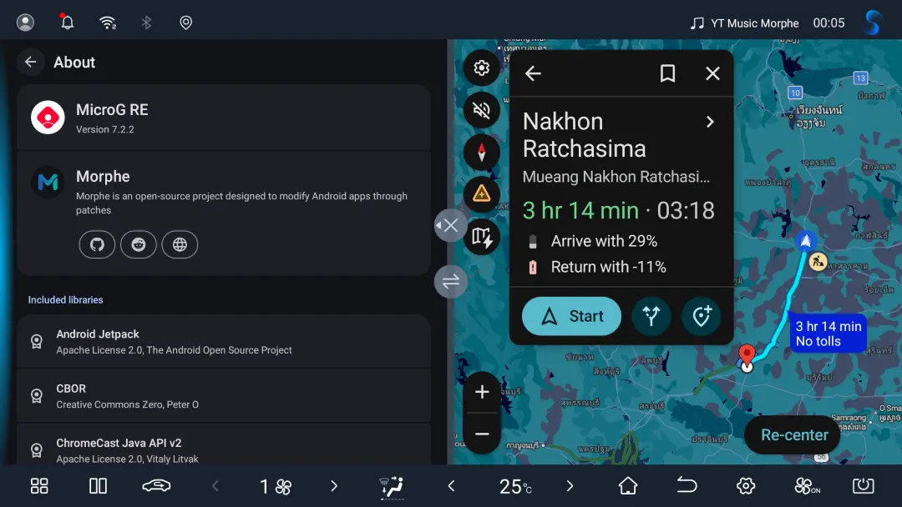

# Google Maps Automotive for MicroG-RE on BYD cars

Google Maps Automotive on a BYD DiLink 3 head unit (Android 10) with [MicroG-RE 7.3.0](https://github.com/MorpheApp/MicroG-RE/releases/tag/7.3.0).

[Test APK](https://tryy.cc/byd), PIN: 344993



The patched app, **Maps Car** (`app.morphe.android.apps.maps.automotive`), installs alongside phone Google Maps. This repository publishes `.mpp` bundles only; bring your own original APK.

## Features

- **UI density** in Settings, so the car layout fits split screen. Until you choose one, it is 200 dpi on the Dolphin's screen (1920×1080) and the system density on other screens.
- **BYD battery (EV)** in Settings: Maps shows the battery on arrival from the car's own reading. Read-only.
- **Send to car** from phone Google Maps on the same Google account.
- **Problem report and safe mode**: A red Report Maps Car app icon to send a report, and switches to turn single features off.

BYD battery, Send to car and the BYD location flicker fix are separate patches, on by default. You can leave them out in Morphe Desktop; only the default set is tested.

## Patches list

<!-- PATCHES_START -->
[v0.1.2](https://github.com/fangkampanat/google-maps-automotive-patches/releases/tag/v0.1.2) · 4 patches

Eligible versions: Any version.

| Patch | Description |
| --- | --- |
| BYD battery (EV) | Feeds the BYD battery into Maps' EV routing (battery on arrival, chargers). On by default on the tested BYD Dolphin, off with an "untested" notice on other BYD models; a Settings row turns it on or off. |
| BYD location flicker fix | Holds back BYD's brief location off/on flips for up to 3 s, so Maps does not flash its location lockout. |
| Google Maps Automotive for MicroG-RE | Runs Google Maps for Android Automotive on Android 10 as "Maps Car" with MicroG-RE 7.3.0. Adds a UI density setting, a problem report and a safe mode. |
| Send to car | Lets phone Maps send a trip to Maps Car through MicroG-RE (push routes, the notification service identity and maps.app.goo.gl links). |

<!-- PATCHES_END -->

## Tested

| Device | Result |
| --- | --- |
| BYD Dolphin, DiLink 3.0 / Android 10, MicroG-RE 7.3.0 | Navigation with voice, problem report |
| BYD Dolphin, DiLink 3.0 / Android 10, MicroG-RE 7.2.2 | Sign-in, search, navigation, Thai and English voice, split screen, vehicle off/on, battery on arrival, Send to car |

Other BYD models, DiLink 5 and Android 11 to 15 are untested. On other BYD models, BYD battery starts off; you can turn it on, but the estimate may be less accurate. Plug-in hybrids are not supported.

## Requirements

- [Morphe Desktop](https://github.com/MorpheApp/morphe-desktop) 1.20.0 or newer, with Java 21
- The original **Google Maps (Android Automotive) 26.10.120003.E** APK (version code `1068833413`), for example from APKMirror. Other Automotive versions may patch, but only this one is tested.
- An ARM64 BYD head unit with Android 10 or newer, 4 KiB memory pages and ADB access

## Install

1. Install `microg-7.3.0-icon-arm64-v8a.apk` from [MicroG-RE 7.3.0](https://github.com/MorpheApp/MicroG-RE/releases/tag/7.3.0) on the head unit and whitelist it:

   ```bash
   adb shell dumpsys deviceidle whitelist +app.revanced.android.gms
   ```

   Turn OFF **MicroG RE** in BYD's **Disable Autostart**, then open it, grant its permissions and sign in. For Send to car, turn on **Cloud messaging**.
   For voice guidance, install [Google TTS for MicroG-RE](https://github.com/fangkampanat/google-tts-microg) and download your voices.
2. In Morphe Desktop, add this repository as a **Remote** source, make it active and turn off other sources for Google Maps:

   ```text
   https://github.com/fangkampanat/google-maps-automotive-patches
   ```

3. Drop the original APK onto **Drop APK here**, click **PATCH WITH DEFAULTS** and install the result on the head unit.
4. Start **Maps Car**.

## Reporting problems

Open the red **Report Maps Car** icon (or tap the notification after a crash, or **Settings › Report a problem**), check the report and tap **Send**. Nothing leaves the car before that. A report holds Maps Car's own logs, the warning and error lines its main process wrote to the system log (also when nothing crashed), the car model, screen and platform, and for each crash the same lines from the crashed process. On Android 11 and newer it also says why Maps Car last closed. Your location, e-mail, VIN and long ID numbers are removed first, and the report is deleted after 14 days.

If Maps Car stays on a grey screen or does not open, send the report before you restart the head unit, because a restart clears the system log.

Then open an [issue](https://github.com/fangkampanat/google-maps-automotive-patches/issues) with the report ID. If no report can be sent, attach the crash file from `Documents/Morphe` on the head unit (`adb pull /sdcard/Documents/Morphe/`).

If Maps Car crashes twice within 10 minutes, it starts in **safe mode** with its extra features off. In Report Maps Car you can turn features back on one at a time to find the one that crashes.

## Credits and license

Built on [Morphe](https://github.com/MorpheApp) and [MicroG-RE](https://github.com/MorpheApp/MicroG-RE). The project is unofficial and not endorsed by Google, BYD or Morphe. Source code is licensed under [GPL-3.0](LICENSE); preserve [NOTICE](NOTICE). Build instructions: [docs/build-setup.md](docs/build-setup.md).
