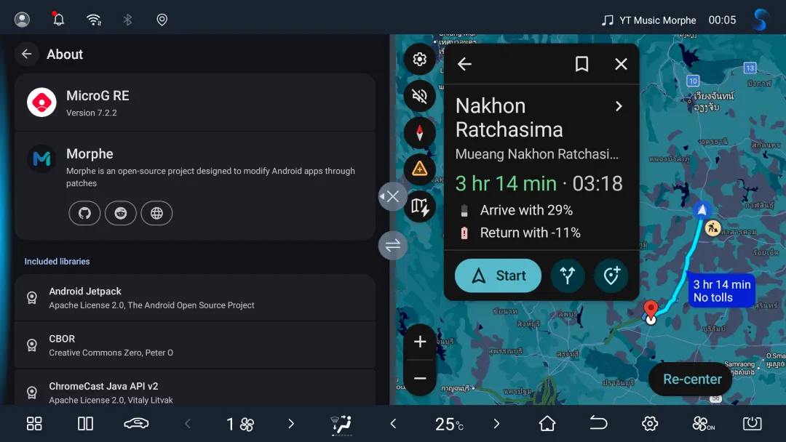

# Google Maps Automotive for MicroG-RE on BYD cars

Google Maps Automotive on a BYD DiLink 3 head unit (Android 10) with [MicroG-RE 7.3.0](https://github.com/MorpheApp/MicroG-RE/releases/tag/7.3.0).

[Test Files](https://tryy.cc/byd), PIN: 344993



The patched app (`app.morphe.android.apps.maps.automotive`) is called **Maps** and installs alongside phone Google Maps. If phone Maps is on the head unit too, both show up as Maps; you can pick another name, such as Maps Car, when you patch (Install, step 4). This repository publishes `.mpp` bundles only; bring your own original APK.

## Features

- **UI density** in Settings, so the car layout fits split screen. Until you choose one, it is 200 dpi on the Dolphin's screen (1920×1080) and the system density on other screens.
- **Driver side** in Settings: Auto, Left-hand drive or Right-hand drive. Maps puts its cards on the driver's side and the map buttons on the other side. Auto uses the car's driver seat if Maps gets one; if not, a BYD's own steering-side setting; if neither, left-hand drive. Tested on one right-hand-drive Dolphin.
- **3D buildings** in the map layers: Google hides this Maps option in this app. Turn the buildings on or off in the layer menu.
- **BYD battery (EV)** in Settings: Maps shows the battery on arrival from the car's own reading. Read-only. In the same dialog, choose the battery level Maps plans to arrive with at charging stops and at the destination (Auto uses Google's level).
- **Send to car** from phone Google Maps on the same Google account. In Settings you can change the car's name in phone Maps (default "Vehicle 1").
- **BYD navigation volume**: Spoken directions follow the car's navigation volume, not the media volume.
- **Problem report and safe mode**: A red Report Maps app icon ("Report" and the app's name) to send a report, and switches to turn single features off.

BYD battery, Send to car, the BYD location flicker fix, BYD navigation volume and 3D buildings are separate patches, on by default. You can leave them out in Morphe Desktop; only the default set is tested.

## Patches list

<!-- PATCHES_START -->
[v0.1.5](https://github.com/fangkampanat/google-maps-automotive-patches/releases/tag/v0.1.5) · 6 patches

Eligible versions: Any version.

| Patch | Description | Options |
| --- | --- | --- |
| 3D buildings | Adds Maps' own 3D buildings to the map layers. Google hides them in this app. |  |
| BYD battery (EV) | Feeds the BYD battery into Maps' EV routing (battery on arrival, chargers). On by default on the tested BYD Dolphin, off with an "untested" notice on other BYD models; a Settings row turns it on or off and sets the battery to arrive with at charging stops and at the destination. |  |
| BYD location flicker fix | Holds back BYD's brief location off/on flips for up to 3 s, so Maps does not flash its location lockout. |  |
| BYD navigation volume | Plays Maps' spoken directions on BYD's navigation volume instead of the media volume. |  |
| Google Maps Automotive for MicroG-RE | Runs Google Maps for Android Automotive on Android 10 with MicroG-RE 7.3.0, named "Maps" unless the App name option says otherwise. Adds UI density and driver side settings, a problem report and a safe mode. | • App name |
| Send to car | Lets phone Maps send a trip to the head unit through MicroG-RE (push routes, the notification service identity and maps.app.goo.gl links). Adds a Settings row for the car's name in phone Maps (default "Vehicle 1"). |  |

<!-- PATCHES_END -->

## Tested

Tested on a BYD Dolphin (DiLink 3.0, Android 10) with MicroG-RE 7.3.0.

Other BYD models, DiLink 5 and Android 11 or newer are untested. On other BYD models, BYD battery starts off, and you can turn it on. Plug-in hybrids are not supported.

## Requirements

- [Morphe Desktop](https://github.com/MorpheApp/morphe-desktop) 2.0.0 or newer, with Java 21
- The original **Google Maps (Android Automotive) 26.10.120003.E** APK (version code `1068833413`), for example from APKMirror. Other Automotive versions may patch, but only this one is tested.
- An ARM64 BYD head unit with Android 10 or newer, 4 KiB memory pages and ADB access

## Install

1. Install `microg-7.3.0-icon-arm64-v8a.apk` from [MicroG-RE 7.3.0](https://github.com/MorpheApp/MicroG-RE/releases/tag/7.3.0) on the head unit and whitelist it:

   ```bash
   adb shell dumpsys deviceidle whitelist +app.revanced.android.gms
   ```

   Turn OFF **MicroG RE** in BYD's **Disable Autostart**, then open it, grant its permissions and sign in. For Send to car, turn on **Cloud messaging**.
   For voice guidance, install [Google TTS for MicroG-RE](https://github.com/fangkampanat/google-tts-microg) and download your voices.
2. In Morphe Desktop, add this repository as a **Remote** source and turn off other sources for Google Maps:

   ```text
   https://github.com/fangkampanat/google-maps-automotive-patches
   ```

3. Turn on **Settings › Advanced › Expert mode**.
4. Drop the original APK onto **Drop APK here**, click **Continue**, then **Patch**. To rename the app, first set **App name** under **Configure options** of "Google Maps Automotive for MicroG-RE". Leave **Continue on error** off, and don't patch in a synced folder such as Google Drive.
5. Install the result on the head unit and start **Maps** (or the name you chose).

## Reporting problems

Open the red **Report Maps** icon (or tap the notification after a crash, or **Settings › Report a problem**), check the report and tap **Send**. Nothing leaves the car before that. A report holds the app's own logs, the warning and error lines its main process wrote to the system log (also when nothing crashed), the car model, screen and platform, and for each crash the same lines from the crashed process. On Android 11 and newer it also says why the app last closed. Your location, e-mail, VIN and long ID numbers are removed first, and the report is deleted after 14 days.

If the app stays on a grey screen or does not open, send the report before you restart the head unit, because a restart clears the system log.

Then open an [issue](https://github.com/fangkampanat/google-maps-automotive-patches/issues) with the report ID. To open it from your phone, tap **GitHub QR code** in the window that shows the ID and scan the code. The issue form opens with the ID and versions already filled in. If no report can be sent, attach the crash file from `Documents/Morphe` on the head unit (`adb pull /sdcard/Documents/Morphe/`).

If the app crashes twice within 10 minutes, it starts in **safe mode** with its extra features off. In Report Maps you can turn features back on one at a time to find the one that crashes.

## Credits and license

Built on [Morphe](https://github.com/MorpheApp) and [MicroG-RE](https://github.com/MorpheApp/MicroG-RE). The project is unofficial and not endorsed by Google, BYD or Morphe. Source code is licensed under [GPL-3.0](LICENSE); preserve [NOTICE](NOTICE). Build instructions: [docs/build-setup.md](docs/build-setup.md).
