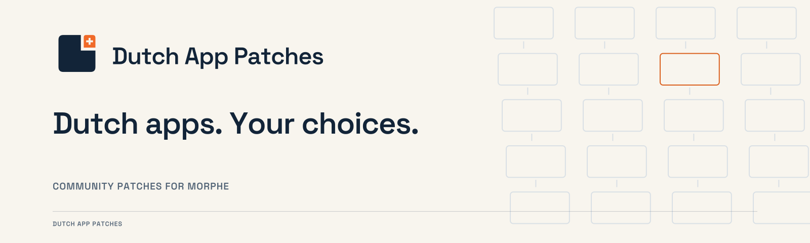

  <picture>
    <source media="(prefers-color-scheme: dark)" srcset="docs/site/assets/brand/readme-dark.png">
    
  </picture>

  

Tap to add the GitLab source in Morphe Manager · <a href="https://nl-morphe-patches-ed90fa.gitlab.io/">Browse the GitLab Pages site</a>

# Dutch App Patches

Community patches for Dutch and Belgian Android apps, compatible with Morphe. Choose which
ads, tracking and prompts to remove, and read what each patch changes in the
[Dutch guide](docs/site/nl/index.md) or
[English guide](docs/site/en/index.md).
Independently maintained; not affiliated with Morphe or the app publishers.

Installable bundles are listed on the
[releases page](https://gitlab.com/johninnld/nl-morphe-patches/-/releases).
All app targets listed below belong to the production patch set.

## Get started

1. Install [Morphe Manager](https://morphe.software/).
2. Check your app's guide for the supported version and original download.
3. Follow [Add the patch source](docs/site/en/guides/install.md#2-add-the-patch-source)
   on your Android device, then choose your patches in Manager and apply them
   to the original app file.

The [installation guide](docs/site/en/guides/install.md) explains updates and
signing. Some patches change notifications or other app features; review the
app page before choosing them. A tracking patch reduces the listed tracking;
it does not guarantee anonymity or remove all network traffic.

### Waze or Flitsmeister missing from Android Auto?

Use the [Android Auto walkthrough with screenshots (Nederlands)](docs/site/nl/guides/android-auto.md)
or [English](docs/site/en/guides/android-auto.md).
It explains why navigation apps need extra installation steps and takes you
through Shizuku-Next, KingInstaller and Android Auto's app list.

## App overview

<!-- PATCHES_START SUMMARY -->
**Patch bundle [v1.101.0](https://gitlab.com/johninnld/nl-morphe-patches/-/releases/v1.101.0)** · 82 apps · 406 patches

### Weather

| App | Changes | Target app versions | Input | Patches |
| --- | --- | --- | --- | --- |
| [Buienalarm](docs/site/en/apps/buienalarm.md) | Ads · Tracking · Prompts · Compatibility | 4.32.0 | APKS | 5 |
| [Buienradar](docs/site/en/apps/buienradar.md) | Ads · Tracking · Prompts | 7.4.8 | APKM | 6 |
| [RainViewer](docs/site/en/apps/rainviewer.md) | Ads · Tracking · Prompts · Compatibility | 8.4.1 | APKM | 9 |
| [Weeronline](docs/site/en/apps/weeronline.md) | Ads · Tracking · Prompts · Plus/Pro | 3.61.0 | APKS | 5 |
| [Weerplaza](docs/site/en/apps/weerplaza.md) | Ads · Tracking · Prompts · Compatibility | 3.13.1 | APKS | 5 |

### News and reading

| App | Changes | Target app versions | Input | Patches |
| --- | --- | --- | --- | --- |
| [AD](docs/site/en/apps/ad.md) | Ads · Tracking · Prompts · Articles | 9.22.0 | APKS | 6 |
| [Bright](docs/site/en/apps/bright.md) | Ads · Tracking · Prompts · Articles | 10.181.0 | APKS | 4 |
| [De Morgen](docs/site/en/apps/demorgen.md) | Ads · Tracking · Prompts · Articles | 7.53.1, 7.55.0 | APKS | 6 |
| [De Tijd](docs/site/en/apps/detijd.md) | Ads · Tracking · Prompts · Articles | 5.6.1 | APKS | 8 |
| [DS Nieuws](docs/site/en/apps/dsnieuws.md) | Ads · Tracking · Prompts | 22.0.0 | APKS | 4 |
| [ED](docs/site/en/apps/ed.md) | Ads · Tracking · Prompts · Articles | 9.22.0 | APKS | 6 |
| [FTM](docs/site/en/apps/ftm.md) | Ads · Tracking · Prompts · Articles | 2.6.8 | APKS | 5 |
| [GVA](docs/site/en/apps/gva.md) | Ads · Tracking · Prompts · Navigation | 22.0.0 | APKS | 5 |
| [HBVL](docs/site/en/apps/hbvl.md) | Ads · Tracking · Prompts · Navigation | 22.0.0 | APKS | 5 |
| [HLN](docs/site/en/apps/hln.md) | Ads · Tracking · Prompts · Articles | 9.23.3 | APKS | 7 |
| [Humo](docs/site/en/apps/humo.md) | Ads · Tracking · Prompts · Articles | 7.53.1, 7.55.0 | APKS | 5 |
| [Medium](docs/site/en/apps/medium.md) | Tracking · Prompts · Articles | 4.5.1784911033, 4.5.1784911134 | APKS | 3 |
| [Nieuwsblad](docs/site/en/apps/nieuwsblad.md) | Ads · Tracking · Prompts | 22.0.0 | APKS | 4 |
| [NOS Teletekst](docs/site/en/apps/nos-teletekst.md) | Tracking | 2.8.10 | APKS | 2 |
| [NRC](docs/site/en/apps/nrc.md) | Ads · Tracking · Prompts · Articles · Newspaper tab | 5.12.25 | APK | 6 |
| [NU.nl](docs/site/en/apps/nunl.md) | Ads · Tracking · Prompts | 26.10.0 | XAPK | 4 |
| [Omroep Brabant](docs/site/en/apps/omroep-brabant.md) | Ads · Tracking · Prompts | 11.1.0 | APKS | 3 |
| [Omroep West](docs/site/en/apps/omroep-west.md) | Ads · Tracking · Prompts | 20.1 | APKS | 3 |
| [Parool](docs/site/en/apps/parool.md) | Ads · Tracking · Prompts · Articles | 7.53.1 | APKS | 6 |
| [RTL Nieuws](docs/site/en/apps/rtl-nieuws.md) | Ads · Tracking · Prompts | 12.7.1 | APKS | 4 |
| [Trouw](docs/site/en/apps/trouw.md) | Ads · Tracking · Prompts · Articles | 7.53.1 | APKS | 6 |
| [Tubantia](docs/site/en/apps/tubantia.md) | Ads · Tracking · Prompts · Articles | 9.23.2 | APKS | 5 |
| [Voetbal International](docs/site/en/apps/voetbal-international.md) | Ads · Tracking · Prompts · Articles | 5.13.52 | APKS | 4 |
| [Volkskrant](docs/site/en/apps/volkskrant.md) | Ads · Tracking · Prompts · Articles | 7.53.1 | APKS | 6 |

### Traffic and navigation

| App | Changes | Target app versions | Input | Patches |
| --- | --- | --- | --- | --- |
| [9292](docs/site/en/apps/9292.md) | Ads · Tracking · Prompts · Compatibility | 2.48.1 | APKM | 4 |
| [ABRP](docs/site/en/apps/abrp.md) | Plus/Pro | 8.0.0 | APKS | 2 |
| [EasyPark](docs/site/en/apps/easypark.md) | See guide | 26.40.1 | APKM | 1 |
| [EasyPark NL](docs/site/en/apps/easypark-nl.md) | See guide | 26.42.4 | APKS | 2 |
| [Flitsmeister](docs/site/en/apps/flitsmeister.md) | Ads · Tracking · Prompts · Plus/Pro · Compatibility · Partner services | 14.17, 15.0 | APKS | 10 |
| [Gearslip](docs/site/en/apps/gearslip.md) | See guide | 0.3.12-alpha, 0.3.31-alpha | APK | 3 |
| [Google Maps](docs/site/en/apps/google-maps.md) | See guide | 26.43.05.1002020710, 26.44.06.1006895251, 26.47.00.1022347503 | APK | 33 |
| [Magic Earth](docs/site/en/apps/magic-earth.md) | See guide | 7.1.26.38.B4684D03.6207A61BA | APKM | 5 |
| [Rollerbank](docs/site/en/apps/rollerbank.md) | Ads · Tracking · Prompts · Compatibility | 4.5.3.1 | APKS | 6 |
| [Vela Maps](docs/site/en/apps/vela.md) | See guide | 0.5.2621 | APK | 1 |
| [Waze](docs/site/en/apps/waze.md) | Ads · Prompts · Home audio | 5.26.90.901, 5.27.0.1, Any | APKM | 41 |

### Entertainment

| App | Changes | Target app versions | Input | Patches |
| --- | --- | --- | --- | --- |
| [Apple Music](docs/site/en/apps/apple-music.md) | See guide | 7.0.0 | APKM | 1 |
| [Beach Buggy Racing](docs/site/en/apps/beach-buggy-racing.md) | Ads · Tracking | 2026.11.02 | APKM | 3 |
| [Candy Crush Soda Saga](docs/site/en/apps/candy-crush-soda-saga.md) | Ads · Tracking | 1.330.1 | APKM | 3 |
| [Deezer](docs/site/en/apps/deezer.md) | Tracking | 9.0.27.3 | APKM | 13 |
| [Dumpert](docs/site/en/apps/dumpert.md) | Ads · Tracking · Prompts | 5.8.0 | APKS | 3 |
| [Eclipse Music](docs/site/en/apps/eclipse-music.md) | See guide | 0.6.75 | APK | 2 |
| [KIJK Android](docs/site/en/apps/kijk.md) | Ads · Tracking · Prompts | 9.8.0 | APK | 3 |
| [KIJK Android TV](docs/site/en/apps/kijk-android-tv.md) | Ads · Tracking | 7.2.7 | APKS | 3 |
| [Myspoti](docs/site/en/apps/myspoti.md) | See guide | 2.3.0, 2.4.0, 2.4.1, Any | APK | 3 |
| [NPO Start](docs/site/en/apps/npo-start.md) | Ads · Tracking · Compatibility | 1.48.2-2405 | APKS | 3 |
| [NPO Start Android TV](docs/site/en/apps/npo-start-android-tv.md) | Ads · Tracking · Compatibility | 1.48.2-2405 | APKS | 3 |
| [Orpheon](docs/site/en/apps/orpheon.md) | See guide | 1.0.0, Any | APK | 3 |
| [Podimo](docs/site/en/apps/podimo.md) | Plus/Pro | 3.7.0 | APKS | 3 |
| [SoundCloud](docs/site/en/apps/soundcloud.md) | See guide | 2026.11.02-release | APKM | 5 |
| [Spotify](docs/site/en/apps/spotify.md) | See guide | 9.2.0.2053 | APKS | 1 |
| [TIDAL](docs/site/en/apps/tidal.md) | See guide | 2.216.0 | APKM | 1 |
| [TVgids.nl](docs/site/en/apps/tvgids-nl.md) | Ads · Tracking · Prompts | 7.0.16 | APK | 3 |
| [upflix](docs/site/en/apps/upflix.md) | Tracking | 5.12.10 | APKS | 3 |
| [Videoland Android](docs/site/en/apps/videoland.md) | Ads · Tracking · Prompts | 1.119.2 | APKS | 4 |
| [Videoland Android TV](docs/site/en/apps/videoland-android-tv.md) | Ads · Tracking | 1.119.2 | APKS | 4 |
| [Wuplay Android TV](docs/site/en/apps/wuplay.md) | See guide | 0.9.4-beta | APK | 1 |
| [WuPlay Mobile](docs/site/en/apps/wuplay-mobile.md) | See guide | 0.1.9-alpha | APK | 1 |
| [YouTube](docs/site/en/apps/youtube.md) | See guide | 21.30.216, Any | APK | 3 |
| [YouTube Music](docs/site/en/apps/youtube-music.md) | See guide | Any | APK | 1 |

### Other apps

| App | Changes | Target app versions | Input | Patches |
| --- | --- | --- | --- | --- |
| [2dehands](docs/site/en/apps/2dehands.md) | Ads · Tracking · Prompts | 16.19.0 | XAPK | 4 |
| [AliExpress](docs/site/en/apps/aliexpress.md) | Compatibility | 8.180.0, 8.180.1 | APK | 10 |
| [AT4K Launcher](docs/site/en/apps/at4k.md) | Plus/Pro | 1.3 | APK | 1 |
| [bol](docs/site/en/apps/bol.md) | Tracking | 2026.23.1 | APKS | 5 |
| [Fennec](docs/site/en/apps/fennec.md) | See guide | Any | APK | 1 |
| [Gboard](docs/site/en/apps/gboard.md) | See guide | 18.8.0.1022711984-beta-arm64-v8a, 18.8.0.1022711984-beta-armeabi-v7a | APK | 32 |
| [GridCraft](docs/site/en/apps/gridcraft.md) | See guide | Any | APK | 1 |
| [Home Assistant](docs/site/en/apps/homeassistant.md) | See guide | 2026.10.1-full | APKS | 1 |
| [LightCraft](docs/site/en/apps/lightcraft.md) | See guide | Any | APK | 1 |
| [Marktplaats](docs/site/en/apps/marktplaats.md) | Ads · Tracking · Prompts | 16.19.0 | APKS | 5 |
| [Monet Android TV](docs/site/en/apps/monet.md) | Plus/Pro | 1.1.1 | APK | 4 |
| [PdfCraft](docs/site/en/apps/pdfcraft.md) | See guide | Any | APK | 1 |
| [Projectivy Launcher](docs/site/en/apps/projectivy.md) | Tracking · Plus/Pro | 4.73 | APK | 2 |
| [Reolink](docs/site/en/apps/reolink.md) | Compatibility | 4.64.3.20261023 | APKM | 6 |
| [Titanium Browser](docs/site/en/apps/titanium.md) | See guide | Any | APK | 1 |
| [Tuya Smart Life](docs/site/en/apps/tuya.md) | See guide | 7.12.6 | APKS | 1 |
| [WordCraft](docs/site/en/apps/wordcraft.md) | See guide | Any | APK | 1 |
| [Zoom Workplace](docs/site/en/apps/zoom.md) | See guide | 7.2.1.43844 | APKS | 1 |

[Patch defaults and supported versions](docs/site/nl/reference/catalogue.md) · [English](docs/site/en/reference/catalogue.md)

Targets and defaults vary by patch; the bundle version is separate from each app version.
<!-- PATCHES_END -->

**2dehands (Belgium):** the 16.19.0 / 633464 profile has four default-on
advertising, tracking, ThreatMetrix and consent-form controls. Use the complete
XAPK, including Notifications and native splits. See the
[2dehands guide](docs/site/en/apps/2dehands.md) and
[privacy evidence and limits](docs/privacy/2dehands/README.md).
Signed-in, incoming-push and checkout acceptance follows stable publication.

[RainViewer 8.4.1](docs/rainviewer/README.md) includes privacy controls, integrity compatibility and optional local Pro controls. The research covers all 19 built-in plan-comparison features and the additional sharing-watermark restriction, with tested server-data availability and current limits.

The source branch also contains the [full Waze 5.26.90.901 catalog](docs/waze/README.md): 24 controls from [bearinmind patches](https://github.com/bearinmindcat/morphe-patches) (De-Waze), ported to this version, alongside the two audio patches, plus silent consent completion and expanded privacy controls. The release table above follows published bundle metadata. Eleven optional controls adapted from Forsigh Waze Patches add driving, camera/hazard, reconnect, recent-list privacy and phone display choices for this Waze version; see the Waze catalog for source credits, configuration and validation limits.

App pages describe patch effects, supported versions, defaults and relevant
limits. Advertising and tracking services are listed where useful.

## Develop and contribute

The optional [Monet Wuplay catalog rows](docs/site/en/apps/monet.md) patch
targets Monet 1.1.0 / 134 and adds dedicated Wuplay catalog choices with stable
saved selections and refresh independent of Recommendations.

The optional [Wuplay catalog publisher](docs/site/en/apps/wuplay.md) targets
Wuplay Android TV 0.9.4-beta / 49. Its **Settings > Catalogs > TV channels**
entry publishes only selected default-profile Home catalogs as Android TV preview channels.
It is disabled by default and does not include Monet changes.

See [CONTRIBUTING.md](CONTRIBUTING.md) for build requirements, app verification
and documentation checks. [Report an issue](https://codeberg.org/JohninNL/nl-morphe-patches/issues)
with the app version, selected patches and reproducible steps.

Code is licensed under [GPLv3](LICENSE). Retained contributor and upstream
credit is in [AUTHORS.md](AUTHORS.md) and [NOTICE](NOTICE). Brand and font
attribution is in [asset sources](docs/site/assets/brand/SOURCES.md).

### bol attribution

The bol controls build on [Wouter075’s bol-patches](https://github.com/wouter075/bol-patches). The 2026.23.1 integration fixes missed advertising paths and adds promotional, consent and tracking controls. See [bol patch notes](docs/release-notes/bol-2026.23.1.md) for the additions beyond the original patches.
