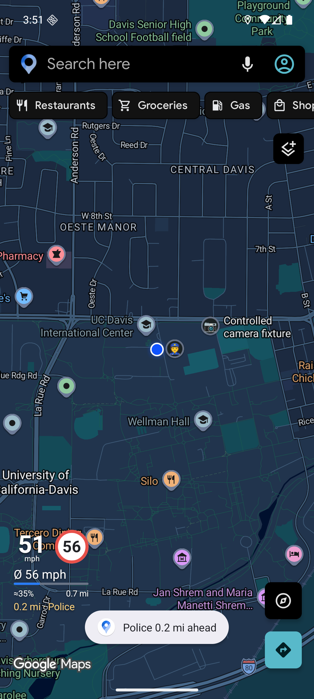
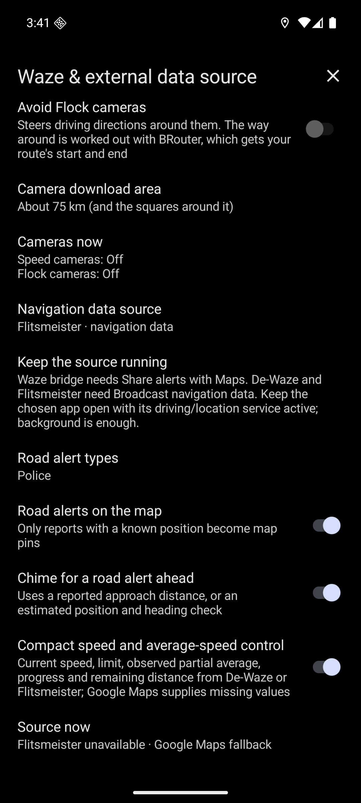
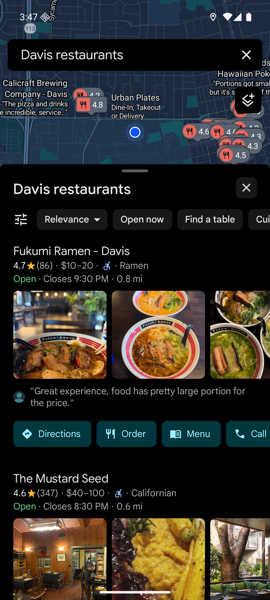

# Google Maps port and validation

The Maps source is imported from [bearinmind patches](https://github.com/bearinmindcat/morphe-patches), checkout `bd522fe` (v2.8.3), preserving the `org.ungoogled` namespaces, GPL licence and upstream attribution. It is integrated into the Dutch App Patches bundle rather than distributed as a second patch source.

Targets, standalone APKs, minimum Android 10 (API 29): `com.google.android.apps.maps` 26.43.05.1002020710 (version code 1068844719), 26.44.06.1006895251 (1068856906), and — for the patch subset listed under "26.47 port" below — 26.47.00.1022347503 (1068892333).

Supplied input SHA-256: `81506a2c54fc9a8faca34c18af7619d9c9d26cbfbe799b66884a59ac17791004`.

REA package inspection evidence `ev_f21f97d5dcba22992f2bcb4c0d54e94446579cc80996a8e68bf745ae2fecc6bd` confirms the package/version/SDK declarations and counts 68,600 classes and 8,875 resources. This static inspection does not establish patch applicability, installability or runtime behavior.

## 26.47 port (26.47.00.1022347503, version code 1068892333)

Input: `com.google.android.apps.maps_26.47.00.1022347503-1068892333_minAPI29(arm64-v8a,armeabi-v7a,x86,x86_64)(nodpi)_apkmirror.com.apk`,
SHA-256 `28cd7b8f0fb3ac9a520c2b40c362337be6d9fbe6b264a568e711b93c7cc01cac`.

The 26.47 build renames most of the obfuscated classes and several members again, so the 26.44 lookups were re-derived from the target's DEX with local smali dumps and class-name-agnostic structural matching (external-framework reference set, string constants, member shapes). The port adds version-selected fingerprints rather than rewriting the 26.43/26.44 paths.

Confirmed 26.44 → 26.47 symbol moves used by the port:

| Area | 26.44 | 26.47 |
| --- | --- | --- |
| Platform location dispatcher / listener | `ajcc` (fused manager), `ajjl` (listener) | `ajny` (fused manager, `k:Lajwn;` availability test), `ajvh` (dispatcher, `c()` modes), `ajvg` (listener) |
| Play services connection descriptor | client `A()`/`d()`/`f()` → `<init>(String,String,Z)` | client `B()`/`d()`/`f()` in `bfrn.O(IILandroid/os/IInterface;I)Z` |
| Navigation camera controller | `bmly` | `bmtc` (`l(Lbmtp;)Lcfxn;`, retarget `bmti.c(Lcfym;Lbmnu;Z)Lcfxn;`, teardown `g()`) |
| Account sheet row holder / row / builder / category | `omf` / `brdm` / `brdk` / `brdj` | `ool` / `brlr` / `brlp` / `brlo` |
| Account sheet builders | `omi.a(Z)`, `kam.t(Lagdp;)` | `ooo.a(Z)Lbrel;`, `oim.O(Lagnt;)Lbrgh;` |
| Account sheet list / row listener | `bwpw`, `ome` | `bwzs`, `Look` |
| Settings row / section title | `bsgx.aP`, `bsgx.D(proto,Context)` | `bucr.bg`, `bsqa.y(Lcmyb;Landroid/content/Context;)` |
| Icon loader | `gez.aC(Context,I)` | `fzc.aP(Context,I)` |
| Car SDK resource cohort | `lvh`/`lvi`/`jbz.b`,`jbz.c`/`nnu`/`lvg` | `lps`/`lpt`/`kyp.y`,`kyp.z`/`qqt`/`lpr` |
| Monogram avatar strategy interface | `buhf`/`bunt` | `buxr` |
| Offline picker model / Compose state | `laphb` (`c:J`, `h`) / `dzc` | `aptd` (`d:J`, `h:Ldtg;`) / `dtg` |

Resource ids that patches emit as literals were remapped by resource *name* against the 26.47 table, for example `quantum_gm_ic_edit_vd_theme_24` `0x7f080baa` → `0x7f080b85`, `gs_directions_car_vd_theme_24` `0x7f080536` → `0x7f080514`, `ic_suitcase` `0x7f080867` → `0x7f080844` and `ic_qu_placelist_heart` `0x7f080813` → `0x7f0807f0`.

Verified against the exact 26.47 APK with the release bundle (`patches-1.92.0.mpp`) and the desktop patcher 1.19.1: **28 controls apply, 0 failures**, the output verifies as a v2 signature under the Morphe key (`CN=Morphe`), and the injected rows/hooks/switches are present in the rebuilt DEX (`uaCustomizationRow`, `uaWazeRow`, `uaSavedRow`, `uaPowerRow`, `HIDE_ADS`/`HIDE_AI`/`HIDE_TABS`, two `Can't sign in` toast sites, `org/ungoogled/ui/Shapes`). Applying: `120 refresh rate`, `Account sheet cleanup`, `Any media app`, `Better offline maps`, `Black theme`, `Blue pin`, `Bypass Play Services checks`, `Change app name`, `Change package name`, `Customization screen`, `Avoid Flock cameras`, `Flock cameras`, `Hide ads and clutter`, `Legacy icon`, `Location provider toggle`, `Native navigation for any Android Auto host`, `Offline saved places`, `Power saving mode`, `Proxy`, `Rectangle shapes`, `Remove permissions`, `Android Auto options`, `Remove sign-in prompts`, `Remove telemetry`, `Speed cameras`, `Speeding chime`, `Trim account menu`, `Zoom controls in navigation`; the optional `Add microG-RE support` and `Follow playing media` also apply when enabled.

`Remove sign-in prompts` is ported: 26.47 merged the "Your profile" dispatcher into `Look.onClick`, so its 14-instruction case (`Look.a` → `ool` row → its `o` action spec → `YourProfileActionSpecClicked` → profile open → close) is replaced with the "Can't sign in" toast, and the removed boxed `msc` case is skipped for that build.

The optional `Use the system voice for navigation` is ported too (default off). With it enabled the same 26.47 APK reports **25 controls applied, 0 failures**; its three edits land on the 26.47 sites `bmld`/`acku.ad` (TextToSpeech → `ProviderSpeech.create`), `aqsc`'s engine check (`bnib.a()` → `ProviderSpeech.acceptedEngine`) and the queue callback `bmqa.b(Lbmpy;Lbjwm;String)Z` → `ProviderSpeech.synthesizeToFile`. The rebuilt DEX then carries nine `ProviderSpeech` references and both `acceptedEngine` call sites.

`Hide ads and clutter` is ported too: the promoted-pin request is now inline in `avbe.e(F)` (guarded right before its `avbt.c(Lcecc;Lcnnv;)V` hand-off), the ads list builders are `lltk.h/lltp.h`, the pin drawer `lluv.c`, the callout `lluy.b` (answering `bwob.a`), the placemark factory `antt.c`, the unified row list `awgw.M`, the review-summary and Ask Maps gates moved to the 26.47 string ids, the explainer's link is skipped with `cuko.bx()` in front of the layout, and the home-strip bind is `agqf.u(ViewGroup)` into `aghs.de`.

What that port touched beyond the 26.47 symbol table: the account-sheet rows are built against `ool/brlr/brlp/brlo` with the `fzc.aP` icon loader and the 26.47 drawable ids; `Trim account menu` cuts both sheet builders (`oim.O(Lagnt;)`, `ooo.a(Z)`) using `btto.aD`/`ool.a()` as the row identities; `Account sheet cleanup` uses the `bsqa.y` section-title resolver, the `Look.onClick` Settings case and `ai()` onDestroy; `Offline saved places` accepts a builder whose alias enum is stored directly (`armi`), remaps its content-description ids (`ACCESSIBILITY_SHARE_PLACE`, sign-in prompts) and its bookmark/save icons, and injects `uaSavedRow` into both builders; `Power saving mode` now also patches the plain static availability predicate `agqs.aa` (26.47 stopped using the boxed Dagger provider) besides the row.

`Avoid Flock cameras` is ported as well: the steer hook now resolves the 26.47 directions chain (`xqc.d` request builder, `wsi` session with `g:Lwss`, `wav.f` fetcher, `wsh.d` record factory, `lygl` pass-through factory whose extra int is filled with 26.44's 200) and builds its ten extension stubs against `cqwk/cqwc/yer/cres/cjqs/bjws/bjwm/bjwf`. A new **Android Auto options** patch exposes the car flags Google ships off: `car_satellite` (three read sites) and `satellite_on_at_startup` (one literal-default site; the other reads use a stored value). Both default off, so the user opts in.

`Better offline maps` is ported: 26.47's picker writes its window selection through `aptd.f(RectF)` instead of a state field, so its branch takes the cap test after the `d:J` read, relaxes the "not too big" check (the test register is overwritten on the second move) and installs `pickerRect`/`pickerOverlay` at the state write and the model call. Verified: 27 controls, 0 failures, four picker markers in the rebuilt DEX.

`Native navigation for any Android Auto host` is ported too: the car SDK cohort (`lps/lpt/kyp/qqt/lpr`), microphone action (`tqh.s()`), guidance cluster (`blyp/blxv/blyl/blxy/blxx`, callback `qk(Lblxv;)V`), guidance validator (26.47 chain `app→nuq→nbh→nup→nbe→nbn`, `nup.n():crin`, `crin.pY()`), car-search hook (`rjs.v(Lqhg;)V` with `G()Z` and the `az:Lxch;` branch, via the new `NativeCarSearch.targetForContext`), content binders (`qeh/pyg/qeu`, `a(Lbhui;)Object`) and the models (`qfp/qdu/qfa/qdo/qfb/qdv`, with `qfp`'s Context at `d` and list at `e`) are all re-derived. The extension reflects those names (`qfp/qdu/qfa/qdo/qdv`, `pqg` consumer) so the recents/search rows read correctly.

Still pinned to 26.44 through `Constants.COMPATIBILITY_MAPS_2644`: only `Receive alerts from a third-party application` (`mapsVoiceContracts` pins the *exact 26.44 bytecode hash, register count and instruction count* of every warning-voice method). These are static patch-application results; no 26.47 install, device launch or runtime behaviour is claimed.

The local flag/settings catalogue and the new 26.47 feature surface are documented in
[research/2026-11-22-maps-26.47-flags.md](../research/2026-11-22-maps-26.47-flags.md).


The source port retains all 30 upstream Maps patches, including the two alternative microG builds and optional media-notification integration. The bilingual user catalogues list the actual patch names and patch-time defaults: [English](../site/en/apps/google-maps.md), [Nederlands](../site/nl/apps/google-maps.md).

`Waze alerts` also consumes the existing Dutch App Patches navigation broadcast protocol from Waze and Flitsmeister. Its UI reuses the compact Vela speed-limit/current-speed/partial-average display while keeping provider selection and Maps bindings local to Maps.

The legacy `Share Waze Alerts with external applications` bridge remains a separate source choice. Extended providers require `Broadcast navigation data`. Data from the selected provider is not mixed with another provider or with legacy bridge values. Missing or expired speed/limit fields can use fresh native Maps values. Partial averages are limited to observed zone coverage and clear when observations expire or the source/zone changes. Only reports with known coordinates become pins. Approach warnings use a supplied distance where available or an explicitly estimated GPS/heading distance; route membership is not established by that estimate.

The current development work also targets native warning events from Flitsmeister 15.0 / 1289. Its producer model/capture checks pass; full integrated, moving-warning and car acceptance remain open. Updated Maps and Vela receivers correct the visible-map startup handoff: FM's engine can start with while-in-use location access while FM's screen stays closed. This passed paired Android 14 emulator checks against the captured released FM15 source. Android 16 has unit/platform-source support, with physical-phone acceptance pending. See the [startup evidence and API boundaries](../research/2026-11-03-fm15-background-startup.md) and [current user setup](../site/en/guides/navigation-data.md). This does not change the artifact scope of the historical validation below.

The current development work also targets native warning events from Flitsmeister 15.0 / 1289. Its producer model/capture checks pass; full integrated, moving-warning and car acceptance remain open. Updated Maps and Vela receivers correct the visible-map startup handoff: FM's engine can start with while-in-use location access while FM's screen stays closed. This passed paired Android 14 emulator checks against the captured released FM15 source. Android 16 has unit/platform-source support, with physical-phone acceptance pending. See the [startup evidence and API boundaries](../research/2026-11-03-fm15-background-startup.md) and [current user setup](../site/en/guides/navigation-data.md). This does not change the artifact scope of the historical validation below.

## Static extension compatibility audit

Target resource identifiers were checked against the supplied APK with Android build-tools 36.1.0 `aapt2 dump resources`, corroborated by the target’s generated R source. Updated 17 drawable/color references in UiScreen, SaveSheet, YouActivity and MediaApps, plus the Kotlin power-saving battery icon. Google Sans font IDs remain unchanged. Shapes’ FAB face/shadow IDs were independently identified as `0x7f0807b2`/`0x7f0807b3` and passed to the telemetry implementation.

The target photo summary (`augf.Y(cqcg)`) reads public String field `cqcg.m`; the dynamically injected photo-field name remains compatible with `SavedPlaces.photoUrls`. CronetProvider retains its reflected `getAllProviders(Context)`, `getName()` and `isEnabled()` APIs; Proxy/ProxyOptions retain their compile-time method signatures. The old provider-selection flag is absent because target `getAllProviderInfos` already includes the platform HttpEngine provider. The patch verifies that native path structurally instead of dropping no-Play-services support. Runtime availability still depends on Android’s platform engine.

The platform GPS-only dispatcher is `ajeb.c`: GPS listener `l`, network listener `m`, passive listener `n`, Looper `z`, listener type `ajea`. The network fallback patch now starts `m` using `z` instead of stopping it. Patch-application and runtime evidence remain separate gates below.

The home screen resolver is now `afsl.bb`, with `agay` state and `pfc` sheet values. Its merge point still overwrites `v1`, while the selected state is in `v9`. The bottom-strip binding is `agav.u(ViewGroup)` to `afsl.dc:byzw`; the loaded holder remains `v1` and `v2` is overwritten by the following stock paths. The place header remains structurally identifiable (`ascv` with directory card `asft`), but the compiler now shares return blocks with `GOTO` for KBYG, directory and review-summary availability. The Ask Maps place action’s Boolean visibility answer is identified by its field-read structure rather than its changed method name. These observations were checked against target DEX instructions, independently of JADX’s control-flow formatting.

## Verified behavior

`Change app name` owns the launcher and app-switcher labels for every build. Both microG support variants retain its exact option value, including the default `Ungoogled Maps`; installing or removing microG cannot change that resource. The microG support controls appear alongside the other Maps controls without separate categories. Package-name handling remains specific to each microG variant.

Run the app-name regression against a built bundle and the supported original APK:

```sh
java -cp "$DESKTOP_JAR" tests/MapsAppNameRegression.java "$BUNDLE" "$MAPS_APK" "$SCRATCH_DIR"
```

This executes the resource patch with no microG, microG-RE and original microG, checking the default, an explicitly entered default, custom names with XML characters, locale isolation, launcher/activity labels and support-patch categories.

All 30 Maps controls are present with the upstream patch defaults. Four full profiles cover the 27 defaults, both microG alternatives and optional media following. Every output rebuilds, verifies its v2 signature, and passes emitted-reference existence/access checks and native speed/limit entry-hook checks. Exact input and output hashes, metadata and test counts are recorded in [validation.json](validation.json).

The Maps extension passes 42 tests. The full release Gradle checks pass alongside 414 Python regressions (45 skipped), 47 release integration tests, 15 Medium tooling tests, the private ABI audit and documentation checks.

On an Android 16 arm64 emulator, the actual patched app launches, loads map data, opens the account and provider settings, returns normal submitted search results, opens place details, saves and unsaves a local place, and builds route previews. Controlled publishers installed under the supported provider packages exercise real Android sender identity and the actual Maps receiver. Eight standalone replay cases pass: unknown values, Flitsmeister zone data, measured Waze zero, malformed alerts, clear, legacy Waze sharing, publisher-death expiry and a false source claim. Native injected pin counts clear to zero for malformed/clear/expiry/spoof cases; legacy and the active zone each inject two items. A ninth check keeps the same Maps process alive while Waze zone data is explicitly cleared; the partial average, zone and native pins disappear. No fatal, verifier or native access errors remain in these runs.

The active replay visibly renders police and camera pins, a current speed and limit, observed partial average, estimated progress and remaining distance, plus the ahead-alert note. The native map generator consumes those items; this is stronger evidence than the Java adapter list alone.







These are controlled consumer replays, not native provider road recordings. The existing Waze and Flitsmeister producers use the same protocol action/field contract and support requests from Maps without producer changes. Physical driving, physical Android Auto displays, actual report availability, microG account sign-in and provider accuracy are not established by these tests. Coordinate-only warnings remain estimated by heading, without proven route membership.

## Publication

Published in [Dutch App Patches v1.25.0](https://github.com/johninnl/nl-morphe-patches/releases/tag/v1.25.0), from source `f57abb97c9eb11de5792dc50d66c3bab62d4489a`. The release workflow succeeds under `johninnl`; Morphe's stable discovery manifest points to the uploaded bundle. Its MorpheSig1 Ed25519 signature verifies against the repository public key.

All 184 Maps/shared compiled class and extension entries in the downloaded release are byte-identical to the locally validated bundle. The release bundle SHA-256 is `92263759a8a6694409cff395098d78a04e70da1091e3cc073bfb8f7841af9ee7`. The installed test APK and the current validation APK differ in outer ZIP/signing layout; all 9,299 uncompressed ZIP entries are byte-identical. Their separate whole-file hashes and canonical payload hash are retained in `validation.json`.

## Release audit

Keep generated versions and release metadata under semantic-release. Before committing or pushing, run the repository's required login/effective-author/effective-committer/history identity checks. Only the `johninnl` identity is permitted.

The release must contain the Maps extension and 30 Maps controls in the same published bundle as existing app patches. A source copy, successful compilation, a generated catalogue, or a green documentation job alone does not prove that delivery.

## Upstream AA work merged (v1.93.0 + host-initiated guidance)

`main` now contains `gitlab/main`'s car work: `feat(Google Maps): start guidance when the car host asks`
(711bfe70) and `fix(Google Maps): a failed start request never ends the car session` (1b7b11c9), merged
onto this 26.47 port. Their patch-side pieces were re-pointed for 26.47:
`validateMapsRoutePreviewStart` now also accepts `tdd.a()Lbhwh;` with the 26.47 footer ids
`0x7f0b090a` / `0x7f0b090d`, alongside the 26.44 `snl.a()Lbhjq;` pair (`0x7f0b0906` / `0x7f0b0909`).

Verified after the merge: `success True applied 28 failed 0`, Native navigation applied, `SIGNATURE_OK`,
`:patches:buildAndroid :patches:test` green, and the rebuilt DEX carries `NativeRoutePreview`.

## Receive alerts ported: 29 of 29 controls apply on 26.47

`Receive alerts from a third-party application` is no longer gated to 26.44. On
`26.47.00.1022347503` (1068892333) the full set now applies:

```
success True  applied 29  failed 0
  Receive alerts from a third-party application  => applied
  Native navigation for any Android Auto host    => applied
  Android Auto options                           => applied
SIGNATURE_OK (CN=Morphe)
:patches:buildAndroid :patches:test green
```

Bundle used for that run: `patches-1.94.0.mpp` (v1.94.0, the current release). Verified in the
patched DEX — every 26.47 voice hook landed on the class with the matching body:

| role | 26.44 | 26.47 | coordinator call |
|---|---|---|---|
| dispatch | `bmyo.b` | `bmcw.b` (19 regs, 572 instr, anchor at 370) | `dispatch` |
| audio focus | `bmyh.g` | `bnfz.g` | `requestNativeFocus` |
| terminal | `bmzz.a` | `bnhq.a` | `terminal` |
| route ctor | `bmon.<init>` | `bmvq.<init>` | `captureRoute` |
| route reset | `bmon.v` | `bmvq.t` | `routeEnded` |
| voice resume | `bmon.u` | `bmvq.s` | `morpheResumeGuidance` |

`Lbmvq` also gains `morpheCanResumeGuidance` and the `MapsGuidanceCoordinator$NativeReplay`
interface. The 26.47 contract table pins exactly those six methods (flags/registers/count/SHA-256);
the other 26.44 rows were integrity pins on classes no hook touches.

The 26.44 path is unchanged and still verified: `MapsWarningVoiceTest` and `MapsSystemVoiceTest`
pass with `MAPS_ORIGINAL_APK` pointing at 26.44.06.1006895251 (51 pinned contracts, resume bytecode,
pinned dispatch fence).

## Android Auto options: the four menu switches

The `Android Auto options` patch is on by default, but every switch inside it is off by default, so
nothing changes until you tick one. In Morphe they appear under `Android Auto options` in the Patches
list, each with the title shown here.

| Menu option | Key | Default | What it changes | What it does not do |
|---|---|---|---|---|
| **Satellite view in the car** | `carSatellite` | off | Replaces the `false` fallback of Maps' `car_satellite` setting at its 3 read sites, so the car map can start on satellite instead of the plain map. | Does not pick a layer for you permanently: a value you set in Maps still wins, and the imagery still needs the tiles Maps already fetches. |
| **Restore satellite view on startup** | `satelliteOnStartup` | off | Replaces the `false` fallback of `satellite_on_at_startup` at its 1 read site, so a session that used satellite starts on it again. | Same: your own choice wins, no extra content is requested. |
| **Keep your navatar in the car** | `navatarKeepState` | off | Makes the navatar controller's private guard answer `false`, so `a()` (colour) and `e()` (model) return what you already have instead of the plain arrow. | Writes nothing: no setting is changed, and phone behaviour is untouched. It only changes what the car is told. |
| **Preselect a navatar** | `navatarModel` | `Maps decides` | Overrides the model-name getter result at its 3 read sites and forces `custom_chevron_opt_in` to 1 at its 4 sites, so one of the ten built-in navatars counts as chosen. | Does not download or create a model: it must be one Maps already fetched for your account, and colour is left alone. |

Reported on every run with the selected switches:

```
Android Auto options: car_satellite default flipped at 3 read sites
Android Auto options: satellite_on_at_startup default flipped at 1 read sites
Android Auto options: navatar preset Navatar_Sedan at 3 read sites (custom chevron opted in at 4)
Android Auto options: navatar guard answers no at Lvot; (car keeps its avatar)
```

## Navatar: the third Android Auto option

`Android Auto options` now exposes `navatarKeepState` (off by default) alongside `carSatellite` and
`satelliteOnStartup`.

Maps only sends the navigation avatar to a car when it believes the user chose it. The guard is a
private method on the navatar controller:

```
u(mode) = carFlag && d.u() == pnj.c && navatar_enabled_state(mode) == AUTO_ENABLED
```

`AUTO_ENABLED` means Maps turned the navatar on by itself. When the guard is true, `vot.e(DRIVE)`
returns an empty model (plain arrow) and `vot.a(DRIVE)` returns 0 (no colour). The
`is_navatar_enabled_state_reset_for_android_auto` boolean (`bace.ix`) is **not** that switch: it is a
one-shot latch recording that the reset was applied, and forcing it changes nothing visible.

The option makes the guard answer false instead:

```
Lvot;->u  (26.47) / Lvok;->u  (26.44)
  0 CONST_4 v0, 0x0        <- inserted
  1 RETURN v0              <- inserted
  ... original body, now unreachable
```

Only two call sites use it — `a()` (colour id) and `e()` (model name) — so both return the stored
`custom_chevron_model_name` / `custom_chevron_model_color_id`. Nothing is written to
`navatar_enabled_state` and no user setting is mutated.

```
Android Auto options: navatar guard answers no at Lvot; (car keeps its avatar)
success True  applied 29  failed 0   SIGNATURE_OK
```

With the option off the guard is untouched (instruction 0 is still `IGET_OBJECT v0,v2 Lvot;->c:Laywx;`)
and the run is still `applied 29 failed 0`. The option adds no patch, so the applied count stays 29.

### Preselecting a built-in navatar

`navatarModel` (default `Maps decides`) preselects one of the ten models Maps knows
(`vps.p`: `Navatar_Sedan`, `Navatar_SUV`, `Navatar_City`, `Navatar_Sportscar`, `Navatar_Truck`,
`Navatar_Moped`, `Navatar_Scooter`, `Navatar_Sportbike`, `Navatar_ClassicBike`, `Navatar_LightBike`).

Choosing one overrides the getter result, not the fallback literal, because Maps hoists those
fallbacks into registers it reuses:

```
Lvot;->e   8 SGET_OBJECT      v5  Lbace;->it:Lbaca;
           9 INVOKE_INTERFACE       Lbabo;->u(Lbaca;Ljava/lang/String;)Ljava/lang/String;
          10 MOVE_RESULT_OBJECT v1
          11 CONST_STRING       v1  "Navatar_Sedan"     <- inserted
```

The same shape is used for `custom_chevron_opt_in` (`bace.is`), which is forced to 1 so Maps treats
the preset as chosen. Model name lands at 3 read sites (`Lvot.e`, `Lvov.e`, `Lvov.v`) and opt-in at 4.

Colour is deliberately not exposed: ids come from the server palette
(`NavatarsColorPickerItemViewModelImpl(color=<int>, colorName=<server name>)` from
`Navigation2Parameters.NavatarsConfig.ColorConfig`), so there is no local set to validate against.

### Custom navatars are a separate project

The navatar is a server-delivered 3D model, not a bundled drawable: the APK contains
`NavatarsLoadModelMissingTextureCount`, `CustomizableChevronPromo.model_manifest`,
`NavatarsConfig.ModelConfig.model_name` and a picker carousel of `imageRequest`s, and
`unzip -l | grep -i navatar` finds no assets at all. Model names also go through a fixed switch
(`vps.p`: `Navatar_Sedan`->2, `Navatar_SUV`->4, `Navatar_City`->6, unknown->1). Bundling our own avatar
means shipping that model format, extending the name map and driving the picker — its own project, not
a theme variant. A cheaper first step is to preselect one of the built-in models and colours.
