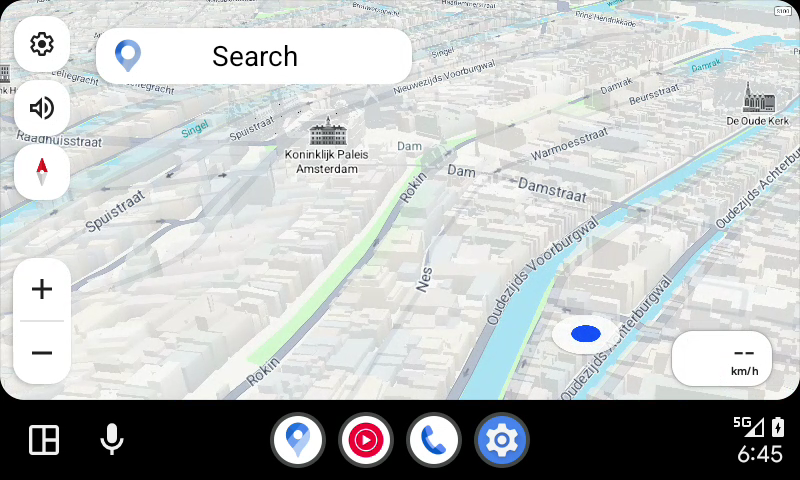

# Google Maps

**App version:** 26.44.06.1006895251 · **Build:** 1068856906 · **Original file:** APK

[Use your original APK](../guides/downloads.md#local-original-inputs){ .md-button .md-button--primary }

Select the complete original APK for this exact version in Morphe Manager. Android 10 or newer is required.

## Native Maps in Gearslip and Android Auto

Our **Native navigation for any Android Auto host** patch shows Maps' own car interface on any Android Auto compatible host, such as Google's Android Auto, DriveDeck, Gearslip, MyCar, Flywheel, BetterAuto, AndroidAuto and AARE. Maps draws everything itself, exactly as in Google's Android Auto: the map, the turn and ETA cards, the Settings, Sound and Compass buttons, zoom, Search, Settings, route options and place panels. The host shows that screen and passes your taps and drags through. It works with a renamed package, so Ungoogled Maps can appear beside stock Maps.

Typing in Maps' search field opens the host's keyboard; the matching Maps suggestions appear in the host's search screen while you type. The Sound button cycles through muted, alerts only and unmuted, as in Android Auto. Maps keeps its layout clear of the host's own controls and dock, using the free area the host reports. On DriveDeck, Maps also tells the host where its own buttons and cards are, and DriveDeck places its floating player in the free space beside them instead of covering them. On Google's Android Auto the first tap after a few seconds without touching the screen only wakes the screen; tap again to press a button.

{ loading=lazy }

*The renamed patched app in Google's Android Auto Desktop Head Unit, using a test location in Amsterdam.*

[Set up Ungoogled Maps for Android Auto](../guides/android-auto.md){ .md-button }

### Why Maps needed a different approach

Waze exposes a standard Android for Cars navigation service that car hosts can discover. The examined Maps version uses Google's private projection service instead. After renaming, Gearslip could mistake its notification capability for a messaging app and open an empty messages screen. Adding a navigation label would not make those two interfaces communicate.

We built a navigation adapter that connects Gearslip and Android Auto to the patched copy's own projection service and original car renderer. The adapter replaces the external AppDecor dependency locally and supplies standard Car App Library card models, following Vela's host-owned layout approach. Maps draws the map; the host measures and positions the cards. Android Auto remains the host when connecting to a car; Gearslip can host the client independently. Acceptance of this replacement is tracked in the [public car client report](https://gitlab.com/johninnld/nl-morphe-patches/-/blob/main/docs/research/2026-11-04-maps-public-car-client.md).

Signing the patched APK creates another problem: Google's optional private vehicle-data client rejects the new signing certificate. We isolated that client so it cannot crash the map, while retaining GPS navigation. Search needed a separate bridge between the host's keyboard and Maps' native editor. The map and editor also have to survive display resizing, keyboard changes and reconnects.

Earlier native-renderer builds were checked for search, route start, guidance and reconnect in Gearslip and Google's official Android Auto Desktop Head Unit. The host-card conversion is undergoing separate validation; the screenshot above predates it. Those checks do not establish every phone, car or live-road setup. The [engineering report](https://codeberg.org/JohninNL/nl-morphe-patches/src/branch/main/docs/research/2026-11-02-maps-native-car-ui.md) records the implementation and test limits.

## Waze and Flitsmeister data inside Maps

**Receive alerts from a third-party application** lets you choose a third-party app as a local navigation-data source. Today that is the patched Waze (De-Waze) or Flitsmeister from these patches; the provider interface is built so more apps can be added. Alongside road-alert pins, it can show current speed, the road limit and an observed average through an average-speed zone, with progress and remaining distance. Available reports can also produce advance warnings.

This uses our **Broadcast navigation data** patch in the provider app. Installing ordinary Waze or Flitsmeister is not enough. The original Waze **Share Waze Alerts with external applications** mode remains available as a separate alert-sharing choice.

[Set up Waze or Flitsmeister data in Google Maps and Vela Maps](../guides/navigation-data.md){ .md-button .md-button--primary }

On the phone and on Android Auto, a speed pill takes the place of Maps' own speed card: the speed-limit sign beside your current speed. Warning pills of the same size stack above it. Before an average-speed zone the pill shows entry distance with a line that fills as you approach; inside it shows the observed average with a fresh section-progress bar. Icons and numeric units replace long warning labels; missing values stay unknown (**—**). On the phone the stack moves beside the map buttons rather than cover them.

With Flitsmeister, the pills follow what Flitsmeister itself shows, so a camera it shows again also comes back in Maps. Warnings sound the same whether they come from Waze or Flitsmeister. Maps and Vela speak their own short wording, such as "Speed camera in 500 metres" or "Start of average speed check", in the app's own language (English, Dutch, German, French, Spanish, Italian or Portuguese, otherwise English). Flitsmeister's alert sound for that type plays first, or replaces the chime when warnings are set to tone; it needs Flitsmeister installed on the phone. Each warning is announced once as it comes up, and again when you enter an average-speed check. An average-speed check counts as one zone, even when the app reports it in segments, so the average keeps counting to the end. Police checks from both apps show the same speed-trap icon. When Maps and Vela both receive warnings, the app on the car screen gets the speaker between announcements.

With **Road alerts on the map** on, each warning pill also gets a pin on the map at the exact position the provider reported. The pin comes and goes with its pill: a warning you have passed, or one off your route, leaves the map too. A fixed point such as a speed camera from Flitsmeister stays until the warning ends. Other positions, including every Waze alert and emergency vehicles, show only while the provider's position is less than five seconds old. A Flitsmeister average-speed check gets its pin at its start while you approach it and moves to its end once you are inside; Waze reports no position for its checks, so they get no pin. Pins show no direction and no length of a zone. Maps draws them as its own saved-place pins, so each uses an emoji close to the pill's icon, and Maps can hide one behind its own labels at some zoom levels. The pins stay while a route is on the map in preview; Maps still hides your saved places there, as it normally does. During navigation each pin is shown instead as one of Google's own incident callouts, with the pill's own icon and no text, on the phone and, with Android Auto, on the car screen; this is not checked on a phone or car yet. Older provider patches and the Waze alert-sharing mode keep their report pins, filtered by the alert types you chose.

## Where these patches come from

The 30 original Maps controls come from [bearinmind patches](https://github.com/bearinmindcat/morphe-patches) by bearinmindcat. We adapted them for Maps 26.44.06.1006895251, extended their **Waze alerts** (now **Receive alerts from a third-party application**) with our shared navigation-data integration, added light/dark launcher choices to **Change app name**, and added **Native navigation for any Android Auto host**. The inherited display, offline-map, privacy and other controls keep their upstream credit.

Select Maps patches from **Dutch App Patches only** for a patching attempt. Our bundle already contains the adapted upstream controls. Selecting overlapping Maps patches from bearinmind patches as well can run incompatible versions of the same shared hooks.

## Patches

### Added by this project

| Patch | Default | What it does |
| --- | --- | --- |
| **Native navigation for any Android Auto host** | On | Adds a navigation entry that runs this patched app's original Android Auto map UI, including under its separate package name. The adapter owns its car UI resources; see the acceptance limits above. |
| **Android Auto options** | On | Adds an Android Auto page to Customization: satellite view in the car, restoring satellite view on startup, and keeping your navatar on car screens. Change them in the app; a setting you pick in Maps still wins. |
| **Use the system voice for navigation** | Off | Reads navigation directions with the phone's selected text-to-speech engine instead of Google TTS, including DriveDeck when it is selected. |

### Extended by this project

| Patch | Default | What it does |
| --- | --- | --- |
| **Receive alerts from a third-party application** | On | Receives road-alert pins, approach chimes, speed, limits and observed average-speed zones from a third-party app. Today: patched De-Waze and Flitsmeister; extendable to more providers. Starts off. |
| **Change app name** | On | Sets the launcher and app-switcher name (default: Ungoogled Maps) and offers six supplied icon styles on light or dark backgrounds. |

### Adapted from bearinmind patches

| Patch | Default | What it does |
| --- | --- | --- |
| **120 refresh rate** | On | Lets Maps use the screen’s supported refresh rate. Enable it in Customization; it can use more battery. |
| **Account sheet cleanup** | On | Removes the extra account-menu heading and keeps the menu open when returning from Settings or Customization. |
| **Add microG-RE support** | Off | Adds Google sign-in through microG-RE or ReVanced GmsCore while keeping the name from Change app name. |
| **Add original microG support** | Off | Uses original microG for Google sign-in on a ROM with signature spoofing; keeps the stock package name. |
| **Any media app** | On | Adds compatible Android Auto music and podcast apps to Navigation’s Default media app choices. |
| **Avoid Flock cameras** | On | Offers driving detours around mapped Flock cameras using BRouter. Starts off; routes with stops are unchanged. |
| **Better offline maps** | On | Adds a resizable offline-area picker, splits large areas into downloads and shows downloaded coverage. |
| **Black theme** | On | Uses black surfaces in dark mode, including navigation. |
| **Blue pin** | On | Uses a flat blue pin for Maps product logos and the search icon. |
| **Bypass Play Services checks** | On | Lets the patched app run with unavailable or disabled Play services and preserves map, search and routing access. |
| **Change package name** | On | Installs alongside stock Maps under a separate package name. |
| **Customization screen** | On | Adds Customization to the account menu for the available in-app patch switches. |
| **Flock cameras** | On | Shows mapped number-plate reader cameras with approach notes and chimes. Starts off; uses OpenStreetMap data. |
| **Follow playing media** | Off | Shows media from apps that do not connect directly to Maps. Requires notification access. |
| **Hide ads and clutter** | On | Hides promoted pins, sponsored results, AI summaries, place-sheet business rows and the Explore feed and bottom tabs. |
| **Legacy icon** | On | Restores the flat multicolour Maps pin used before the gradient icon, unless an explicit App icon is selected in Change app name. |
| **Location provider toggle** | On | Adds a choice of Android, Google Play services or microG-RE location, with network-location fallback. |
| **Offline saved places** | On | Saves local places and lists, imports and exports backups, and adds an optional local Timeline recorder. |
| **Power saving mode** | On | Adds a black navigation screen and settings for its button, idle activation, speedometer and frame rate. |
| **Proxy** | On | Adds an HTTP proxy setting for Maps traffic; map loading stops if the configured proxy is unavailable. |
| **Rectangle shapes** | On | Squares off rounded interface corners and navigation buttons. |
| **Remove permissions** | On | Removes selected account, advertising and sensor permissions, including microphone and camera. Voice search, Lens and Live View stop working. |
| **Remove sign-in prompts** | On | Hides first-launch, search and account-menu sign-in reminders. |
| **Remove telemetry** | On | Reduces advertising pings, usage measurement, performance monitoring, surveys and background learning services. |
| **Speed cameras** | On | Shows OpenStreetMap speed and red-light cameras with approach notes and chimes. Starts off. |
| **Speeding chime** | On | Adds a chime when speed exceeds the known road limit; configure the threshold in the external-data settings. |
| **Trim account menu** | On | Removes Timeline, Location sharing, Your data in Maps and Help & feedback from the account menu. |
| **Zoom controls in navigation** | On | Adds zoom-in, zoom-out and reset buttons while the navigation camera keeps following. |

## Advertising and tracking services

**Remove telemetry** and **Hide ads and clutter** reduce the listed advertising and measurement features. Maps still uses Google’s services for maps, search, routes and any enabled account features. The selected Waze or Flitsmeister provider continues using its own services.

External navigation data is received locally from the selected app on the same phone. OpenStreetMap camera layers download nearby camera positions. **Avoid Flock cameras** sends the route’s start and end to `brouter.de` when enabled. These controls start off in the external-data settings.

## Before using

**Outstanding Maps issues:** the car Exit action can leave navigation active, and an FM zone-entry voice warning can be interrupted. These issues remain open in this release. Additional display profiles, music-overlay reflow and current Waze driving coverage remain incompletely validated.

**Known limitation in this release:** external Waze/Flitsmeister warning cards and spoken alerts during Android Auto navigation are still experimental. Native navigation, provider data and a successful parked preview do not prove that every warning will appear or speak. Keep using the provider’s own alerts where you need dependable warning output. Repatch the provider and receiving map together for the updated connection and shutdown behavior.

The native FM event/speech upgrade remains a development feature. Flitsmeister 15.0 / 1289 has passed model/capture coverage checks, and earlier FM15 development builds passed controlled delivery, moving-camera and zone checks with both receivers. The current candidate includes later text, recovery and speech-readiness corrections; its final installed, timing and phone/car acceptance remain open. Its category/output review, parked preview and recovery controls are described in the [native-warning setup section](../guides/navigation-data.md#native-flitsmeister-warning-audio).

Updated navigation-data patches start the selected provider without opening its screen after one-time setup. For Flitsmeister, update Maps or Vela too: the corrected handoff lets a visible receiving map start FM in the background with location access while using the app. This has been checked on an Android 14 emulator; the Android 16 phone check is pending. Always-on location is not a blanket requirement for this handoff. Keep the receiving map visible while selecting FM and check its source status. See the [navigation-data setup guide](../guides/navigation-data.md).

Keep **Change package name** selected to install beside stock Maps; the default package is `org.ungoogled.android.apps.maps`. **Change app name** uses **Ungoogled Maps** by default and always keeps your chosen name with either microG support patch. **Add microG-RE support** changes the default package to `org.ungoogled.android.apps.maps.microg`. The two microG support patches are alternatives: choose only the one matching your setup. Original microG needs a ROM with signature spoofing and keeps the stock Maps package.

In **Change app name**, use **App icon** to choose Classic pin, Outlined pin, Classic map tile, Raised map pin, Gradient pin, or Folded map, each on a light or dark background. **Automatic** follows the **Legacy icon** patch; **Original Google Maps** keeps Google’s original launcher icon. An explicit choice takes precedence over Legacy icon. These choices apply to the regular and round launcher icons. Explicit choices leave the stock splash screen in place; in-app artwork still follows your other selected patches, such as Blue pin. With Automatic, Legacy icon keeps its existing splash-screen behavior. Name and icon can be configured independently, and changing them requires patching again.

For native car navigation, keep **Native navigation for any Android Auto host** selected and grant the patched Maps app precise location access. A host such as Gearslip or DriveDeck then discovers one navigation tile instead of treating Maps as a messenger. For Android Auto, install the patched APK through KingInstaller and check its installation result; use its Shizuku mode if the normal method does not record the expected installer. Select **Ungoogled Maps** or your chosen app name in the car launcher so the session uses the patched copy.

Open the account menu’s **Customization** and **Waze & external data source** rows to configure the selected patches. A patch marked **On** above is selected by default when patching; camera layers and external sources still require enabling in the app. **120 refresh rate** also starts off in Customization.

Follow the [navigation-data setup guide](../guides/navigation-data.md) to patch a provider, select it in Maps and configure the compact speed display, map pins and advance chimes. It also explains the separate legacy Waze mode, partial averages and fallback when data expires.

**Remove permissions** disables voice search, Lens and Live View through its microphone/camera changes. The microG-RE account build leaves account-related permissions and services in place. **Proxy** needs a supported network engine; follow its in-app availability message. **Follow playing media** needs notification access and is not intended for root mount installs. YouTube Music and Spotify’s direct media integration still depends on Google’s own Maps; use the available notification-based option where supported.

[Installation](../guides/install.md) · [Choose patches](../guides/choose-patches.md) · [Compatibility and defaults](../reference/catalogue.md)
