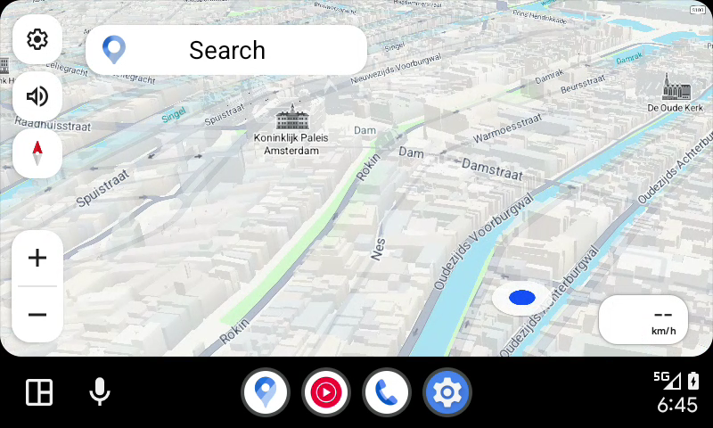

# Google Maps

**Appversie:** 26.44.06.1006895251 · **Build:** 1068856906 · **Origineel bestand:** APK

[Gebruik je originele APK](../guides/downloads.md#local-original-inputs){ .md-button .md-button--primary }

Selecteer de volledige originele APK voor deze exacte versie in Morphe Manager. Android 10 of nieuwer is vereist.

## Native Maps in Gearslip en Android Auto

Onze patch **Native navigation for any Android Auto host** toont de eigen auto-interface van Maps op elke Android Auto-compatibele host, zoals Google Android Auto, DriveDeck, Gearslip, MyCar, Flywheel, BetterAuto, AndroidAuto en AARE. Maps tekent alles zelf, precies zoals in Google Android Auto: de kaart, de route- en aankomstkaarten, de knoppen Instellingen, Geluid en Kompas, zoomen, en de panelen voor Zoeken, Instellingen, routeopties en plaatsen. De host toont dat scherm en geeft je tikken en sleepbewegingen door. Dit werkt ook met een gewijzigde pakketnaam, zodat Ungoogled Maps naast de originele Maps-app kan staan.

Typen in het zoekveld van Maps opent het toetsenbord van de host; de bijpassende suggesties van Maps verschijnen tijdens het typen in het zoekscherm van de host. De knop Geluid wisselt zoals in Android Auto tussen drie standen: gedempt, alleen meldingen en geluid aan. Maps houdt de eigen indeling vrij van de bedieningselementen en het dock van de host, op basis van de vrije ruimte die de host doorgeeft. Op DriveDeck geeft Maps ook door waar de eigen knoppen en kaarten staan, zodat DriveDeck de zwevende speler in de vrije ruimte ernaast zet in plaats van eroverheen. In Google Android Auto wekt de eerste tik na een paar seconden zonder aanraking alleen het scherm; tik nog een keer om een knop in te drukken.

{ loading=lazy }

*De hernoemde gepatchte app in Googles Android Auto Desktop Head Unit, met een testlocatie in Amsterdam.*

[Ungoogled Maps instellen voor Android Auto](../guides/android-auto.md){ .md-button }

### Waarom Maps een andere aanpak nodig had

Waze heeft een standaard navigatiedienst voor Android for Cars die autohosts kunnen vinden. De onderzochte Maps-versie gebruikt daarentegen Googles eigen projectiedienst. Na het hernoemen kon Gearslip de meldingsfunctie als berichtenapp herkennen en een leeg berichtenscherm openen. Alleen een navigatielabel toevoegen laat die twee interfaces nog niet met elkaar communiceren.

We bouwden een navigatieadapter die Gearslip en Android Auto verbindt met de eigen projectiedienst en oorspronkelijke autoweergave van de gepatchte versie. De adapter vervangt de externe AppDecor-afhankelijkheid lokaal en levert standaard kaartmodellen aan de Car App Library, volgens Vela's indeling door de host. Maps tekent de kaart; de host bepaalt de grootte en positie van de informatiekaarten. Android Auto blijft de host bij verbinding met de auto; Gearslip kan de client zelfstandig hosten. De acceptatie van deze vervanging staat in het [rapport over de publieke autoclient](https://gitlab.com/johninnld/nl-morphe-patches/-/blob/main/docs/research/2026-11-04-maps-public-car-client.md).

Het ondertekenen van de gepatchte APK veroorzaakt nog een probleem: Googles optionele privéclient voor voertuiggegevens weigert het nieuwe ondertekeningscertificaat. We hebben die client geïsoleerd zodat hij de kaart niet laat crashen, terwijl GPS-navigatie blijft werken. Zoeken vroeg om een aparte koppeling tussen het toetsenbord van de host en het native zoekveld van Maps. De kaart en het zoekveld moeten bovendien behouden blijven bij schermwijzigingen, het openen van het toetsenbord en opnieuw verbinden.

Eerdere versies met de native weergave zijn gecontroleerd op zoeken, een route starten, navigeren en opnieuw verbinden in Gearslip en Googles officiële Android Auto Desktop Head Unit. De overstap naar informatiekaarten van de host wordt afzonderlijk gecontroleerd; de afbeelding hierboven is van de eerdere weergave. Daarmee is niet iedere telefoon, auto of rit op de weg getest. Het [technische verslag](https://codeberg.org/JohninNL/nl-morphe-patches/src/branch/main/docs/research/2026-11-02-maps-native-car-ui.md) beschrijft de uitvoering en testgrenzen.

## Gegevens van Waze en Flitsmeister in Maps

**Receive alerts from a third-party application** laat je een externe app kiezen als lokale bron van navigatiegegevens. Nu zijn dat de gepatchte Waze (De-Waze) of Flitsmeister uit deze patches; de bronkoppeling is gebouwd om meer apps toe te voegen. Naast wegmeldingen op de kaart kan deze koppeling actuele snelheid, de maximumsnelheid en een waargenomen gemiddelde tijdens een trajectcontrole tonen, met voortgang en resterende afstand. Beschikbare meldingen kunnen ook voorwaarschuwingen geven.

Hiervoor is onze patch **Broadcast navigation data** in de bronapp nodig. Alleen de gewone Waze of Flitsmeister installeren is niet voldoende. De oorspronkelijke Waze-modus **Share Waze Alerts with external applications** blijft als aparte keuze voor het delen van meldingen beschikbaar.

[Waze of Flitsmeister koppelen aan Google Maps en Vela Maps](../guides/navigation-data.md){ .md-button .md-button--primary }

Op de telefoon en op Android Auto neemt een snelheidspil de plaats in van de eigen snelheidskaart van Maps: het snelheidsbord naast je actuele snelheid. Waarschuwingspillen van hetzelfde formaat stapelen erboven. Vóór een trajectcontrole toont de pil de afstand tot de ingang met een lijn die volloopt terwijl je nadert; binnen het traject toont deze het waargenomen gemiddelde met een nieuwe voortgangsbalk voor dat traject. Symbolen en getallen met eenheden vervangen lange waarschuwingsteksten; ontbrekende waarden blijven onbekend (**—**). Op de telefoon schuift de stapel naast de kaartknoppen in plaats van ze te bedekken.

Met Flitsmeister volgen de pillen wat Flitsmeister zelf toont: een camera die Flitsmeister opnieuw toont, verschijnt ook in Maps weer. Waarschuwingen klinken hetzelfde, of ze nu van Waze of van Flitsmeister komen. Maps en Vela spreken hun eigen korte tekst uit, zoals "Flitser over 500 meter" of "Begin trajectcontrole", in de taal van de app zelf (Engels, Nederlands, Duits, Frans, Spaans, Italiaans of Portugees, anders Engels). Het waarschuwingsgeluid van Flitsmeister voor dat type klinkt eerst, of vervangt de pieptoon als waarschuwingen op toon staan; daarvoor moet Flitsmeister op de telefoon staan. Elke waarschuwing wordt één keer uitgesproken als die eraan komt, en nog een keer als je een trajectcontrole inrijdt. Een trajectcontrole telt als één zone, ook als de app die in stukken doorgeeft, dus het gemiddelde loopt door tot het einde. Politiecontroles uit beide apps tonen hetzelfde flitsericoon. Ontvangen Maps en Vela allebei waarschuwingen, dan krijgt de app op het autoscherm de luidspreker tussen twee meldingen door.

Staat **Road alerts on the map** aan, dan krijgt elke waarschuwingspil ook een speld op de kaart, precies op de positie die de bronapp doorgaf. De speld komt en gaat met de pil: een waarschuwing die je bent gepasseerd of die niet op je route ligt, verdwijnt ook van de kaart. Een vast punt, zoals een flitspaal uit Flitsmeister, blijft staan tot de waarschuwing afloopt. Andere posities, waaronder elke Waze-melding en hulpdiensten, staan er alleen zolang de positie van de bron minder dan vijf seconden oud is. Een trajectcontrole van Flitsmeister krijgt haar speld op het begin zolang je eraan komt, en die verhuist naar het einde zodra je erin rijdt; Waze geeft geen positie voor zijn trajectcontroles, dus die krijgen geen speld. Spelden tonen geen richting en geen lengte van een traject. Maps tekent ze als zijn eigen spelden voor opgeslagen plaatsen, dus elke speld gebruikt een emoji die op het symbool van de pil lijkt, en Maps kan er een achter zijn eigen labels verbergen bij sommige zoomniveaus. De spelden blijven staan zolang er een route in het routeoverzicht staat; je opgeslagen plaatsen verbergt Maps daar zoals gewoonlijk. Tijdens het navigeren toont Maps elke speld in plaats daarvan als een van Googles eigen meldingsballonnen, met het eigen symbool van de pil en zonder tekst, op de telefoon en met Android Auto op het autoscherm; dit is nog niet op een telefoon of in een auto gecontroleerd. Oudere bronpatches en de Waze-modus voor het delen van meldingen houden hun meldingsspelden, gefilterd op de gekozen meldingstypen.

## Waar komen deze patches vandaan?

De 30 oorspronkelijke Maps-opties komen uit [bearinmind patches](https://github.com/bearinmindcat/morphe-patches) van bearinmindcat. We pasten ze aan voor Maps 26.44.06.1006895251, breidden hun **Waze alerts** (nu **Receive alerts from a third-party application**) uit met onze gedeelde navigatiegegevens, voegden lichte en donkere launchericonen toe aan **Change app name**, en voegden **Native navigation for any Android Auto host** toe. De overgenomen scherm-, offlinekaart-, privacy- en overige opties blijven aan de oorspronkelijke maker toegeschreven.

Kies bij het patchen van Maps alleen patches uit **Dutch App Patches**. Onze bundel bevat de aangepaste oorspronkelijke opties al. Ook overlappende Maps-patches uit bearinmind patches kiezen kan verschillende versies van dezelfde gedeelde koppelingen uitvoeren.

## Patches

### Toegevoegd door dit project

| Patch | Standaard | Wat verandert er? |
| --- | --- | --- |
| **Native navigation for any Android Auto host** | Aan | Voegt een navigatie-ingang toe die de oorspronkelijke Android Auto-kaartinterface van deze gepatchte app gebruikt, ook onder een aparte pakketnaam. De adapter beheert de eigen auto-interface; zie de acceptatiegrenzen hierboven. |
| **Android Auto options** | Aan | Voegt een Android Auto-pagina toe aan Customization: satellietweergave in de auto, satelliet herstellen bij het starten en je navatar behouden op autoschermen. Wijzig ze in de app; een instelling die je in Maps kiest blijft gelden. |
| **Use the system voice for navigation** | Uit | Leest navigatie-aanwijzingen voor met de tekst-naar-spraak-engine die op de telefoon is gekozen in plaats van Google TTS, ook DriveDeck als die is gekozen. |

### Uitgebreid door dit project

| Patch | Standaard | Wat verandert er? |
| --- | --- | --- |
| **Receive alerts from a third-party application** | Aan | Ontvangt wegmeldingen, voorwaarschuwingen, snelheid, limieten en waargenomen trajectcontroles van een externe app. Nu: gepatchte De-Waze en Flitsmeister; uitbreidbaar met meer bronnen. Begint uit. |
| **Change app name** | Aan | Stelt de naam in de launcher en appkiezer in (standaard: Ungoogled Maps) en biedt zes meegeleverde icoonstijlen met een lichte of donkere achtergrond. |

### Aangepast vanuit bearinmind patches

| Patch | Standaard | Wat verandert er? |
| --- | --- | --- |
| **120 refresh rate** | Aan | Laat Maps de ondersteunde verversingssnelheid van het scherm gebruiken. Zet dit aan in Customization; het kan meer batterij verbruiken. |
| **Account sheet cleanup** | Aan | Verwijdert de extra kop in het accountmenu en houdt het menu open bij terugkeer uit Settings of Customization. |
| **Add microG-RE support** | Uit | Voegt Google-aanmelding via microG-RE of ReVanced GmsCore toe en behoudt de naam uit Change app name. |
| **Add original microG support** | Uit | Gebruikt originele microG voor Google-aanmelding op een ROM met signature spoofing; behoudt de oorspronkelijke pakketnaam. |
| **Any media app** | Aan | Voegt geschikte muziek- en podcastapps voor Android Auto toe aan de keuze Default media app in Navigation. |
| **Avoid Flock cameras** | Aan | Biedt autoroutes om bekende Flock-camera’s heen via BRouter. Begint uit; routes met tussenstops blijven gelijk. |
| **Better offline maps** | Aan | Voegt een aanpasbaar selectievak voor offlinegebieden toe, verdeelt grote gebieden over downloads en toont gedownloade dekking. |
| **Black theme** | Aan | Gebruikt zwarte vlakken in donkere modus, ook tijdens navigatie. |
| **Blue pin** | Aan | Gebruikt een platte blauwe speld voor Maps-logo’s en het zoekpictogram. |
| **Bypass Play Services checks** | Aan | Laat de gepatchte app werken met ontbrekende of uitgeschakelde Play services en behoudt toegang tot kaarten, zoeken en routes. |
| **Change package name** | Aan | Installeert naast de oorspronkelijke Maps-app onder een andere pakketnaam. |
| **Customization screen** | Aan | Voegt Customization toe aan het accountmenu voor de beschikbare patchschakelaars. |
| **Flock cameras** | Aan | Toont bekende kentekencamera’s met een melding en geluid bij nadering. Begint uit; gebruikt OpenStreetMap-gegevens. |
| **Follow playing media** | Uit | Toont media van apps die niet rechtstreeks met Maps verbinden. Vereist meldingstoegang. |
| **Hide ads and clutter** | Aan | Verbergt gesponsorde spelden en zoekresultaten, AI-samenvattingen, bedrijfsrijen, de Explore-feed en onderste tabbladen. |
| **Legacy icon** | Aan | Herstelt de platte meerkleurige Maps-speld van vóór het verloopicoon, tenzij een expliciet App icon is gekozen in Change app name. |
| **Location provider toggle** | Aan | Voegt een keuze toe tussen locatie via Android, Google Play services of microG-RE, met terugval op netwerklocatie. |
| **Offline saved places** | Aan | Bewaart plaatsen en lijsten lokaal, importeert en exporteert back-ups en voegt een optionele lokale Timeline-opname toe. |
| **Power saving mode** | Aan | Voegt een zwart navigatiescherm toe en instellingen voor de knop, automatisch openen, snelheidsmeter en beeldsnelheid. |
| **Proxy** | Aan | Voegt een HTTP-proxyinstelling voor Maps-verkeer toe; kaarten laden niet door als de ingestelde proxy onbereikbaar is. |
| **Rectangle shapes** | Aan | Maakt afgeronde hoeken en navigatieknoppen rechthoekig. |
| **Remove permissions** | Aan | Verwijdert geselecteerde account-, advertentie- en sensorrechten, waaronder microfoon en camera. Spraakzoeken, Lens en Live View werken daardoor niet. |
| **Remove sign-in prompts** | Aan | Verbergt aanmeldverzoeken bij de eerste start, bij zoeken en in het accountmenu. |
| **Remove telemetry** | Aan | Vermindert advertentiemeldingen, gebruiksmetingen, prestatiemetingen, enquêtes en leerdiensten op de achtergrond. |
| **Speed cameras** | Aan | Toont flitsers en roodlichtcamera’s uit OpenStreetMap met een melding en geluid bij nadering. Begint uit. |
| **Speeding chime** | Aan | Voegt een geluid toe wanneer de snelheid de bekende limiet overschrijdt; stel de drempel in bij de externe gegevens. |
| **Trim account menu** | Aan | Verwijdert Timeline, Location sharing, Your data in Maps en Help & feedback uit het accountmenu. |
| **Zoom controls in navigation** | Aan | Voegt knoppen voor inzoomen, uitzoomen en herstellen toe terwijl de navigatiecamera blijft volgen. |

## Advertentie- en trackingdiensten

**Remove telemetry** en **Hide ads and clutter** verminderen de genoemde advertentie- en meetfuncties. Maps blijft Google-diensten gebruiken voor kaarten, zoeken, routes en ingeschakelde accountfuncties. De gekozen Waze- of Flitsmeister-bron blijft zijn eigen diensten gebruiken.

Externe navigatiegegevens worden lokaal ontvangen van de gekozen app op dezelfde telefoon. Cameralagen van OpenStreetMap downloaden cameraposities in de buurt. **Avoid Flock cameras** stuurt het begin en einde van de route naar `brouter.de` wanneer dit aanstaat. Deze functies beginnen uit in de instellingen voor externe gegevens.

## Voor gebruik

**Openstaande Maps-problemen:** de afsluitactie in de auto kan de navigatie actief laten en een gesproken FM-melding bij de ingang van een trajectcontrole kan worden onderbroken. Deze problemen blijven in deze release open. Extra schermprofielen, de aanpassing aan muziekoverlays en livewaarschuwingen van de huidige Waze-versie zijn nog niet volledig gevalideerd.

**Bekende beperking in deze release:** externe waarschuwingskaarten en gesproken meldingen van Waze/Flitsmeister tijdens Android Auto-navigatie zijn nog experimenteel. Werkende navigatie, brongegevens en een geslaagd geparkeerd voorbeeld bewijzen niet dat iedere waarschuwing verschijnt of klinkt. Gebruik de eigen meldingen van de bronapp wanneer u betrouwbare waarschuwingen nodig hebt. Patch de bronapp en ontvangende kaartapp samen opnieuw voor de bijgewerkte verbinding en het afsluitgedrag.

De koppeling met native FM-gebeurtenissen en spraak blijft een ontwikkelfunctie. Flitsmeister 15.0 / 1289 heeft de dekkingscontroles voor modellen en opname doorstaan. Eerdere FM15-ontwikkelversies doorstonden met beide kaartapps gecontroleerde levering, bewegende cameracontroles en trajectcontroles. De huidige kandidaat bevat latere verbeteringen aan tekst, herstel en spraakgereedheid; de uiteindelijke controles van de geïnstalleerde apps, timing en telefoon/auto staan nog open. De categorie-/audiokeuze, het geparkeerde voorbeeld en herstel staan in de [instellingen voor native waarschuwingen](../guides/navigation-data.md#native-waarschuwingsaudio-van-flitsmeister).

Bijgewerkte navigatiegegevenspatches starten de gekozen bron na eenmalige instellingen zonder het bronscherm te openen. Werk voor Flitsmeister ook Maps of Vela bij: met de herstelde overdracht kan een zichtbare kaartapp FM op de achtergrond starten met locatietoegang tijdens appgebruik. Dit is gecontroleerd op een Android 14-emulator; de controle op de Android 16-telefoon staat nog open. Altijd toegestane locatie is geen algemene eis voor deze overdracht. Houd de kaartapp zichtbaar wanneer je FM kiest en controleer de bronstatus. Zie de [installatiegids voor navigatiegegevens](../guides/navigation-data.md).

Laat **Change package name** geselecteerd om naast de oorspronkelijke Maps-app te installeren; de standaardpakketnaam is `org.ungoogled.android.apps.maps`. **Change app name** gebruikt standaard **Ungoogled Maps** en behoudt je gekozen naam bij beide microG-patches. **Add microG-RE support** wijzigt de standaardpakketnaam naar `org.ungoogled.android.apps.maps.microg`. De twee microG-patches zijn alternatieven: kies alleen de variant die bij je omgeving past. Originele microG vereist een ROM met signature spoofing en behoudt de oorspronkelijke Maps-pakketnaam.

Kies bij **App icon** in **Change app name** uit Classic pin, Outlined pin, Classic map tile, Raised map pin, Gradient pin of Folded map, elk met een lichte of donkere achtergrond. **Automatic** volgt de patch **Legacy icon**; **Original Google Maps** behoudt Googles oorspronkelijke launchericoon. Een expliciete keuze gaat vóór Legacy icon. De keuzes gelden voor het gewone en ronde launchericoon. Een expliciete keuze behoudt het oorspronkelijke opstartscherm; afbeeldingen in de app volgen je overige gekozen patches, zoals Blue pin. Bij Automatic behoudt Legacy icon zijn bestaande wijziging van het opstartscherm. Naam en icoon zijn onafhankelijk instelbaar; voor een wijziging moet de APK opnieuw worden gepatcht.

Laat voor native autonavigatie **Native navigation for any Android Auto host** geselecteerd en geef de gepatchte Maps-app toegang tot de exacte locatie. Een host zoals Gearslip of DriveDeck vindt dan één navigatietegel in plaats van Maps als berichtenapp te behandelen. Installeer de gepatchte APK voor Android Auto via KingInstaller en controleer het installatieresultaat; gebruik de Shizuku-modus als de normale methode niet de verwachte installer vastlegt. Kies **Ungoogled Maps** of je eigen appnaam in de autolauncher, zodat de sessie de gepatchte versie gebruikt.

Open **Customization** en **Waze & external data source** in het accountmenu om de gekozen patches in te stellen. **Aan** in de tabel betekent dat de patch standaard geselecteerd is tijdens het patchen; cameralagen en externe bronnen moeten daarnaast in de app worden aangezet. **120 refresh rate** begint ook uit in Customization.

Volg de [handleiding voor navigatiegegevens](../guides/navigation-data.md) om een bron te patchen, die in Maps te kiezen en de compacte snelheidsweergave, kaartspelden en voorwaarschuwingen in te stellen. Daar staan ook de aparte oude Waze-modus, gedeeltelijke gemiddelden en terugval bij verlopen gegevens uitgelegd.

**Remove permissions** schakelt spraakzoeken, Lens en Live View uit door de wijzigingen aan microfoon- en cameratoegang. De microG-RE-accountversie behoudt de bijbehorende accountrechten en -diensten. **Proxy** heeft een ondersteunde netwerkengine nodig; volg de beschikbaarheidsmelding in de app. **Follow playing media** vereist meldingstoegang en is niet bedoeld voor root mount-installaties. De rechtstreekse media-integratie van YouTube Music en Spotify blijft afhankelijk van Google’s eigen Maps; gebruik waar mogelijk de optie via meldingen.

[Installeren](../guides/install.md) · [Patches kiezen](../guides/choose-patches.md) · [Compatibiliteit en standaardkeuzes](../reference/catalogue.md)
