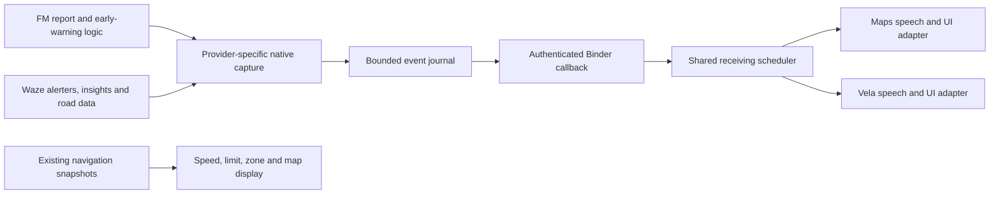

# First-class Waze and Flitsmeister warnings in patched Google Maps and Vela

- **Status:** proposed engineering design; implementation and physical-device acceptance pending.
- **Date:** 2026-11-02.
- **Source baseline:** `e1314b8ea2deb4e37070de8d29715c721eed58e9`. The four principal producer/consumer/control files were checked and are unchanged from research baseline `839868dfab1624eba2265b0fa199f123eadc2d1a`.
- **App targets:** Waze 5.26.90.901; Flitsmeister 14.17; Google Maps 26.43.05.1002020710 and its supported patched package variants; Vela Maps 0.5.2621.
- **Audience:** patch implementers and reviewers.

## 1. Intent and requirements

Make both Waze and Flitsmeister first-class silent background warning providers for the selected receiving map. Preserve what each source means, when its native logic decides to warn, and the important distinctions between warning classes. Google Maps or Vela supplies the visible warning and speech. Either provider can be primary; neither is restricted to generic fallback alerts.

The existing patches already start the provider silently, monitor native engine health and mute provider playback during a managed session. Extend that implementation. Do not build another startup mechanism, require root/Shizuku, launch the provider UI automatically, or copy the provider's recorded voice assets.

| ID | Required outcome |
| --- | --- |
| R1 | Export each provider's native road warnings and additional warning paths, including FM early warnings and Waze rich alerters, road features, segment insights and notification insights, with meaningful subtypes and available instructions |
| R2 | Deliver a native “announce now” event without waiting for the state heartbeat, current twelve-second heuristic or global eight-second cooldown |
| R3 | Show and speak recognizable messages in both Maps and Vela, coordinated with navigation guidance and user mute settings |
| R4 | Keep each API-managed provider silent throughout its managed session; avoid two receiving apps announcing the same provider event concurrently by assigning one audio owner; perform a quiescent handover when changing primary provider |
| R5 | Distinguish provider running, warning transport ready, speaker ready, accepted, started and completed; surface failures rather than treating enqueueing as successful playback |
| R6 | Recover brief IPC interruptions with bounded replay, preserving identity, cancellation, expiry and passage checks; never replay an expired warning as a new danger |
| R7 | Preserve the existing speed/limit/zone feed and older startup API, mixed-version compatibility, source selection and stored user preferences |
| R8 | Prove capture → delivery → scheduling → audio start → passage timing for all four app patches and all four provider/consumer pairings, including phone and car sessions |

“Complete” means coverage of the native warning paths and supported warning models of both pinned provider versions, with every category explicitly accounted for in separate provider manifests. Presence in an APK is structural evidence, not proof of live availability. It does not mean detecting an unreported danger, guaranteeing that Android will run a killed process, or proving that a person heard a speaker. Report limitations at those boundaries.

Scope excludes a new traffic-routing engine, automatic detours from received incidents, account/location upload, a new Flock database and automatic fusion of providers. Preserve compatible legacy broadcasts. Native Waze event capture is in scope with equal release gates. Waze-route-specific lanes/traffic/ETA/tolls are evaluated as contextual enrichment with explicit prerequisites; they cannot silently override the receiving map's route. Flock remains optional, with its own provenance and coverage.

## 2. Approaches and selected direction

| Approach | Benefits | Limitation | Decision |
| --- | --- | --- | --- |
| Enrich only the existing periodic report snapshot | Small transport change; improves labels and pins | Still loses transient notifications, native announce timing, playback outcomes and special early-warning paths | Retain snapshots for state/display; insufficient as the warning mechanism |
| Native semantic events over the existing authenticated provider connection, alongside snapshots | Preserves native decisions and meaning; supports acknowledgement, replay and one audio owner | Requires guarded native hooks and a new speech adapter in Maps | **Selected proposal**, following the requested source-and-receiver patch approach |
| Leave providers as the audible warning apps | Keeps native voice behavior with little receiver work | Does not fulfill the requested silent provider / main-app speech behavior | Excluded from this design |

The user requested the event design and then explicitly expanded the objective to maximize Waze's value and make both sources first-class. Implementation choices below are engineering proposals, not claims of implemented or user-approved runtime behavior.



Only the app selected as audio owner uses its speaker adapter. Other authorized clients may render current state without making sound.

## 3. Which patches users apply

Extend existing patch selections rather than introducing independently optional transport/speaker components that can accidentally be omitted.

| App | User-facing patch | Required engineering changes |
| --- | --- | --- |
| Waze / De-Waze | **Broadcast navigation data**, retaining included **Stay awake in the background** | Rich native warning/insight capture, UI-free controller readiness, precise namespace-aware semantics/validation, the same event API/journal/diagnostics, existing silent startup and provider audio gate |
| Flitsmeister | **Broadcast navigation data**, retaining its dependency on **Fix PairIP startup** | Native warning/early-warning capture, text/subtype extraction, event journal, optional alert Binder endpoint, delivery diagnostics; retain current silent startup and provider audio gate |
| Google Maps | **Waze alerts** (keep the existing patch identity) | Provider-neutral event client, common scheduler, both rich coverage profiles, semantic warning UI, speech adapter, native-guidance coordination, audio outcome reporting and explicit setup/migration |
| Vela | **External speed controls** | Same event client/scheduler, complete semantic warning rendering, native voice adapter with outcome/cancellation hooks, phone/car lifecycle integration |

The Maps patch currently depends on its shared extension, activity and navigation hooks, settings, map markers, speeding chime and external-telemetry visibility hooks. Preserve those dependencies. **Native navigation for Gearslip and Android Auto** remains the separate requirement for Maps' native car navigation; it is not needed just to receive phone warnings. Vela's patch already has dedicated car integration.

The chosen provider and receiving app must both be repatched with a compatible bundle. Supporting both primary choices means updating both providers and the receiving apps in use. Installing a new MPP alone does not update an installed APK. No new Android runtime permission is needed for exchanging these local Binder messages; the existing provider background location and foreground-service conditions remain necessary.

Do not rename the canonical Maps patch in this change. Its product settings can describe “External road warnings” and explicitly name both sources. Preserve existing saved source choices and the separate old Waze Share alerts bridge. Optional Waze Native camera and hazard controls, Speed limit controls, Speed camera sound at any speed and OSM layers keep their individual settings/policy effects; they are not prerequisites for all native event capture and do not create unavailable road data.

## 4. Existing implementation and changes by component

| Area | Existing source | Change |
| --- | --- | --- |
| Waze producer | `extensions/waze/.../NavigationBroadcasts.java` | Rich descriptor/insight/notification adapters, raw namespace preservation and optional route-context model; retain existing speed/zone schema |
| Waze bytecode patch | `patches/src/main/kotlin/patches/waze/WazeNavigationBroadcastPatch.kt`, `WazeNavigationAudio.kt` | Guarded native lifecycle/sound-intent capture and background subscription; preserve native audio completion while muted |
| Waze control | `extensions/waze/.../NavigationControlService.java`, `NavigationStartup.java` | Supply the same warning endpoint, separate warning-controller readiness from engine readiness, preserve initialized route-less startup |
| FM producer | `extensions/flitsmeister/.../NavigationBroadcasts.java` | Keep schema-1 observations; replace lossy model classification with model-aware adapters; reference the new event capture without turning the list into an announcement source |
| FM bytecode patch | `patches/src/main/kotlin/patches/flitsmeister/NavigationBroadcastPatch.kt` | Bind native semantic hooks after existing guarded edits in finalize; validate every new target before mutating |
| FM provider audio | `patches/src/main/kotlin/patches/flitsmeister/NavigationAudio.kt`, `support/navigation-startup/.../ProviderAudio.java` | Retain silent playback and native completion behavior; capture semantic data upstream of playback suppression |
| Startup control | `support/navigation-startup/.../ProviderControlService.java` | Add an optional protected hook to append each provider's alert endpoint to STATUS; both provider subclasses implement it |
| FM control | `extensions/flitsmeister/.../NavigationControlService.java` | Supply the FM alert endpoint through that hook; no change to private engine startup |
| Shared implementation, new | `support/navigation-alerts/src/main/java/nl/johninnl/navigation/alerts/` | Primitive event codec, Binder API/client, bounded journal, deduplication, ownership, scheduling and diagnostics |
| Maps | `extensions/extension/.../ExternalTelemetry.java`, `WazeAlerts.java`, `RoadWarningEngine.java` | Add both event providers; keep snapshot UI and explicit legacy mode; prevent schema-1 reports from announcing again after that provider's event ownership is active |
| Maps speech, new | `extensions/extension/.../MapsWarningSpeaker.java`, `MapsGuidanceCoordinator.java` and guarded Kotlin hooks | Explicit speech lifecycle and integration with native guidance; see section 10 |
| Vela | `extensions/vela/.../TelemetryRuntime.java`, `NativeUi.java`, `CarUi.java` | Feed event text/subtypes to UI and scheduler; add native voice outcome/cancellation integration |

These are proposed filenames. Keep provider-independent state machines plain Java and free of app classes. Include the new support source set in Waze, FM, Maps and Vela. Both providers implement the same contract using distinct native adapters. Run startup/lease/audio compatibility tests for both sources; neither provider's readiness can be inferred from the other.

## 5. Native provider capture contracts

### 5.1 Flitsmeister: capture semantic intent before sound suppression

Use separate hooks for discovery/current state and native announcements:

- `AppNotificationBus.getBusAlertedReports()` remains useful for the active-report set. Never interpret every repeated bus list as “speak all of these now.”
- `fc0.J(BaseReport, boolean)` is the audited native AppNotificationService enter/exit path; `fc0.O(BaseReport)` updates existing state. Capture state/relevance changes after their native acceptance decisions.
- `s6i.l(BaseReport, boolean, boolean, String, z39)` carries report context, native entry/exit meaning and available speech text. Capture at method entry before its audio preference/recording selection and before `t50` playback gates.
- `s6i.b(EarlyWarningTypeEnum, EarlyWarningReport, EarlyWarningNotification, String, boolean, z39)` provides the separate early-warning content. Cover both object variants, including events without ordinary report coordinates.
- Audit the `xl` native AlertManager's VOICE_ONLY path and the two early-warning buses for paths that bypass these speech methods. Add targeted hooks where necessary, with one canonical emission per native warning instance.

Canonical ANNOUNCE authorities are `s6i.l` for regular warnings and `s6i.b` for early warnings, plus only the verified bypass entry points in the coverage manifest. `fc0.J/O` and bus subscriptions provide state/relevance and never emit a second ANNOUNCE for the same decision. A native call that intentionally repeats an announcement receives a new announcement_index; an incidental duplicate observation does not.

These symbols and argument types were found in the supplied 14.17 artifact. They are discovery anchors, not completed fingerprints for this new change. The implementation must record exact descriptors, access flags, instruction counts/hashes, semantic references, insertion points and control-flow/register safety in artifact-backed regression fixtures. Verify the meaning of each native boolean; do not assign meaning to the second boolean in `s6i.l` from its position alone.

Do not hook only `TextToSpeech.speak()` or a final audio file queue: that boundary can lose report context, omit prerecorded warnings or see text only after native sound preferences discarded it. Native warning capture must continue when provider playback is muted. Do not change native event production, completion callbacks, subscription lifetimes or user category choices merely to make a test pass.

### 5.2 Flitsmeister: eligibility versus local sound preferences

Capturing entry arguments does not, by itself, authorize public ANNOUNCE emission. Evaluate a documented eligibility decision first:

| Decision | Authority |
| --- | --- |
| Native detection, road/relevance, active warning, category disabled as a warning feature, source stopped | FM remains authoritative; do not re-enable an intentionally disabled native warning feature |
| Whether FM uses recorded speech, TTS, tone, its local speaker, Bluetooth or a sound pack | Provider-local output only; must not suppress export of an otherwise eligible semantic warning during a managed receiver session |
| Receiving category selection, Voice/Tone/Silent and effective native mute mode | Maps/Vela decide their own output; report USER_FILTERED or USER_MUTED explicitly |

Work package 1 must classify every predicate following `s6i.l/b` entry, including the camera, zone-start/end, traffic-start/end, roadworks and service-vehicle predicates. Map each to its actual setting and label/meaning, not an obfuscated method name. Capture context at entry, then emit only after warning eligibility is established, before local sound gates. Use side-effect-free native predicates or guarded branch-specific hooks; do not execute a native audio method a second time to discover its decision. An ambiguous predicate blocks that category's complete-support claim until resolved. This classification is part of the artifact coverage manifest.

### 5.3 Flitsmeister: preserve message meaning

Prefer the native fully formatted instruction plus its actual language when available. If an announcement uses only a prerecorded sound, resolve a versioned, subtype-specific text template using the native model and native resources. Do not claim to transfer the provider's recorded voice or sound pack.

Preserve distinctions such as wrong-way driver, person on road, stationary vehicle, obstacle, slippery road, lane closure and emergency vehicle. Preserve “behind,” “oncoming” and other relationships only when supported by native information. Do not manufacture “ambulance behind you” from the ambulance enum alone. Unknown direction should produce the native neutral wording, not an ahead-camera instruction.

An `EarlyWarningReport` currently reports INCIDENT but is not the ordinary Incident class and lacks `getIncidentType()`. Select an adapter by concrete model family before reading subtype-specific methods. Do not repeat the present reflective failure-and-skip behavior.

### 5.4 Flitsmeister coverage manifest

Create an artifact-backed coverage manifest. Every native enum value and native warning entry point must be classified as exported, intentionally excluded with reason, or unsupported and blocking completion. Required coverage includes:

| Family | Coverage |
| --- | --- |
| Cameras and enforcement | SpeedCam with camera subtype, SpeedTrap, PoliceHotspot and native control incidents |
| Zones | Approaching, native start, active updates, native end; native repeat announcements only when actually emitted |
| Road incidents | Every IncidentType in the pinned artifact, preserving subtype, especially WRONG_WAY_DRIVER, PERSON_ON_ROAD, STATIONARY_VEHICLE, OBSTACLE and VOICE_ONLY |
| C-ITS | Bridge/lane closure, speed advice and weather, preserving native instruction and directional/lane information when supplied |
| Other road vehicles | ServiceVehicle and SlowMovingVehicle |
| Early warning | All 17 EarlyWarningTypeEnum values: FIRE_DEPARTMENT, AMBULANCE, POLICE, ROAD_SERVICE, four railway-crossing variants, BRIDGE_CLOSED, SLOWING_DOWN_TRAFFIC, ADVICE, ACTION_CAR, SERVICE_CAR, ROAD_WORKER, TEXT_CAR, TRAFFIC_CONTROLLER and UNKNOWN |
| Other BaseReportType values | Explicitly audit BASEREPORT, LBA, CITS_PARKING, FM_OFFICE, PARKED_LOCATION, TOLLING and ENVIRONMENTAL_ZONE; exclude commercial/personal parking content, but document any real native road-warning use rather than dropping by enum name alone |

Unknown native types with usable native text can be displayed/spoken as unknown semantic types with that text. Unknown types without usable content produce an explicit unsupported diagnostic. Do not silently relabel everything as “hazard” and claim full support. Urgency for an unknown type is not inferred from arbitrary text.

### 5.5 Waze native capture and UI-free controller lifetime

Waze is a full Warning Events provider. Its adapter has distinct inputs:

1. **Native alerter repository:** `AlerterNativeManager.b(NativeAlertRepositoryUpdate)` supplies candidate/current state. Read descriptor identity, AlerterInfo, validation distance/time, priority, trigger, abort-on-removal and zone state. Use presence bits and preserve native observation clocks. This callback alone never means “speak every descriptor.”
2. **Native selection and sound intent:** trace the pinned `alerters.a.q` holder, `alerters.b.e` selector and `alerters.a.m` callback adapter. `q.i()` → `m.f(id)` → `AlerterNativeManagerBase.h(id)` → `playSoundNTV(id)` is the proposed regular native ANNOUNCE boundary, correlated to the live descriptor. Validate native category/range/silence policy before emission. `onAlertStartNTV` reports a different presentation/start boundary and must not be substituted by name alone.
3. **Segment insights:** `InsightsInfraNativeManager.c(SegmentInsightUpdate)` currently reaches the patch only for average-speed-camera type 7. Adapt every relevant segment family, including APPROACHING/WITHIN, distance, remaining duration, priority and linked source-alert IDs. Correlate a segment's alert identity with its repository/native announcement so a school zone or average-speed zone is not announced twice.
4. **Zone start/end:** cover the native ZoneAlertData before/in/after path and zone-exit sound request. A native zone exit announcement is separate from a disappearing snapshot; no invented completion chime on data expiry.
5. **Notification insights:** `NotificationInsightsNativeManager.a(Notification)` and `b(NotificationId)` supply add/remove, native text, car variants, priority and timeout; the pinned Feature enum includes cyclists. ADD supports UPSERT. ANNOUNCE requires a verified native audible decision or an explicit, separately labelled user opt-in for visual-advisory speech. Do not forge native SHOWN/click/confirmation events when a receiving app displays a card.
6. **Optional patch-owned OSM layers:** Flock and speed-camera layers retain exact OSM camera type and provenance. Capture their own eligible warning decision; distinguish geometric ahead gating from native validation. Do not require these layers for ordinary native Waze alerts.

The current UI-free initializer starts the native engine but does not prove that lazy alert selection or notification collectors are running. Resolve/subscribe to the existing service-safe singleton providers while the managed session is active; do not create a MapsActivity, Waze Activity, CarContext or fake UI surface to activate them. Manage only the new subscription's lifetime and preserve native UI consumers. Engine readiness, warning-controller readiness and content availability are separate states. For each family, prove headless native callback → policy/selection → event output; finding an enum or resolving a singleton is not sufficient.

**Opted-in advisory speech authority:** the Waze provider creates derived ANNOUNCE, never the receiver from a repeated UPSERT. REGISTER carries an explicit `opt_in_advisory_types` policy and policy generation; only the current audio owner's negotiated policy can enable this extension. On the first eligible native ADD/activation for a new warning instance after opt-in, emit one self-contained ANNOUNCE with `announcement_origin=advisory_extension`, its native feature identity, current policy generation and the earlier of native expiry or the ordinary ten-second announcement cap. A repeated content update does not create speech; a genuine new occurrence/phase or verified escalation may. Enabling the setting or fetching a current snapshot does not announce old stored notifications. Turning it off invalidates queued extension announcements. It never overrides native invalidity, intentionally disabled categories or familiar/grouped suppression; only specifically allowlisted visual-only advisory families are eligible.

Keep derived and native speech origin distinct in outcomes and diagnostics. If a native audible decision later arrives for the same instance/phase, it replaces an unsaid advisory without postponing its deadline. If the advisory already completed, deduplicate the equivalent native content unless it adds a verified escalation/new instruction or legitimate native repeat. Both origins use the same provider BEGIN_ATTEMPT grants and failure rules. FM can advertise no advisory-extension types; equal integration does not require inventing an FM feature.

Do not solve route-dependent data gaps by silently starting a Waze route. Native Waze emergency-vehicle data can be a partner/map hazard, not a live vehicle approaching from behind. Preserve movement/direction only when supplied. Native host filtering must appear in availability state and tests; rendering a phone event in Vela's car UI does not create an event the source never emits.

### 5.6 Waze meaning, policy and coverage

Preserve native title, description and current title-with-distance only with their language/freshness context. Correlate exact speech with the native warning ID before using any TTS fragment: Waze sound/TTS/cache/URL callbacks also contain route guidance and personal prompts. If correlation cannot be established, use reviewed subtype-specific native text/templates and identify that message origin. Do not copy voice files or broadcast all Waze speech.

The Waze coverage manifest accounts for all 26 wire AlerterType entries (including UNRECOGNIZED), all 96 pinned UI-controller subtype entries and linked proto subtype namespaces. Category groups include:

| Family | Required distinctions and treatment |
| --- | --- |
| Enforcement | Speed/red-light/combined, HOV/bus/carpool, phone, seat belt, following distance, stop sign, noise, railway, dummy/unknown; police visible/hidden/mobile-camera |
| Road hazards | Object, pothole, road kill, oil, broken traffic light, construction, emergency vehicle, vehicle on road versus shoulder; retain people-around/near-lane/poor-marking traits |
| Lane and road structure | Blocked left/center/right lane; left/right lane or shoulder ending; merges/forks/intersections; raised/highway crossings and narrow bridges |
| Weather and traffic | Specific native weather subtype, jam severity and sudden slowdown; no invented severity or live coverage |
| Road features | Bumps/topes, sharp curves, toll booths, school zones, speed-limit decreases, danger/enforcement zones |
| Segment insights | All nine pinned segment types: traffic, speed bump, dangerous curve, HOV, carpool, bus lane, enforcement zone, average-speed camera and school zone; approach versus within and linked native alerts |
| Notification insights | Cyclist/unknown feature, title/body and supported car variants, timeout/removal and independently established output policy |
| Remaining alerter families | Explicitly classify CHITCHAT, PARKING/PARKED, DYNAMIC, OTHER, SOS, REROUTE, GUARDIAN, ECO and PERSONAL_SAFETY by actual content/use; exclude social/advertising/personal-route content without silently dropping genuine road danger |

Integer namespaces are not interchangeable. Wire alerter SPEED_LIMIT_DECREASE=23 while the UI/RtAlertItem model uses 22; wire HazardSubType emergency=13 while the UI subtype uses 28; wire blocked-lane LEFT=4 while the UI subtype uses 1. EventOnRoute has its own subtype values. Record namespace, raw numbers and verified canonical semantics; build actual-native-model fixtures for each conversion.

The separate enum definitions do not prove which encoding an untyped integer field uses. In particular, verify the actual encoding of `AlerterInfo.subType` through its native producer/UI consumer; the inspected converter reads that numeric field directly. Do not infer a 13↔28 conversion just from matching names in two compiled enums.

Respect native `isValid`, optional validation distance/time, `requireDistanceInRange`, `isApproachingWithValidation`, silent activation (Experiment/Familiar/Grouped), close-alert capping and abort-on-removal. Invalid/rejected/silent candidates may update display/state but cannot become an ordinary ANNOUNCE just because they appeared in the repository. Missing native distances stay absent; a positive trigger threshold never becomes the measured distance. Time-to-alert requires its presence bit and verified semantics; an absent zero default does not mean due now.

Native priority value/preemptive is preserved and interpreted within Waze's verified policy. It is not directly comparable to an FM priority number and cannot automatically promote every high-priority non-road notification to P0. Keep source warning eligibility separate from the managed local playback mute. Existing source category, camera-at-any-speed and speed-limit-drop patch settings remain meaningful; expose the active policy and test those combinations instead of forcing all categories on.

**Native/OSM camera overlap:** reconcile within the Waze adapter, preserving both original IDs/provenance. Assign an optional equivalence group only for an exact canonical camera subtype match, positions within 25 m, and compatible directed-road context; known opposite directions, different enforcement kinds, dummy/unknown versus real enforcement, or conflicting road projections cannot merge. Where road/direction evidence is insufficient, do not assert equivalence merely because titles look alike; an unresolved possible duplicate remains explicitly unresolved and is measured in acceptance tests.

For an established equivalent group, a fresh valid native payload supplies preferred wording/metadata, but it cannot postpone an OSM warning already eligible sooner. Emit/play at the first eligible decision. Replace an unsaid OSM announcement with native content when it becomes available, retaining the earlier deadline; if an equivalent announcement already completed, mark the later one DEDUPLICATED. A materially new subtype, conflicting safety instruction, verified escalation or legitimate repeat is not discarded as a duplicate. An invalid native descriptor is not an authoritative active warning; the separately opted-in OSM layer follows its own documented eligibility. Never collapse distinct co-located enforcement types to achieve a lower duplicate count.

### 5.7 Route-context enrichment and user actions

Waze additionally exposes current/next road segment, route geometry/events, ETA/traffic sections, lanes, toll prices and native report actions. Evaluate and model this richer value rather than discarding it to match the smaller common feed. Classify it separately:

- **Portable warning:** a native-eligible current-road hazard/enforcement/feature message, with its actual relevance and optional position. Main-route relevance can reject an off-route point; missing geometry must not veto a fresh nonspatial emergency.
- **Source-route enrichment:** traffic severity/extent/duration, lane guidance, tolls, route time/distance and route alternatives. Carry a Waze route generation and explicit route-required availability. Do not present Waze ETA/turn/lane advice as Maps/Vela's route. Equivalent destinations are insufficient; explicit synchronization and verified directed-route agreement would be a separate opt-in feature. Recalculation/deviation invalidates agreement.
- **User action:** local card dismissal is local; native there/not-there/confirmation actions require an explicit user gesture, live source-native identity and a verified action mapping. Never auto-report, auto-confirm or call Waze reroute to change the main navigator. Write actions require a later explicitly enabled action capability and independent review/test fixtures; core warning support is read-only.

RtAlertItem and route-list APIs contain useful distance/on-route/timestamps but also reporter identities, comments, images and personal state. The adapter exports only the necessary warning information; no reporter/account names, photographs, saved places or arbitrary action URLs. An on-demand route-list getter is not proof of a background subscription, native validity or route-less availability.

### 5.8 First-class capability profiles

Both providers implement the same transport and receiving semantics, but advertise distinct coverage manifests. Per-family state distinguishes `supported_capture`, `source_enabled`, `controller_ready`, `requires_source_route`, `native_available`, `host_filtered`, `temporarily_unavailable` and `binding_unproven`. A missing current report does not mean unsupported; compiled fields do not mean ready.

All required portable warning bindings for each provider must be covered before its first-class release claim. Region/route/host prerequisites can legitimately make a supported family inactive and must be visible as such. Unproven required capture is a release gate, not a way to silently shrink the required capability set. Supported visual-only native families remain visual-only unless the user chooses the explicit advisory-speech extension; that is faithful provider policy, not second-class integration.

Optional route enrichment is represented in capabilities now, with route agreement/privacy gates; it is not silently omitted or allowed to overwrite the receiving route. No automatic fusion is included. Both primary-provider choices receive equal core engineering and acceptance work.

### 5.9 Maximum-value supplemental mode: evaluated extension

The maximum-value extension is an explicitly selected **primary provider plus supplemental warnings** in one receiving app. It is not required to make either standalone provider first-class and is not silently enabled by installing both. Model it now so the architecture does not prevent it:

- Keep speed and current road-limit authority together with the chosen primary/native fallback. Do not time one provider's warnings using the other's speed implicitly.
- Keep each zone's identity, segment, observed distance/time and average entirely within one source. Never merge partial averages or attach a Waze remainder to an FM zone.
- Feed supplementary semantic warnings into the same receiver scheduler/speaker, preserving provider identity, urgency, source policy and deadlines. An urgent secondary warning can preempt a primary advisory; primary does not mean “ignore another source's emergency.”
- Deduplicate only evidence-backed equivalence of type, position, directed relevance and active lifetime. Primary may break a metadata tie, but is not proof that a conflicting report/limit is correct; retain source-attributed disagreement instead of averaging it away.
- The receiver must claim each participating provider, retain separate durable grant/outcome ledgers and refuse/degrade supplemental audio if another app owns that source. Do not create an independent speaker per provider. A failed secondary cannot report full combined coverage; the primary remains independently usable.
- Extra provider startup, network/GPS work and any route synchronization require explicit user opt-in and measured resource impact. Source-only private/local data remains excluded.

Shipping this mode requires additional multi-source conflict/duplicate and ownership tests; the first-class baseline remains the four fully supported standalone pairings. Free-form “merge everything” is rejected because it would confuse route context, contradictory limits, zone averages and duplicate announcements. This is a concrete evaluated architecture path, not a reason to reduce Waze's standalone semantics to FM's profile.

## 6. Two compatible data paths

Keep `nl.johninnl.navigation.NAVIGATION_STATE` schema 1 unchanged for speed, limits, active zone and report display. Its existing observation timestamps, sender verification and expiry remain authoritative.

Add **Warning Events v1**, a separate negotiated API for native state/announcement events. Its version is independent of schema 1 and STARTUP_V1.

| Field | Contract |
| --- | --- |
| `provider_package` / `provider_profile_version` | Verified source package and versioned mapping profile; match the authenticated Binder owner, never use this label as authentication |
| `protocol_version` | 1 for this event protocol |
| `provider_session` / `sequence` | Random provider-process UUID plus strictly increasing event sequence; transport identity |
| `warning_id` / `revision` / `announcement_index` | Opaque native warning identity and revision; announcement_index changes only for a legitimate new native announcement, including permitted native repeats |
| `operation` | `UPSERT`, `ANNOUNCE`, `CLEAR`; ANNOUNCE carries a self-contained current payload so it cannot race a separate UPSERT |
| `phase` | Approach, enter, active, exit, or notice; CLEAR does not itself request speech |
| `native_namespace` / `native_type` / `native_subtype` / `native_trait` | Explicit original source-model namespace, names and raw values plus verified canonical semantics; no cross-enum integer guessing |
| `category` / `priority` | Stable UI category plus explicit priority class; preserve original subtype independently |
| `message` / `language_tag` / `message_origin` | Native formatted text or audited native-resource/template text; never generated free-form text |
| `announcement_origin` / `policy_generation` / `equivalence_group` | Native sound intent versus explicitly enabled advisory extension, its owner-scoped policy and optional evidence-backed duplicate group; preserve original warning/event identities |
| `observed_elapsed_ms` / `issued_elapsed_ms` | Source observation and emission clocks; same-device monotonic time |
| `announce_until_elapsed_ms` / `state_until_elapsed_ms` | Separate announcement deadline and state validity; may only be extended by a new native observation/revision |
| `relevance` / `relationship` | Native-relevant point/zone, moving emergency, or nonspatial advice; ahead/behind/unknown only where established |
| `distance_m` / `trigger_m` / coordinates | Optional native distance/trigger and report position, with observation time and native/estimated flags; absent is unknown, never zero |
| `supersedes` / `repeat_reason` | Optional predecessor announcement and native repeat reason; used for revision replacement and deliberate repeats |
| `validation` / `source_priority` / `policy_origin` | Native validity/presence-qualified distance and time-to-alert, native priority/preemptive and silence/setting provenance; normalization never overwrites raw source facts |
| `context` / `source_route_generation` | Portable point/zone, nonspatial, or source-route-dependent; optional route identity invalidated on native recalculation |

Text limit: 4 KiB UTF-8 per message; event limit: 24 KiB encoded; batch limit: eight events and 128 KiB, whichever is reached first. Validate the encoded size, primitive types, bounds and clocks. Never silently truncate an instruction. If native messages exceed the limit, report an encoding failure and retain the original current state for diagnosis; a coverage/replay test must resolve this before claiming full support.

Use native deadlines when available. Proposed maximum replay windows without a native deadline: five seconds for urgent moving/emergency ANNOUNCE, ten seconds for other ANNOUNCE; state expires at the earlier of native clear or thirty seconds since its last real observation. A matching source/receiver passage or route-relevance rejection may shorten the deadline. Do not invent refresh observations to keep a warning alive. These caps are engineering choices to validate against native fixtures, not existing product behavior.

## 7. Binder API, threading and compatibility

### 7.1 Discover through the current control service

Keep `nl.johninnl.navigation.STARTUP_V1`, transaction STATUS and `version=1` unchanged. Add an optional STATUS Bundle field `warning_api` containing an IBinder and a `warning_protocols` integer array. The base service exposes a protected provider hook after caller authentication; the default hook adds nothing. Both FM and Waze supply their own endpoint with the same contract. Update the client to inspect optional capabilities before its current early return on `state=running`.

No extra exported Android component or HTTP listener is needed. The separate interface descriptor is `nl.johninnl.navigation.WARNINGS_V1`. Use the project's manual Binder/Bundle style and primitive fields, with a shared codec and transaction constants; no proprietary Parcelable classes cross processes.

For a cold start, begin preparing the receiving speaker while binding the existing control service. Register the event callback and establish its journal cursor before sending the provider-created startup PendingIntent. Capture must be installed before the native driving service begins emitting warnings. Claim audio only after the selected effective output adapter is ready; intentional Silent mode needs no TTS engine. If preparation fails, the source may still run for data/display with explicit audio-unavailable status, but cannot advertise voice readiness. For an already running provider, register, fetch current state and resume only unexpired journal events; do not fabricate an earlier announcement from a current snapshot.

Conceptual transactions:

```text
REGISTER(callback, consumer_nonce, supported_types, output_modes, opt_in_advisory_types, policy_generation) -> registration_token, provider_session, head_sequence
GET_STATE(registration_token) -> current warnings, transport status, audio owner
CLAIM_AUDIO(registration_token, speaker_ready, requested_mode) -> owner_token, owner_epoch, lease_until or BUSY
RENEW_AUDIO(registration_token, owner_token, owner_epoch, speaker_ready) -> lease_until
RESUME(registration_token, provider_session, after_sequence) -> event batches or RESYNC_REQUIRED
BEGIN_ATTEMPT(registration_token, owner_token, owner_epoch, event_key, attempt_nonce) -> playback_grant or refusal
OUTCOME(registration_token, owner_token, owner_epoch, event_key, attempt, state, reason)
RELEASE(registration_token)

callback: EVENTS(batch), STATE_INVALIDATED, OWNER_REVOKED(epoch)
```

GET_STATE is data-only. It never triggers startup or announcements by itself. The existing STATUS/start PendingIntent remains the startup mechanism.

Authenticate **every** incoming transaction using Binder caller UID plus the existing configured receiver-package policy. Bind registration tokens to UID and callback binder; tokens do not substitute for caller authentication. Consumers validate the service's installed provider package/UID and endpoint descriptor, and accept callbacks only from that UID. Never trust a package extra or an event's source label as authentication.

Allow at most four live registrations, one per authorized UID unless an old callback is explicitly replaced. Link death recipients in both directions. Validate callback interface descriptors and clear calling identity only after authorization where local framework work requires it. Consumer-declared lifecycle/readiness is coordination input from an authorized app, not proof of foreground-service eligibility.

Each provider advertises a `required_capability_set` and digest derived from its pinned warning coverage manifest. REGISTER may succeed for a partial/display-only client, but CLAIM_AUDIO requires support for every enabled source warning family/subtype, its message/relationship semantics, priority and output outcomes. An adapter may not lower the required manifest merely because a binding is unfinished. Unknown-type native-text support is an explicit capability, not a substitute for missing emergency handling. An intentionally filtered receiving category counts as understood-and-filtered; an unsupported category does not. Incomplete clients return COVERAGE_INCOMPLETE, remain display-only and cannot show “complete warnings · voice ready.” A capability-set change requires revalidation before further grants.

### 7.2 Concurrency and backpressure

Source capture copies bounded immutable primitives and posts locally; it never performs remote Binder, database, TTS or network work on a native callback/UI thread. A single local owner serializes source state; bounded dedicated delivery workers call each client off the main thread. One hung receiver cannot block another or cause replacement-thread growth. Receiver callbacks validate/copy/enqueue and return promptly; speaking occurs on the app adapter's appropriate thread.

Callback delivery is ordered per registration. An in-memory journal retains up to 128 events and at most thirty seconds, bounded by event deadlines. Reconnect uses provider session and sequence. A gap outside retention returns RESYNC_REQUIRED and a current-state snapshot; never silently skip a sequence gap. Coalesce superseded UPSERTs first, keep CLEAR/ANNOUNCE while valid, and expose OVERFLOW if capacity is exhausted. Bounded memory means absolute losslessness under arbitrary overload is not promised.

On provider process restart, invalidate old epochs/sessions and acquire a fresh current snapshot. Do not persist/reannounce old warning events across boot or process sessions. Existing native engine recovery remains unchanged.

The replay cursor `after_sequence` means the highest contiguous sequence the client has validated and accepted locally, not queued, spoken or terminally handled. Transport replay is idempotent and does not authorize playback. GET_STATE/RESUME also return the relevant playback-attempt disposition so a receiver restart cannot turn an uncertain attempt into a fresh warning.

Before any real speaker start, obtain BEGIN_ATTEMPT. The selected provider records the grant before replying; the receiver must not play without a valid grant for its current epoch. Grant retries with the same nonce are idempotent. A source-side grant is the conservative “may already have played” boundary: losing the reply or STARTED acknowledgement cannot cause automatic replay under a new attempt/owner. If the same live receiver can positively establish no playback began, it can report NOT_STARTED and request a new valid attempt; death or silence is not that evidence.

Persist only the small grant/ownership uncertainty ledger atomically in provider-private storage before granting playback, off native/main threads. It contains opaque identities, owner UID, boot identity and attempt disposition, never warning text, coordinates or a replayable prompt. This ledger survives a provider-process restart so outstanding output is not forgotten; clear it on a different boot or verified terminal/quiescent outcome. Keep the warning event journal itself in memory as specified. Persistence latency is included in measured dispatch-to-playback latency.

### 7.3 Mixed versions

| Combination | Behavior |
| --- | --- |
| New Waze or FM + new Maps/Vela | Same negotiated event path, with that source's coverage and availability profile |
| New provider + old receiver | Existing STATUS and schema-1 behavior outside exclusive event ownership; no new complete-warning guarantee |
| Old provider + new receiver | Existing telemetry and explicit heuristic compatibility mode remain; show “Update [source] patch for complete spoken warnings” |
| Switching Waze ↔ FM | Quiesce the old provider's output, release its epoch, then register/claim the new source; no cross-source field borrowing |

**Concurrent mixed-version policy:** complete event ownership is supported when all actively receiving Maps/Vela apps are event-capable, or when other legacy receivers have the relevant provider source disabled. An old receiver has no revocation/playback-acknowledgement contract, so new ownership cannot guarantee that its already queued chime stops. Do not label concurrent old/new output as supported or duplicate-free. Setup documentation requires updating or disabling the other receiver before complete-warning use; a detected legacy control-client session causes LEGACY_RECEIVER_ACTIVE and refuses a full audio claim until that session is released/expired. A historical broadcast-only receiver may be undetectable; do not pretend otherwise. Waze's old Share alerts bridge is also an independent legacy path: disable it during an exclusive managed event session and clear its receiving state; otherwise an old Maps bridge could still announce outside WARNINGS_V1. Preserve the user's saved bridge choice for use after the managed session.

While a new event-owned session is active, either provider directs full warning snapshots to registered event-capable receiver packages and emits a schema-1 compatibility view with alerts and zone approach explicitly disabled to other permitted legacy destinations. Preserve speed, road limit and active-zone fields and their clocks. This prevents new parallel heuristic camera/approach announcements; it cannot cancel legacy audio already queued. Keep this mask while playback is UNCERTAIN. Restore normal legacy warning publication only after explicit event-session release with quiescent output, or safe ordinary session expiry. Preserve the configured Receiver package restriction. This conditional compatibility policy is an intentional change to both providers' publication during new exclusive warning sessions, not a schema-version change.

Send both views explicitly to disjoint package sets: registered capable recipients versus other installed packages in the startup receiver allowlist, restricted by Receiver package when set. Never send the masked view implicitly to the event owner, where it could race a full snapshot with the same sequence. Historical arbitrary broadcast-only third-party consumers are outside this exclusive supported mode; document that its full warning stream is no longer an unrestricted implicit feed during ownership.

Once either provider's event ownership is active, its schema-1 reports remain display data and cannot independently cause a second heuristic chime/TTS announcement. During an event transport failure in that same provider session, do not silently switch those snapshots back into an announcement source; reconnect or expose degraded status. A deliberately mixed-version session can use the old heuristic mode with its stated limitations.

## 8. Scheduling and warning timing

Use one shared scheduler implementation in Maps/Vela. Provider-native ANNOUNCE is ready immediately: no additional camera-distance threshold, minimum driving speed, ahead cone or global cooldown applies to accepting it. In particular, a native ambulance-behind event must survive stationary speed and missing coordinates.

Spatial checks apply to **fresh as well as replayed spatial point warnings** from either provider. When the receiver has a usable active route and fresh fix, reject a clearly passed target or a point outside its directed route corridor, even if Waze considers it valid on a different route. Native eligibility remains necessary but is not proof of relevance to the main navigator's branch. When both navigators have active routes and point relevance cannot be established because coordinates/fix/context are missing, show the event as CONTEXT_UNVERIFIED and hold speech only while its deadline permits; do not assume the two routes agree. With no receiving route, use established native current-road relevance and available fresh heading/context rather than claiming route matching. Nonspatial native emergency/notice events remain exempt from forward-camera geometry and minimum-speed filters; do not reject an ambulance-behind message as off-route merely because it has no point.

A point warning delayed beyond its freshness deadline is rejected rather than spoken late. A report list alone is never proof that the provider announced it. These relevance outcomes must be visible in diagnostics and must not create a fabricated later announcement.

Proposed priority table, to encode in the coverage manifest:

| Priority | Examples | Scheduling |
| --- | --- | --- |
| P0 immediate | Wrong-way driver; active approaching emergency vehicle; native emergency/person-in-carriageway danger | Interrupt lower-priority warning speech and coordinate a pause of route guidance; attempt output immediately |
| P1 imminent | Native camera/mobile-control/zone-entry warning; obstacle/person/accident with immediate relevance | Schedule by earliest announcement deadline and native issue order; start immediately if the speaker is idle |
| P2 advisory | Non-imminent traffic/roadworks/weather/advice; native exit information | Use a guidance gap while still valid; discard superseded/expired advice with an explicit outcome |

Do not classify solely by broad `hazard`. A person-on-road event can be P0 or P1 according to native urgency; the binding manifest must define that rule. Two P0 events cannot be spoken simultaneously: earliest deadline first, no arbitrary eight-second pause; display both immediately and keep their distinct outcomes. Do not interrupt and restart the same announcement indefinitely.

Queue up to sixteen pending announcements. Replace older unsaid revisions of the same warning. Evict expired/cancelled/superseded entries before lower-priority advice; if all slots are valid urgent events, expose overload and terminal outcomes rather than claiming guaranteed delivery. Candidate selection must consider all pending eligible events, not merely the nearest map item.

Deduplicate transport by `(provider_package, provider_session, sequence)` and semantic speech by `(provider_package, provider_session, warning_id, phase, announcement_index)`. Revisions update unsaid text; they do not invent a new repeat. Native legitimate repeats use a new announcement_index. An interrupted attempt may resume/retry while valid; COMPLETED, USER_MUTED, USER_FILTERED and EXPIRED have explicit terminal meanings. Do not mark an event completed before actual speaker completion.

Data-driven expectations for warm, healthy local sessions:

- Native ANNOUNCE → validated receiver acceptance: p95 ≤250 ms, p99 ≤500 ms on the controlled test setup.
- P0 acceptance → speaker start: p95 ≤500 ms with a ready idle speaker; no fixed cooldown. Measure separately when interrupting guidance or waiting for Android audio focus.
- P1 acceptance → speaker start: target ≤1 second when idle; scheduling may wait for a genuinely short guidance segment only if its deadline permits.
- There is no unconditional distance guarantee: a source first announcing fifty meters before a target cannot be turned into a five-hundred-meter warning by the receiver. Record source lead time as well as added integration latency.

These are release acceptance targets, not present measurements or Android real-time guarantees.

## 9. Audio ownership, silence and failure policy

Keep the existing 45-second provider-engine/audio session lease. A separate short audio-owner lease identifies which receiver may announce: renew every two seconds, expires after six seconds. Owner readiness is separate from engine running. When the user chooses mute, the receiver remains the owner but declares intentional muted mode; that is not a transport failure and never causes either provider to speak.

First ready receiver to claim owns audio; a second app receives BUSY with the owner package and can render state. Do not automatically steal ownership because both apps claim navigation is active. On an explicit source/session release, stop/cancel the owner's pending/current external warning, acknowledge release, then permit another claim. On unresponsive/dead owner, wait for owner-lease expiry, invalidate its epoch and fence old callbacks/queued work before another claim. All speaker start/completion callbacks must check provider session, source generation and owner epoch.

Lease expiry permits automatic audio failover only when the durable ledger has no possibly playing/granted attempt. If an attempt was granted and no terminal audio-stop/completion outcome is known, enter AUDIO_UNCERTAIN: revoke future grants but keep the next receiver display-only. Six seconds alone does not prove an external TTS engine stopped. Accept authenticated terminal/quiescent reports for the old grant even after its epoch is revoked, but never accept a new STARTED claim or grant from that epoch. Resume audio after a verified adapter stop/completion or explicit parked recovery in which the user stops the previous receiver and resets warning audio. A disconnected or restarted provider must reload this uncertainty before granting another speaker. This is a deliberate preference for no competing warnings over speculative audible failover.

If both apps are open, explain the actual owner in source status. Do not claim that each selected app is independently announcing. A source change/off ends its alert registration and cancels pending/current external warning speech; car STOP/DESTROY alone does not cancel an independently active phone-navigation session.

For a Waze ↔ FM change inside a receiver, enter SWITCHING: stop/deadline-fence its current and queued source audio, obtain a quiescent/terminal outcome under the old provider, release the old claim, then initialize/claim the new provider. An UNCERTAIN old attempt blocks audible handover even though new-source state may render. Maintain provider-specific speed/zone state without mixing fields.

Ownership is per provider. The supported first-release topology is one selected audible primary provider per device, used by either receiving app; two apps may subscribe to that same provider with one owner. Two receiving apps simultaneously announcing different providers are not automatically coordinated by these independent source endpoints. Require external warning audio off in one app for that topology and do not claim device-wide exclusivity there. Automatic multi-provider fusion/global cross-app arbitration is a separate feature; this explicit limitation does not reduce either of the four normal provider/consumer pairings.

**Default failure policy follows the user's existing requirement:** both providers stay muted during their managed sessions. An unavailable receiver, missing voice engine or audio error does not automatically unmute a source. Show “Warning audio unavailable” with a specific cause in the receiver when alive and in the provider's ongoing integration notification when appropriate. Retain still-valid events for bounded retry. Do not open a provider Activity or create an audible fallback notification.

Normal native provider audio restoration after the existing managed lease expires is unchanged; that is session expiry, not an instantaneous emergency fallback. An optional future “let the provider speak on receiver failure” feature requires a separate explicit product decision. This design does not introduce it silently.

No IPC design can guarantee both exactly-once audible delivery and no loss across arbitrary process/audio-service failure. If a consumer dies after audio starts but before confirming completion, classify the outcome as UNCERTAIN; do not automatically replay it to another owner. Show an active visual warning if still relevant. This conservative duplicate-avoidance policy and its possible missed-audio boundary must be documented and tested.

Outcome states: RECEIVED, QUEUED, CONTEXT_UNVERIFIED, NOT_STARTED, STARTED, COMPLETED, INTERRUPTED, CANCELLED, USER_MUTED, USER_FILTERED, DEDUPLICATED, EXPIRED, REJECTED, FAILED and UNCERTAIN. Each attempt has an ID. RECEIVED/QUEUED never mean spoken. COMPLETED means the audio API completed, not proof that the volume, car routing or user's hearing made it audible.

## 10. Receiver speech adapters

### 10.1 Shared speaker interface

Define `prepare(language)`, `isReady()`, `speak(event, attempt, callbacks)`, `cancel(attempt)` and `close()`. Emit start/completion/error/cancellation callbacks with the original event/attempt identity. Maintain readiness during background navigation and car-only sessions; do not depend on an Activity or speed-widget frame.

Provide a native-guidance coordinator with current guidance activity, next imminent instruction where discoverable, and safe pause/cancel/resume operations. Warning speech and native route speech must not fight over independent queues. Requests require granted audio focus; denied focus is a retryable failure while the event is valid, not a successful announcement. Release focus on completion and cancellation. Use navigation-guidance audio attributes and honor phone/car output routing.

### 10.2 Google Maps

The existing extension contains chimes and no external semantic speech adapter. This is new work.

Chosen implementation: a receiver-owned Android TextToSpeech speaker for external semantic warnings, coordinated with guarded native Maps guidance start/stop/cancel hooks. Reuse installed offline-capable voices where available; do not add a cloud speech dependency. Match the receiving app's selected language when a mapped template exists; preserve original native text with its language when translating it would require guessing.

The first implementation work package must identify and verify the actual native Maps guidance lifecycle/mute/audio boundaries in the pinned original APK. Record exact descriptors and artifact contracts. Native guidance must be paused/cancelled only through verified host operations; do not emulate global mute or change stream volumes. For ordinary alerts wait for a safe guidance gap within deadline; for P0 pause lower-priority guidance, speak, and let Maps regenerate only an instruction still relevant to its current route/location. Do not replay stale turn text captured before an interruption.

**Release gate:** no Maps voice rollout until guidance coordination, user mute, cancellation and phone/car routing are demonstrated in the real patched Maps artifact. If a safe native coordination boundary cannot be established, stop that work package and revise this design; an unrelated TTS stream playing over Maps is not an acceptable fallback. Target-specific symbol discovery is an explicit engineering task, not a claim that an existing Maps speech API has already been found.

### 10.3 Vela

Retain Vela's `wy4` voice engine and its selected installed engine/voice. The current `TelemetryRuntime.speakWarning()` invokes `wy4.j(String,boolean,boolean)` but exposes no per-event playback result. Extend the guarded native adapter to attach event identity through queue, start, completion, stop and error paths without overwriting Vela's existing listener/callback behavior.

Follow Vela's native voice modes. Its current muted-with-alerts mode uses a chime; retain that when the user selects tone mode. Voice mode speaks semantic messages, fully muted mode remains silent. Never pass an ignore-mute flag to force speech. Use verified native stop/preemption and generation checks to prevent late queued speech after source/off or owner change. Validate both its system TTS and supported alternative voice engine paths; one successful `j()` invocation does not prove playback started.

The native mode caps the receiving choice:

| Vela native mode | External Voice | External Tone | External Silent |
| --- | --- | --- | --- |
| Voice on (`n=false`) | Voice | Tone | Silent |
| Alerts only (`n=true, o=true`) | Tone | Tone | Silent |
| Fully muted (`n=true, o=false`) | Silent | Silent | Silent |

Show the effective mode and reason, such as “Tone · Vela is in alerts-only mode,” rather than promising Voice when native mute blocks it. Changing the external choice never changes Vela's native mode automatically. Apply the same cap principle to Maps using its verified native mute states; do not assume its internal flags match Vela's.

The implementation must determine exact native queue and engine callbacks as an artifact-binding work package, with the same release gate against overlapping navigation or stale queued audio. Preserve native route prompts and avoid taking over its application-wide TTS listener without forwarding existing callbacks.

### 10.4 Display behavior

Both apps show the meaningful native warning label/message, source attribution and optional fresh distance. Do not prefix an emergency-behind message with “ahead.” Missing distance stays absent. Keep details visible when speech is intentionally muted. Show multiple current urgent warnings without relying on a single nearest-camera footer.

Maps retains map pins for spatial events and its compact phone UI; add a supported car warning surface through its native car integration where available. A phone toast or a phone Activity widget is not proof of Android Auto rendering. Vela uses its existing native phone/car UI hooks. Use concise car-safe cards; do not launch a phone settings Activity while driving.

## 11. Settings, migration and honest status

Use plain product controls: source, warning categories, output mode (Voice / Tone / Silent) and a parked preview. Keep map-pin visibility separate from audible category selection so hiding pins cannot silently disable an emergency announcement.

On first setup of the new complete-warning capability, present a single review of the selected provider's meaningful categories and output mode. Existing explicit mute/category choices remain selected; do not change an established Police-only choice behind the user's back. A fresh configuration recommends cameras, zones, road danger and available emergency warnings with voice, subject to native source and receiving mute policy. Waze road-feature/cyclist advisory speech that was natively visual-only requires the explicit opt-in described above. This setup is distinct from every later silent startup.

Legacy Vela `morphe_telemetry_spoken=false` and Maps chime/category preferences need an explicit migration mapping with origin markers; absence of a preference is not evidence the user chose silence. New voice preference cannot override native full mute. A parked preview must use clearly labelled synthetic examples, stay local and require no fake road report.

Status separates engine, warning controllers, native content prerequisites and output: e.g. “[Source] running · warnings connected · voice ready,” “No source route for route details,” “Category disabled in Waze,” “Update provider patch,” “Alerts handled by Vela,” “Voice muted by you,” “Voice engine unavailable,” “Location permission required” and “Warning delivery interrupted.” No green “complete protection” label based only on a running provider.

Do not suppress native Flock features just because either provider supplies speed/limits or this event API is connected. Keep any independent Flock feature under its saved opt-in settings and deduplicate equivalent reports when possible. Maps' existing Flock route avoidance must remain independent; Vela's effective detour/route flags must no longer be masked by general telemetry. No Flock expansion is required for this provider-warning project.

## 12. Privacy and resource limits

Events stay within authenticated installed-app IPC. Do not upload warning text, location, accounts, audio or diagnostics. Production logs contain event identities, coarse semantic categories, timing/outcomes and failure codes; avoid raw messages, coordinates, account data or personal destinations. Full test captures use synthetic/public fixtures, are opt-in, bounded and excluded from releases.

Respect the existing configured Receiver package restriction on both the startup and warning APIs. Preserve callback authentication on older Android versions; the new Binder event channel does not inherit the weaker pre-Android-14 open-broadcast sender model. Keep the ordinary snapshot authentication unchanged and its limitation explicit.

Bound registrations, journal, callback workers, scheduler queue, payloads, retries and deduplication. Retry only transient delivery/focus/engine errors while the event deadline allows; never spawn unbounded replacement workers. Existing foreground-service and Android background-start restrictions still apply.

## 13. Verification and acceptance

### 13.1 Unit and protocol tests

Use meaningful failures before implementation for the defects found in the research: model-aware EarlyWarningReport handling; source ANNOUNCE not delayed by the twelve-second heuristic; nearest-not-due report cannot suppress an urgent second report; emergency behind at zero speed; CLEAR/source switch/expiry cancels speech; original text/subtype survives; user mute remains respected.

Test event codec bounds, unknown fields/minor versions, caller/callback UID mismatch, stale boot/session/epochs, ordered batches, duplicates, legitimate repeats, sequence gaps, replay expiry, overflow, client death/hung worker, BUSY ownership, owner expiry, quiescent source switching and status/startup compatibility for both providers. Add Waze namespace-conversion fixtures, absent versus zero validation fields, native invalid/silent state, descriptor removal and source-priority/preemption cases.

Test speaker adapters through start, completion, cancellation and failure, including a late callback from an obsolete attempt. A test double returning successfully from enqueue is not a playback-success test.

### 13.2 Artifact binding and rebuild

Apply the complete intended patch combination to each pinned original, including Waze native/default/optional-category combinations, FM startup restoration/default controls, Maps supported package variants and optional native car patch, and Vela's existing navigation patch. Verify all new targets before edits; fail patch application on incompatible ABI. Rebuild, sign with local test identities, verify manifest/components, install and cold-start the actual results in an isolated owned emulator. Confirm Waze's original publisher signature and DEX identity before extracting new contracts; distinguish original inputs from previously modified/repacked analysis APKs.

The source capture hooks must be exercised through real native model/announcement entry points. Do not fabricate only a final WARNINGS_V1 packet and call that proof of either provider's production. Conversely, a producer callback probe is not proof of receiver UI or audio. Each provider coverage manifest must state whether the underlying family produces in a route-less/UI-free session, needs a source route or is native-host-filtered.

### 13.3 End-to-end scenarios

Run all applicable cases against **Waze → Maps, Waze → Vela, FM → Maps and FM → Vela**, with independent provider/receiver UIDs and provider Activities backgrounded. Exercise native-only and relevant optional source-patch configurations:

| Scenario | Required evidence |
| --- | --- |
| Regular native camera warning at 50/100/130 km/h | Native decision time, semantic message, receiving/audio times and positive lead before target; no extra twelve-second gate |
| Wrong-way driver, person on road, stationary vehicle and obstacle | Distinct native content/category, correct priority and output; never generic-only hazard |
| Ambulance/fire/police/road-service early warning, behind and direction unknown | Correct relationship where supplied; works at zero speed, with no point coordinates and while navigation is speaking |
| Every native warning family and enum | Coverage manifest proves exported behavior or a reviewed intentional exclusion |
| Waze specific enforcement and hazard subtypes | Correct camera type, mobile-camera police, road/shoulder vehicle, blocked-lane side and traits; exact native namespaces, no invented severity |
| Waze school zone, curve, bump, speed-limit decrease and segment insights | Native approach/within and linked announcement identity; upcoming limit only where actually supplied; source settings and route/host prerequisites preserved |
| Waze notification/cyclist and emergency-vehicle hazard | Correct native text/presence/car variants and visual-versus-audible policy; no assumed FM-style live vehicle direction or universal native car support |
| Waze validation, priority, familiar/grouped silence and abort-on-removal | Invalid/nearby descriptors do not become false native ANNOUNCE; absence of distance/time is not zero; source timing is preserved |
| Route context differs from Maps/Vela; Waze has no active route | Portable warnings are evaluated honestly; lanes/ETA/traffic are never misrepresented as the receiving route; no silent route creation |
| Two different dangers within eight seconds; urgent behind a nearer ordinary report | Both outcomes accounted for; no nearest-only starvation or artificial cooldown loss |
| Native update/repeat/clear; zone approach/start/end | One announcement per intended native announcement; no speech invented by heartbeat or CLEAR |
| Route bend, parallel road, passed point and delayed replay | Correct stale/pass/relevance handling without applying a forward-camera filter to emergency events |
| Both receivers bound; ownership release and process death | One valid audio owner, fenced old work and explicit UNCERTAIN policy |
| Bluetooth/car routing, music ducking, mute and voice-engine failure | Actual receiver audio evidence, provider silence, correct outcomes and visible degraded status |
| Phone UI absent, car-only visible session, screen off during navigation | Existing startup/lease remains active; event and speaker lifetimes do not depend on widgets |
| Old/new provider/consumer, Waze legacy bridge and primary-source switching | Exact compatibility/legacy masking and quiescent handover; no duplicate heuristic or bridge announcements and no false complete-support claim |

Record monotonic source observation, source ANNOUNCE, journal append, callback send, receiver acceptance, scheduler selection, playback start/end and pass/clear. Report latency percentiles and event outcome counts, including failures and intentional suppressions. For emulator speech, record/assert a recognizable output signal plus native playback lifecycle; hearing one chime is not proof of text fidelity or car routing.

Physical-device acceptance follows emulator proof: the user's own device when authorized, then a passenger-operated or prerecorded route test with representative camera/zone/road-warning fixtures. A real ambulance or dangerous situation is not a necessary test stimulus. Do not create false public reports. Validate Google Maps and Vela in supported actual car setups separately; simulator success is not universal head-unit acceptance.

### 13.4 Completion gates

R1–R8 require an evidence matrix linking requirements to artifact versions, fixtures, packet/event logs, speaker callbacks and recorded output. A green build or current 150-test baseline alone does not prove the new feature. Known native capture or Maps/Vela speech-binding gaps block the “complete spoken warnings” claim rather than being silently scoped out.

## 14. Work packages and delivery

1. **Binding discovery and feasibility:** inventory both providers' native warning paths and every relevant enum/namespace; fingerprint FM semantic hooks and Waze selection/sound/segment/notification boundaries; prove Waze's headless controller readiness, Maps guidance coordination and Vela playback lifecycle/cancellation. Produce minimal private spikes and separate complete coverage manifests. Resolve API/ABI findings before broad implementation.
2. **Shared contract and transport:** codec, endpoint discovery hook, registration/authentication, bounded delivery/replay, owner/outcome state machines and negative tests. Schema-1 behavior remains independent.
3. **Both provider sources:** FM model/early-warning adapters and Waze rich namespace/validation/policy adapters; native announcement and auxiliary insight capture, precise text/templates, identity/repeat/clear, source-route capability state and silence regression checks. Neither provider's required portable warning work is deferred to a later feature release.
4. **Receiving scheduler and UI:** integrate both consumers with both profiles, semantic display and category/output controls, quiescent source changes, no duplicate heuristic/legacy-bridge announcements, and independent Flock behavior.
5. **Speech integration:** Maps coordinated TTS and Vela native speaker callbacks, priorities, cancellation, readiness, focus, mute and car-only lifecycle.
6. **Full validation and delivery:** actual four-app patch/rebuild/install runs and all four receiving pairings, provider-specific timing/coverage/prerequisite matrices, controlled device/car tests, bilingual user documentation, reviewed PR and CI, then separately authorized stable promotion.

Keep implementation commits coherent and follow the repository's johninnl-only author/committer/authentication checks. Declare affected app scope for shared behavior using Release-Apps; the intended behavior scope is Waze, Flitsmeister, Google Maps and Vela Maps. Do not manually change generated release versions, catalogs or changelog sections. This document does not authorize deploying an implementation.

## 15. Assumptions, engineering choices and remaining proof

The proposed event architecture, bounded timing/queue limits, conservative UNCERTAIN handling, no automatic provider audio fallback, single-primary topology and owner selection are explicit design choices. Native user mute, silent startup, preservation of warning meaning and first-class Waze/FM support follow the stated user requirements. FM's Netherlands strengths and Waze's richer/different native data are both preserved; neither defines a lowest-common-denominator cap on the other.

Exact new FM/Waze fingerprints, Waze UI-free controller behavior, Maps guidance symbols and Vela queue/playback callback bindings must be discovered and tested in work package 1. They are not presently implemented in this design. If the chosen coordination/capture mechanism cannot meet the specified semantics, update this design with evidence before building a weaker substitute. Physical accuracy, network coverage and whether a native source warns early enough remain separate from added integration latency.

## References

- [Research findings and reproduced warning defects](../../research/2026-11-02-navigation-alert-audit.md).
- [Waze first-class provider research, value tiers and native lifecycle](../../research/2026-11-02-waze-first-class-provider.md).
- [Waze native model and enum inventory](../../waze/native-provider-inventory.json).
- [Existing schema-1 broadcast and startup/audio contract](../../navigation-broadcasts.md).
- [Existing silent-startup design](2026-11-02-navigation-silent-startup.md).
- [Android Binder/AIDL threading and IPC contract](https://developer.android.com/develop/background-work/services/aidl): remote calls may run concurrently; do not assume UI-thread execution.
- [Android utterance progress callbacks](https://developer.android.com/reference/android/speech/tts/UtteranceProgressListener): speech lifecycle reporting must be observed separately from queue submission.
- [Android audio focus](https://developer.android.com/media/optimize/audio-focus): request and check focus before playback and handle loss/release.

## Design review record

A fresh read-only builder review identified six material ambiguities: concurrent legacy clients, playback grants/recovery cursors, uncertain-output failover, source-setting precedence, native/output-mode precedence and partial consumer capabilities. These were resolved in sections 5, 7, 9 and 10. A second builder check reported no important planning questions remaining. This review does not substitute for the native binding discoveries, implementation review or runtime acceptance specified above.

The Waze expansion received its own fresh builder review. It identified advisory-speech event authority, fresh point relevance on a different receiving route, and native/OSM duplicate authority as material decisions. Sections 5 and 8 now resolve those rules explicitly. The final check reported no important planning questions remaining and confirmed equal standalone provider obligations; richer route-context and optional supplemental value retain separate prerequisites. This is an architecture review, not a claim that new Waze event hooks or speech integrations have shipped.
