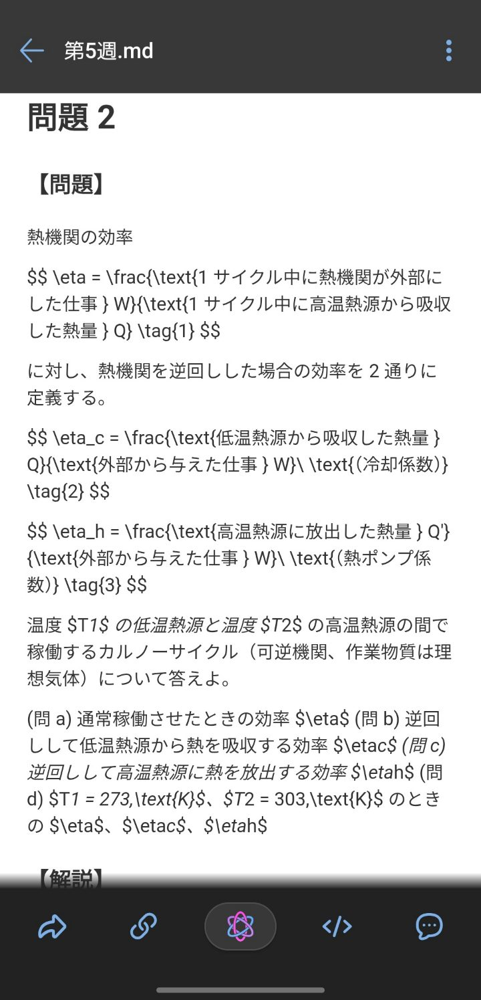
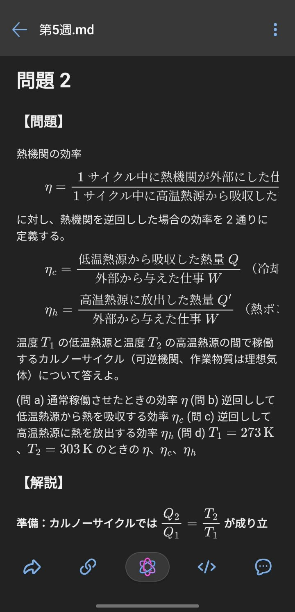

# 🧩 Box Markdown Preview

Box for Android の Markdown プレビューで TeX 数式を描画し、アプリのダークテーマに
追従させる [Morphe](https://github.com/MorpheApp) パッチです。

## 📸 before / after

| パッチなし | パッチ適用後 |
| :---: | :---: |
|  |  |

- **before**: `$$ … $$` がそのまま文字として表示され、ダークテーマでも背景は白いまま。
- **after**: 数式が MathJax で組み版され、Box のナイトモードに合わせて暗い配色になる。

## ❓ これは何か

Box の `.md` プレビューは WebView で [Showdown](https://github.com/showdownjs/showdown)
を動かしています。数式は知らないうえ、背景色は白で固定されています。

このパッチは APK 内のプレビュー用ページを差し替えて、次のことを行います。

- Showdown に渡す前に `$…$`、`$$…$$`、`\(…\)`、`\[…\]` を取り出し、数式内の
  `_`、`*`、`\\` が壊れないようにする
- 各数式を [MathJax 3](https://www.mathjax.org) の SVG 出力で描画する
  (WebView にフォントファイルを足さなくて済む)
- Box のナイトモードに `prefers-color-scheme` で追従する
- 数式以外は一切変えない。コードブロックや表の見た目はそのまま、コード中の
  `$` はただの文字として残る

変更するのは `assets/showdown/` の中だけです。バイトコードには触らないので、
難読化されたクラス名に依存せず、Box の Java 側が変わっても壊れにくくなっています。

> 本プロジェクトは Morphe 本家、Box、Box, Inc. のいずれとも関係ありません。
> それらが承認・作成したものではありません。

## 🩹 パッチ一覧

> **[v1.0.0](https://github.com/haya9924/box_md_preview/releases/tag/v1.0.0)**&nbsp;&nbsp;•&nbsp;&nbsp;`main`&nbsp;&nbsp;•&nbsp;&nbsp;パッチ 1 件

**🎯 対応バージョン:**

| 7.6.732 |
| :---: |

| 💊&nbsp;パッチ | 📜&nbsp;説明 | ⚙️&nbsp;オプション |
|----------|----------------|-----------|
| Markdown math preview | Markdown プレビューで TeX 数式を Obsidian のように描画します。プレビューのダークテーマも追加します。 |  |

## 📲 インストール

1. [Releases](https://github.com/haya9924/box_md_preview/releases) から
   `patches-1.0.0.mpp` を取得します。
2. Box `7.6.732`(`com.box.android`、`.apkm` か `.apk`)を自分で用意します。
3. [Morphe CLI](https://github.com/MorpheApp/morphe-cli) でパッチを当てます。

   ```bash
   java -Xmx5g -jar morphe-cli.jar patch Box.apkm \
       -p patches-1.0.0.mpp \
       -e "Markdown math preview" \
       --striplibs=arm64-v8a \
       -o Box-7.6.732-math.apk
   ```

   `--striplibs=arm64-v8a` は 64bit ARM のライブラリだけを残す指定で、
   730 MB の APK が 300 MB 程度になります。他の ABI が必要なら外してください。
4. 署名が変わるので Play ストア版の Box をアンインストールしてから、
   パッチ済み APK をインストールします。

GUI でよければ Morphe Manager でも同じ `.mpp` を読み込めます。

## 🛠 ビルド

Gradle ビルドは GitHub Packages 上の Morphe レジストリを参照します。
`read:packages` を付けたトークンを用意し、環境変数だけで渡してください
(ファイルには書かない)。

```bash
export GITHUB_ACTOR=<GitHub ユーザー名>
export GITHUB_TOKEN=<read:packages 付きトークン>

./gradlew :patches:buildAndroid
```

成果物は `patches/build/libs/patches-<version>.mpp` です。

`./gradlew generatePatchesList` で `patches-list.json`(外部ツールが読む
パッチ一覧)を作り直せます。

プレビュー用のページは `patches/src/main/resources/boxmarkdown/` にあります。
デスクトップブラウザで試すときは、Box の `assets/showdown/` を展開して隣に置き、
`index.html` を開いてください。

## 🔍 仕組み

| 手順 | ファイル |
|------|------|
| コードブロックとインラインコードを退避し、`$…$` を Markdown から取り出す | `math-preview.js` |
| 数式を私用領域のプレースホルダに置き換えて Showdown を実行 | `math-preview.js` |
| 描画後の DOM でプレースホルダを MathJax の SVG に差し替える | `math-preview.js` |
| MathJax が読めなかったときは TeX のソースをそのまま表示 | `math-preview.js` |
| 本文・見出し・リンク・コード・引用・表のダーク配色 | `index.html` |

MathJax は数式ごとにスクリーンリーダー用の MathML コピーを埋め込みます。
`startup.typeset` を切っていると MathJax 自身のスタイルシートが挿入されず、
Box の WebView ではそのコピーが表示されて数式が二重に見えていました。
そこでコピーの生成を止め、DOM からも取り除き、念のため CSS でも隠しています。

## 📝 注意

- ディスプレイ数式は中央寄せです。画面より広い数式は横スクロールになります。
- 解析できない数式は TeX のソースとして表示され、消えることはありません。
- パッチ済み APK は再署名されるため、Play Integrity に気付かれる可能性があります。
  開発中の端末では Box のサインインもファイルのプレビューも動作しましたが、
  すべての端末・アカウントで同じとは限りません。

## 📄 ライセンス

このリポジトリのソースは MIT です([LICENSE](LICENSE))。

同梱物のうち、次のものはそれぞれの条件を保ちます。

- ビルドした `.mpp` は [Morphe のパッチライブラリ](https://github.com/MorpheApp)
  (GPLv3)を同梱するため、バンドル全体としては GPLv3 で配布されます
  (Morphe の名称に関する制限は [NOTICE](NOTICE) を参照)。
- 同梱の MathJax は Apache-2.0 です。ライセンス全文はパッチバンドル内の
  `MathJax-LICENSE.txt` に入っています。

Box のプレビュー用アセットは Box, Inc. に帰属します。パッチが同梱するのは、
それを置き換える小さなページだけです。

## 🚀 リリース

リリースはタグから作ります。タグを push すると、ワークフローがバンドルを
ビルドし、draft リリースを作成して `patches-<version>.mpp` を添付し、公開します。

```bash
git tag v1.0.0
git push origin v1.0.0
```

`.mpp` のファイル名と `patches-list.json` のバージョンは `gradle.properties` の
`version` から決まるので、タグを打つ前に上げてください。
