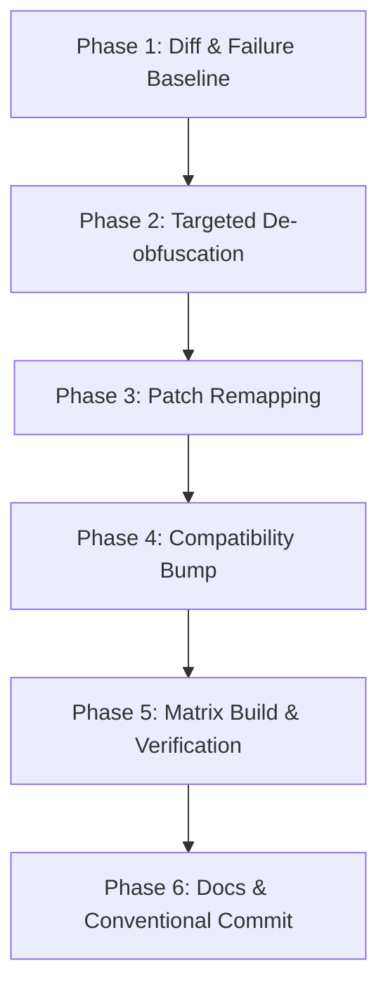

# Target App Version Upgrade Playbook

This reference provides the step-by-step protocol for upgrading supported target application versions when a new app release is published on the Google Play Store.

---

## 1. Upgrade Philosophy & Hard Invariants

1. **No Speculative Version Bumps**:
   - Never add a version string to `shared/Constants.kt` based on Play Store release notes, version scraping, or bytecode similarity alone.
   - Every version upgrade requires passing real-artifact verification with `apk-lab check` across the default configuration plus every boolean option inversion, followed by a device smoke of the changed flow.
2. **Never Weaken Assertions**:
   - Never change a required target check (`disableRequiredVoidMethodsByName`, `mutableClassDefByOrNull ?: throw PatchException(...)`) into a silent no-op just to make a check pass.
   - If an obfuscated class or method has moved, locate the new symbol and update the patch. If it cannot be located with evidence, stop; do not guess.
3. **Clean Workspace Rule**:
   - Do not manually unpack APKs into random directories. Use `apk-lab analyze` and `apk-lab check` inside managed `.apk-lab/` workspaces.

---

## 2. The 6-Phase Upgrade Workflow



### Phase 1: Diff & Failure Baseline

Compare the currently supported version against the new target version to identify architectural drifts, class renames, and failing patches:

```bash
# 1. Structural comparison: container splits, DEX counts, manifest changes, class deltas
cargo run --locked --quiet --manifest-path tools/apk-lab/Cargo.toml --bin apk-lab -- compare \
  path/to/old-version.apkm \
  path/to/new-version.apkm

# 2. Force-run the current patch bundle against the new APK to capture failing patches.
# --all means every compatible patch, including default = false patches; use --patch
# only for explicit selection.
cargo run --locked --quiet --manifest-path tools/apk-lab/Cargo.toml --bin apk-lab -- check \
  path/to/new-version.apkm \
  --mpp patches/build/libs/patches-<version>.mpp \
  --package com.example.app \
  --all \
  --force
```

Review the failure log from `--force`. Note which specific classes, methods, Hermes function offsets, or native offsets failed to resolve.

### Phase 2: Targeted Bytecode Analysis & De-obfuscation

When an obfuscated class (e.g. `LA6/c0;`) is renamed to `LB2/d1;`:

1. **Smali Extraction**:

   ```bash
   cargo run --locked --quiet --manifest-path tools/apk-lab/Cargo.toml --bin apk-lab -- analyze path/to/new-version.apkm --smali
   ```

   The command prints the managed workspace path; search that workspace rather than unpacking elsewhere.
2. **Symbol Mapping via Anchors**:
   Search string literals across all DEX files, then inspect candidate classes/methods surgically:

   ```bash
   # Find the unique literal and the DEX/split that contains it
   cargo run --locked --quiet --manifest-path tools/apk-lab/Cargo.toml --bin apk-lab -- strings path/to/new-version.apkm \
     --query "SELECT \\* FROM user_preferences"

   # Disassemble a candidate class; use the exact method descriptor for overloads
   cargo run --locked --quiet --manifest-path tools/apk-lab/Cargo.toml --bin apk-lab -- inspect-code path/to/new-version.apkm \
     --class com.example.app.data.PreferencesStore \
     --method "load(Ljava/lang/String;)Ljava/util/List;" \
     --format smali

   # Compare a candidate method against the previously supported artifact
   cargo run --locked --quiet --manifest-path tools/apk-lab/Cargo.toml --bin apk-lab -- inspect-code path/to/new-version.apkm \
     --class com.example.app.data.PreferencesStore \
     --method load \
     --compare path/to/old-version.apkm
   ```

   `inspect-code` requires `--class`; it has no free-text `--symbol` search. Use `apk-lab strings` or `rg` over the managed Smali workspace for literal discovery.
3. **Call-Graph & Cross-Reference Mapping**:
   If string constants are missing, inspect callers of known unchanged Android SDK classes (e.g. `Landroid/app/Activity;`, `Landroid/content/SharedPreferences;`) or interface implementations.

### Phase 3: Patch Remapping

Update the patch implementations in `patches/src/main/kotlin/app/aidan/patches/<app>/`:

- Update class descriptors (e.g. `"LA6/c0;"` $\to$ `"LB2/d1;"`) only after verifying the new class by anchor evidence.
- Update method names or parameter descriptors to the exact new signature.
- In Hermes bundles (`index.android.bundle`), re-resolve function offsets and verify opcode bytes for the bundle's HBC version; never reuse v98 bytes blindly on another version.
- In native libraries (`lib/**/*.so`), disassemble the exact ABI with NDK `llvm-objdump`, recalculate offsets/branches, and validate encodings. `apk-lab asm` assembles limited instruction forms; it does not disassemble binaries.

### Phase 4: Compatibility Metadata Bump

Once patch code matches the new target, update `patches/src/main/kotlin/app/aidan/patches/<app>/shared/Constants.kt`. Use the current `Compatibility(name, packageName, apkFileType, ..., targets = listOf(AppTarget(...)))` form; do not copy the legacy `PackageName(versions = ...)` form into new files.

```kotlin
import app.morphe.patcher.patch.ApkFileType
import app.morphe.patcher.patch.AppTarget
import app.morphe.patcher.patch.Compatibility

internal object Constants {
    const val PACKAGE_NAME = "com.example.app"

    // Illustrative values only; use the verified package, file type, and target version.
    val COMPATIBILITY_EXAMPLE = Compatibility(
        name = "Example App",
        packageName = PACKAGE_NAME,
        apkFileType = ApkFileType.APKM,
        appIconColor = 0x123456,
        targets = listOf(
            AppTarget(version = "2.6.0", minSdk = 24),
        ),
    )
}
```

Keep only versions that pass Phase 5 on a real artifact. `AppTarget` may also carry `versionCodes`, `isExperimental`, and `description` when the app requires them.

### Phase 5: Build & Matrix Verification

Execute the bundle build, metadata generation, and real-artifact check:

```bash
# 1. Compile and regenerate public metadata
./gradlew :patches:buildAndroid
./gradlew generatePatchesList

# 2. Execute every compatible patch with its boolean inversions
cargo run --locked --quiet --manifest-path tools/apk-lab/Cargo.toml --bin apk-lab -- check \
  path/to/new-version.apkm \
  --mpp patches/build/libs/patches-<version>.mpp \
  --package com.example.app \
  --all
```

`apk-lab check` generates one default case per selected patch plus one independent inversion per boolean option. It does not test every combination of multiple options and does not exercise string/int options unless supplied. Cases run concurrently by default; if a case fails with an archive-level error such as `Failed to find end record`, rerun that case alone and/or with `-j 1` before treating it as a patch regression.

| Stage | Establishes | Does not establish |
|---|---|---|
| `:patches:compileKotlin` / `compileReleaseJavaWithJavac` | Kotlin and Java sources compile together; extension ABI signatures are valid Java. | That injected Smali descriptors match Java methods; Smali is text inside Kotlin and is assembled later. |
| `:patches:buildAndroid` | Bundle packaging and extension merge succeed. | That the patch applies to a real APK or that behavior is correct. |
| `generatePatchesList` | Patch declarations instantiate and metadata is generated. | Any target compatibility or runtime behavior. |
| `apk-lab check` | Patch application, identity, checksum, member delta, and extension-class inventory (see below). | Dalvik verifier semantics, reflection/linkage, native execution, UI, or feature behavior. |
| `apk-lab deploy --launch` + `monitor` | The app installs, starts, and the exercised flow does not crash/ANR/spin on the tested device. | Untested devices, ABIs, app states, option combinations, or edge-case inputs. |

#### The Actual `apk-lab check` Gates

1. **Morphe execution and selection**: `result.json` exists; `failedPatches` is empty; the target patch and every declared dependency appear in `appliedPatches`.
2. **Valid output and identity**: the output is a safe, inspectable zip; package name matches the input (or a patch-declared `packageName` option); version code is unchanged.
3. **DEX structural check**: `dexdump -c` runs on every output `.dex`. `-c` verifies the DEX checksum (and exits); it is not the Dalvik bytecode verifier and does not prove type safety or runtime validity.
4. **Member delta**: at least one patchable archive member changed (`AndroidManifest.xml`, `resources.arsc`, `.dex`, `res/`, `assets/`, or `lib/`). This is an archive-hash delta, not a class/method/field semantic diff.
5. **Extension class inventory**: classes whose descriptors contain `Lapp/aidan/extension/` are collected and reported. This is diagnostic only: an empty list does not fail the case, and presence does not prove the `.mpe` set matches, that a Smali descriptor links to a Java method, or that reflection resolves.

#### What These Gates Do Not Establish

- App startup, Activity/Service lifecycle, or absence of crashes/ANRs.
- That a patched feature, dialog, WebView, bridge, or native library works at runtime.
- That reflection targets exist on the device build or accept the supplied arguments.
- That native bytes are correct for every shipped ABI.
- That security-sensitive bypasses behave safely or fail closed.
- That optional UI paths and all option combinations were exercised.

Declare a new app version supported only after Phase 5 passes **and** the changed user flow is exercised on a device:

```bash
cargo run --locked --quiet --manifest-path tools/apk-lab/Cargo.toml --bin apk-lab -- deploy path/to/new-version.apkm \
  --mpp patches/build/libs/patches-<version>.mpp \
  --package com.example.app \
  --all \
  --launch
cargo run --locked --quiet --manifest-path tools/apk-lab/Cargo.toml --bin apk-lab -- monitor --package com.example.app
```

### Phase 6: Documentation & Conventional Commit

1. **Update App Docs**:
   - Update `docs/<app>/architecture.md` with any newly discovered obfuscation patterns or architecture changes.
   - Update `docs/<app>/patches.md` if any user-facing patch options or behaviors were modified.
2. **Commit Message Format**:
   - Bumping supported target app versions **MUST** use type `bump(...)`.
   - **NEVER** use `fix` or `chore` for app version bumps.
   - Use the canonical app scope defined in `AGENTS.md` (e.g. `sezzle`, `sidelineswap`, `aftership`, `canvas-student`, `geocaching`, `fizz`, `365pay`, `adobe-scan`, `blackjack`, `navigate360-student`, `nhl`):

   ```text
   bump(sezzle): bump supported version to 5.4.0
   ```

---

## 3. Troubleshooting Common Upgrade Failures

| Failure Symptom | Probable Cause | Correct Action |
|---|---|---|
| `PatchException: Could not find class ...` | ProGuard/R8 obfuscation rename | Use `apk-lab strings` for a literal or call-site anchor, then `apk-lab inspect-code --class ...` to confirm the new class. |
| `PatchException: Method ... not found` | Method signature changed (e.g. parameter added) | Inspect overloads on the resolved class and compare exact parameter/return descriptors. |
| Assembler/encoder rejects a register | Wrong instruction format (for example `v16` in a `22c` operand) | Use `apk-lab validate-smali`; move the value to a low register or use an appropriate `/from16` or `/range` form. |
| Runtime `VerifyError` | Invalid types/flow or invalid emitted bytecode; a register-width mistake is one possible cause but not the only one | Reproduce on device, inspect the rejected method, validate the injected snippet, and compare against the original control flow. Do not assume `dexdump -c` would have caught it. |
| `Checksum mismatch on Hermes bundle` | `editor.updateFooterHash()` missing | Call `editor.updateFooterHash()` before `bundleFile.writeBytes(...)`. |
| Hermes byte mismatch / unexpected opcode | Wrong HBC version or reused offset/bytes from another release | Verify magic/version and function header; re-disassemble the exact bundle; stop if the layout is unsupported. |
| `Member delta check failed (0 members modified)` | Patch skipped all instructions or the target was already in the patched state | Confirm the patch actually mutates a patchable member; re-check the vendor logic. |
| Native bytes mismatch | Offset belongs to a different build/ABI | Re-derive from the exact `.so` with `llvm-objdump`; never overwrite `expected` with observed bytes to force a pass. |
