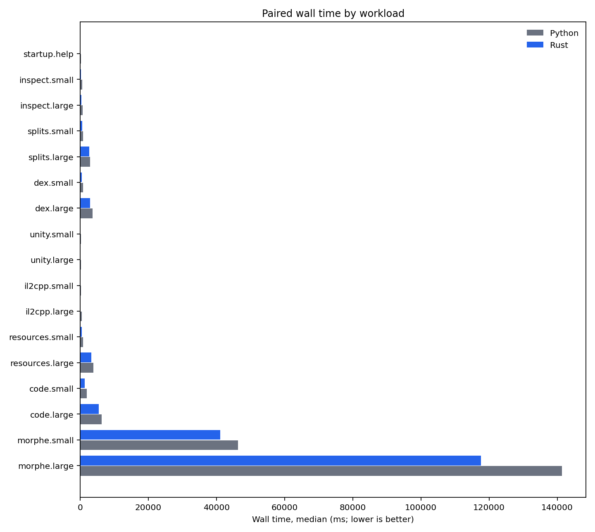
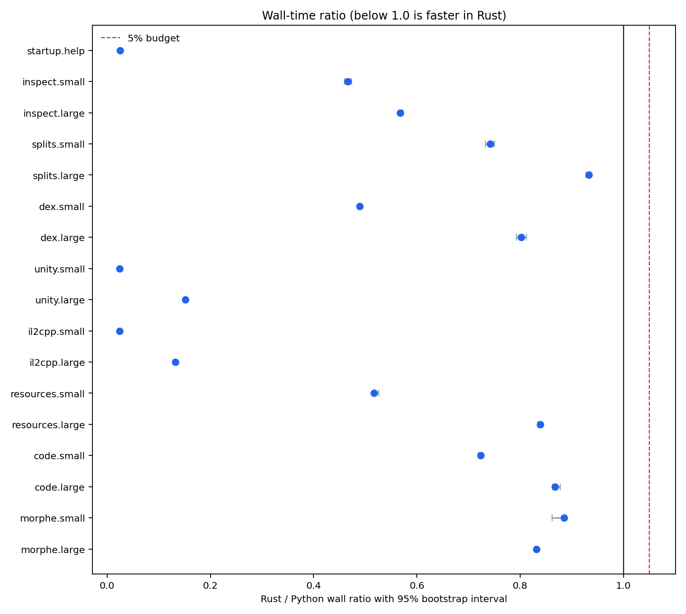

# APK Lab: Python to Rust migration report

> Historical migration report. The Python implementation, its oracle, and the
> migration harness that produced this evidence were retired after acceptance. This
> document records the migration, the measured results, and the rollback identity. It
> is not an entrypoint reference; use [apk-lab.md](apk-lab.md) for the supported
> command surface.

## Goals and non-goals

Replace the Python APK Lab implementation with a native Rust command surface while
preserving archive safety, CLI contracts, patch verification, Play delivery, R2/CI
state, and device behavior. This report records measured results; it is not a claim
that every external tool became native. JVM, Android SDK, ADB, Gradle, and Node/Bun
subprocesses remain external by design.

## Architecture

APK Lab is one host crate, `tools/apk-lab`, with a library and one production
binary, `apk-lab`; `tools/asset-prep` and `tools/play-metadata` are separate host
crates. During the migration the crate also built a migration-only binary;
that binary and the harness behind it were deleted after acceptance. Shared owners are:

- `archives.rs`: one validated ZIP/split materialization and limit policy.
- `workspace.rs`: one managed run/marker/cleanup policy.
- `process.rs`: one shell-free subprocess and bounded-output adapter.
- `morphe.rs`: patch selection, independent option cases, execution, and postconditions.
- `acquisition.rs`, `fixtures.rs`, `compatibility_ci.rs`: delivery and durable state.
- `asset-prep`: native font, OCR, PDFBox, and icon preparation.

During migration, the Rust core was measured against an independently executable
Python oracle. The oracle was never linked into the candidate and was retired after
the accepted parity and performance evidence.

## Migration map

| Area                                        | Before            | After                           |
| ------------------------------------------- | ----------------- | ------------------------------- |
| APK/APKM/XAPK inspection and analysis       | Python            | Rust                            |
| Patch checks, deploy/dev, monitor, crash/UI | Python            | Rust                            |
| Play acquisition, accounts, R2, CI state    | Python            | Rust                            |
| Font/OCR/PDFBox/icon preparation            | Python            | Rust                            |
| README generation and hooks                 | Python            | Bun                             |
| External patch engine, signing, SDK, ADB    | JVM/Android tools | unchanged                       |
| APK Lab oracle and tests                    | Python            | retired after accepted evidence |

## Clean-code decisions

- One archive policy and one workspace policy, rather than per-command copies.
- One typed exit/error model and one process adapter; no shell concatenation.
- No generic plugin framework: command modules own their format semantics.
- Secrets are redacted before truncation; OAuth tokens never enter subprocess argv.
- Performance fixes removed repeated split extraction, double hashing, a 1 MiB
  `dexdump`/`aapt2` capture truncation, and full-DEX in-memory class scanning.

## Provenance

- Measured source revision: `bd3512b4bf0f89188ac81496ca3d83335662bcf2`.
- Worktree dirty at measurement: `false`.
- Pre-registered performance policy: SHA-256
  `7f33adfeccf23363546584d082b94af061b5173c1dc7920d2386f379da0c77d0`. The policy
  file lived alongside the retired harness and is recorded here only by that identity.
- Raw paired samples and the derived comparison are preserved in Git history and are
  intentionally omitted from the current documentation tree.
- Host: macOS arm64, 16 logical CPUs, 32 GiB RAM.
- Python oracle: 3.12.14. Native binary: release build of the measured revision.

## Methodology

Every workload ran the retired Python CLI oracle (`python -m apk_lab.cli`) and the
native release binary with identical argv, inputs, options, jobs, and isolated
sandbox. Engine order alternated per sample using the pre-registered seed. Local
workloads used 5 warmups and 30 measured pairs; costly Morphe workloads used 2 and 10.
Inputs and the MPP were hash-verified before timing. Outputs were validated against
declared exit codes, required text, expected files, and cross-engine normalized
output. Morphe normalization removes only `durationSeconds`, `gitRevision`, and
`toolVersions`; speedups do not skip that normalization.

Wall, CPU, and peak descendant RSS were collected with the units recorded in the raw
data. No thresholds were changed after observing results.

## Data and charts

- [chart manifest](benchmarks/apk-lab/charts/manifest.json)
- [wall-time chart](benchmarks/apk-lab/charts/wall-time.png)
- [wall-ratio chart](benchmarks/apk-lab/charts/wall-ratio.png)





The charts were rendered outside the checkout from the archived comparison data with
Python 3.12.14 and matplotlib 3.10.5; that rendering environment was not part of the
repository toolchain.

## Correctness and integration evidence

The counts and checks in this section describe the measured/cutover revision. The
migration-only golden runner and harness were removed afterward; they are historical,
not current commands.

- Native APK Lab tests: 693 passed at the measured revision.
- Core parity: 8/8 with four approved native-only CLI text/flag differences.
- Analysis parity: synthetic 22/22 and real pinned tools 22/22, with one approved
  `res --json` usage-text difference.
- Patching/device parity: 21/21 offline; real AfterShip check 12/12 matches Python.
- Acquisition/CI parity: 11/11; native latest `5.25.9/52590` and older
  `5.25.8/52580` delivery.
- Isolated R2/CI run: 12/12, HTTP 200 callback, persisted submission and marker.
- Device: `emulator-5554` deploy/launch/monitor/crash-trace/UI click verified.
- Asset pipeline: exact font/OCR hashes, 112 PDFBox members, 37/37 icon pixels.
- Full audit: 38/38 checks.

## Rejected and inconclusive measurements

No workload was rejected or left inconclusive in the final accepted comparison. An
earlier run was discarded because its RSS sampler overlapped orphan processes from a
timed-out attempt; it was rerun without those processes. The discarded values are not
used in this report.

## Performance acceptance verdict

**Pass.** All 17 workloads meet the pre-registered wall, CPU, and RSS policy; no
material regression or inconclusive interval remains. Selected wall ratios
(Rust/Python; lower is faster):

| Workload          | Ratio |
| ----------------- | ----: |
| `startup.help`    | 0.025 |
| `inspect.large`   | 0.567 |
| `splits.large`    | 0.933 |
| `dex.large`       | 0.802 |
| `resources.large` | 0.839 |
| `code.large`      | 0.867 |
| `morphe.small`    | 0.885 |
| `morphe.large`    | 0.832 |

All measured workload IDs: `startup.help`, `inspect.small`, `inspect.large`,
`splits.small`, `splits.large`, `dex.small`, `dex.large`, `unity.small`,
`unity.large`, `il2cpp.small`, `il2cpp.large`, `resources.small`,
`resources.large`, `code.small`, `code.large`, `morphe.small`, and `morphe.large`.
Per-workload results, confidence intervals, and RSS verdicts are preserved in the
archived comparison data in Git history. No single aggregate speedup is asserted.

## Python retirement

Plan 009 retired the first-party Python APK Lab implementation after this report was
accepted. The active source contains no Python package, tests, manifests, lockfile, or
Python-backed APK Lab downloader/hook. The retained CJS APKMirror runner is not Python
and lives at `tools/apk-lab/apkmirror_runner.cjs`.

Removed: `tools/apk-lab/apk_lab/` (Python package), its Python test suite,
`pyproject.toml`, `uv.lock`, `.python-version`, root `pytest.ini`, and the obsolete
binary-fixture generator. Audit and dependency tooling no longer runs Ruff, mypy,
pytest, PyPI resolution, uv, or pre-commit. Workflows use native Rust binaries and the
existing JVM/Android/Bun tooling.

Added at cutover:

- The migration harness's golden-case check executed the native CLI against 36
  committed golden cases across core, analysis, patching/device, and acquisition/CI,
  with Python sentinels first on `PATH`; exact output/exit/hash mismatches failed.
  The harness was retired with the Python implementation.
- `scripts/check-no-python.ts`: deterministic first-party Python-free gate, with
  narrow historical exclusions for plans, immutable migration evidence, changelog,
  this migration report, and frozen oracle fixtures. Ordinary `bun run audit` ran it
  on every check. Removed after the cutover once Python retirement was complete: the
  scan no longer guarded any behavior, so it was deleted with its CI job and audit
  stage instead of becoming a maintained allowlist.

Cutover code revision:
`5f42d6b373f021feb7cf2c6f7ba5ea68e9a2f1c9`.

Verification at the cutover revision:

- `bun run audit`: all 35 checks pass across format, lint, typecheck, and tests,
  including 704 native APK Lab tests, asset-prep, Play metadata, NHL native, C++,
  Gradle, Worker, site, scripts, dependencies, icons, and documentation.
- The same 35-check audit passed with a Python-free `PATH` containing no `python`,
  `python3`, `pip`, `uv`, `pytest`, `mypy`, or Ruff executable. Host Python
  installations remain present but are not reached by repository commands.
- The golden-case check passed 36/36 native cases with sentinel
  `python`/`python3`/`pip`/`uv`/`pytest` executables first on `PATH`; no sentinel ran.
- `./gradlew :patches:buildAndroid --no-daemon`, `bun run --cwd site check:icons`, and
  native CLI `--help`/`asm` smoke from the repository root and a temporary directory
  passed.
- Rollback archive: preserved outside the repository; the archived
  `baseline-source/ROLLBACK.md` records aggregate SHA-256
  `58d5bdc30913acb840c2afc8fde3eef3b89cb4ddde6cf0c7a8b018a0a23ec279`.
  Rollback is a reviewed source revert/rebuild, not a dormant Python fallback.

No first-party Python runtime, build, release, CI, hook, test, or dependency-management
requirement remains. Historical prose and frozen oracle fixtures may mention Python;
the gate permits those only outside executable requirements.

## Operational rollback and rebuild

Rollback restored the prior Python entrypoint from the recorded source archive or
revision, then ran its locked environment and tests. Rebuild the native candidate with:

```bash
cargo build --release --locked --manifest-path tools/apk-lab/Cargo.toml --bin apk-lab
cargo test --locked --manifest-path tools/apk-lab/Cargo.toml
bun run audit
```

The raw paired JSON plus the pass-through comparison reproduce this verdict without
re-running the workloads.

## Limitations

External JVM/Android/SDK/ADB/Gradle and Node/Bun portions remain outside the native
binary. Network and device timings are not inferred from fixtures. The benchmark host
is one macOS arm64 workstation; Linux host capability was proven separately for Play
delivery but not for every timed workload.
