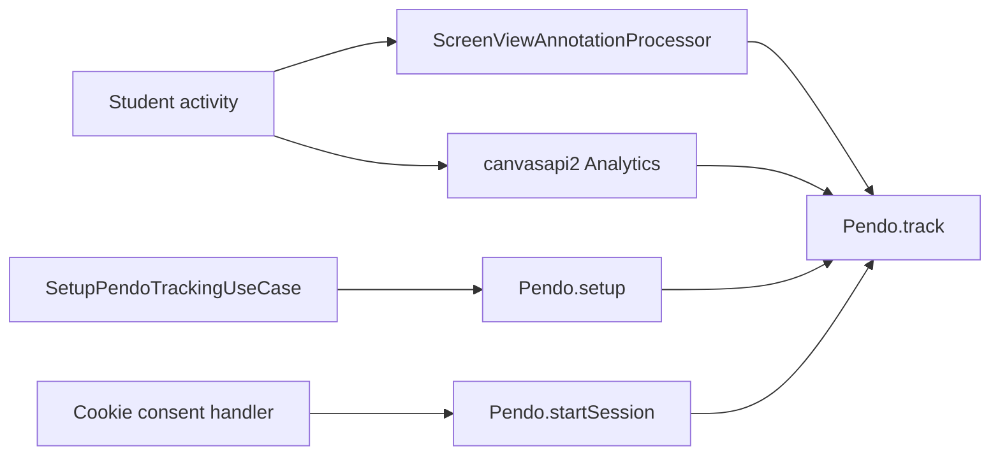
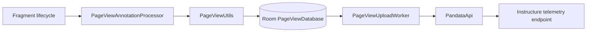

# Canvas Student Architecture & Reverse Engineering Specification

## Overview

| Attribute                   | Specification                                                                                          |
| --------------------------- | ------------------------------------------------------------------------------------------------------ |
| **Application Name**        | Canvas Student                                                                                         |
| **Package Name**            | `com.instructure.candroid`                                                                             |
| **Supported Version**       | `8.12.0` (Morphe Compatibility: `8.12.0`, `minSdk` 28)                                                 |
| **Analyzed Version Code**   | `300` (Derived from APK analysis; Constants specifies version string)                                  |
| **Target SDK**              | `36` (Android 16)                                                                                      |
| **Minimum SDK**             | `28` (Android 9.0)                                                                                     |
| **APK Format**              | APKM (`base.apk`, arm64-v8a, xhdpi splits)                                                             |
| **Package Signing SHA-256** | `abfe1362d84c5234c174c2c03d405a480405e361162f7b28dad6bec825ba02b3`                                     |
| **Architecture**            | Native Kotlin/Java; Jetpack Compose, Hilt, Room, Retrofit, WorkManager, and arm64-v8a native libraries |

Canvas Student is Instructure's Android learning-management client. The APK includes the Pendo SDK, first-party Pandata tracking, Firebase Crashlytics, and support for course content rendered through Nutrient/PSPDFKit.

## Technology Stack

- **UI and navigation**: AndroidX fragments and Jetpack Compose with Instructure's InstUI/Horizon UI packages.
- **Dependency injection**: Hilt supplies repositories, the `PageViewDao`, `PageViewUtils`, and startup use cases.
- **Networking**: Retrofit and OkHttp communicate with each Canvas institution and the separate Pandata telemetry endpoint.
- **Persistence and background work**: Room persists `PageViewEvent` records; WorkManager runs `PageViewUploadWorker`.
- **Document viewing**: Nutrient/PSPDFKit renders course documents. Its bundled analytics API is an event interface; the inspected app has no `AnalyticsClient` implementation.

## Telemetry Architecture

### Pendo Behavioral Tracking

Pendo is embedded in over 4,000 classes across `classes6.dex` through `classes8.dex`. The app-owned startup class `SetupPendoTrackingUseCase` calls `Pendo.setup(...)`; its consent path gets the current user, hashes the user's UUID, includes the account UUID and locale/survey attributes, then calls `Pendo.startSession(...)`.

`com.instructure.canvasapi2.utils.Analytics` uses `Pendo.track(...)` for app events. `ScreenViewAnnotationProcessor` converts annotated screen navigation into Pendo event names. The SDK also exposes visitor/device/account IDs, guide activities, screen-content scanning, and click analytics.

### Pandata Pageview Surveillance

`PageViewUtils.startEvent` records the current Canvas domain, URL, course/group context, student ID, masquerade ID where applicable, session ID, timestamps, and per-event duration. Events are stored through `PageViewDao` and `PageViewDatabase`. `PageViewUploadWorker` later reads queued records and uses `PandataApi` to upload them with a signed token and server-provided URL.

`OfflineAnalyticsManager` additionally logs offline course openings and duration when the user returns online. This path uses both `Analytics.logEvent` and `PageViewUtils.saveSingleEvent`.

### Diagnostic Telemetry and Prompts

`BaseAppManager.onCreate` enables Firebase Crashlytics collection. The app records exceptions from PageView processing and other UI/network paths and can set Crashlytics user IDs and custom keys. The Help screen also exposes `StudentHelpDialogFragmentBehavior.rateTheApp`, which redirects users to the Play Store.

## Patch Targets

1. **`RemoveTrackingAndAnalyticsPatch.kt` (`compositeFeaturePatch`):** Neutralizes Pendo setup/session startup and event APIs, stubs first-party analytics and token analytics reporting (`AppManager.logTokenAnalytics`), suppresses Pandata pageview persistence and uploads, offline telemetry, Firebase Crashlytics reporting (including custom keys), the Help rating redirect, and `Logger.canLogUserDetails`. Its internal resource layer sets `firebase_crashlytics_collection_enabled=false` on `<application>` and removes the Crashlytics NDK registrar metadata from `ComponentDiscoveryService`.
2. **`ShowRemoteConfigEditorPatch.kt` (`bytecodePatch`):** Appends `SettingsItem.REMOTE_CONFIG` to the `Preferences` section of `StudentSettingsBehaviour.getSettingsItems()`.
3. **`UnlockNotebookAndOfflineContentPatch.kt` (`bytecodePatch`):** Forces `FeatureFlagProvider.notebookEnabled` and `offlineEnabled` to return `Boolean.TRUE`.
4. **`DisableAiStudyToolsPatch.kt` (`bytecodePatch`):** Stubs `StudyToolsViewModel.checkStudyToolsAvailability` and forces `StudyToolsUiState.getAvailable()` to `false`.

## Hidden Client Gates

Several 8.12.0 features are gated only in the client, so their UI is unreachable without an entitlement the app never asks for, or reachable only when an environment flag is on.

### Settings Sections

`StudentSettingsBehaviour.getSettingsItems()` builds a `LinkedHashMap<Integer, List<SettingsItem>>` keyed by section string resource; `0x7f130c1a` is the `Preferences` section that already receives conditional items (`PAIR_WITH_OBSERVER`, `SUBSCRIBE_TO_CALENDAR`, `SWITCH_EXPERIENCE`, `HOMEROOM_VIEW`). `SettingsItem.REMOTE_CONFIG` and its `RemoteConfigParamAdapter` editor are complete, but the enum is never appended, so the editor is unreachable. `SettingsViewModel` takes `offlineEnabled` as a constructor parameter and drops the offline section when it is false, which is why the flag gates a settings surface rather than a course screen.

### Environment Feature Flags

`FeatureFlagProvider` exposes one suspend `checkEnvironmentFeatureFlag(name, continuation)` and thin per-flag wrappers: `notebookEnabled` → `notebook`, `offlineEnabled` → `mobile_offline_mode`, plus `checkCookieConsentFlag`, `checkRestrictStudentAccessFlag`, `checkWidgetDashboardFlag`, `checkAccountSurveyNotificationsFlag`, and `checkCanvasForElementaryFlag`. Values come from the `EnvironmentFeatureFlagsDao` Room cache after `fetchEnvironmentFeatureFlags`. Each wrapper compiles to `(Lju/c;)Ljava/lang/Object;` and returns `Boolean`, so an injected `Boolean.TRUE` return is a valid completed result.

Canvas Career and Next Gen Canvas are not client flag gates: `SWITCH_EXPERIENCE` depends on `ApiPrefs.getCanSwitchToCanvasCareer()` and the Canvas Career/Next Gen choice comes from server entitlement (`career/experience_summary`, `next_gen_canvas`), so forcing them can strand an account the institution does not support.

### Study Tools Availability

`StudyToolsViewModel.checkStudyToolsAvailability(String)` is the only caller of `GetStudyToolsUseCase`; its result feeds `StudyToolsUiState.available`, and `PageDetailsScreenKt` renders the Study Tools button only when that field is true. Stubbing the private check and forcing `getAvailable()` to false removes both the entry point and the button.

## Launcher Resources

The 8.12.0 manifest points `android:icon` at `@mipmap/ic_launcher`. The effective adaptive icon is `res/mipmap-anydpi-v26/ic_launcher.xml` in the APK; Morphe decodes it as `res/mipmap-anydpi/ic_launcher.xml` after the version qualifier is stripped. The default configuration `res/mipmap/ic_launcher.xml` is an empty `<adaptive-icon/>` placeholder. Both declare an adaptive-icon root, and only the v26 configuration declares `<background>`, `<foreground>`, and `<monochrome>`.

The v26 foreground and monochrome both reference `@drawable/ic_launcher_foreground`, a 72×72 viewport vector whose single `<path>` originally uses `android:fillColor="#e62429"`. The background references `@color/white`. `ChangeAppIconPatch` treats those anchors as required for 8.12.0 and fails if the red vector path or the v26 foreground/monochrome references change.

The patch writes the selected background to `@color/aidan_canvas_launcher_background` instead of a literal color. Adaptive icon inflation resolves `<background android:drawable>` as a drawable; a raw color literal can make the launcher fall back to the default Android icon. Because the decoder strips the `-v26` qualifier when minSdk is 28, the patch also recreates `res/mipmap-anydpi-v26/ic_launcher.xml` from the decoded anydpi adaptive icon.

## Clone Manifest Invariants

The manifest package is `com.instructure.candroid`, and every component class name is already absolute. Provider authorities are literal strings with the original package prefix. The original-package custom permission is `com.instructure.candroid.DYNAMIC_RECEIVER_NOT_EXPORTED_PERMISSION`; its declaration and `<uses-permission>` entry must both be rewritten for a clone.

The clone does not touch DEX classes or package-name strings such as `com.instructure.student.BuildConfig.APPLICATION_ID`. Runtime FileProvider authorities are built from `Context.getPackageName()`, so rewriting manifest authorities keeps sharing consistent with the cloned package. App Links, OAuth redirects, push registration, and Nutrient/PSPDFKit licensing can still be bound to the original application ID or certificate; these are account- and service-dependent and must be verified on a device.
