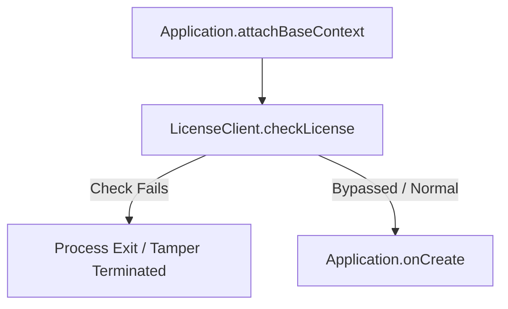
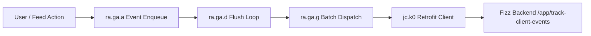
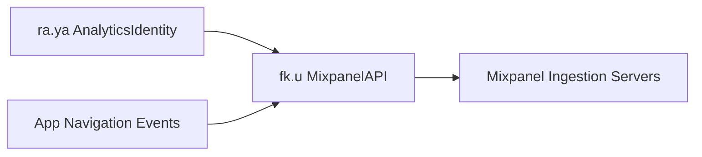

# Fizz Architecture & Reverse Engineering Specification

## Overview

| Attribute                   | Specification                                                                                                                                                              |
| --------------------------- | -------------------------------------------------------------------------------------------------------------------------------------------------------------------------- |
| **Application Name**        | Fizz                                                                                                                                                                       |
| **Package Name**            | `com.ashtoncofer.Buzz`                                                                                                                                                     |
| **Supported Versions**      | `1.54.0` (`minSdk` 23, version code `400032`) and `1.72.0` (`minSdk` 24, version code `465123`)                                                                            |
| **Obfuscation Map**         | Every supported build renames its own classes; per-version descriptors live in the `*_TARGETS_1_*` tables of each patch and are selected by `packageMetadata.versionName`. |
| **Target SDK**              | `36` (Android 16)                                                                                                                                                          |
| **Minimum SDK**             | `23` (Android 6.0)                                                                                                                                                         |
| **APK Format**              | APKM (`base.apk`, split configs)                                                                                                                                           |
| **Package Signing SHA-256** | `622850867847ccb7a1371bc42c865b1137fa51bd19987dc81b53815c9a9817bf`                                                                                                         |
| **Architecture**            | Native Kotlin/Java; Jetpack Compose, Dagger/Hilt, Kotlinx Coroutines, Retrofit/OkHttp, Mixpanel, Airbridge, Adjust, Sentry, Google Play Integrity / PairIP                 |

Fizz is a college-centric anonymous social feed and messaging platform. The application incorporates extensive telemetry across first-party analytics pipelines, attribution services, third-party analytics SDKs, session crash reporting, and Google Play Integrity Protection (PairIP).

---

## Technology Stack

- **UI & Presentation**: Modern Jetpack Compose UI with declarative design components and Compose navigation.
- **Dependency Injection**: Dagger and Hilt manage dependencies for repositories, network clients, view models, and application lifecycles.
- **Networking**: Retrofit 2 and OkHttp handle RESTful endpoints for feed browsing, comments, direct messaging, client event tracking, and attribution syncing.
- **Coroutines & Asynchronous Work**: Kotlinx Coroutines run background jobs, batch uploads, and real-time state management.
- **Serialization**: Kotlinx Serialization parses incoming and outgoing API models.
- **Tamper Protection**: Google Play Automatic Integrity Protection / PairIP client (`com.pairip.licensecheck.LicenseClient`) verifies licensing and APK signature integrity at application startup.

---

## Telemetry & Anti-Tamper Architecture

### 1. Google Play Automatic Integrity Protection (PairIP)

The application embeds PairIP (`com.pairip.licensecheck.LicenseClient`) invoked early in `Application.attachBaseContext`. If signature mismatches or tampering are detected, the process terminates before initialization of main activities or user interactions.



### 2. First-Party Client Event Pipeline

User interactions (post impressions, votes, profile opens, community switching, comment expansion) are captured into event models (`ra.q9`) and dispatched through `ra.ga` (implementing `ra.v9`). `ra.ga` queues events locally in memory, flushes them periodically, and uploads serialized JSON payloads to the `/app/track-client-events` backend endpoint via `jc.k0`.



### 3. Mixpanel Product Analytics

Mixpanel (`fk.u`) tracks granular user flow, super properties, funnel analytics, and distinct user identities. In conjunction with `ra.ya` (which generates and persists random installation and device tracking UUIDs), events are aggregated and uploaded to Mixpanel ingestion endpoints.



### 4. Airbridge Measurement & Attribution

Airbridge (`co.ab180.airbridge.Airbridge`, wrapped in `sa.l0`) collects install attribution, deferred deep links, campaign parameters, and device hardware aliases. It hooks campaign intent triggers via `sa.l0.f`.

### 5. Adjust Mobile Attribution

Adjust (`com.adjust.sdk.Adjust`, wrapped in `sa.b`) tracks deep-link referrals, app sessions, advertising campaigns, and subscription measurement. `sa.b.g` manages initialization from application context.

### 6. Google Advertising Identifier (AAID)

The app queries Google Play Services `AdvertisingIdClient` to retrieve the device Advertising ID (AAID) and ad-tracking preferences. `sa.n0` registers this device identifier with backend services for cross-device user matching and targeted re-engagement campaigns.

### 7. Sentry Performance & Crash Reporting

Sentry Android (`io.sentry.android.core.s1`, initialized via `ec.p1.b`) monitors unhandled exceptions, ANRs, HTTP breadcrumbs, and UI transaction performance traces. Telemetry captures breadcrumbs of navigation, network requests, and device state.

### 8. Direct Message Screenshot Surveillance

In private direct messaging conversations, `ConversationViewModel` observes system screenshot events. When a screenshot is captured, `sd.a2` (a coroutine worker) triggers `jc.n2.q` to invoke `/chat/notify-screenshot`, alerting the chat counterpart that their private messages were captured.

````mermaid
flowchart LR
    SC[Android Screenshot Event] --> VM[ConversationViewModel]
    VM --> WK[sd.a2 Coroutine Worker]
    WK --> RP[jc.n2.q ChatRepository]
    RP --> API[POST /chat/notify-screenshot]
    API --> CP_NOTIF[Counterpart Notified]

---

## Typography & Emoji Subsystem

Fizz constructs its user interface exclusively using Jetpack Compose (`androidx.compose.ui.text`). Typography styling defaults to `Nunito` (`res/font/nunito_variable.ttf`), loaded at runtime via Compose's `AndroidFontLoader` (`hg.g`) and resolved through `FontFamilyResolverImpl`.

### 1. EmojiCompat Integration

The application registers `androidx.emoji2.text.EmojiCompatInitializer` with `androidx.startup.InitializationProvider`. When enabled:
1. `EmojiCompatInitializer.b` creates a `FontRequestEmojiCompatConfig` backed by Google Play Services downloadable fonts.
2. `AndroidParagraphIntrinsics` (`q4.c`) checks `EmojiCompat.isConfigured()` (`x5.i.c()`).
3. If initialized, `EmojiCompat.process(...)` scans incoming text and wraps emoji sequences in `TypefaceEmojiSpan` (`x5.u`), enforcing Google Noto emoji rendering.

```mermaid
flowchart TD
    A[Compose Text Component] --> B[AndroidParagraphIntrinsics]
    B --> C{EmojiCompat.isConfigured?}
    C -->|Yes / Default| D[EmojiCompat.process -> TypefaceEmojiSpan Google Noto]
    C -->|No / Patched| E[Raw Text -> Canvas.drawText with Custom Typeface]
    E --> F[Minikin Font Fallback Chain]
    F --> G[AppleColorEmoji.ttf iOS Emojis]
````

### 2. Custom Fallback Typeface Pipeline

When `EmojiCompat` is neutralized:

1. `EmojiCompatInitializer.b` immediately returns `Boolean.FALSE`, preventing `EmojiCompat` registration.
2. Compose leaves emojis as untransformed characters.
3. `hg.g.c` (`AndroidFontLoader.load`) intercepts `nunito_variable` resolution and delegates to `EmojiFontBridge.wrapTypeface(Context, Typeface)`.
4. On Android API 29+ (Android 10+), `EmojiFontBridge` creates a composite fallback typeface using `Typeface.CustomFallbackBuilder` with `Nunito` as the primary family and `assets/fonts/AppleColorEmoji.ttf` as the custom fallback. Below API 29 or on font-load failure, the original typeface is returned unchanged.
5. `wj.a.t` (PlatformTypefaces) intercepts generic and platform font resolution, routing to `EmojiFontBridge.wrapPlatformTypeface`. On API 29+, the platform composite pairs Apple Color Emoji with system `sans-serif` fallback.
6. When supported, Minikin renders all emoji codepoints using the high-resolution CBDT/CBLC bitmap glyphs from `AppleColorEmoji.ttf`.

---

## Patch Targets

1. **`RemoveTrackingAndAnalyticsPatch.kt` (`bytecodePatch`)**:
   - Neutralizes PairIP signature verification (`LicenseClient.checkLicense`).
   - Stubs first-party event enqueuing and batch uploads (`ra.ga`, `jc.k0`, `ec.j`).
   - Disables Mixpanel tracking methods, resets, and forces tracking opt-out (`fk.u`, `ra.ya`).
   - Neutralizes Airbridge attribution methods and lifecycle initialization (`sa.l0`, `Airbridge`).
   - Neutralizes Adjust attribution methods and session hooks (`sa.b`, `Adjust`).
   - Zeroes the Google Advertising ID (`00000000-0000-0000-0000-000000000000`) and limits ad tracking (`AdvertisingIdClient`, `sa.n0`).
   - Configurable option `disableCrashReporting`: Disables Sentry initialization and reporting (`ec.p1`, `s1`).
   - Configurable option `silentScreenshots`: Disables screenshot detection alerts to chat counterparts (`sd.a2`, `jc.n2.q`).
2. **`ReplaceEmojiFontWithIosPatch.kt` (`compositeFeaturePatch`)**:
   - Bundles `AppleColorEmoji.ttf` into `assets/fonts/AppleColorEmoji.ttf` in target APK via an internal raw resource stage.
   - Stubs `EmojiCompatInitializer.b` to return `Boolean.FALSE`, disabling Google Noto emoji replacement via an internal bytecode stage.
   - Wraps Compose font loader `hg.g.c` and platform font resolver `wj.a.t` with `EmojiFontBridge` fallback building (effective on API 29+).
3. **`EnableDeveloperSettingsPatch.kt` (`bytecodePatch`)**:
   - Injects `DeveloperMenuBridge.init` into `MainActivity.onCreate`.
   - Injects developer mod menu button into Home Screen top bar composable (`td.v.a` on 1.54.0, `ee.n1.a` on 1.72.0).
   - Bypasses Mobile Studio drawer gating (`de.k1.invokeSuspend` on 1.54.0, `de.r2.invokeSuspend` on 1.72.0).
   - `DeveloperMenuBridge` reflects the activity's Mobile Studio request holder (`m0` on 1.54.0, `o0` on 1.72.0) and resolves Kotlin `Function0`/`Unit` by candidate list (`yl.a`/`kl.z` → `hn.a`/`tm.z`).
4. **`RemoveAdsPatch.kt` (`bytecodePatch`)**:
   - Filters commercial feed advertisements (`sc.k` on 1.54.0, `yc.n` on 1.72.0) and optional marketplace listing cards (`sc.t1` on 1.54.0, `yc.z1` on 1.72.0) from Home feed `displayItems` via `FeedFilterBridge` in `HomeFeedViewModel.l0` (1.54.0) / `HomeFeedViewModel.u0` (1.72.0).
   - Preserves repository item models in `FeedRepository`, maintaining uninterrupted infinite scrolling without falsely triggering `endReached`.
5. **`BlockUpdatePromptsPatch.kt` (`bytecodePatch` with `extensions/extension.mpe`)**:
   - Bypasses `SessionState` outdated check (`nc.j0.d` on 1.54.0, `tc.s0.m` on 1.72.0) and semantic version comparison (`nc.c.b` on 1.54.0, `tc.c.d` on 1.72.0).
   - Neutralizes `isAppUpdateRequired` field initialization in `OnboardingUiState` (`ge.u1.l0` on 1.54.0, `se.h2.K0` on 1.72.0).
   - Neutralizes the onboarding screen update check branch (`ge.r1.h` on 1.54.0, the single flag read in `se.d2` on 1.72.0).
   - Stubs update prompt composable (`kd.o1.a` on 1.54.0, `td.a2.a` on 1.72.0) with an immediate `return-void`.
   - Spoofs `fizz-client-version` and `fizz-build-number` headers in the OkHttp interceptor (`ic.g.a` on 1.54.0, `nc.i.a` on 1.72.0) using `VersionBridge`.
   - Spoofs `clientVersion` in session synchronization DTO (`ub.dc.<init>` on 1.54.0, `ub.id.<init>` on 1.72.0) using `VersionBridge.getClientVersion()`.
   - Injects `VersionBridge.init(this)` into `MainActivity.onCreate` for daily asynchronous Google Play version synchronization via Cloudflare Worker.

---

## Dynamic Version Spoofing & Gateway Synchronization

### 1. Gateway Version Gate Mechanism

Fizz enforces client freshness at the HTTP gateway level (`api510.pineapple-connect.com`). When establishing a session (`/api/v1/app/session-state`), both HTTP request headers and the request body must present an accepted client version:

1. **Header Interceptor (`ic.g.a` on 1.54.0, `nc.i.a` on 1.72.0)**: Emits `fizz-client-version` and `fizz-build-number` on every outbound request to the Fizz gateway (`1.54.0`/`400032`, `1.72.0`/`465123`).
2. **DTO Initialization (`ub.dc.<init>` on 1.54.0, `ub.id.<init>` on 1.72.0)**: Hardcodes the wire `clientVersion` into `SessionStateRequestData`.

When the backend detects an outdated version (e.g. `1.54.0` while `1.72.0` is current), it rejects session establishment, transitioning the root app state to `kd.e.SessionUnavailable` and displaying the "Error connecting to Fizz" screen with developer debug controls ("Mono App sandbox: Disabled").

### 2. Runtime Extension Architecture (`VersionBridge.java`)

To prevent session rejection without requiring manual patch recompilation for every Play Store update:

1. **Seed Version**: `VersionBridge` contains build-time defaults matching the newest supported wire values (`DEFAULT_VERSION = "1.72.0"`, `DEFAULT_BUILD_NUMBER = "465123"`).
2. **Persistent Storage**: On first launch, `VersionBridge.init(Context)` loads the cached version from `SharedPreferences` (`aidan_fizz_version_spoof`).
3. **Daily Daemon Sync**: If the cached timestamp is older than 24 hours, a background daemon thread queries the Cloudflare Worker:
   `GET https://worker.patch.p0ntus.com/api/version/com.ashtoncofer.Buzz`
4. **Zero Main-Thread Blocking**: `VersionBridge.getClientVersion()` and `getBuildNumber()` return volatile memory fields instantly, avoiding any main-thread network operations or frame drops.

### 3. Edge Worker Synchronization Contract

The Cloudflare Worker exposes a dedicated endpoint:

`GET /api/version/:packageName` (with alias `GET /api/version/fizz`)

Payload contract:

```json
{
  "packageName": "com.ashtoncofer.Buzz",
  "versionName": "1.72.0",
  "versionCode": null,
  "updatedAt": "2026-11-20T00:46:53.000Z"
}
```

`versionCode` may be `null` when Play metadata is scraped without a build number; `VersionBridge` then keeps the previous build-number seed.

Edge caching is set to `Cache-Control: public, max-age=3600` with public CORS support. A daily CI script (`scripts/sync-fizz-version.ts` / `.github/workflows/sync-fizz-version.yml`) keeps the initial build-time seed in `VersionBridge.java` aligned with the latest Play Store release.
