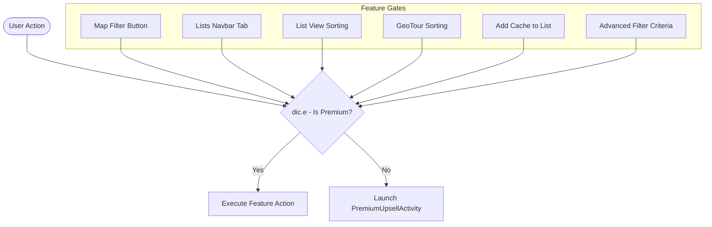

# Geocaching Architecture & Reverse Engineering Specification

## Overview

| Attribute                   | Specification                                                                                                                                  |
| --------------------------- | ---------------------------------------------------------------------------------------------------------------------------------------------- |
| **Application Name**        | Geocaching                                                                                                                                     |
| **Package Name**            | `com.groundspeak.geocaching.intro`                                                                                                             |
| **Supported Version**       | `10.24.0` (Morphe Compatibility: `10.24.0`, `minSdk` 31)                                                                                       |
| **Analyzed Version Code**   | `1541`                                                                                                                                         |
| **Target SDK**              | `36` (Android 16)                                                                                                                              |
| **Minimum SDK**             | `31` (Android 12)                                                                                                                              |
| **APK Format**              | APKM (`base.apk`, `split_config.arm64_v8a.apk`, per-language `split_config.<lang>.apk`, `split_config.xxxhdpi.apk`; 27 splits)                 |
| **Package Signing SHA-256** | `7f000458070a8272e5960f2b3c9d3348372f31b0e600c86af34fc06e85f8db8c`                                                                             |
| **Architecture**            | Native Android (Kotlin/Java); Jetpack Compose (`androidx.compose`), AndroidX Navigation, Room SQLite, Retrofit2, Google Maps SDK, MapLibre SDK |

Geocaching is Groundspeak's primary Android client for outdoor GPS geocaching. The app features map exploration, list management, offline cache packaging, trackable inventories, and social communication. While basic cache finding is permitted for free accounts, extensive features—including custom cache lists, advanced search filters (difficulty, terrain, cache size, attributes, favorite points), and sorting tools—are locked behind a Geocaching Premium subscription gate.

---

## Technology Stack & Components

- **UI Framework**: AndroidX Activities & Fragments integrated with Jetpack Compose (`androidx.compose`).
- **Main Shell**: `com.groundspeak.geocaching.intro.main.MainActivity` hosting `Navigation` graph and `BottomNavigationView`.
- **Map View Engine**: `GoogleMapFragment` and `MapLibreFragment` (`SharedMapViewModel`) rendering cache markers, trails, and attribution.
- **Lists Hub**: `com.groundspeak.geocaching.intro.listhub.ListHubFragment` (`ListHubViewModel`) managing user lists, offline bundles, and shared lists.
- **Filter Surface**: `com.groundspeak.geocaching.intro.geocachefilter.FilterScreen` (`FilterViewModel`) driving cache search filter criteria.
- **List View & Sorting**: `com.groundspeak.geocaching.intro.mainmap.listview.GeocacheListFragment` providing tabular cache lists and `SortByDialogFragment`.
- **User Session & Membership Model**: `Ldic;` holding account identity (username `w`), OAuth access token (`c`), and membership tier (`f`).
- **Upsell Barrier**: `com.groundspeak.geocaching.intro.premium.upsell.PremiumUpsellActivity` presenting marketing comparison flows when non-premium users access locked features.

---

## Membership Verification & Gate Architecture

User membership state is maintained in `Ldic;`:

- `this.f`: `1` = Basic (free), `2` = Charter Member, `3` = Premium Member.
- `Ldic;->e()Z`: Evaluates `3 == this.f || 2 == this.f`, returning `true` for Premium/Charter users and `false` for Basic users.

### 1. Map Filter Gate

In `GoogleMapFragment` (`com/groundspeak/geocaching/intro/mainmap/map/e.java`) and `MapLibreFragment` (`k.java`), clicking `menu_item_filter` queries the user session premium predicate `Ldic;->e()Z`. If false, `vr7.d` navigates to `ck4("Filter", false)`, launching `PremiumUpsellActivity`. If true, the app executes the coroutine navigating to `toFiltersNavGraph`.

### 2. Lists Hub Gate

In `ListHubFragment.onViewCreated`, the fragment evaluates the user session premium predicate `Ldic;->e()Z`. If non-premium, it launches `PremiumUpsellActivity` (`PremiumUpsellActivity$a->b(Context, String, I)`). `ListHubViewModel` also tracks premium state in a StateFlow governing collaborative and offline capabilities.

### 3. List Sorting Gate

In the list-view sort handler (`lg4`), clicking the sort header queries `Ldic;->e()Z`. If false, it launches the list-view premium upsell; if true, it displays `SortByDialogFragment` (`"sortByDialog"`). GeoTour sorting (`dk4`) branches on `Ldic;->e()Z` to display `geotourSortDialog` or launch upsell.

---

## Telemetry, Analytics & Advertising Pipelines

The application integrates extensive first-party and third-party tracking pipelines:

- **First-Party Analytics**: `com.groundspeak.geocaching.intro.analytics.firebase.AnalyticsRepo` (event dispatchers `a`, `b`, `e`–`m` plus the static `l` helper) and the webview bridge `AnalyticsWebInterface.logEvent`. The former `vm3`/`go3` helpers no longer exist; roughly 30 app classes now call `FirebaseAnalytics.logEvent` directly (65 call sites), so the Firebase layer is the effective choke point.
- **Firebase Analytics & Google Measurement**: `com.google.firebase.analytics.FirebaseAnalytics` (`logEvent`, `setUserProperty`, `setUserId`, …), `com.google.android.gms.measurement.*`.
- **Crash Reporting & Diagnostics**: `com.google.firebase.crashlytics.FirebaseCrashlytics` and internal wrapper `com.groundspeak.geocaching.intro.analytics.crashlytics.a`.
- **Performance & Messaging**: `com.google.firebase.perf.FirebasePerformance`, `com.google.firebase.inappmessaging.FirebaseInAppMessaging` (the latter pulls `com.google.developers.mobile.targeting.ClientSignals` protos through `FetchEligibleCampaignsRequest`).
- **Attribution & Ad Identifiers**: Google Play Advertising ID (`AdvertisingIdClient.getAdvertisingIdInfo`), consumed only by `com.google.android.gms.measurement.internal.*`. No ad-network SDK (AdMob, AppLovin, ironSource, Unity Ads) is present. The Play Install Referrer library and `finsky` referrer service classes ship in the DEX with no app call site.
- **Facebook SDK**: `com.facebook.appevents` (event dispatch funnels `b->e`/`b->d`), `com.facebook.internal.FetchedAppSettingsManager`. 10.24.0 has no `AppEventsLogger` public API class; only Facebook Login/Share is reachable from app code.
- **Marketing Automation**: `com.iterable.iterableapi.d` (`IterableApi` singleton field `x`) — `p` = `events/track`, `r/q/s/t/u/h` = in-app and push-open events, `m/n/b/o/l` = profile/device registration (`users/update`, `users/disableDevice`).
- **Usercentrics CMP**: `com.usercentrics.sdk.*`, dispatcher `com.groundspeak.geocaching.intro.permissions.usercentrics.a->j(UsercentricsAnalyticsEventType)`.
