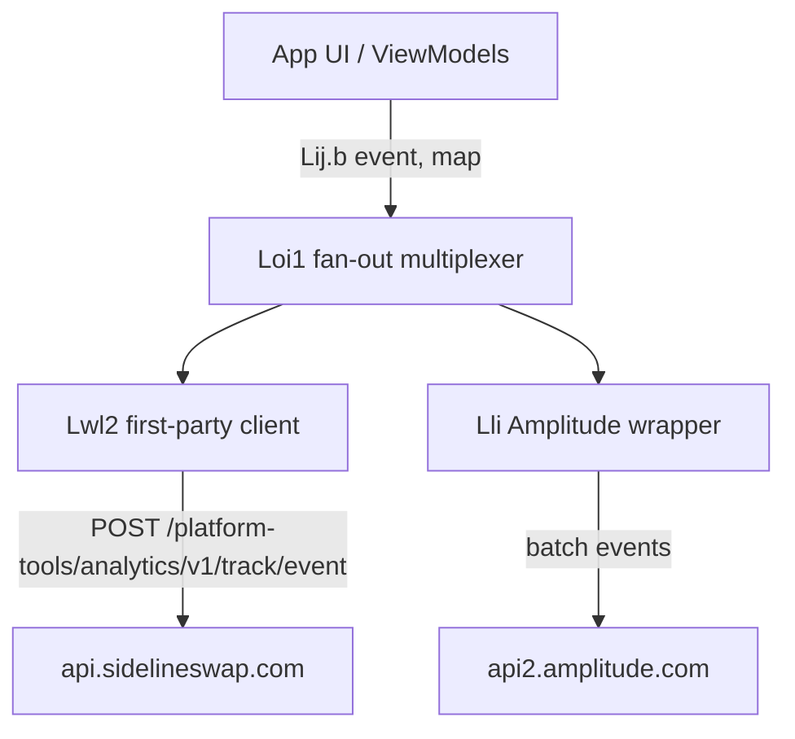

# SidelineSwap Architecture & Reverse Engineering Specification

## 1. Overview

| Attribute                   | Specification                                                                                       |
| --------------------------- | --------------------------------------------------------------------------------------------------- |
| **Application**             | SidelineSwap: Buy & Sell Gear (`com.sidelineswap.android`)                                          |
| **Supported version**       | `2.3.2` (version code `1251`), `minSdk` 24                                                          |
| **Target SDK**              | `36`                                                                                                |
| **Distribution format**     | XAPK (base + 18 config splits + arm64)                                                              |
| **Package signing SHA-256** | `e434334ea79d8702a5d023ce7bfae4da9fa5539796cb9e0ba515cb471528697f`                                  |
| **Architecture**            | Compose Material 3, Kotlin Multiplatform shared models, Ktor, Dagger/Hilt, R8 full-mode repackaging |

2.3.2 is a rewrite. The previous 1.52.0 release (AppCompat fragments, 80+ XML layouts, Retrofit,
Jetpack Navigation) shares **no bytecode descriptors** with it and is no longer supported.

### 1.1 Repackaging and obfuscation

- R8 moves the entire program (app + libraries) into the **default package**: 11,660 of 12,314
  classes are top-level files such as `Lwl2;`, `Luo7;`, `Ljd1;`. Only 12 names survive
  (`com.sidelineswap.app.{MainActivity,SlsApplication}`, `com.sidelineswap.core.{auth,network,ui/avatar}`,
  `com.sidelineswap.data.checkout.payments`).
- Vendor SDK packages keep real names where catalogued: `com/amplitude/**`, `com/iterable/**`,
  `com/braintreepayments/**`, `com/google/**`, `com/squareup/**`, `com/bumptech/**`.
  There is **no** `com/facebook/**` in this build.
- Grep by `androidx.*` class names is unreliable: Compose UI classes are renamed, and only a few
  Compose exception classes keep their original names.
- Consequence: patch anchors are build-specific. Every patch verifies `packageMetadata.versionName`
  against `2.3.2` and fails fast otherwise.

### 1.2 Navigation model

Kotlin Multiplatform shared code declares routes as kotlinx-serializable singletons/classes whose
FQNs survive as strings (`com.sidelineswap.core.navigation.*`, example: `InviteFriendsRoute`).
Implementations are obfuscated (`Liy3` for `InviteFriendsRoute`). The serializer registry is `Lzi3`;
routes are pushed through the navigator facade `Lrz` (`c(route)`). Compose destinations are built in
`Lf21` (per-tab) with content composables such as `Lw5` for `AccountTab`.

### 1.3 Networking

Ktor client against `https://api.sidelineswap.com` and `https://auth.sidelineswap.com`.
Other first-party endpoints observed: `/platform-tools/analytics/v1/track/event` (analytics),
`/seel_quote` (checkout insurance), ButterCMS content (`https://api.buttercms.com`).

---

## 2. Technology Stack

| Layer          | Components                                                                                                                                                              |
| -------------- | ----------------------------------------------------------------------------------------------------------------------------------------------------------------------- |
| Presentation   | Compose Material 3 (`androidx.compose.material3`, runtime, foundation, animation) hosted by a single `AbstractComposeView`; no app-owned XML layouts or color resources |
| Shared logic   | Kotlin Multiplatform with kotlinx.serialization (route + API models); route FQNs survive as strings                                                                     |
| DI             | Dagger/Hilt graph (`Lv8`, `Lz7`, `Lgxx` component builders)                                                                                                             |
| Networking     | Ktor client + OkHttp engine, kotlinx.serialization content negotiation                                                                                                  |
| Images         | Coil 3, Glide                                                                                                                                                           |
| Payments       | Braintree (drop-in, cards, PayPal, Venmo), Google Pay, Seel insurance quotes, Sezzle                                                                                    |
| Messaging/push | Firebase Cloud Messaging, Iterable SDK, Ada chat WebView                                                                                                                |
| Diagnostics    | Firebase Crashlytics, Firebase Analytics/GMS measurement, Firebase Sessions                                                                                             |
| Analytics      | First-party tracker fan-out, Amplitude (with Compose auto-capture)                                                                                                      |
| Storage        | Room, DataStore, AndroidX WorkManager                                                                                                                                   |
| Native         | 3 arm64 libraries from AndroidX graphics (`libsurface_util_jni`, `libimage_processing_util_jni`, `libandroidx.graphics.path`)                                           |

---

## 3. UI stack

- **Compose Material 3 only.** `MainActivity` hosts an `AbstractComposeView` subclass (`Ldi1`) and
  calls `setContent`; the root composable is `Lcq5;->a`, which calls the theme `Luo7;->a`.
- The app ships **no app-owned layouts or color resources**; `res/layout` and `res/values/colors.xml`
  contain library entries only. Dialogs/popups are library Compose hosts (`p15`/`m15`, `x82`/`u82`, `l06`).
- **WebViews** are the only native view hosts: `Ld9` (Ada chat, JS bridge `AdaAndroid`), `Lec`
  (Compose `AndroidView` factory for web pages), `Lb24` (in-app web dialog hosting `Lb34`), with the
  shared client `Lc34`. `androidx.webkit` is not packaged, so dark mode must be applied through
  reflection/JS (`DarkWebViewBridge`).

### 3.1 Theme pipeline

```text
Lcq5.a (root composable)
   └─ Luo7.a(...)                       theme entry
        ├─ vo7                         custom typography
        └─ Lod1.d(16 colors, mask)     ColorScheme factory
             └─ Lmd1                   ColorScheme (48 roles)
```

`Luo7;->a` supplies 16 roles from app constants and `Lod1;->d` fills the remaining 32 roles from the
Material light token table `Ljd1`:

| Role                     | Source                  | Shipped value |
| ------------------------ | ----------------------- | ------------- |
| primary                  | `Lho7;->a`              | `#253C32`     |
| onPrimary                | `Lgo7;->e`              | `#FFFFFF`     |
| secondary                | `Lho7;->b` ← `Lgd3;->b` | `#1DB847`     |
| onSecondary              | `Lgo7;->e`              | `#FFFFFF`     |
| tertiary                 | `Lho7;->c` ← `Lid6;->a` | `#7A70FF`     |
| onTertiary               | `Lgo7;->e`              | `#FFFFFF`     |
| background / surface     | `Ldo7;->a`              | `#FFFFFF`     |
| onBackground / onSurface | `Lgo7;->a` ← `Lzg0;->g` | `#242529`     |
| surfaceVariant           | `Ldo7;->b` ← `Lzg0;->a` | `#F5F5F7`     |
| onSurfaceVariant         | `Lgo7;->b` ← `Lzg0;->f` | `#78828F`     |
| error                    | `Lho7;->d` ← `Loh6;->b` | `#FA423C`     |
| onError                  | `Lgo7;->e`              | `#FFFFFF`     |
| outline                  | `Leo7;->a` ← `Lzg0;->c` | `#DADEE5`     |
| outlineVariant           | `Leo7;->b` ← `Lzg0;->b` | `#E6E9F0`     |

Notes:

- `Luo7;->a` also builds typography (`Lvo7`) and provides `MaterialTheme` (`Lex4`).
- The neutral ramp `Lzg0` backs `Ldo7`/`Lgo7`/`Leo7`; tonal ramps `gd3` (green), `id6` (purple),
  `oh6` (red), `bj5` (orange), `yg0` (blue) back semantic accents.
- `Ljd1` is read **only** by `Lod1`, making it a safe central lever for surface tokens.
- Brand accents are **compile-time constants**; only per-label colors (`ItemLabel.color`,
  `FacetItemLabel.color`) come from the API.
- There is no dark scheme and no `values-night` resources.
- Where the app authors a light surface outside the palette, it is patched separately:
  promo/free-shipping card `Lbd0` (`#F5FCF8`, border `#BFEBD2`) and selected row `Lbl1` (`#EAF8EE`).

### 3.2 Launch surfaces and system bars

- `Theme.Sls.Launch` (`res/values/styles.xml`, `res/values-v31/styles.xml`) sets a white
  `windowBackground` and (v31) `windowSplashScreenBackground`.
- Bars are transparent/edge-to-edge on API 26+. `MainActivity.onCreate` derives icon appearance from
  the system night flag and calls `Lmj9;->P(statusStyle, navStyle, window, decor, isDark, isDark)`;
  `Lt09;->c/b` toggle `SYSTEM_UI_FLAG_LIGHT_STATUS_BAR` / `LIGHT_NAVIGATION_BAR`.

---

## 4. Telemetry surface

The 1.52 `AnalyticsLogger`/`SidelineSwapClient`/`LogRepo` dispatcher is gone. 2.3.2 uses one tracker
interface `Lij;` with `a(String)`, `b(String, Map)` and `reset()`:



| Layer              | Implementation                                                                                              | Notes                                                                   |
| ------------------ | ----------------------------------------------------------------------------------------------------------- | ----------------------------------------------------------------------- |
| First-party        | `Lwl2;->b` → `TrackEventBody` → `Lx42` coroutine                                                            | Gated by a DI boolean                                                   |
| Amplitude          | `Lli` (constructor starts `amplitude-init`) over `Lji`                                                      | Includes Compose frustration/dead-click auto-capture                    |
| Firebase Analytics | `AppMeasurement;->logEventInternal`; `AppMeasurementReceiver/Service/JobService`, `SessionLifecycleService` | R8 stripped the `FirebaseAnalytics` event API; no app call sites        |
| Crashlytics        | wrapper `Lyb5` (user id), handler `Lqs1`, controller `dr1`                                                  | Handler delegates to the default handler, so crashes still terminate    |
| Iterable           | wrapper `Ls24`, SDK `Lb14`, push services                                                                   | App only sets identity/email                                            |
| Braintree FPTI     | `AnalyticsUploadWorker` / `AnalyticsWriteToDbWorker` (`c()Lin4;`), enqueued from `Lwi0`                     | Result types: `hn4` success, `fn4` failure, `gn4` retry                 |
| Advertising ID     | `Lie` → `Lhe` (renamed `AdvertisingIdClient`), callers `a6b`/`t8b`                                          | `google_analytics_adid_collection_enabled=false`; no `AD_ID` permission |
| Install referrer   | GMS `Llab;->S` → `Lc44` → `Lh2b`                                                                            | Play Store referrer service                                             |

Absent from this build: Facebook SDK, AdMob/AppLovin/Unity/IronSource/MoPub/Meta Audience, Sentry,
Datadog, Branch, AppsFlyer, Adjust, Mixpanel, Segment, Play Integrity, and Ktor request logging.

---

## 5. Referral / Invite Friends

- Route: `InviteFriendsRoute` → singleton `Liy3`; ViewModel `Lqy3` emits `Visited Invite Friends`.
- Account page: destination `Lf21` (`AccountTab`), content `Lw5`. The referral/invite row is guarded by
  `Lu6;->d:Lai6` and labelled with `screens_account_referralAmounts` (`0x7f140318`).
- In-app entry: navigation callback `Lh5` case `8` pushes `Liy3`.
- Deep links: `MainActivity.q(Intent)` → `Luz` → parser `Liz` (path `invite` → `Laz`) → `Lrz`.
  The parser's unmatched-path branch returns `null`.
- There is **no** account badge model in 2.3.2; only inbox `BadgeData` exists.

---

## 6. Startup sequence

```text
Application (SlsApplication)
 ├─ FirebaseInitProvider / androidx.startup
 ├─ Iterable + Crashlytics registrars
 └─ Dagger graph (Lv8/Lz7): Ktor clients, `Lij` tracker fan-out, repositories
MainActivity.onCreate
 ├─ edge-to-edge system bar setup (`Lmj9.P`, `Lmj9.p`)
 ├─ `Ldi1` Compose host + `setContent` (`Lcq5.a` root composable)
 └─ deep-link evaluation (`q(Intent)` → `Luz` → `Liz` → `Lrz`)
```

---

## 7. Gated and hidden features (audit result)

- `api_force_staging` is **Google Play services** internals (`DynamiteModule`), not app code.
- The app has a `STAGING` environment enum but DI hardcodes `PRODUCTION`; the only staging-aware
  string ("Discover isn't available on staging") is dead code. Switching it would target staging
  infrastructure, not unlock features.
- No debug/developer/test screen, no app `BuildConfig`, no hidden diagnostic route.
- Pro/Pro+, Autopilot, auto-reject and auto-price-drop are **server-authoritative**:
  `UserConfigurationData` carries `pro_seller`, `pro_plus_seller`, `features`; `kl4` turns them into
  UI gates, and mutations are sent to the server.

Conclusion: no client-side hidden menu or unlockable feature is viable, so no hidden-feature patch
exists for this app.
