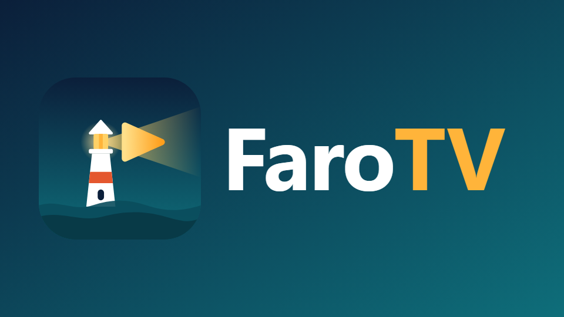

<p align="center">
  
</p>

# FaroTV Patches

Parches no oficiales para **YouTube en Android TV** (`com.google.android.youtube.tv`), compatibles con
[Morphe](https://morphe.software). *Unofficial patches for YouTube on Android TV, compatible with Morphe.*

FaroTV no es un producto de Google, YouTube ni del proyecto Morphe.

## ✨ Qué hace

- **MicroG-RE**: la app funciona sin Google Play Services y se instala junto al YouTube original (otro nombre de
  paquete). Inicio de sesión con código de activación (yt.be/activate).
- **Sección "FaroTV Parches" dentro de los Ajustes de YouTube** (y se oculta "Compras y membresías"), con interruptores:
  - Bloquear anuncios (de video y los videos "Patrocinado" de Inicio).
  - Ocultar las promociones de YouTube Premium.
  - SponsorBlock: salta los patrocinios, la autopromoción y los recordatorios de suscripción (y, si los activas,
    intros, créditos, avances, relleno y partes sin música), con un aviso "Se omitió" en pantalla.
  - Mostrar los "No me gusta" (Return YouTube Dislike): la cifra aparece al seleccionar el botón No me gusta.
  - Ocultar Shorts.
  - Ocultar las pestañas temáticas (Videojuegos, Noticias, Deportes…).
  - Personalizar el reproductor: ocultar los botones Canal, Descripción, Suscribirse, Me gusta / No me gusta,
    Comentarios, Preguntar (IA), Guardar, Súper gracias, Denunciar y Estadísticas, y la fila de videos relacionados.
  - Las opciones que necesitan reiniciar muestran el diálogo propio de YouTube con el botón **Reiniciar**.
- **Marca FaroTV**: nombre, icono, banner de Android TV, logo dentro de la app, pantalla de inicio (splash) propia,
  color de acento ámbar en lugar del rojo de YouTube (barras de progreso, distintivo "en vivo", etc.) (y se oculta "Obtener YouTube Premium").
  En "Acerca de" se ocultan "Ayuda" y "Enviar comentarios" y se muestran el autor y la versión de FaroTV Parches.
- **Instalador de MicroG-RE**: si falta, la app lo avisa con un panel al estilo de YouTube TV y lo descarga e instala
  desde GitHub (MorpheApp/MicroG-RE, versión oficial sin cambios). Al terminar, el botón "Reiniciar la app" la vuelve
  a abrir.
- **Arranque más ligero**: la app (y con ella MicroG-RE) ya no se abre sola en segundo plano cada vez que se enciende
  el TV, lo que en televisores con 1 GB de RAM retrasaba el arranque.
- **Spoof device** (desactivado por defecto): hace pasar el TV por un Chromecast, para televisores que YouTube
  marca como "no compatibles".

## 📦 Cómo usarlos

1. Instala [MicroG-RE](https://github.com/MorpheApp/MicroG-RE/releases) en el TV.
2. Añade este repositorio como fuente de parches en Morphe Manager:
   https://github.com/jair1c/farotv-patches

   <a href="https://morphe.software/add-source?github=jair1c/farotv-patches">
     
   </a>

3. Parchea tu propio APK de **YouTube for Android TV 7.32.300** (armeabi-v7a) e instálalo en el TV.

Este repositorio **no** distribuye el APK de YouTube, ni original ni parcheado.

## 🩹 Lista de parches

<!-- PATCHES_START EXPANDED -->
> **[v1.4.1](https://github.com/jair1c/farotv-patches/releases/tag/v1.4.1)**&nbsp;&nbsp;•&nbsp;&nbsp;`main`&nbsp;&nbsp;•&nbsp;&nbsp;7 patches total
<details open>
<summary>📦 YouTube for Android TV&nbsp;&nbsp;•&nbsp;&nbsp;6 patches</summary>
<br>

**Package name:** `com.google.android.youtube.tv`

**🎯 Supported versions:**

| 7.32.300 |
| :---: |

| 💊&nbsp;Patch | 📜&nbsp;Description | ⚙️&nbsp;Options |
|----------|----------------|-----------|
| [Custom branding](#custom-branding) | Changes the app name, icon, TV banner and the logo inside the app to FaroTV's (or another name). | • App name |
| [Disable start on boot](#disable-start-on-boot) | Keeps the app (and MicroG-RE) from starting in the background when the TV is switched on. |  |
| [FaroTV settings and scripts](#farotv-settings-and-scripts) | Adds a "FaroTV" section to YouTube's Settings with switches to hide Shorts, hide the topic tabs and block video ads. |  |
| [GmsCore support](#gmscore-support) | Redirects the app's Google Play Services calls to GmsCore (MicroG-RE). Requires MicroG-RE to be installed. Without it, YouTube for Android TV crashes because Google Play Services rejects DroidGuard for the new package name. |  |
| [Run without Google Play Services](#run-without-google-play-services) | Changes the package name so the patched app installs next to the original one, and keeps it running when Google Play Services rejects the new package name. Sign in with an activation code (yt.be/activate). |  |
| [Spoof device](#spoof-device) | Reports another TV model to YouTube, so it runs on TVs it calls "not compatible". Default: Google Chromecast. | • Brand<br>• Model<br>• Manufacturer<br>• Chipset |

</details>

<details open>
<summary>🌐 Universal&nbsp;&nbsp;•&nbsp;&nbsp;1 patch</summary>
<br>

| 💊&nbsp;Patch | 📜&nbsp;Description | ⚙️&nbsp;Options |
|----------|----------------|-----------|
| [Clone app](#clone-app) | Changes the app package name to allow installing the same app multiple times. By default ".morphe" is appended to the package name. Each cloned install must use a unique package name. Cloning does not work with all apps and using this patch may cause app crashes or other unexpected behavior. | • Package name<br>• Update permissions<br>• Update providers |

</details>

<!-- PATCHES_END -->

## 🛠️ Cómo funciona

YouTube para Android TV es una capa Android (Cobalt, basado en Chromium) que carga la web `youtube.com/tv`.
- Los parches de bytecode añaden MicroG-RE, mantienen activo el observador de navegación de Cobalt e inyectan los
  scripts de `extensions/extension/src/main/js/` en cada carga de página.
- Los scripts modifican las respuestas de InnerTube (`JSON.parse`) y registran los ajustes como ajustes propios de
  YouTube.
- "Spoof device" añade `libytvshim.so` (fuente en `native/ytvshim/`), que responde a las consultas de marca y modelo
  del motor nativo.

Más detalles en [docs/ANALISIS_YOUTUBE_TV.md](docs/ANALISIS_YOUTUBE_TV.md).

### Compilar

Requiere Java 21 y un token de GitHub con permiso `read:packages`:

```bash
GITHUB_ACTOR=<usuario> GITHUB_TOKEN=<token> ./gradlew buildAndroid
```

Resultado: `patches/build/libs/patches-<versión>.mpp`. Las versiones se publican solas con `release.yml` al subir
commits `feat:` / `fix:` a `dev` (prerelease) o `main` (estable).

## ⚖️ Licencia y créditos

GPLv3 (ver [LICENSE](LICENSE) y [NOTICE](NOTICE)).
- Partes de GmsCore support y Clone app vienen de [Morphe](https://github.com/MorpheApp/morphe-patches)
  y ReVanced.
- El sistema de scripts y ajustes se basa en [utv-runtime](https://github.com/DylanDuff/utv-runtime) (MIT, Dylan Duff).
- La inyección de JavaScript se basa en [ysamjo/morphe-patches](https://github.com/ysamjo/morphe-patches) (GPLv3).
