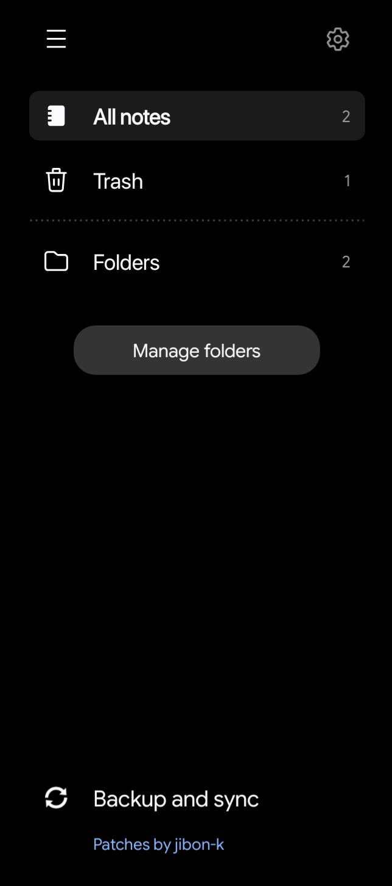
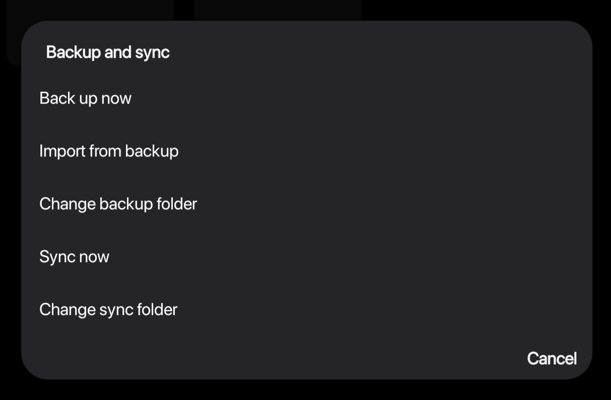
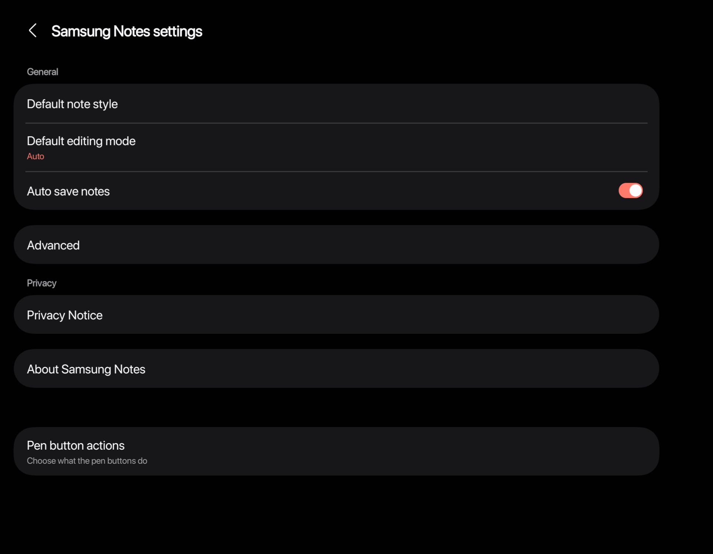
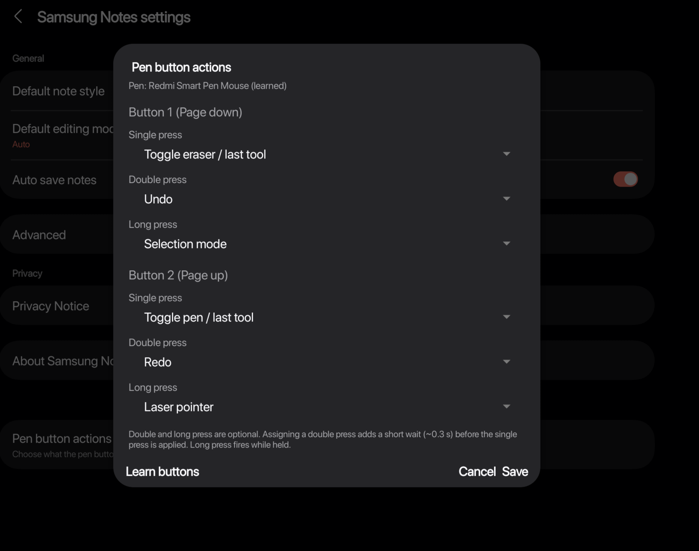
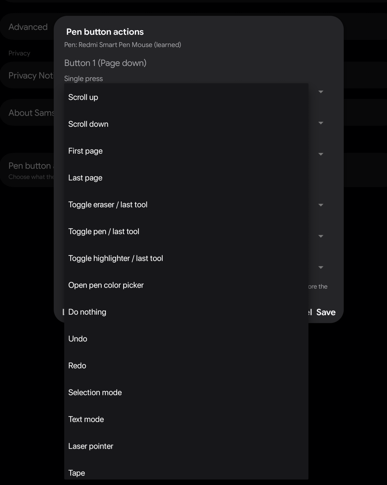
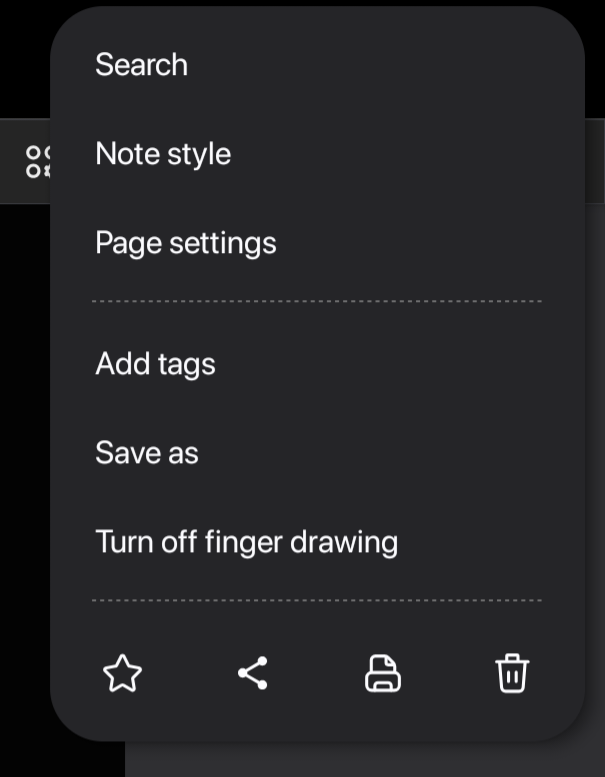

# Jibon's Notes patches

Morphe patches that run Samsung Notes on Android devices not made by Samsung, tested on a Redmi Pad 2 with Samsung Notes 4.4.48.15.

Add them to Morphe: https://morphe.software/add-source?github=jibon-k/notes-morphe-patches

## Features

- Samsung Notes installs and runs without One UI, including notes, handwriting, the pen toolbar and the colour picker.
- An active pen works like an S Pen, and fingers can draw and scroll.
- The pen's buttons run actions such as undo, eraser, pen colour or page scroll on single, double and long press. Learn buttons in Settings records any pen's two buttons.
- Notes back up to a folder you choose and can be imported back.
- Notes sync between devices through a shared folder (experimental).
- Samsung account, cloud and Galaxy AI features that can't work outside Samsung's own app are hidden, and their background services are turned off.
- The app is named "Notes" with its own icon and accent colour, both changeable when patching.

## Screenshots

<table>
  <tr>
    <td></td>
    <td></td>
  </tr>
  <tr>
    <td>Side menu with Backup and sync</td>
    <td>Backup and sync</td>
  </tr>
  <tr>
    <td></td>
    <td></td>
  </tr>
  <tr>
    <td>Settings with Pen button actions</td>
    <td>Pen button actions with learned buttons</td>
  </tr>
  <tr>
    <td></td>
    <td></td>
  </tr>
  <tr>
    <td>Actions for a pen button</td>
    <td>Note menu with finger drawing</td>
  </tr>
</table>

## Backup and sync

Backup to folder adds a Backup row at the bottom of the side menu. Back up now saves every note that changed since the last backup as an `.sdocx` file, the same file Samsung Notes shares, in a folder you pick. Import from backup adds the notes from that folder that the app doesn't have, for instance after a reinstall or on a new device, and leaves the notes it already has alone.

Folder sync is off by default, so turn it on when patching. It uses a second folder that every device shares. Each device writes its list of notes and every changed note into that folder, then brings in the other devices' new notes, edits and deletions. It runs when you tap Sync now and each time the app opens. When the same note was edited on two devices, both versions are kept and one shows up as a copy.

The app doesn't move the folder between devices itself. Use [Syncthing](https://syncthing.net) to keep the sync folder the same on your phone, tablet and PC, and every device with these patches can sync its notes through it.

## Patches

<!-- PATCHES_START -->
> **[v1.0.0](https://github.com/jibon-k/notes-morphe-patches/releases/tag/v1.0.0)**&nbsp;&nbsp;•&nbsp;&nbsp;`main`&nbsp;&nbsp;•&nbsp;&nbsp;12 patches total

📦 Samsung Notes&nbsp;&nbsp;•&nbsp;&nbsp;12 patches

 

**🎯 Supported versions:**

| 4.4.48.15 |
| :---: |

| 💊&nbsp;Patch | 📜&nbsp;Description | ⚙️&nbsp;Options |
|----------|----------------|-----------|
| [Backup to folder](#backup-to-folder) | Adds a Backup row to the bottom of the side menu: backs up changed notes as .sdocx files to a folder you choose (any folder, including SD card or a synced folder). |  |
| [Branding](#branding) | Your own app name, the Notes pen logo as launcher icon, and an accent colour in place of Samsung's blue. | • App name • Accent colour (light theme) • Accent colour (dark theme) |
| [Crash fixes](#crash-fixes) | Reports no iris scanner, and finds the pen settings layouts and colour palettes after a package rename (otherwise the colour picker crashes). |  |
| [Finger drawing](#finger-drawing) | Turns off "S Pen only" by default (once, at first start), so fingers can draw and scroll. Without it, the app assumes an S Pen and ignores finger input in notes. |  |
| [Folder sync](#folder-sync) | Experimental. Syncs notes with other devices through a shared folder (for example one kept in sync by Syncthing): "Sync now" in the Backup menu, and automatically each time the app opens. |  |
| [Hide Samsung account features](#hide-samsung-account-features) | Hides Samsung Cloud sync, sign-in prompts, sharing, Galaxy AI and note locking. They need a Samsung-signed app; this matters mostly on Samsung phones, where the account exists. |  |
| [Hide camera](#hide-camera) | Removes Insert > Camera from the editor. |  |
| [Manifest compatibility](#manifest-compatibility) | Makes One UI-only libraries optional (otherwise the install fails), gives foreground services a type (Android 14+ crashes without one) and drops multiArch. |  |
| [Pen button actions](#pen-button-actions) | Lets the pen's two buttons run actions (pen, eraser, undo, colour picker, page up/down...) with single, double and long press. Set up in Settings > Pen button actions. Works with pens whose buttons send key presses (the Redmi Smart Pen sends Page Up / Page Down). | • Upper button key code • Lower button key code • Pen device name |
| [Samsung framework compatibility](#samsung-framework-compatibility) | Adds stand-ins for One UI framework classes and redirects calls to One UI-only methods and fields, so the app runs on non-Samsung Android. |  |
| [Treat as pen device](#treat-as-pen-device) | Turns on the app's pen features (pen toolbar, hover) on a device with an active pen that isn't a Samsung S Pen. Leave it off on devices without an active pen. |  |
| [Turn off Samsung cloud components](#turn-off-samsung-cloud-components) | Turns off the Samsung account, cloud sync, push and co-editing services and receivers. They can't work in a patched app and would only run in the background. |  |

<!-- PATCHES_END -->

## Author

Jibon Krishna Joy, [GitHub](https://github.com/jibon-k)

These patches are for use with Morphe, and they are not made by or affiliated with the Morphe project or Samsung. No Samsung code is included, because the patches change an APK you provide.
