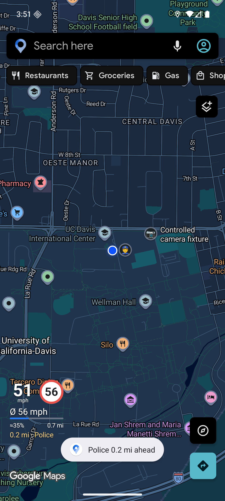
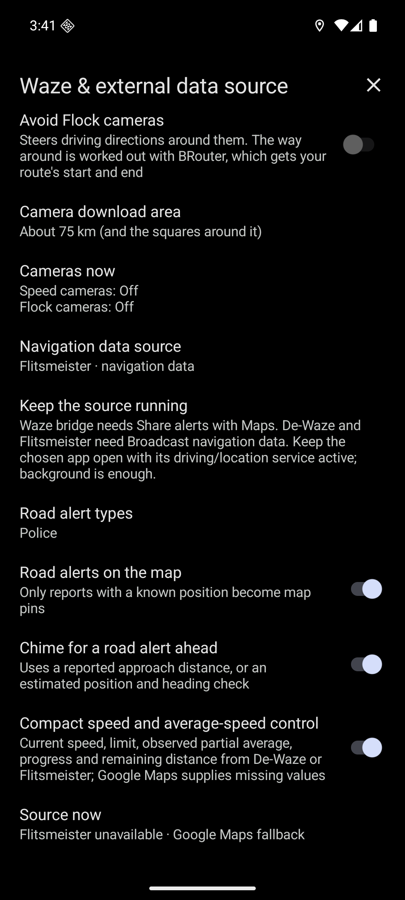
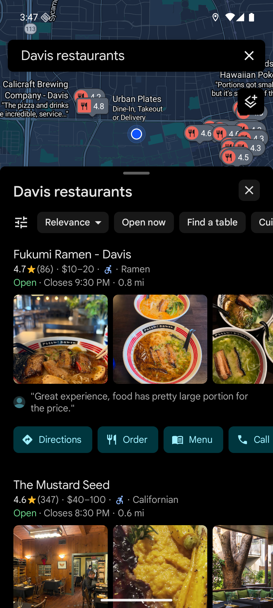

# Google Maps port and validation

The Maps source is imported from [bearinmind patches](https://github.com/bearinmindcat/morphe-patches), checkout `bd522fe` (v2.8.3), preserving the `org.ungoogled` namespaces, GPL licence and upstream attribution. It is integrated into the Dutch App Patches bundle rather than distributed as a second patch source.

Target: `com.google.android.apps.maps` 26.43.05.1002020710, version code 1068844719, standalone APK, minimum Android 10 (API 29).

Supplied input SHA-256: `81506a2c54fc9a8faca34c18af7619d9c9d26cbfbe799b66884a59ac17791004`.

REA package inspection evidence `ev_f21f97d5dcba22992f2bcb4c0d54e94446579cc80996a8e68bf745ae2fecc6bd` confirms the package/version/SDK declarations and counts 68,600 classes and 8,875 resources. This static inspection does not establish patch applicability, installability or runtime behavior.

## Included scope

The source port retains all 30 upstream Maps patches, including the two alternative microG builds and optional media-notification integration. The bilingual user catalogues list the actual patch names and patch-time defaults: [English](../site/en/apps/google-maps.md), [Nederlands](../site/nl/apps/google-maps.md).

`Waze alerts` also consumes the existing Dutch App Patches navigation broadcast protocol from Waze and Flitsmeister. Its UI reuses the compact Vela speed-limit/current-speed/partial-average display while keeping provider selection and Maps bindings local to Maps.

The legacy `Share alerts with Maps` bridge remains a separate source choice. Extended providers require `Broadcast navigation data`. Data from the selected provider is not mixed with another provider or with legacy bridge values. Missing or expired speed/limit fields can use fresh native Maps values. Partial averages are limited to observed zone coverage and clear when observations expire or the source/zone changes. Only reports with known coordinates become pins. Approach warnings use a supplied distance where available or an explicitly estimated GPS/heading distance; route membership is not established by that estimate.

## Static extension compatibility audit

Target resource identifiers were checked against the supplied APK with Android build-tools 36.1.0 `aapt2 dump resources`, corroborated by the target’s generated R source. Updated 17 drawable/color references in UiScreen, SaveSheet, YouActivity and MediaApps, plus the Kotlin power-saving battery icon. Google Sans font IDs remain unchanged. Shapes’ FAB face/shadow IDs were independently identified as `0x7f0807b2`/`0x7f0807b3` and passed to the telemetry implementation.

The target photo summary (`augf.Y(cqcg)`) reads public String field `cqcg.m`; the dynamically injected photo-field name remains compatible with `SavedPlaces.photoUrls`. CronetProvider retains its reflected `getAllProviders(Context)`, `getName()` and `isEnabled()` APIs; Proxy/ProxyOptions retain their compile-time method signatures. The old provider-selection flag is absent because target `getAllProviderInfos` already includes the platform HttpEngine provider. The patch verifies that native path structurally instead of dropping no-Play-services support. Runtime availability still depends on Android’s platform engine.

The platform GPS-only dispatcher is `ajeb.c`: GPS listener `l`, network listener `m`, passive listener `n`, Looper `z`, listener type `ajea`. The network fallback patch now starts `m` using `z` instead of stopping it. Patch-application and runtime evidence remain separate gates below.

The home screen resolver is now `afsl.bb`, with `agay` state and `pfc` sheet values. Its merge point still overwrites `v1`, while the selected state is in `v9`. The bottom-strip binding is `agav.u(ViewGroup)` to `afsl.dc:byzw`; the loaded holder remains `v1` and `v2` is overwritten by the following stock paths. The place header remains structurally identifiable (`ascv` with directory card `asft`), but the compiler now shares return blocks with `GOTO` for KBYG, directory and review-summary availability. The Ask Maps place action’s Boolean visibility answer is identified by its field-read structure rather than its changed method name. These observations were checked against target DEX instructions, independently of JADX’s control-flow formatting.

## Verified behavior

All 30 Maps controls are present with the upstream patch defaults. Four full profiles cover the 27 defaults, both microG alternatives and optional media following. Every output rebuilds, verifies its v2 signature, and passes emitted-reference existence/access checks and native speed/limit entry-hook checks. Exact input and output hashes, metadata and test counts are recorded in [validation.json](validation.json).

The Maps extension passes 42 tests. The full release Gradle checks pass alongside 414 Python regressions (45 skipped), 47 release integration tests, 15 Medium tooling tests, the private ABI audit and documentation checks.

On an Android 16 arm64 emulator, the actual patched app launches, loads map data, opens the account and provider settings, returns normal submitted search results, opens place details, saves and unsaves a local place, and builds route previews. Controlled publishers installed under the supported provider packages exercise real Android sender identity and the actual Maps receiver. Eight standalone replay cases pass: unknown values, Flitsmeister zone data, measured Waze zero, malformed alerts, clear, legacy Waze sharing, publisher-death expiry and a false source claim. Native injected pin counts clear to zero for malformed/clear/expiry/spoof cases; legacy and the active zone each inject two items. A ninth check keeps the same Maps process alive while Waze zone data is explicitly cleared; the partial average, zone and native pins disappear. No fatal, verifier or native access errors remain in these runs.

The active replay visibly renders police and camera pins, a current speed and limit, observed partial average, estimated progress and remaining distance, plus the ahead-alert note. The native map generator consumes those items; this is stronger evidence than the Java adapter list alone.

These are controlled consumer replays, not native provider road recordings. The existing Waze and Flitsmeister producers use the same protocol action/field contract and support requests from Maps without producer changes. Physical driving, physical Android Auto displays, actual report availability, microG account sign-in and provider accuracy are not established by these tests. Coordinate-only warnings remain estimated by heading, without proven route membership.

## Publication

Published in [Dutch App Patches v1.25.0](https://github.com/johninnl/nl-morphe-patches/releases/tag/v1.25.0), from source `f57abb97c9eb11de5792dc50d66c3bab62d4489a`. The release workflow succeeds under `johninnl`; Morphe's stable discovery manifest points to the uploaded bundle. Its MorpheSig1 Ed25519 signature verifies against the repository public key.

All 184 Maps/shared compiled class and extension entries in the downloaded release are byte-identical to the locally validated bundle. The release bundle SHA-256 is `92263759a8a6694409cff395098d78a04e70da1091e3cc073bfb8f7841af9ee7`. The installed test APK and the current validation APK differ in outer ZIP/signing layout; all 9,299 uncompressed ZIP entries are byte-identical. Their separate whole-file hashes and canonical payload hash are retained in `validation.json`.

## Release audit

Keep generated versions and release metadata under semantic-release. Before committing or pushing, run the repository's required login/effective-author/effective-committer/history identity checks. Only the `johninnl` identity is permitted.

The release must contain the Maps extension and 30 Maps controls in the same published bundle as existing app patches. A source copy, successful compilation, a generated catalogue, or a green documentation job alone does not prove that delivery.
