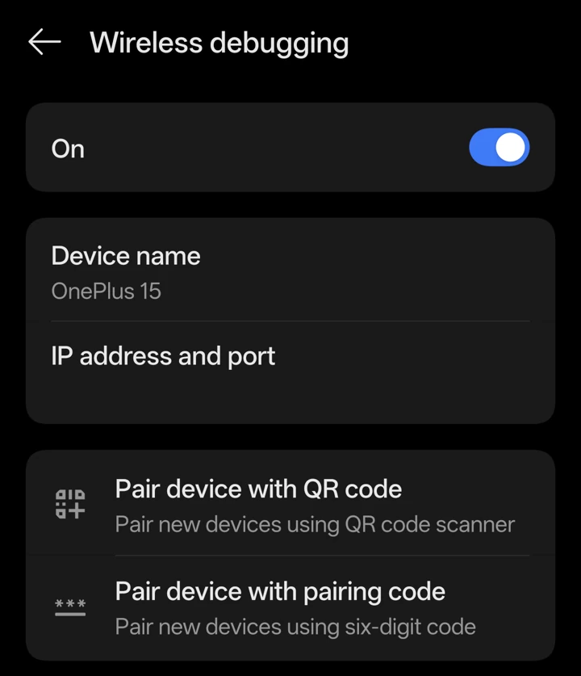
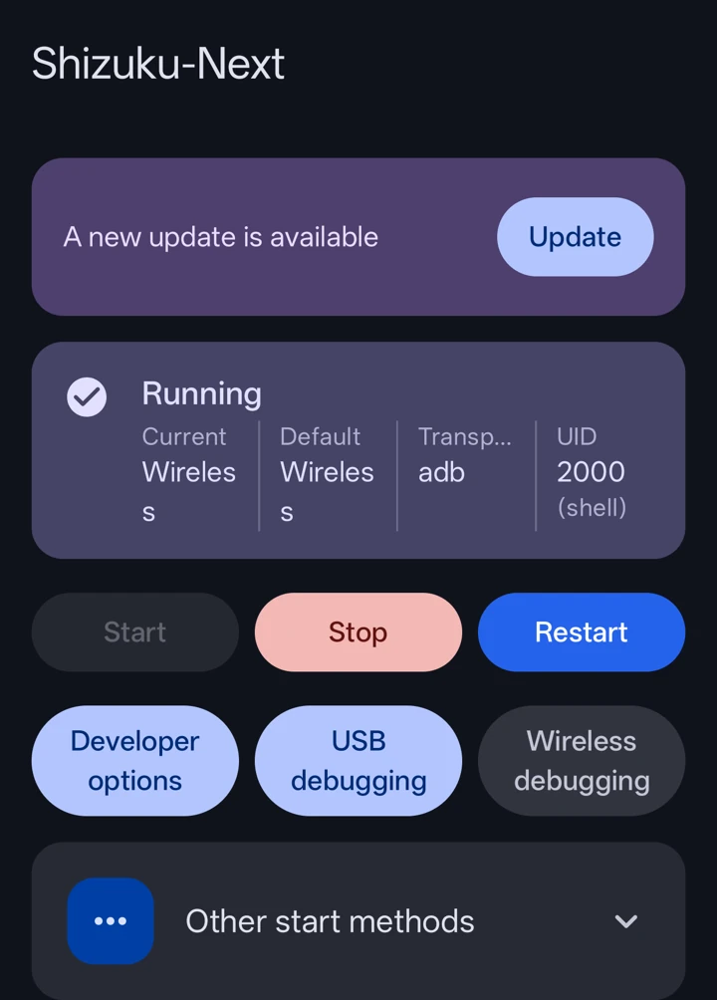
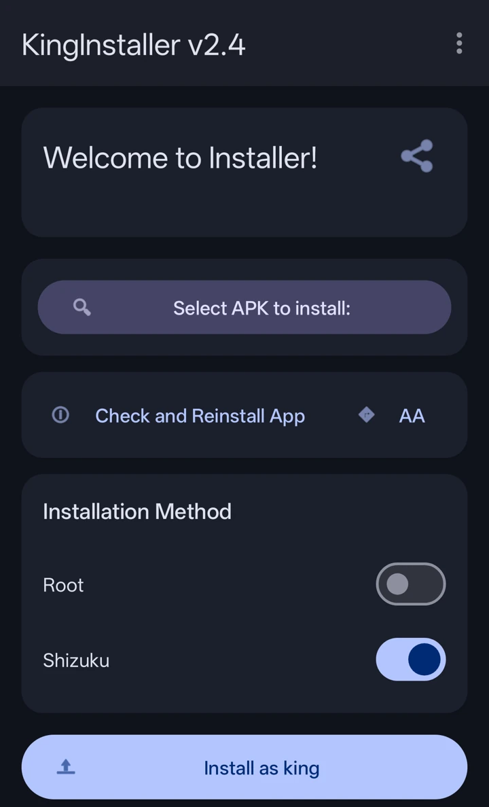
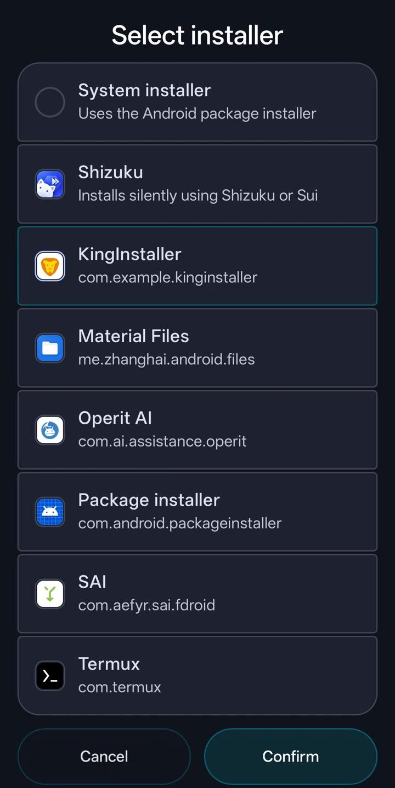
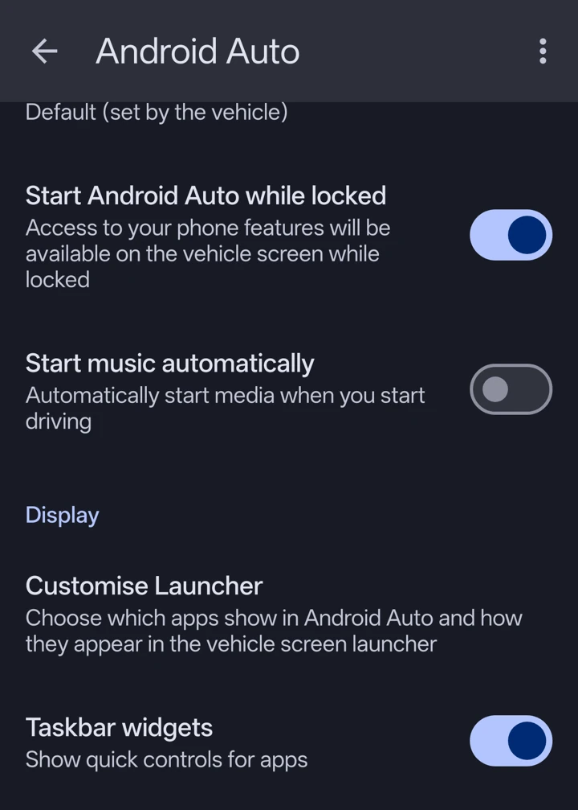
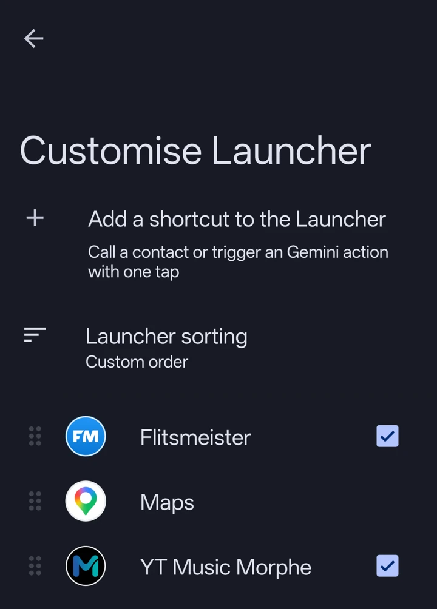

# Waze en Flitsmeister in Android Auto krijgen

Werkt de gepatchte app op je telefoon, maar zie je hem nergens op je autoscherm? Volg dan deze stappen voor [Waze](../apps/waze.md) of [Flitsmeister](../apps/flitsmeister.md). Je doet dit op je telefoon, voordat je verbinding maakt met de auto.

Je patcht de app in Morphe Manager, start Shizuku-Next en installeert het resultaat via KingInstaller. Voor deze route is geen root nodig. Sommige telefoonmerken beperken deze mogelijkheid; kijk bij [problemen oplossen](#als-je-vastloopt) als de installatie mislukt.

## Waarom zijn die extra stappen nodig?

Android Auto controleert hoe een app is geïnstalleerd. Een app kan prima werken op je telefoon en toch ontbreken in de applijst van je auto. Dat kan gebeuren als je de gepatchte APK met je bestandsbeheerder of de gewone Morphe-installer installeert.

KingInstaller installeert de gepatchte APK met Google Play Store als geregistreerde installatiebron. Shizuku geeft KingInstaller de extra Android-toegang die daarvoor nodig is. Het blijft jouw gepatchte app; Google heeft dat bestand niet gecontroleerd of ondertekend.

Bij muziekapps kan het anders werken. Android Auto heeft een ontwikkelaarsinstelling **Onbekende bronnen** voor media-apps, berichtmeldingen en apps voor gebruik tijdens het parkeren. Volgens de [documentatie van Google](https://developer.android.com/training/cars/testing#unknown-sources) geldt die uitzondering niet voor apps die met de Android for Cars App Library zijn gebouwd. Het vinkje is dus geen algemene oplossing voor navigatie-apps. Gebruik voor gepatchte Waze en Flitsmeister de installatiestappen hieronder.

## 1. Download de hulpmiddelen en patch de app

1. Installeer [Morphe Manager](https://morphe.software/) als je die nog niet hebt.
2. Download [Shizuku-Next](https://github.com/rushiranpise/Shizuku-Next/releases/latest) en [KingInstaller](https://github.com/fcaronte/KingInstaller/releases/latest). Klap op elke releasepagina **Assets** open en download het `.apk`-bestand, niet **Source code**. Open beide downloads om ze te installeren. Geef je browser of bestandsbeheerder toestemming als Android vraagt of die dit bestand mag installeren.
3. Gebruik de originele versie op de pagina van [Waze](../apps/waze.md) of [Flitsmeister](../apps/flitsmeister.md). Selecteer het volledige originele APKS-/APKM-archief in Morphe en pas je patches toe. Laat bij Flitsmeister **Fix PairIP startup** aan.
4. Laat na het patchen het resultaatscherm openstaan. In stap 4 installeer je vanaf dat scherm.

Heb je al een werkende Shizuku-installatie? Die kun je houden. Je hoeft niet over te stappen naar Next. Verschillende Shizuku-uitvoeringen kunnen andere ondertekeningssleutels gebruiken; lees de [Shizuku-handleiding](shizuku.md) voordat je overstapt.

## 2. Start Shizuku-Next

Shizuku is een hulpdienst waarmee apps die jij toestemming geeft taken kunnen uitvoeren waar gewone Android-apps niet bij kunnen. Hier geef je KingInstaller die toegang om je navigatie-app op de juiste manier te installeren.

Vanaf Android 11 kun je dit op de telefoon via wifi instellen:

1. Verbind je telefoon met wifi.
2. Open **Instellingen**, zoek **Buildnummer** (vaak onder **Over het apparaat → Versie**) en tik er zeven keer op. Vul je schermvergrendelingscode in als daarom wordt gevraagd. Hiermee zet je de **Ontwikkelaarsopties** van je telefoon aan.
3. Open **Ontwikkelaarsopties → Draadloze foutopsporing** en zet dit aan. Geef zo nodig toestemming voor je huidige wifinetwerk. Dit zijn de instellingen van je telefoon, los van de ontwikkelaarsinstellingen van Android Auto.
4. Open Shizuku-Next en volg de instructies voor draadloos koppelen. Geef toestemming voor meldingen als daarom wordt gevraagd, zodat je de koppelcode kunt invoeren.
5. Tik bij **Draadloze foutopsporing** op **Apparaat koppelen met koppelcode**. Houd dat venster open terwijl je de code via de koppelmelding van Shizuku invoert, of volg de automatische koppelaanwijzing van Next als die verschijnt.
6. Ga terug naar Shizuku-Next en tik op **Start**. Ga pas verder als het beginscherm **Running** of **Actief** aangeeft.

{ .aa-screenshot loading=lazy }

*Tik op Pair device with pairing code (Apparaat koppelen met koppelcode). Het netwerkadres is afgeschermd op deze screenshot.*

{ .aa-screenshot loading=lazy }

*Controle: Shizuku geeft aan dat de dienst draait. Alleen de Shizuku-app installeren is niet genoeg.*

Lukt het koppelen niet, of heb je Android 10 of ouder? Volg de [Shizuku-handleiding](shizuku.md), met daarin ook de methode via een computer.

## 3. Geef KingInstaller toegang tot Shizuku

1. Open KingInstaller.
2. Zet de schakelaar **Shizuku** aan (in sommige versies **Shizuku trick**).
3. Vraagt Shizuku of KingInstaller toegang mag krijgen? Tik op **Toestaan** (**Allow**).
4. Laat **Root** uit. Geef bestandstoegang als daarom wordt gevraagd, zodat KingInstaller je gepatchte APK kan lezen.

{ .aa-screenshot loading=lazy }

*Controle: Shizuku staat aan in KingInstaller voordat je de navigatie-app installeert.*

## 4. Installeer de gepatchte APK via KingInstaller

1. Ga terug naar het scherm waar Morphe meldt dat het patchen klaar is en tik op **Installeren** (**Install**).
2. Kies **KingInstaller** in de lijst met installers en tik op **Confirm** (Bevestigen). De afzonderlijke optie **Shizuku** in Morphe is een andere installer; kies voor deze handleiding KingInstaller.
3. Controleer of je gepatchte APK in KingInstaller geselecteerd is en Shizuku nog aanstaat.
4. Tik op **Install as king** en bevestig **Installeren** of **Bijwerken** in het installatievenster van Android. Wacht tot de installatie klaar is.

{ .aa-screenshot loading=lazy }

Staat KingInstaller niet in de lijst? Sla de **gepatchte APK** op vanuit Morphe. Open KingInstaller, tik op **Select APK to install** (of **Select file**) en kies die opgeslagen APK. Ga daarna verder met **Install as king**. Het APKS-/APKM-archief dat je downloadde was het invoerbestand voor het patchen; dat kies je hier dus niet.

Heb je de gepatchte app al op een andere manier geïnstalleerd? Probeer die via KingInstaller bij te werken met dezelfde gepatchte APK. Houd Morphes ondertekeningssleutel voor toekomstige updates gelijk.

Meldt Android een ondertekeningsconflict of een conflict met een bestaand pakket? Dan staat mogelijk de originele app van de uitgever nog op je telefoon, of een gepatchte versie met een andere sleutel. Bewaar eerst de gegevens die je wilt houden voordat je die versie verwijdert. Verwijderen kan appgegevens wissen. Lees [installeren en ondertekenen](install.md#4-installeer-en-werk-bij).

## 5. Controleer de applijst van Android Auto

1. Open Waze of Flitsmeister één keer op je telefoon. Rond de eerste instellingen af en geef de rechten die de app nodig heeft voor navigatie.
2. Open de **Instellingen** van je telefoon en zoek naar **Android Auto**. Open het resultaat met de Android Auto-instellingen.
3. Tik op **Launcher aanpassen** (**Customise Launcher** op de screenshots). Zoek **Flitsmeister** of **Waze** en zet het vinkje aan. Heb je Wazes patch **Change app name** toegepast? Zoek dan op de gekozen naam; standaard is dat **De-Waze**.
4. Verbind je telefoon opnieuw met de auto en controleer de applijst op het autoscherm. Doe dit terwijl je geparkeerd staat.

{ .aa-screenshot loading=lazy }

{ .aa-screenshot loading=lazy }

*Staat de app helemaal niet in deze lijst? Ga dan terug naar stap 2 tot en met 4. Het vinkje verschijnt pas als Android Auto de installatie accepteert.*

## Updates en opnieuw opstarten

Patch bij elke app-update opnieuw het ondersteunde originele bestand en installeer het resultaat via KingInstaller met Shizuku aan. Een gewone installatie kan de geregistreerde installatiebron weer veranderen.

Controleer na het herstarten van je telefoon of Shizuku draait voordat je weer iets via KingInstaller installeert. Je moet de dienst mogelijk opnieuw starten. Shizuku wordt hier gebruikt voor de installatie; je hoeft KingInstaller voor deze handleiding niet open te laten tijdens het rijden.

## Als je vastloopt

| Wat zie je? | Wat kun je doen? |
| --- | --- |
| De Android Auto-instellingen openen niet | Open in de telefooninstellingen Apps → Android Auto. Staat de app uitgeschakeld? Tik op Inschakelen en open de Android Auto-instellingen opnieuw. |
| Shizuku is geïnstalleerd, maar meldt niet dat de dienst draait | Rond het koppelen af en tik op Start. Controleer wifi en Draadloze foutopsporing. Zie de [Shizuku-handleiding](shizuku.md). |
| KingInstaller kan Shizuku niet gebruiken | Start Shizuku eerst. Controleer in Shizuku onder Apps of KingInstaller toegang heeft. Open KingInstaller opnieuw en zet Shizuku aan. |
| De app werkt op de telefoon, maar ontbreekt bij Launcher aanpassen | Installeer opnieuw via KingInstaller met Shizuku aan. Controleer of je de gepatchte APK koos en de installatiebevestiging van Android afrondde. |
| De app staat in de lijst, maar ontbreekt in de auto | Vink hem aan bij Launcher aanpassen en verbind je telefoon opnieuw met de auto. Kijk ook of Waze onder een andere naam staat. |
| De installatie mislukt op Xiaomi, POCO of Redmi | KingInstallers [compatibiliteitsinformatie](https://github.com/fcaronte/KingInstaller) beschrijft beperkingen van MIUI/HyperOS. De Shizuku-route zonder root kan daar mislukken. Volg het advies voor je toestel; blijf de navigatie-app niet verwijderen. |
| De app verschijnt, maar crasht, kan niet inloggen of toont geen kaart | Dat is een afzonderlijk appprobleem. Bekijk de app-pagina en [meld het probleem](troubleshooting.md#meld-een-probleem). Zichtbaarheid in de launcher bewijst niet dat elke autofunctie werkt. |

Vermeld bij een ontbrekende app je telefoonmodel, Android- en Android Auto-versie, appversie, KingInstaller-versie, of Shizuku draaide en welke installer je in Morphe koos. Wis de gegevens van Android Auto of je navigatie-app niet alleen om de lijst te vernieuwen.

De screenshots komen van een Android 16-telefoon met Engelse schermteksten. Namen en schermen kunnen op jouw telefoon verschillen. Je ziet KingInstaller 2.4, Shizuku-Next 14.0.30-next en Morphe Manager 2.3.0.
