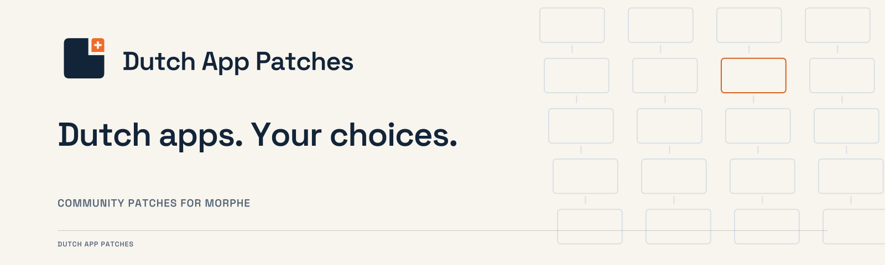

  <picture>
    <source media="(prefers-color-scheme: dark)" srcset="docs/site/assets/brand/readme-dark.png">
    
  </picture>

  
  
  

# Dutch App Patches

Community patches for Morphe, with clear explanations of what Dutch Android apps collect and what each patch changes. Independently maintained; not affiliated with Morphe or the app publishers.

  <a href="https://morphe.software/add-source?github=johnneerdael/dutch-applications-patches"><b>Add to Morphe</b></a> &nbsp;·&nbsp;
  <a href="https://buzzheavier.com/gnmtadlpn31g"><b>Download original apps</b></a> &nbsp;·&nbsp;
  <a href="https://morphe-patches.neerdael.nl/"><b>Nederlandse documentatie</b></a> &nbsp;·&nbsp;
  <a href="https://morphe-patches.neerdael.nl/en/"><b>English documentation</b></a> &nbsp;·&nbsp;
  <a href="https://github.com/johnneerdael/dutch-applications-patches/releases"><b>Releases</b></a>

> **[Download original app files](https://buzzheavier.com/gnmtadlpn31g)**
>
> Get the original APK, APKM or APKS file for patching in Morphe Manager. [Per-app downloads and supported versions](https://morphe-patches.neerdael.nl/en/guides/downloads/).

## Quick start

1. Install [Morphe Manager](https://morphe.software/).
2. [Add this patch source](https://morphe.software/add-source?github=johnneerdael/dutch-applications-patches).
3. [Download the original file for your app](https://morphe-patches.neerdael.nl/en/guides/downloads/), review the patches and apply them in Manager.

Leave **Use pre-release patches** off for stable releases. Enable it for testing builds from `dev`. [Full installation guide](https://morphe-patches.neerdael.nl/en/guides/install/).

## Start here

- **Use the patches:** [install](https://morphe-patches.neerdael.nl/en/guides/install/) and [choose controls](https://morphe-patches.neerdael.nl/en/guides/choose-patches/).
- **Understand your app:** browse [weather](https://morphe-patches.neerdael.nl/en/apps/weather/), [news](https://morphe-patches.neerdael.nl/en/apps/news/) or [traffic and navigation](https://morphe-patches.neerdael.nl/en/apps/mobility/) [entertainment](https://morphe-patches.neerdael.nl/en/apps/entertainment/) or [other apps](https://morphe-patches.neerdael.nl/en/apps/other/).
- **Understand tracking:** follow [an event from a tap to a server](https://morphe-patches.neerdael.nl/en/learn/how-tracking-works/), learn [how identifiers connect activity](https://morphe-patches.neerdael.nl/en/learn/identifiers/), and read [tracker profiles](https://morphe-patches.neerdael.nl/en/trackers/).
- **Check the claims:** read [our evidence method](https://morphe-patches.neerdael.nl/en/reference/methodology/), [external research](https://morphe-patches.neerdael.nl/en/reference/sources/) and the [technical destination register](docs/TRACKING_DESTINATIONS.md).

The bilingual Markdown source is in [docs/site](docs/site). App pages distinguish documented SDK capabilities, inspected code paths, configured destinations and runtime observations. Device approval establishes the reported functionality; it does not establish a complete traffic audit.

## Supported apps

<!-- PATCHES_START SUMMARY -->
**Patch bundles:** [Stable v1.19.2](https://github.com/johnneerdael/dutch-applications-patches/releases/tag/v1.19.2) · [Pre-release v1.20.0-dev.4](https://github.com/johnneerdael/dutch-applications-patches/releases/tag/v1.20.0-dev.4) · 28 apps

### Weather

| App | Changes | Target app versions | Input | Patches |
| --- | --- | --- | --- | --- |
| [Buienalarm](https://morphe-patches.neerdael.nl/apps/buienalarm/) | Ads · Tracking · Prompts · Compatibility | 4.32.0 | APKS | 5 |
| [Buienradar](https://morphe-patches.neerdael.nl/apps/buienradar/) | Ads · Tracking · Prompts | 7.4.8 | APKM | 5 |
| [Weeronline](https://morphe-patches.neerdael.nl/apps/weeronline/) | Ads · Tracking · Prompts · Plus/Pro | 3.61.0 | APKS | 5 |
| [Weerplaza](https://morphe-patches.neerdael.nl/apps/weerplaza/) | Ads · Tracking · Prompts · Compatibility | 3.13.1 | APKS | 5 |

### News and reading

| App | Changes | Target app versions | Input | Patches |
| --- | --- | --- | --- | --- |
| [AD](https://morphe-patches.neerdael.nl/apps/ad/) | Ads · Tracking · Prompts · Articles | 9.22.0 | APKS | 5 |
| [De Morgen](https://morphe-patches.neerdael.nl/apps/demorgen/) **Pre-release** | Ads · Tracking · Prompts · Articles | 7.53.1 | APKS | 5 |
| [DS Nieuws](https://morphe-patches.neerdael.nl/apps/dsnieuws/) **Pre-release** | Ads · Tracking · Prompts | 22.0.0 | APKS | 4 |
| [FTM](https://morphe-patches.neerdael.nl/apps/ftm/) | Ads · Tracking · Prompts · Articles | 2.6.8 | APKS | 5 |
| [HLN](https://morphe-patches.neerdael.nl/apps/hln/) **Pre-release** | Ads · Tracking · Prompts · Articles | 9.22.0 | APKS | 5 |
| [Humo](https://morphe-patches.neerdael.nl/apps/humo/) **Pre-release** | Ads · Tracking · Prompts · Articles | 7.53.1 | APKS | 5 |
| [Nieuwsblad](https://morphe-patches.neerdael.nl/apps/nieuwsblad/) **Pre-release** | Ads · Tracking · Prompts | 22.0.0 | APKS | 4 |
| [NOS Teletekst](https://morphe-patches.neerdael.nl/apps/nos-teletekst/) | Tracking | 2.8.10 | APKS | 2 |
| [NRC](https://morphe-patches.neerdael.nl/apps/nrc/) | Ads · Tracking · Prompts · Articles · Newspaper tab | 5.12.24 | APK | 6 |
| [NU.nl](https://morphe-patches.neerdael.nl/apps/nunl/) | Ads · Tracking · Prompts | 26.9.0 | APKS | 4 |
| [Omroep Brabant](https://morphe-patches.neerdael.nl/apps/omroep-brabant/) | Ads · Tracking · Prompts | 11.1.0 | APKS | 3 |
| [Parool](https://morphe-patches.neerdael.nl/apps/parool/) | Ads · Tracking · Prompts · Articles | 7.53.1 | APKS | 5 |
| [RTL Nieuws](https://morphe-patches.neerdael.nl/apps/rtl-nieuws/) | Ads · Tracking · Prompts | 12.7.1 | APKS | 4 |
| [Trouw](https://morphe-patches.neerdael.nl/apps/trouw/) | Ads · Tracking · Prompts · Articles | 7.53.1 | APKS | 5 |
| [Voetbal International](https://morphe-patches.neerdael.nl/apps/voetbal-international/) | Ads · Tracking · Prompts · Articles | 5.13.52 | APKS | 4 |
| [Volkskrant](https://morphe-patches.neerdael.nl/apps/volkskrant/) | Ads · Tracking · Prompts · Articles | 7.53.1 | APKS | 5 |

### Traffic and navigation

| App | Changes | Target app versions | Input | Patches |
| --- | --- | --- | --- | --- |
| [9292](https://morphe-patches.neerdael.nl/apps/9292/) | Ads · Tracking · Prompts · Compatibility | 2.48.1 | APKS | 4 |
| [Flitsmeister](https://morphe-patches.neerdael.nl/apps/flitsmeister/) | Ads · Tracking · Prompts · Plus/Pro · Compatibility · Partner services | 14.17 | APKS | 6 |

### Entertainment

| App | Changes | Target app versions | Input | Patches |
| --- | --- | --- | --- | --- |
| [Dumpert](https://morphe-patches.neerdael.nl/apps/dumpert/) | Ads · Tracking · Prompts | 5.8.0 | APKS | 3 |
| [KIJK Android TV](https://morphe-patches.neerdael.nl/apps/kijk-android-tv/) | Ads · Tracking | 7.2.7 | APKS | 3 |
| [NPO Start Android TV](https://morphe-patches.neerdael.nl/apps/npo-start-android-tv/) | Ads · Tracking · Compatibility | 1.48.2-2405 | APKS | 3 |
| [TVgids.nl](https://morphe-patches.neerdael.nl/apps/tvgids-nl/) | Ads · Tracking · Prompts | 7.0.16 | APK | 3 |
| [Videoland Android TV](https://morphe-patches.neerdael.nl/apps/videoland-android-tv/) **Pre-release** | Ads · Tracking | 1.117.0 | APKS | 2 |

### Other apps

| App | Changes | Target app versions | Input | Patches |
| --- | --- | --- | --- | --- |
| [Marktplaats](https://morphe-patches.neerdael.nl/apps/marktplaats/) | Ads · Tracking · Prompts | 16.17.0 | APKS | 5 |

[Full descriptions, defaults and build targets](https://morphe-patches.neerdael.nl/reference/catalogue/) · [English](https://morphe-patches.neerdael.nl/en/reference/catalogue/)

Targets and defaults vary by patch; the bundle version is separate from each app version.
<!-- PATCHES_END -->

Stable support is version-specific. The app guides distinguish user-reported device checks from source and bytecode verification. Research findings for other apps are [listed separately](https://morphe-patches.neerdael.nl/en/apps/research/) and do not imply published controls.

KIJK 7.2.7 and NPO Start 1.48.2-2405 have separate **Android TV** targets in the stable bundle. Use the complete original TV APKS and follow the [KIJK TV](https://morphe-patches.neerdael.nl/en/apps/kijk-android-tv/) or [NPO Start TV](https://morphe-patches.neerdael.nl/en/apps/npo-start-android-tv/) guide. The dev channel also contains ongoing phone-app work.

## Important choices

- **Buienradar:** the default tracking patch retains Swrve and background location upload for weather alerts. **Disable Swrve and location upload** is off by default and also disables all weather push alerts.
- **RTL Nieuws:** standard controls remove the identified native ads and client-side video-ad inputs, block promotional campaigns, and stop the identified reading/viewing measurements while keeping push available. **Disable Swrve (expert)** also stops the remaining Swrve user/device/channel activity and background push code, reducing SDK-related data exchange. Push notifications and Swrve channel synchronization stop working with this optional setting.
- **Flitsmeister:** all six reviewed controls default on. Paid Parking, Toll and Carwash entries/settings are removed. Live CITS location exchange, core maps/routing and operational account/push requests remain.
- **Omroep Brabant:** removes identified feed, article and video ads and stops inspected reading/viewing measurements while retaining local reading history and media services. All three controls default on. Skip consent screens also removes the cookie menu/dialog and automatic notification request; you can enable notifications yourself.
- **News audio:** queue/heartbeat coordination can still send device identity, media and playback state. Independent audio-telemetry coverage differs between apps; read the individual app page.

A patched APK uses a different signing key from the publisher original. Preserve important data before replacing an installation.

**Disable tracking** is a patch name with a documented scope. It does not guarantee anonymity, zero network traffic or removal of every identifier. Article/local-feature changes do not create purchases or supply content withheld by a backend.

## Develop and contribute

App patches are developed on `dev`; approved changes reach `main` through the existing release process. Follow [CONTRIBUTING.md](CONTRIBUTING.md) and [publication/version targeting](docs/PUBLISHING.md). [Build and validation instructions](docs/DEVELOPMENT.md) cover the toolchain and exact checks. To work on the site, use [site authoring](docs/SITE_AUTHORING.md).

[Report an issue](https://github.com/johnneerdael/dutch-applications-patches/issues) with the app version/build, patch bundle version, selected controls and reproducible steps. Keep APKs, credentials, tokens and identifying logs out of Git.

## License and identity

Code: [GPLv3](LICENSE), with the upstream template's [NOTICE](NOTICE). The supplied brand artwork has its own provenance; font notices and asset attribution are retained in [brand assets](docs/site/assets/brand/SOURCES.md).
