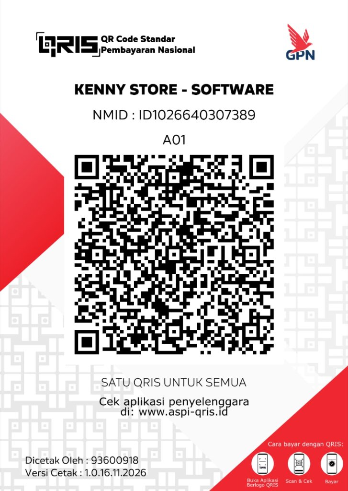

# BYD Maps Patches

Google Maps-only Morphe patch bundle for **Android Auto** that displays your BYD's live state of charge and estimated arrival battery (`86% → 11%`) from [byd-open-remote](https://github.com/kennyric/byd-open-remote), while keeping Google Maps' **Material You** design.

Forked from [nl-morphe-patches](https://gitlab.com/johninnld/nl-morphe-patches) and narrowed down to **Google Maps only** (GPL-3.0).

---

## Quick Start: Add Repo to Morphe

### Option 1 — Morphe Manager (on Android)
1. Install **[Morphe Manager](https://morphe.software/)**.
2. Add this repository as a patch source (either method):
   - **One-tap**: Open `https://morphe.software/add-source?github=kennyric/byd-maps-patches` on your phone.
   - **Manual**: Switch to the **Sources** tab, tap **`+`**, and paste:
     ```
     https://github.com/kennyric/byd-maps-patches
     ```
3. Select **Google Maps** in Morphe Manager and follow its prompt to fetch the matching original app.
   Morphe knows this bundle is pinned to **Google Maps `26.44.06.1006895251`** (versionCode `1068856906`, `minSdk 29`) and guides you to that exact build, so you do not need to hunt for it on APKMirror yourself.
4. Tap **Patch** and keep the defaults — the BYD battery and Android Auto patches are already selected.
5. **Reinstall the patched APK through KingInstaller** before using it in the car — see [Android Auto setup](#android-auto--byd-open-remote-setup). A normal install works on the phone, but Android Auto only lists navigation apps that were installed as if from Google Play.

### Option 2 — Morphe Desktop CLI (on PC)
Download the latest `patches-*.mpp` from [Releases](https://github.com/kennyric/byd-maps-patches/releases/latest) and run:
```bash
java -jar morphe-desktop-2.2.0-all.jar patch \
  -p patches-1.93.0.mpp \
  -o maps-byd.apk \
  GoogleMaps_26.44.06.apk
```

---

## Android Auto & BYD Open Remote Setup

1. **Install [BYD Open Remote](https://github.com/kennyric/byd-open-remote/releases/latest) (`≥ 1.1.0`)** on your phone and sign in with your BYD account.
   - If you patched with `Add microG-RE support`, set BYD Open Remote's target package to `org.ungoogled.android.apps.maps.microg`. Otherwise leave the default `org.ungoogled.android.apps.maps`.
2. **Install [KingInstaller](https://github.com/fcaronte/KingInstaller/releases/latest)** on the phone — download the `.apk` from **Assets**, not the source code. Its classic, non-root method is all you need; **no Shizuku**.
3. **Install the patched Maps APK through KingInstaller.** In Morphe's finished patching screen, tap **Install**, choose **KingInstaller**, and let it install with no switches enabled.
   - If KingInstaller is not offered, export the patched APK from Morphe, open KingInstaller, select that APK, and install it there.
   - **Why this matters:** Android Auto only lists navigation apps installed as if from Google Play. KingInstaller records the Play Store as the installer; a normal install records Morphe or your file manager, so Maps stays hidden.
   - ADB alternative: `adb install -i com.android.vending -r maps-byd.apk`
4. On the phone, open **Settings → Android Auto → Customize launcher** and enable **Ungoogled Maps**. If it is still missing, force-stop `com.google.android.projection.gearhead` or reconnect the phone.
5. Install every future patched update through KingInstaller too — a normal install can change the recorded installer again.

### Already patched and installed?

If the patched app already runs on the phone but never appears in Android Auto, reinstall it through KingInstaller. You do not need to unpatch or start over:

1. Use the patched APK you installed. If you no longer have it, patch the same original Google Maps version again in Morphe — with the same Morphe signing key, the result installs over the existing app as an update.
2. Open KingInstaller, select that patched APK, and tap **Install** with no switches enabled. Confirm **Update** when Android asks.
3. If KingInstaller reports a signature conflict, the installed copy was signed with a different key. Uninstall that copy first (this deletes its app data), then install the patched APK through KingInstaller again.

---

## How the BYD Battery Pill Works

- **Dynamic Day/Night pill**: During active navigation on Android Auto, a rounded Material pill sits above the bottom-left ETA card (`current% → arrival%`), automatically adapting to Day (frosted white) and Night (dark slate) with green (`≥ 30%`), amber (`15–29%`), and red (`< 15%`) SoC text.
- **Freshness**: Data older than 15 minutes is hidden automatically so stale readings are never shown.
- **Diagnostics**:
  ```bash
  adb logcat -s BydTelemetry BydVehicle
  ```

---

## Support

**BYD Maps Patches** is free and open-source. If this patch bundle makes your drive easier, you can support ongoing development:

[](https://ko-fi.com/kenny40049)

### QRIS



---

## License

GPL-3.0 — see [LICENSE](LICENSE). Upstream Android Auto navigation adapter and base Maps patches by [johninnl / nl-morphe-patches](https://gitlab.com/johninnld/nl-morphe-patches).
